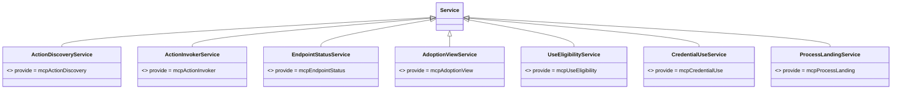

# MCP Cordis 定义的对象模型

本成员没有自己的领域对象。值、失败、接入点、清单与端口答复都归 [mcp-contract](../../mcp-contract/README_ZH.md)，本成员只在方法签名里引用它们。理由是本成员只拥有装配接缝：它规定对象经哪个服务键、以哪种 Cordis 方式交换，不规定对象本身。

本成员定义下列技术对象。它们不自动成为产品领域对象。精确形状归 `src/cordis.ts`，导出索引归[公开接口页](public-api.md)。

## 对象与关系

| 对象                                 | 身份                    | 拥有者 | 可变性         | 关联                                                             |
| ------------------------------------ | ----------------------- | ------ | -------------- | ---------------------------------------------------------------- |
| `ActionDiscoveryService
` 抽象类   | 键 `mcpActionDiscovery` | 本成员 | 静态，随包发布 | `extends` Cordis 的 `Service`，`implements` `ActionDiscovery
` |
| `ActionInvokerService
` 抽象类     | 键 `mcpActionInvoker`   | 本成员 | 静态           | `implements` `ActionInvoker
`                                  |
| `EndpointStatusService<P, S>` 抽象类 | 键 `mcpEndpointStatus`  | 本成员 | 静态           | `implements` `EndpointStatus<P, S>`                              |
| `AdoptionViewService<P, S>` 抽象类   | 键 `mcpAdoptionView`    | 本成员 | 静态           | `implements` `AdoptionView<P, S>`                                |
| `UseEligibilityService
` 抽象类    | 键 `mcpUseEligibility`  | 本成员 | 静态           | `implements` `UseEligibility
`                                 |
| `CredentialUseService
` 抽象类     | 键 `mcpCredentialUse`   | 本成员 | 静态           | `implements` `CredentialUse
`                                  |
| `ProcessLandingService
` 抽象类    | 键 `mcpProcessLanding`  | 本成员 | 静态           | `implements` `ProcessLanding
`                                 |
| `Context` 增补                       | 七个属性，名同键        | 本成员 | 静态           | 泛型类取 `unknown`                                               |

七个类各自 `implements` mcp-contract 的接口，图中不画。

## 生命周期

| 对象           | 创建   | 变化                   | 结束   |
| -------------- | ------ | ---------------------- | ------ |
| 抽象类         | 包发布 | 接口增删方法时随包升版 | 包退出 |
| `Context` 增补 | 包发布 | 同上                   | 包退出 |

子类的实例不归本成员：它由装载它的插件的 fiber 拥有，fiber 卸载时结束。
