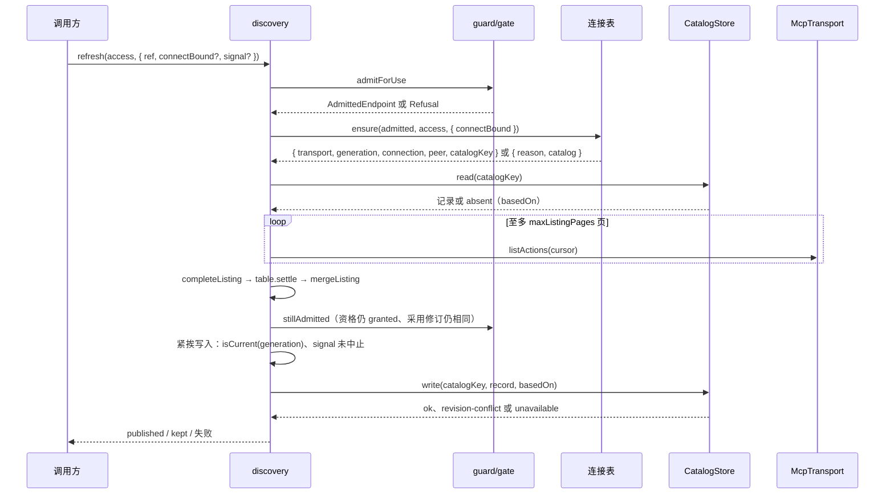
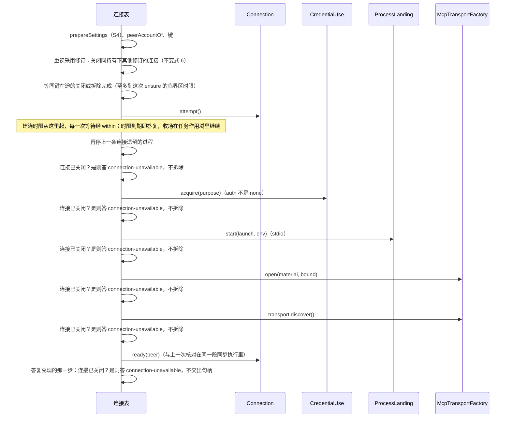
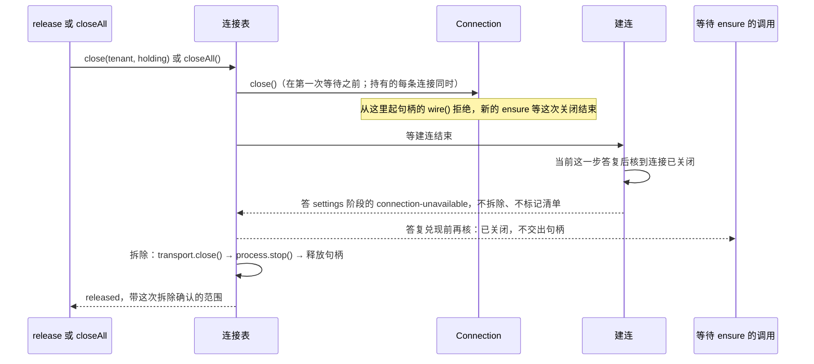
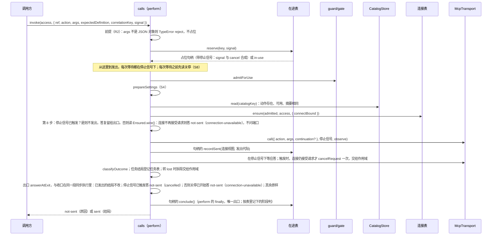

# 关键流程

本文件给出本包的四个关键流程：刷新清单、调用动作、建立连接、关闭连接。前提：端口已由宿主提供；调用方给出 `access`。

## 流程

刷新（`discovery.refresh`，SPEC MC-7）：

建立连接（`table.ensure`，SPEC MC-5）：

关闭（`connections.release` 与 `closeAll`，SPEC MC-10）：一个键同时只有一次关闭：拒新请求（`Connection.close()`）→ 等在途的建连结束 → `transport.close()` → `process.stop()`（自己的与上次未确认停止的，每个都问）→ 释放凭据句柄 → 报告确认范围。端口违约不跳过后一步，也不跳过其余进程（SPEC MC-14）。拆除（后三步）是条目唯一的，`lose` 与准备失败先同步转 `lost` 再走同一个拆除；拆除途中的关闭等它完成，`ensure` 至多等到自己的临界区时限。

关闭落在建连途中时，三方的次序如下。建连核到关闭就答复，不自己拆除，所以关闭开始之后只有关闭自己的一次拆除，报告带它确认的范围：

关停（`closeAll`）：置已关停 → 同步发起全部在途落点句柄的释放（已交来进程的落点除外） → 并发关闭各条目 → 等全部拆除与释放结束 → 任务作用域记下了本包的错误时以 `AggregateError` 抛出，否则报告每条连接的确认范围。之后本实例不再建连（S8）：`refresh` 答 `connection-unavailable`，`invoke` 与 `continueWithInput` 答「未发出：`connection-unavailable`」，任务操作答 `effect-unknown`（`no-connection`）（SPEC [MC-16](../SPEC.md#mc-16)、[MC-17](../SPEC.md#mc-17)）。`closeAll` 落在操作发出之前的途中时，操作不再开始下一步，不问端口；答复在出口一处从当时的状态读出，与关停之后才开始的操作相同。已发出的结局和已发布的清单不改。

调用（`invoker.invoke`，SPEC [MC-16](../SPEC.md#mc-16)；`continueWithInput` 相同，另核代际）：

每步失败的原因、建连失败与 `not-sent` 的映射表、取消的接线见 SPEC [MC-16](../SPEC.md#mc-16)；任务操作的次序（`provideTaskInput` 先按 R2 判值树 → 发起者 → 关停 → 复用或新建连接 → 一个请求）见 [MC-17](../SPEC.md#mc-17)。

## 失败与生命周期

- 关口拒绝或配值缺陷时没有连接、没有外部效果。调用「未发出」时没有对端效果。键怎样收口见 SPEC [MC-16](../SPEC.md#mc-16) 第 13 步：停止信号已触发的未发出调用转为已结束，其余未发出的调用撤销占位；发出后无应答时效果未知，不重发。
- 建立连接的任一步失败、超时或端口违约：连接转 `lost`、传输关闭、已起的进程 `stop()`、凭据句柄释放、清单 `markUnavailable`；时限到期时建连立即答复，这些收场在任务作用域里继续，答复的 `catalog` 是 `pending`；迟到交来的句柄与传输同样收口，迟到交来的进程停止一次、未确认的范围记为 `residual`，它的凭据句柄在这次 `stop()` 之后释放。答复与原因表见 SPEC MC-5。
- 调用方中止：等建连时答 `kept(cancelled)`（建连留给其他调用方），取页时答 `kept(cancelled)`，发布边界上答 `kept(cancelled)`；都不标记清单。
- 页取得失败：带 `unusable` 标记的答复与 `not-sent`（`authorization-required`）使连接 `lost` 并标记清单（契约 S7）；其他失败与取页超时使连接 `degraded`，刷新答 `kept(listing-incomplete)`，原采用不变。旧代际迟到的页不改变重建后的连接，刷新答 `kept(superseded)`。
- 发布边界不成立时不写入：迟到的连接 `kept(superseded)`，取消 `kept(cancelled)`，资格不再 `granted` 答对应 `Refusal`。
- 关闭只报告 `stop()` 确认的范围。未确认的进程留在条目里作为 `residual`，下一次关闭或重建前再次请求停止。`stop()` 违约记为 `unconfirmed`。
- 宿主退出时调用 `closeAll()`。本包的后台工作只有时限之后继续的收场与迟到结果的收口，归连接表的任务作用域；本包不重连。
