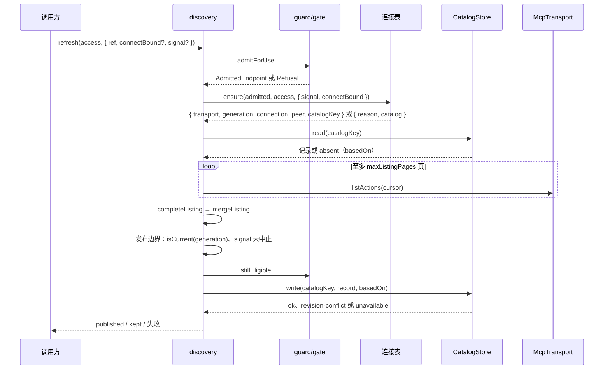
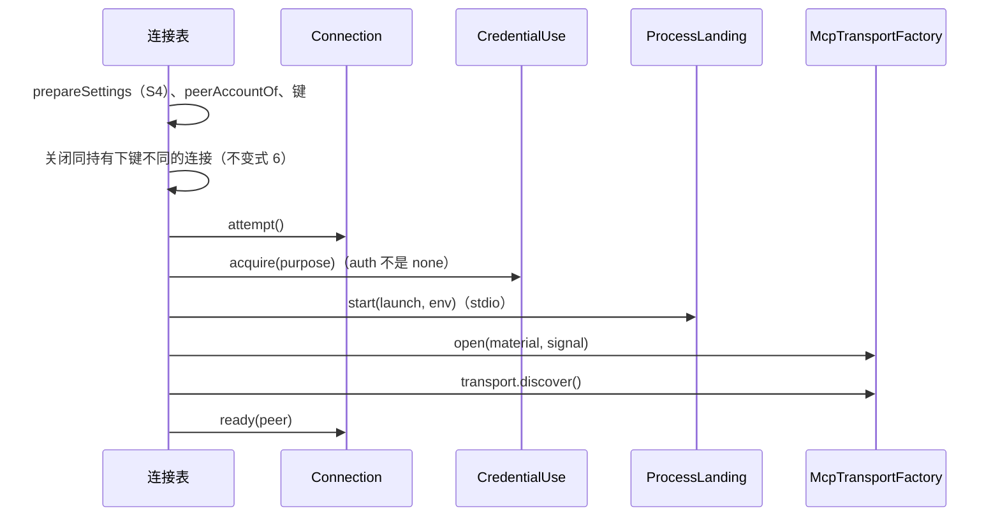

# 关键流程

本文件给出本包的三个关键流程：刷新清单、建立连接、关闭连接。前提：五个端口已由宿主提供；调用方给出 `access`。

## 流程

刷新（`discovery.refresh`，SPEC MC-7）：

建立连接（`table.ensure`，SPEC MC-5）：

关闭（`connections.release` 与 `closeAll`，SPEC MC-10）：拒新请求（`Connection.close()`）→ `transport.close()` → `process.stop()` → 释放凭据句柄 → 报告确认范围。

下一波 `invoke` 的次序（本波不实现）：`InFlightCalls.reserve` → `admit` → 读清单核动作与摘要 → `table.ensure` → `transport.call` → `markSent` → 等结局 → `markEnded`。

## 失败与生命周期

- 关口拒绝或配值缺陷时没有连接、没有外部效果。
- 建立连接的任一步失败：传输关闭、已起的进程 `stop()`、凭据句柄释放、连接转 `lost`、清单 `markUnavailable`。答复与原因表见 SPEC MC-5。
- 页取得失败：`not-sent` 使连接 `lost` 并标记清单；其他失败使连接 `degraded`，刷新答 `kept(listing-incomplete)`，原采用不变。
- 发布边界不成立时不写入：迟到的连接 `kept(superseded)`，取消 `kept(cancelled)`，资格不再 `granted` 答对应 `Refusal`。
- 关闭只报告 `stop()` 确认的范围。未确认的进程留在条目里作为 `residual`，下一次关闭或重建前再次请求停止。
- 宿主退出时调用 `closeAll()`；本包没有后台任务，也不重连。
