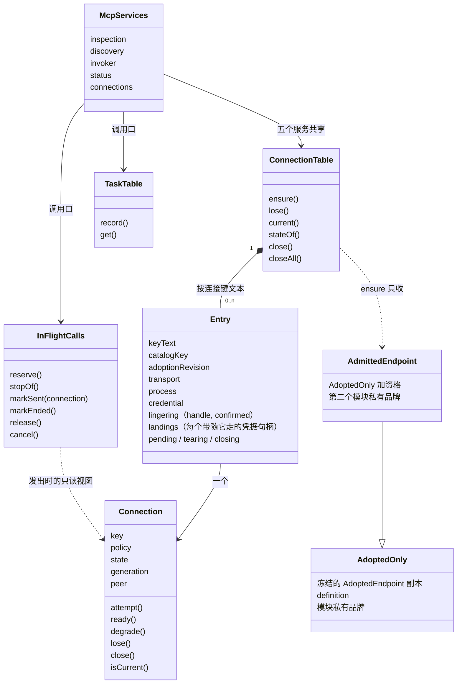

# 对象模型

本包有两个有状态的聚合（`Connection`、`InFlightCalls`，都是 `class`）、一张连接表（闭包里的 `Map`）、一张任务表（`TaskTable`，`class`）和一个内存存储（闭包里的 `Map`）。服务是无状态的对象字面量。

## 对象与关系

`Connection` 的状态是 `none`、`preparing`、`ready`、`degraded`、`lost`、`closed`；转移表与代际规则见 SPEC MC-6 与 `tests/connection.spec.ts` 的合法转移表。`Entry` 的形状在 `internal/entry.ts`，身份是连接键文本；一个租户与持有在任一时刻至多有一个未关闭的条目，关闭后仍带未确认进程或等待迟到落点的条目保留，状态视图合并它们的 `residual`。`AdoptedOnly` 与 `AdmittedEndpoint` 是值，不是实体：各证明一次采用通过与一次关口通过。`Ensured` 是 `ensure` 答复那一刻的快照，带连接的只读视图。

## 生命周期

- `Connection` 由连接表在第一次 `ensure` 时创建，`lost` 后在同一对象上重建，`closed` 后由新对象延续代际；只有连接表与它发起的建连写它。
- `Entry` 随第一次 `ensure` 创建；已关闭且五项资源都不持有时删除（`forgettable`）；进程未确认停止时保留，带未确认的进程句柄。条目的拆除同时只有一次，`lose`、准备失败、重建与关闭共用。
- 传输、进程句柄、凭据句柄由条目持有，在关闭次序里释放，每一项在它的端口答复之后才离开条目；准备失败时在同一次调用里释放。落点在时限内未答时进程凭据句柄移到这个落点上：进程交来则在它停止之后释放，`closeAll` 先到则立即释放，只释放一次。
- `InFlightCalls` 的表项在一次运行内保留，`ended` 不删除；占位带一个取消信号，发出时记下连接视图与代际。
- `TaskTable` 的表项在一次运行内保留，不删除；记发出代际、对端账号与输出 schema。
- 内存存储的记录在一次运行内保留。
