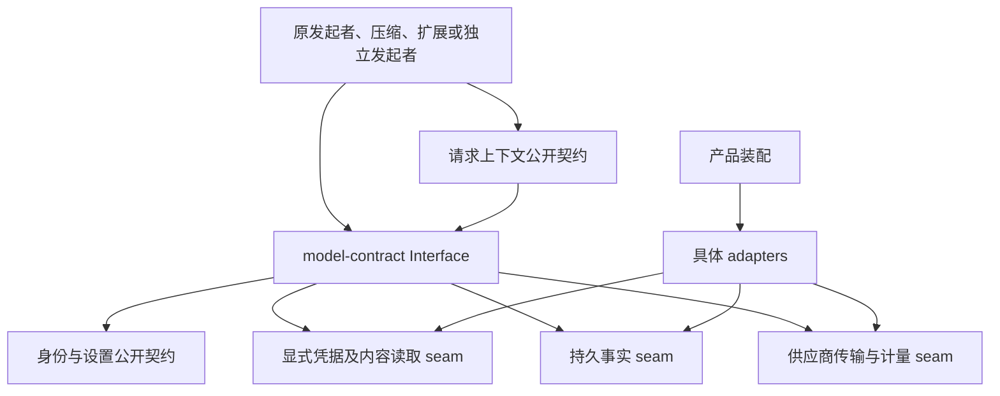
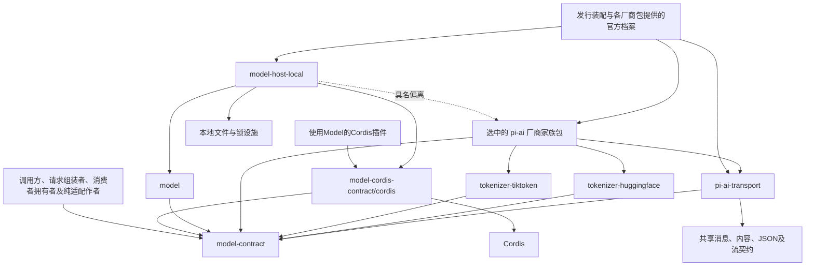

# 模型调用组的工程关系

产品承诺与非 pi-ai 成员设计已接受，包括领域契约、Cordis 定义、可复用实现及本地宿主设计。pi-ai 的成员划分、家族贡献取得协议、Tokenizer 资源与计量分工及迁移接受条件已接受；厂商适配的内聚细化、官方支持证据矩阵及物化资源控制仍按各节标注保持候选。model-contract 与 model-cordis-contract 已发布全部声明并有测试，导出清单见各包 `tests/fixtures/exports.json`，清单没有 pending 名字。model 已实现凭据判定、独立单次执行，以及 createModelRuntime 的受理、查询、取消意图、原流确认保存、最小实例观察和[有限原终局收场](../model/SPEC.md#已实现的调用收场)。model-host-local 已实现本地凭据保管、生产发送资源、本地 Model 装配入口 `assembleLocalModel`，以及装配对计量准备资源的接入。结果读取及 processed ACK 已实现；retained ACK、自动清理、策略循环、生产宿主和跨进程恢复尚未实现。凭据源码已按本页边界迁移，包存在不证明完整能力可用。

## 依赖方向



箭头表示消费或实现关系，不表示共同寿命或数据库事务。Model 不导入域外工作与编排、工具实现、SDK 或应用私有实现。请求组装者投影 ToolDefinition 为 Model 的工具声明；模型只处理共享消息、声明及供应商格式。

Cordis 定义与宿主插件分别从 model-cordis-contract/cordis 和 model-host-local/cordis 发布。领域根 interface 不接收全局 Context；租户、主体、用途和采用值显式传入。源码无 Cordis、声明无 Cordis、运行不启动 Cordis和安装不包含 Cordis是不同验证，不能仅凭 exports 宣称安装隔离。

## 技术栈与采用范围

`0.0.0 → 0.1.0` 的模型适配和请求沿用项目维护的 pi-ai 技术栈。来源基线是 pi 1.0.0、commit `a13d35a742c6ef8462812a28fbe1d8c8b7431c32` 的定向 fork，复用 OpenAI-compatible 请求/流处理及 SSE 机制。接入路线承接 OpenRouter，通过固定路由绑定实际 serving provider。迁移保存许可证、源码映射与修改依据，不因沿用技术栈继承旧领域依赖或全部行为。

**线路决定：只经 OpenRouter。** 所有模型只经 OpenRouter 的固定路由发出。本组不为直连厂商或其他网关预留结构（PanQiWei，2026-10-22，[#446 的决定评论](https://github.com/nemori-ai/omne-harness-lite/issues/446#issuecomment-6335019456)）。所以网关引擎只实现 OpenRouter chat completions 一份协议，记录直接写 OpenRouter 的路由名与固定的服务方。

这是阶段技术栈决定。pi-ai 传输、家族和相关引擎的包划分，以及本页的家族贡献取得接口已接受；其余 Model 包边界及通用端口沿原接受范围执行。型号支持、真实路由符合性和运行交付须逐项确认。模型厂商、网关和实际服务商是不同身份：厂商家族组织模型语义，网关组织传输协议，实际接收方参与凭据与外传核验。

## 成员与新增条件

本节、[家族贡献取得协议](#pi-家族贡献的取得协议)、[Tokenizer 分工](#tokenizer-的资源与计量分工)及[迁移接受条件](#迁移与接受条件)已由 PanQiWei 在 [#447 技术决定](https://github.com/nemori-ai/omne-harness-lite/issues/447#issuecomment-6272139544)中接受。接受范围包含下面 11 个 pi-ai 相关成员的职责与建包条件，不表示这些成员已实现。

目标组织分离纯领域契约、Cordis 集成契约和具名运行提供者，再组合共享 pi 传输、厂商家族适配和 tokenizer 引擎 adapter。厂商家族是默认包粒度，一个具体型号是家族内的精确绑定；只有型号具有独立平台、资源体积、许可证或发布周期要求时，才进一步拆包。

| 目标路径，均在 packages/model 下 | Interface 与消费者 | Implementation 及独立收益 |
| --- | --- | --- |
| model-contract | 领域值、操作、行为协议和可替换提供者端口，供调用方、请求组装者、消费者拥有者、独立程序及提供者消费 | 只含必要纯函数与契约；不安装 Cordis、运行宿主或厂商实现 |
| model-cordis-contract | 托管运行的唯一 Service、键、类型增补及定义自有注册表，供 Cordis 消费者及提供者消费 | 隔离框架依赖；仅含 IC-3 允许的登记机制，不含业务运行提供者 |
| model | 可复用领域实现，供独立程序及宿主消费 | executeModel、createModelRuntime、档案/准备/执行/保管的协调；依赖通过端口注入；生产安装闭包不含 Cordis 或固定单机存储；凭据引用与解析的归属见下文 |
| model-host-local | 单机宿主提供者，供应用装配消费 | 时钟、实例调度、本地凭据保管、目录装载、Cordis 门面及阶段插件；复用 model，不复制执行逻辑 |
| pi-ai-transport | 具名构造接缝与 ModelTransport，供装配及独立程序消费 | 公共 HTTP/SSE、取消、连接资源、请求规划骨架、固定绑定与回执；集中维护 pi fork，不复制到每个厂商包 |
| pi-ai-openai | OpenAI 家族定义及固定适配贡献 | 家族参数、工具/消息投影、模板/估算、usage/replay 解释及逐型号验证 |
| pi-ai-anthropic | Anthropic 家族定义及固定适配贡献 | 同上，包含家族特有缓存/历史规则及所需编码资源 |
| pi-ai-google | Google 家族定义及固定适配贡献 | 同上，明确原生/代理编码依据，不把 surrogate 说成精确计量 |
| pi-ai-deepseek | DeepSeek 家族定义及固定适配贡献 | 同上，家族内分别维护各型号 tokenizer、模板、媒体与路由绑定 |
| pi-ai-xai | xAI 家族定义及固定适配贡献 | 同上；没有可靠本地 tokenizer 的路径沿显式计量方法，不伪造编码器 |
| pi-ai-qwen | Qwen 家族定义及固定适配贡献 | 同上；开源资源和商业模型估算分别绑定，不按厂商名统一算法 |
| pi-ai-moonshot | Moonshot 家族定义及固定适配贡献 | 同上；共享词表与不同配置/模板分别记录，不合并型号语义 |
| pi-ai-zai | Z.AI 家族定义及固定适配贡献 | 同上；各 GLM 型号绑定自己的模板、计量或明确估算方法 |
| tokenizer-tiktoken | ModelTextTokenizer 的引擎 adapter，供 OpenAI、Anthropic、Moonshot 等家族计量器构造 | 封装 js-tiktoken、资源初始化和 count 语义；共享引擎实现，不收齐所有厂商词表 |
| tokenizer-huggingface | ModelTextTokenizer 的引擎 adapter，供 DeepSeek、Google、Qwen、Z.AI 等家族计量器构造 | 封装 Hugging Face tokenizer 运行库及资源初始化；隔离引擎依赖，不拥有家族模板和上游计量口径 |

model-contract、model-cordis-contract、model 与 model-host-local 已是 workspace 成员。model-host-local 目前承载本地凭据保管、生产发送资源 `createPiSendResources` 与本地 Model 装配 `assembleLocalModel`。装配把凭据保管、发送边界、pi 传输与调用方注入的 `ModelCommands` 连成一条请求路径，并在同一组家族与 `ModelCommands` 上给出 model 的计量准备资源；时钟、实例调度、目录装载与托管运行插件尚未实现。pi-ai-transport 的根入口已导出五个家族贡献接口类型、三段传输的工厂 `createPiTransport` 与网络资源的工厂 `createNetworkResources`。装配创建并拥有网络资源，再把它交给 `createPiTransport`。连接容量、HTTP 交换、SSE 分帧、协议帧与诊断隔离在包内实现。pi-ai-transport 的根入口还导出家族表，子入口 `./chat-completions` 导出网关引擎（请求与流解码），子入口 `./testing` 导出家族测试助手；家族包 pi-ai-openai 与 pi-ai-anthropic 使用它们。两个家族经同一 `composeFamilies` 与 `createPiTransport` 的联调是 pi-ai-anthropic 的慢层用例。tokenizer-tiktoken 的根入口已导出 `createTiktokenTokenizer` 与两个资源类型；它在初始化时核对家族传入的词表与配置，不收录厂商词表。pi-ai-openai 以 o200k 词表消费它，pi-ai-anthropic 以随包发布的 `claude.json` 消费它。其余六个 `pi-ai-*` 成员及 tokenizer-huggingface 尚未初始化。model 不转导契约或聚合提供者。后续运行成员沿[workspace](../../../docs/workspace.md)在具有实际实现和消费验证的切片建立；目标名称不表示运行能力已存在。

厂商包的 interface 应让消费者一次取得相容的精确绑定及其资源租约，不要求调用方自行拼接 tokenizer、模板、投影和 usage 算法。删除厂商包后，这些关联会散布到目录、计量与传输调用者，因而其 depth 有实际价值。将每个型号各做一个只转发家族工厂的包则没有这种收益。

## 包依赖与装配



箭头是导入/消费方向。虚线是具名偏离：model-host-local 的 `ModelProfilesLocalPlugin` 在 [plugins/profiles.ts](../model-host-local/src/plugins/profiles.ts) 一个文件里导入 `pi-ai-openai` 取官方档案，依据 R1-D4 与线包 C-PROFILE，退出条件是发行装配改由调用方注入定义列表，此后只改这一个文件，见 [model-host-local SPEC](../model-host-local/SPEC.md#官方档案读取)。Family 只依赖实际需要的引擎，图不要求每家同时依赖两套。家族通过 pi-ai-transport 拥有的适配贡献 interface 提供模型差异；共享传输从装配参数取得贡献，不反向 import 家族，不内置官方型号总表。公共协议工厂不凭模型名前缀扫描或猜测家族。家族的请求规则只消费无秘密的 Model 请求值及 ToolDeclaration，输出当前 json-text 契约的值；不读取 ToolDefinition、注册表或调用方私有历史。

model-contract 不导入任何 Model implementation。model 通过注入消费传输、计量、媒体和持久化端口，不反向导入全部家族。发行装配显式选择家族，并组合各厂商包提供与发布的官方档案（偏离：M2 的单机插件自己固定 OpenAI 家族，见上）；Model 契约不定义发布或导入清单的接口；独立程序仅装配所需家族。全量发行可以安装所有目标家族，但这不能迫使单家消费者安装其他家的资源。官方清单只保存定义、采用和可用工厂的对应关系，读取清单不创建 tokenizer、网络连接或模型实例。

只读定义和取得执行资源分开。读取定义无初始化副作用；取得精确绑定时核全部采用并初始化所需资源，返回匹配的请求/响应规则、meter 和本次释放责任。任一资源或采用不匹配则整体失败并释放已取得项，不用同名最新件补齐。家族工厂不能以几份无关联的公开对象要求普通调用者自行保证相容。

ModelTransport 的 factory 生命周期由装配拥有者管理；单次 PreparedTransport/MaterializedTransport 只持有本次取得。共享连接池归公共传输，家族持有其配置/资源租约，引擎 adapter 持有已初始化编码器。退休停止新取得并排空旧使用，晚到释放不能销毁后继或仍被别家使用的资源。

Model 的服务定义从 model-cordis-contract/cordis 唯一发布，具体运行插件从 model-host-local/cordis 发布。其他实际成员按需提供自己的 `./cordis`，不重复 Model 服务定义，不为每个型号或 tokenizer 增加全局服务键。纯数据和引擎 adapter 不因成包自动成为 Service。

## 契约包的公开边界

Model 对外提供两个契约包，实现分为可复用 model 与单机 model-host-local。model-contract 面向纯领域消费，model-cordis-contract 面向 Cordis 集成。契约函数须由共同语义决定结果，且无 I/O、时钟、随机值、并发调度或持久状态；独立执行虽然遵守共同协议，仍属于实现。分离的依据是实际安装闭包不同；不再按档案、计量、Commands 或每个接口创建契约包。提供者端口与普通操作共享请求、回执、预算和身份，暂无独立发布或安装收益。

分包增加构建、发布及版本组合验证的成本，但把框架、平台和实现依赖的变化限制在实际消费者中。若长期共包，增加提供者或升级实现依赖会同时影响纯契约消费者的安装与更新。Model 已有普通调用者、独立执行者、adapter 作者和 Cordis 宿主这些不同需求，因此选择按上述四种责任分开；不以包数量或接口数量判断设计质量。

| 消费者 | 消费入口 | 不应被要求安装 |
| --- | --- | --- |
| 调用方、请求组装者、消费者拥有者、托管调用者 | model-contract 根入口，取得注入的操作对象 | Model 运行提供者、Cordis、pi、词表和存储引擎 |
| pi、家族、tokenizer、持久化及替代运行提供者作者 | model-contract 的 `./provider` 入口中的窄端口，以及根入口的共享值 | 默认运行提供者及不相关 adapter |
| Cordis 插件消费者 | model-cordis-contract/cordis 的键、类及增补 | Model 运行提供者与厂商实现 |
| 独立程序及宿主实现者 | model 的工厂或 executeModel、选中的 adapter | Cordis 或默认单机宿主 |
| 单机应用装配者 | model-host-local/cordis 及选中的 adapter | 不承诺不安装已明确选择的宿主和框架 |

纯契约包拥有领域品牌、数据、调用/档案/准备/转换操作、ModelProvider 管理接口与可替换端口，按消费者分两个入口导出。根入口给调用方与消费者拥有者：领域品牌、数据、调用操作、`ModelRuntime` 与 ModelInputMeter 等消费侧名字。`./provider` 入口给提供者作者：档案、准备与转换操作，ModelProvider 管理接口，以及 ModelCommands、ModelTransport、ModelTextTokenizer、ModelMediaReader、ModelInstanceHost 等可替换端口。两个入口共享同一份定义，一个名字只从一个入口导出，分组规则见 [model-contract 的提供者协议入口](../model-contract/docs/public-api.md#提供者协议入口)。端口用于不同消费者，不要求普通调用者学习或取得所有能力。包或 TypeScript 类型不授予写入、恢复或发布资格。

正确消费领域值必需的校验、编解码和比较函数随契约发布。它们不得创建 runtime、加载词表、读环境或启动 I/O。createModelRuntime、executeModel 是实际执行函数，归 model；其 ModelDependencies 和 ModelConfiguration 是该实现工厂的构造形状，也归该成员。model 内允许有状态协调和异步执行，但必须通过时钟、宿主、存储及传输端口取得外部能力，不读取全局容器或固定单机设施。model-host-local 的限定名表达具体宿主，model 是供不同宿主复用的领域算法成员。契约不转导工厂、不隐式选择默认实现。其他提供者实现公共操作和行为协议，不必复刻model 工厂或配置。

model-cordis-contract 的根只允许纯类型导出，Service 类、键及 Context/Events 增补只从 ./cordis 导出。该包明确安装 Cordis；根入口无 Cordis 值边不表示安装无 Cordis。业务操作的 Service 为抽象定义；ModelInstancesService 和 ModelConvertersService 保留 IC-3 允许的定义自有登记实现，包括本地贡献状态、token、caller-fiber effect 和条件撤除。该例外只适用于 Cordis 定义包，不扩大纯领域契约的无状态边界，也不容纳模型发送、业务调度或持久化实现。登记协议及其实现共同通过符合性套件验证。model-host-local 的插件继承唯一 Service，普通插件不导入它来取得类型增补。

品牌与 Service 类各有唯一声明源，提供者不复制 unique symbol 或抽象类。依 IC-10，目标事件名为 `model-cordis-contract/call-changed`，服务键仍为 modelRuntime 等能力名。迁移同步监听者，不双发旧名，也不把包更名当作调用身份、状态或持久记录格式变更。

## 安装闭包与共同依赖前置

纯契约的完整生产安装闭包不得包含 Cordis、Model 运行提供者、pi、厂商 SDK、tokenizer 引擎/词表或具体存储引擎。公开声明需要的共享依赖必须可安装，不能放到 devDependencies 后声称隔离；import type、tree shaking 和子入口只能分别解决类型或加载问题，不能证明安装闭包。

共享 `Outcome` 由零生产依赖的 [operation-result](../../common/operation-result/SPEC.md) 唯一定义，采用依据是 [#371](https://github.com/nemori-ai/omne-harness-lite/issues/371)。Model 从 `@omne-harness/operation-result` 根入口引用，不复制或改变结果类型。`kernel-basis` 根入口为空导出，其 Cordis 辅助与测试装配不属于纯契约的生产依赖。model-contract 已声明 `operation-result` 生产依赖，并有安装闭包测试检查已安装产物的传递依赖与导入。model-cordis-contract 与 model 各有自己的闭包检查。共享结果成员的拆分本身不是安装隔离的证据；验证范围以各包持续验证页为准，其他成员落地时仍须逐项检查完整传递依赖与仓库外安装。

TenantId、ContentBlock、Message、JsonValue、CallAccount 等继续沿原拥有者引用，逐项检查直接与传递清单、声明及平台约束。必要的纯表示解析器可留在契约闭包，不因它包含实现代码而另造副本。当前共享成员声明 Node 版本限制，拆包不自动承诺浏览器或其他运行平台支持。

单一声明源不自动保证安装时只有一个版本。实际组合须检查契约版本解析、Service 类身份及所有提供者的行为符合性。契约变化包括失败、顺序、资源和状态协议，不只包含签名。0.1.0 前按当前发布政策同步真实消费者并删除被替代入口，不为未承诺的消费者保留转导壳。

## 文档归属与迁移

正文已按下表归属落位。非 pi-ai 公开声明已接受，两个契约成员已发布全部声明。model 已实现凭据判定、独立单次执行，以及 createModelRuntime 的受理、查询、取消意图、原流确认保存、最小实例观察和[有限原终局收场](../model/SPEC.md#已实现的调用收场)。model-host-local 已实现本地凭据保管、生产发送资源、本地 Model 装配入口 `assembleLocalModel`，以及装配对计量准备资源的接入。结果读取及 processed ACK 已实现；retained ACK、自动清理、策略循环、生产宿主和跨进程恢复尚未实现。

| 内容 | 当前拥有者与后续归属 |
| --- | --- |
| 领域不变量、公开行为及提供者协议；领域值、操作与提供者端口；符合性场景 | [model-contract](../model-contract/README_ZH.md) 的 SPEC、设计声明、消费指南和验证资源 |
| executeModel/createModelRuntime、ModelDependencies/ModelConfiguration；协调算法、内部流程及配置 | [model](../model/README_ZH.md) 的设计入口、SPEC 和内部设计 |
| 服务定义、事件及定义自有登记表/协议 | [model-cordis-contract](../model-cordis-contract/README_ZH.md) 的设计定义、SPEC 和 Cordis 主题 |
| 具体业务插件、目录装载、依赖装配和单机宿主接续 | 凭据插件已在 [model-host-local/docs/cordis](../model-host-local/docs/cordis.md)，其余暂在 [model/docs/cordis](../model/docs/cordis.md)，随实际宿主切片迁 model-host-local |
| 家族及引擎的具体构造、资源、依赖和验证 | 相应 pi/家族/tokenizer 成员 |

外部行为始终归契约，内部流程引用它；实现差异不能降低共同保证。拆包不改变调用身份、发送围栏、首内容后不重发、保管 ACK 或观察与取消的区别。实例登记仍依原 caller-fiber 和资格机制，disposer 不使网络输出可逆。

落地顺序为共同依赖闭包裁定、纯契约的真实声明与消费验证、Cordis 定义和具名运行提供者、实际 adapter 组合。每个切片同步真实导入、文档导航、登记、符合性记录及事件消费者，删除被替代正文。设计定义的 @owner 指向当前契约成员，源码实现后继续沿该唯一归属。

接受包隔离至少验证四层：源码值依赖、生成声明、打包后的实际 import、仓库外干净安装。普通消费者、纯 adapter 作者、独立执行程序、Cordis 消费者和宿主装配者分别用真实发布产物测试；不能用 monorepo 链接或只检查未打包源码替代。契约符合性由受控替代提供者及实际提供者共同执行，测试运行器不进入契约生产依赖。具体场景见[验证义务](../model-contract/verification/README.md#契约包隔离与迁移)。

## 厂商适配的内聚范围

本节是 pi-ai 相关实现细化，保持候选。所引用的通用 Model 契约按其已接受范围执行。

| 责任 | 厂商家族包拥有 | 公共传输或领域拥有 |
| --- | --- | --- |
| 官方模型 | 精确型号定义、能力/限制依据、允许路由及实现采用 | 发行清单组合；Model 档案身份、维护权限及层序求值 |
| 请求表示 | 参数/schema 支持、角色映射、工具声明和消息的家族规则、必要缓存映射 | 共用请求规划骨架、最终固定编码；ToolDefinition 投影仍由上层组装者完成 |
| 计量 | 模板、tokenizer 配置/资源、媒体公式、精度与余量适用依据 | 引擎 adapter 数文本；请求组装方在请求前用 Model 的计量能力形成 RequestBudget 并核约束覆盖；Model 的发送路径不计量 |
| 响应 | 家族语义、终止/拒绝/用量口径及可支持的历史回放解释 | 公共 HTTP/SSE framing、真实取消及资源释放；Model 共享到达映射、首内容与保管 |
| 认证与验证 | 精确 leaf/route 的固定样本、计量资源摘要、符合性记录 | 共同协议验证、安装闭包及组合行为；清单中存在不等于远端认证 |

OpenAI 与 Anthropic 两个家族按本表落地。家族包给出记录（纯数据）、带修订名的四个 hook 规则、计量器与官方档案。请求规划、编码与流解释只有 pi-ai-transport 网关引擎一份，引擎源码不含厂商名。两家的差异只出现在记录的线数据与 hook 中：角色与内容形式、缓存放置、参数子集、推理格式与整组回放、用量算术与计量规则。

**项目约定：不关闭推理。** 为了不引入复杂度，网关引擎与本项目提供的记录和档案不关闭推理（PanQiWei，2026-10-22）。引擎没有关闭推理的写法：网关词表不含 `reasoning.enabled` 与推理强度 `none`，记录没有前缀要求。每条记录把 `reasoning-effort` 的 `none` 映射为 `unsupported`。外来工具轮次不能接续时，请求保持请求的推理强度，encode 只对略去的状态给出 `replay-omitted` 诊断。Model 契约仍允许其他提供者给出 `reasoning-disabled` 诊断，本项目的引擎不给出它。

供应商相同的规则复用普通函数，有实质差异才在既有 seam 提供不同 adapter。公共传输不允许家族以 hook 隐藏重试、重定向、凭据读取或额外网络发送；一次真实发出只对应一个固定接收方。Model 的有限重试和当前资格围栏继续拥有这些决定。

## Tokenizer 的资源与计量分工

本节设计已接受。所引用的通用 Model 契约按其已接受范围执行。

Tokenizer 分三层：引擎执行、具体编码定义、完整请求计量。两类引擎包共享执行机制；具体词表、特殊 token 配置、模板及模型适用证据归家族包；完整输入 meter 与家族投影内聚。通用引擎不返回 ModelRequest、费用或“模型可以发送”的判断。

引擎初始化接收固定的资源与采用描述，完成摘要和配置核验后返回 ModelTextTokenizer。普通 count 调用只接受文本/显式特殊 token 段，不读文件或联网下载。资源定位使用包自身可发布的资源入口或装配明确注入的合法内容，不读取仓库目录或当前工作目录。引擎类型不穿过领域 interface。

相同 vocabulary 不证明相同 tokenizer。词表可在一个家族包内去重存放，但 configuration、特殊 token、预切分规则和 template 分别固定；绑定及缓存键使用完整组合。跨厂商仅因使用同一引擎不合并资源包。只有多个真实成员复用同一不可变资源且发布/许可收益明确时，才另设专门资源成员。

本地精确分词不证明上游完整计量精确。代理编码、私有模板、媒体或历史回放缺少完整依据时，保持 estimate 或明确不可用。各家族沿 [Model 计量契约](../model-contract/SPEC.md#分词与完整请求计量)，不复制第二套预算、余量和失败政策。

## 迁移与接受条件

封存件逐文件去向、tokenizer 资源、#199 能力基线及 #193 L01/L02 的交接见[迁移清单](migration.md)。清单分配后续工作，不表示实现或接受条件已经完成。

阶段技术栈沿用不授权旧行为覆盖现行契约。公共运输的连接准入、容量等待和必要资源预约在 materialize/发送准备阶段完成。成功交付的 MaterializedTransport 持有本地发送容量，直至 start 消费或 close 释放；容量不自行过期，也不被后台回收。容量不足须在物化交付前失败。MaterializedTransport.start 在最终资格围栏内同步发起实际请求，不能返回一个尚未触发的 lazy iterator，也不能在方法内部再 await 队列。容量保留不保证远端连接成功，突发传输故障仍沿现行发送结果语义处理。迁移的首次切片须包含实际 implementation、公开消费例和反例，使用包模板建立成员并登记，不直接依赖封存源码或保留空的成功工厂。

1. 两类 tokenizer adapter 各用至少一个具名家族的固定资源验证 count、普通/特殊 token、版本失配及发布后资源读取。依赖沿仓库采用版本固定，升级另有依据。
2. 共享 pi 传输连同一个家族走通当前 `prepare → materialize → start`，零提前媒体读取、真实取消、流事实及资源释放；共同传输 seam 至少由第二个差异显著家族验证，避免把第一家的规则写死。
3. 其余家族逐精确型号迁移定义、实际接收方、参数/schema、计量、响应和资源。沿叶级证据决定支持范围，不用“同厂商”“OpenAI-compatible”或目录存在代替符合性。
4. 发行装配组合家族及各厂商包发布的官方档案，并验证完整消费者。子入口、声明、独立运行及安装闭包分别检查，根 Model 不引入全部供应商或引擎依赖。

当前实现线建立 `pi-ai-transport`、`pi-ai-openai`、`pi-ai-anthropic` 与 `tokenizer-tiktoken`。四条条件保留，按已接受范围分次兑现：

| 条件 | 本线承担 | 留后续线补齐 |
| --- | --- | --- |
| 1 | tiktoken 使用 OpenAI 固定编码（o200k）验证；pi-ai-anthropic 的 `claude.json` 经同一引擎计数，核对文件摘要与参考计数 | Hugging Face 引擎及具名家族资源验证 |
| 2 | 共享传输与 OpenAI 走通三段协议及其反例。Anthropic 作为第二个差异显著家族验证共享传输接口：parts 内容、1h 末消息缓存、整组签名回放。两家经同一 `composeFamilies` 与 `createPiTransport` 对本地 HTTPS 服务发送各自的记录夹具，符合性套件 transport 组通过（pi-ai-anthropic 的 `tests/two-families.spec.ts`） | — |
| 3 | OpenAI 与 Anthropic 的精确型号沿本线验证 | 其余六家逐型号迁移与验证 |
| 4 | OpenAI 单家装配、官方档案与消费者及安装闭包验证 | 后续家族加入时验证其实际组合 |

第 1、3 行的延期已获上述技术决定允许。后续线仍须满足对应条件。本线为条件 2 交付 Anthropic 家族及上表所列的两家联调验证。接受结论记录在 #463 与 #465 的交付卡上。第 4 行只覆盖 OpenAI 单家装配；Anthropic 的发行装配与安装闭包没有在本线验证。向产品拥有者交付能力事实时须保留第 1、3、4 行的未覆盖范围。

旧式工具依赖、依赖调用方私有历史的响应大对象、静默丢参数、未知 usage 默认口径、普通文本自动激活特殊 token 和任意 opaque 回放不随技术栈迁入。未支持的共享表示先由原拥有者细化，不能借 JsonValue 或厂商私有字段绕过消息契约。实际秘密绑定继续消费既定外部凭据契约，不复制旧凭据通道假设。

## 内部协作与验证

Context 拥有表示选择、组装、预算分配与压缩；Model 提供计量能力（供请求组装方在请求前使用）、参数校验及最终物化检查，发送路径不计量。调用方保存选择，原发起者保存用途和消费位置。执行不要求原调用者持续在线。

module 分解与依赖分类见[成员架构](../model/docs/architecture.md#内部-module-与-interface)。实际流程见[成员流程](../model/docs/flows.md)。产品能力与验证对应见[覆盖表](../model-contract/verification/README.md#model-产品能力与设计覆盖)，本页不复制状态机或提交协议。

## pi 家族贡献的取得协议

本节设计已接受。所引用的通用 Model 契约按其已接受范围执行。

下列是 pi-ai-transport 拥有的已接受接口，已从该成员根入口以类型导出；该成员的 ModelTransport 实现是根入口的 `createPiTransport`，行为见[成员 SPEC“三段传输”](../pi-ai-transport/SPEC.md#三段传输)。它只约束选择该实现的家族作者，不扩充领域契约或强制其他 ModelTransport 使用 pi。构造配置固定路由协议、限额和资源目录；依赖注入提供内容读取、连接容量及凭据适配；每次 acquire 的参数只选择原供应商和采用。

```ts
import type { Outcome } from '@omne-harness/operation-result'
import type { JsonValue } from '@omne-harness/json-text'
import type { ContentReference } from '@omne-harness/content-block'
import type {
  Adoption, Supplier, FixedModelRequest, ModelRequestRules, ModelCountingBasis,
  TransportFailure, ModelFault, MeterRepresentation, MediaMeasurementFact, ReplayDeclaration,
} from '@omne-harness/model-contract'
import type {
  CalibratedInputMeter, ModelToolPayloadAdapter, TransportFact, TransportDispatch,
  ProviderDiagnostic,
} from '@omne-harness/model-contract/provider'

export type PiProtocolFrame = Readonly<{ kind: 'data'; value: JsonValue }>
  | Readonly<{ kind: 'end-marker' }>
export interface PiResponseDecoder {
  accept(frame: PiProtocolFrame): Outcome<readonly TransportFact[], ModelFault>
  end(): Outcome<readonly TransportFact[], ModelFault>
}
export type PiMaterializedMedia = Readonly<{
  reference: ContentReference; mime: string; bytes: Uint8Array; measurement: MediaMeasurementFact
}>
export type PiFamilyBinding = Readonly<{
  supplier: Supplier; adoption: Adoption; counting: ModelCountingBasis
  rules: ModelRequestRules; meter: CalibratedInputMeter
  replayFormat: string | null
  tools: ModelToolPayloadAdapter<JsonValue>
  encode(input: Readonly<{
    request: FixedModelRequest; media: readonly PiMaterializedMedia[]
    declaration: ReplayDeclaration; resent: TransportDispatch['resent']
  }>): Outcome<Readonly<{
    body: JsonValue; representation: Extract<MeterRepresentation, { kind: 'materialized' }>
    diagnostics: readonly ProviderDiagnostic[]
  }>, TransportFailure>
  createDecoder(): PiResponseDecoder
  release(): Promise<void>
}>
export interface PiFamilyContributions {
  acquire(supplier: Supplier, signal: AbortSignal): Promise<Outcome<PiFamilyBinding, TransportFailure>>
}
```

acquire 核型号、接收方、route 和所有采用相容后，一次交付完整绑定。绑定内 supplier 与所请求供应商一致，counting 与 meter 的依据一致；不能混搭同名不同版本。取消或任何初始化失败释放已取得资源。只读官方目录不调用 acquire。退休后停止新取得，既有租约保持固定版本直到 release；release 幂等且只释放本次持有。

`acquire` 是提供者内部的绑定取得，不增加传输阶段。`ModelTransport` 继续按领域契约执行 `prepare → materialize → start`。

绑定的 `replayFormat` 是本次发出产出的回放格式。物化回执原样带上它，供 Commands 收场时组成消息。家族记录没有回放格式时，`replayFormat` 为 `null`，回执不带该项。

`PiFamilyBinding.release` 只有在本次资源确已释放后才成功返回。资源清理失败时拒绝该 Promise，不吞掉失败或标记释放完成；持有绑定的装配拥有者继续负责未完成的清理。向 `ModelPreparationResources` 提供租约时，该拥有者捕获预期的清理失败，转换为既定的 `unavailable` 结果，`dependency` 指明资源提供者，诊断不含私有内容。租约重复释放返回同一结果，后续清理仍由提供者负责，遵守[准备资源的释放协议](../model-contract/SPEC.md#档案和准备提供者的组合协议)。这不改变领域契约的失败形状。

rules、tools 和 encode 是纯计算，不读环境、秘密、网络或文件。encode 使用已固定的表示、合法物化媒体、请求中该供应商的回放声明（`declaration`，取 `request.declarations` 中与该供应商同序的一项）和本次发出的再发略去集合（`resent`，取 `prepare` 的第三个参数），只返回请求 body 的 JsonValue、相应物化计量表示和本次编码的诊断（`diagnostics`：回放略去），不返回 URL、headers 或重定向命令。公共传输在发出之后、解码器的事实之前，把这些诊断逐条作为 `diagnostic` 事实交出。传输侧提供已核验的媒体计量事实；family 形成其固定 schema 的 tokenInput，公共传输以实际序列化字节核 representation.requestBytes。传输与发送路径都不计量预算；预算由请求组装方在请求前计量，最终是否超限以上游响应为准。bytes 由传输暂借，家族不能保留或修改；后续原生库需要复制时，该副本归本次编码操作并受同一配额及清理约束。公共传输核返回体与已固定参数、工具声明和表示相容，完成序列化及摘要后密封发送对象。不得悄悄删工具、改历史或重新压图。

每个物理 dispatch 创建一个 decoder，不共享流状态。HTTP/SSE framing 由公共传输处理，家族解释合法帧中的内容、终止和 usage；decode 不自行重试、读取网络或查其他调用。协议 end-marker 与传输 EOF 分开；end 只结束当前解析，不把缺少合法终局的 EOF 改成成功。finish 后的 usage 尾帧沿固定有界协议收取；已 ended 的 decoder 拒绝后续内容。unknown usage scope 保持未知，不能因家族或型号匹配失败就套用默认口径。decoder 交出的账目是不含调用身份的账目报告（`CallAccountReport`），在 `ended` 之前给出；用量自相矛盾、推理状态载荷超长等情况以 `diagnostic` 事实交出。

| 失败位置 | 对外结果及拥有者 |
| --- | --- |
| 取得固定采用或资源失败 | prepare/materialize 返回 unavailable；不换用最新件 |
| 参数、schema 子集或历史表示不支持 | invalid 或 unsupported，指明安全字段；不静默删值 |
| 媒体无权、摘要不符或读取超出容量 | denied 或 invalid；不进入 start |
| 本地连接容量不能预约 | materialize 返回 unavailable；start 不等待容量 |
| start 后 HTTP 401/403、429/5xx 或连接失败 | 分别形成 credential、upstream-unavailable 等适用 ModelFault；保留安全状态码，真实发送不确定仍按不确定处理 |
| start 后上游以输入超出限制拒绝 | 传输提供者按供应商自己的超限信号形成 input-over-limit，保留 reported 与状态码；重试策略不重发，也不换同档案的其他供应商 |
| 合法 HTTP 但坏帧、非法块变更或错误终局 | upstream-protocol；保存已确认部分；不伪造 completed |
| 保存输出失败 | persistence；由 Model 处理，不能伪报供应商错误 |

状态码只是证据，不单独决定 retryable。有限重试仍由 ModelRetryPolicy 及首内容/接收窗口事实裁定。公共传输禁用隐式 HTTP 重试和自动重定向，SDK 的内部重试也须关闭或证明为零；一次 start 对应原接收方的一次物理发出。

## 官方支持与计量证据矩阵

本节是 pi-ai 相关实现细化，保持候选。所引用的通用 Model 契约按其已接受范围执行。

发行装配维护精确型号、实际 route、定义修订、家族实现、资源摘要及验证记录的清单。每条记录分别给出参数/schema 子集、输入输出模态、限制及其来源、历史回放、usage 范围、完整计量精度与余量。未知值显式未知；不以目录存在、文本 token 精确或本地样本通过声明远端全能力支持。

| 阶段承接家族 | 绑定必须说明的差异 | 计量接受重点 |
| --- | --- | --- |
| OpenAI | 具体模型/route 的工具参数、推理与缓存表达 | 编码器精确也须另证模板、工具和媒体口径 |
| Anthropic | 消息及缓存映射、思考/历史回放、尾帧用量 | 私有模板依据与估算余量，不冒称原生精确 |
| Google | 模型及 route 的媒体和历史格式 | 代理编码器必须标为估算，不能沿用代理模型的上限 |
| DeepSeek | 各型号词表、模板和思考回放 | 完整组合适用证据，不能只按厂商名选择 |
| xAI | 实际路由的参数、工具及多模态支持 | 无可靠 tokenizer 时采用有证据的估算，否则拒绝 |
| Qwen | 开源资源与商业模型格式差异 | 商业模板假设保持 estimate，不能按开源型号升级 exact |
| Moonshot | 共享词表但不同配置、模板及媒体规则 | 完整组合缓存键及资源摘要 |
| Z.AI | 各 GLM 型号的模板、媒体与 usage 解释 | 不跨型号复用未经证明的计量或校准 |

本表规定八家族的交付与验证责任，不新增具体型号或宣称已认证。精确 leaf/route 清单随实现切片从固定来源迁移，经合法真实路由验证后采用。只迁移类型或旧测试不能补足证据。源码/协议变化导致原证据不适用时，停止相应支持声明或重新验证，不能静默保留认证标记。

## 物化和引擎资源控制

本节是 pi-ai 相关实现细化，保持候选。所引用的通用 Model 契约按其已接受范围执行。

传输提供者配置必须显式给出单资源与总字节、解码像素/音视频时长、并发、暂存容量、转换候选次数和处理期限的有限正值及其采用。产品限额与运行资源限额分别记录；达到任一限制即明确失败，不在 start 后补做准备。具体值由发行和资源拥有者采用，此处不造统一默认。

materialize 先取得实际发送容量，再按原来源及当前资格逐个读取选中的模型可见 ref。读取同时限制累计字节，并核共享引用声明的长度、摘要及媒体类型；解码前后分别核压缩大小和实际资源需求，避免小文件触发无界解码。转换只执行固定表示规定的有限候选。Model 不对物化后的请求重新计量，也不以计量结论作为发出条件。附件地址文本始终不参与此扫描。

任何失败或取消都会关闭 reader、销毁暂存并归还已预约容量；取消信号不证明原生解码器已结束，必须等实际退出再释放其缓冲区。资源不足不能交出半物化成功。start 使用密封 body、固定接收方及仍有效的容量，立即发起；不在第一次读取 iterable 时才发送。延迟消费输出也不延迟发送围栏内的动作。

引擎初始化核发布资源的摘要、配置和许可证，禁止 count 时下载资源或读 cwd。相邻普通文本按完整串编码，模板的特殊 token 通过显式段传入。缓存键含完整计量组合、内容与资格范围，缓存有容量上限；不会因缓存命中跳过当前授权。单次 release 归还租约，共享编码器只在退役且所有使用者退出后关闭。

## 凭据的现有装配边界

凭据引用与发送前解析已有实现，分属四处：保管实现在 model-host-local，契约在 model-contract，判定在 model，服务定义在 model-cordis-contract。createModelRuntime 已支持受理、查询、取消意图、原流确认保存、最小实例观察和[有限原终局收场](../model/SPEC.md#已实现的调用收场)，结果读取及 processed ACK 已实现；retained ACK、自动清理、策略循环、生产宿主和跨进程恢复尚未实现。公开类型在 model-contract，本地保管与插件在 model-host-local。model 源码与包清单都不含 Cordis、proper-lockfile 与 model-cordis-contract，包导出根与独立 testing 入口。根入口不启动 Cordis 不等于安装隔离，安装隔离须由实际安装闭包报告证明；model 的报告由 `install-closure` 产生，运行方式与验证范围见 [model 测试说明](../model/tests/README.md#安装闭包)。凭据秘密不进入身份契约、Runtime Context 或调用记录正文；调用记录可以保存凭据引用。

凭据引用与解析按以下责任归属，由现有四成员承担，不另建凭据包。

| 责任 | 目标拥有者 |
| --- | --- |
| CredentialId、引用、查询、结果及 CredentialPort，必要的纯校验 | model-contract，保持唯一品牌和领域形状 |
| ModelCredentialService、modelCredential 键和 Context 增补 | model-cordis-contract/cordis，服务定义引用纯操作类型，不依赖实现 |
| 显式依赖的凭据判定和 deliver，以及模型执行工厂 | model，消费纯契约与注入能力，不持有 Cordis Context |
| 本地保管工厂、磁盘格式、文件锁及资源关闭 | model-host-local 的根入口，限定为本地提供者 |
| LocalCredentialPlugin、deliverInjected 及阶段适配 | model-host-local/cordis，消费唯一定义并构造业务依赖 |

model 的生产安装闭包不得含 Cordis 或 model-cordis-contract、model-host-local，也不得因凭据引用与解析固定本地文件存储。model-host-local 可以安装 Cordis 和 proper-lockfile，其根入口的本地工厂不启动 Cordis；选择这个具体宿主不承诺安装无 Cordis。独立领域消费者使用 model 和自己选择的端口实现。model-cordis-contract 不得反向导入 model 来取得凭据类型。

公开契约、内部判定及磁盘编码分开归属：判定与状态快照形状在 model，磁盘编码随本地提供者在 model-host-local。快照类型（`Binding`、`BindingLife`、`CustodianState`）是[判定对保管状态的显式依赖形状](../model/docs/public-api.md#已实现的凭据入口)：它们从 model 根入口与 `judgePresence`、`judgeResolution` 一并导出，不进任何契约包。其中 `Binding.secret` 与 `CustodianState.factorySecret` 带秘密字段，只作为类型公开，不携带值。已考虑把它们收窄成读端口，并否决：租户匹配会散到每个宿主，工厂秘密仍留在依赖形状里。model-host-local 构造快照并调用 model 的判定，model 不依赖 model-host-local。凭据保留五种结果、租户资格、轮换与撤销可见性及保存未知语义，发送前须有受信授权。model 不提供框架入口，不转导，使安装依赖不回流。当前可导入入口以[判定入口](../model/docs/public-api.md#已实现的凭据入口)与[本地保管入口](../model-host-local/docs/public-api.md)为准。

装配、动态换代与收尾由宿主按[装配设计](../model/docs/cordis.md#纯实现与-cordis-装配的分工)兑现。安装隔离须检查实际包产物、公开声明和完整生产安装闭包；集成能力须以服务装载、依赖缺席、换代、在途固定采用及收尾用例验证。文档采用不表示源码迁移或组合验证完成。
