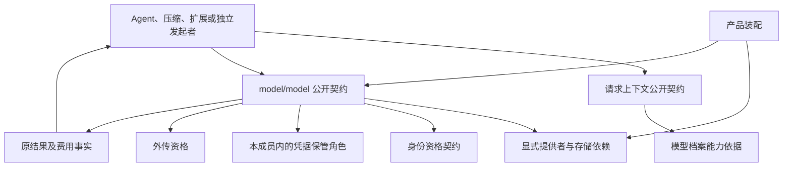

# 模型调用组的工程关系

本页在正式维护位置保存待审技术设计。领域分解已评审不等于成员技术接受、阶段选择或实现支持。具名目录只有文档，公开形状和实际验证仍待设计及补证。

## 依赖方向

箭头表示公开消费关系，不要求循环代码导入。发起者读取模型定义与调用接口；模型通过显式依赖返回结果，不反向导入 Agent 或 Session 实现。身份资格与凭据保管分开。秘密不放进身份契约，也不放进 Runtime Context。提供者适配共同契约，不重定义成功、首内容、费用或 ACK。

领域能力独立于 Cordis 使用，须声明自身显式依赖。Cordis 集成按现行 IC 约定拥有装配、绑定、替换和撤除；不能让 Cordis 作用域决定租户身份或调用寿命。凭据接缝的服务、插件和 fiber 见 [cordis](../model/docs/cordis.md)。其余导出仍待设计。客户端接入消费系统公开投影，SDK 不导入模型服务端、存储或 runtime 实例。

## 成员分解与邻接协作

档案、执行、转换、保管和费用在目标 model/model 内组织。request-context 负责实际表示、预算和压缩；Session 保存选择；发起和消费方负责原用途，Model 不反向导入其私有实现。

本组不维护第二份状态机、错误集合或精确承接协议。成员的四块文档是 [architecture](../model/docs/architecture.md)、[key-flow](../model/docs/key-flow.md)、[model](../model/docs/model.md) 和 [cordis](../model/docs/cordis.md)。责任与事实归属见[领域角色](../../../docs/domains/model-invocation/architecture.md)。
