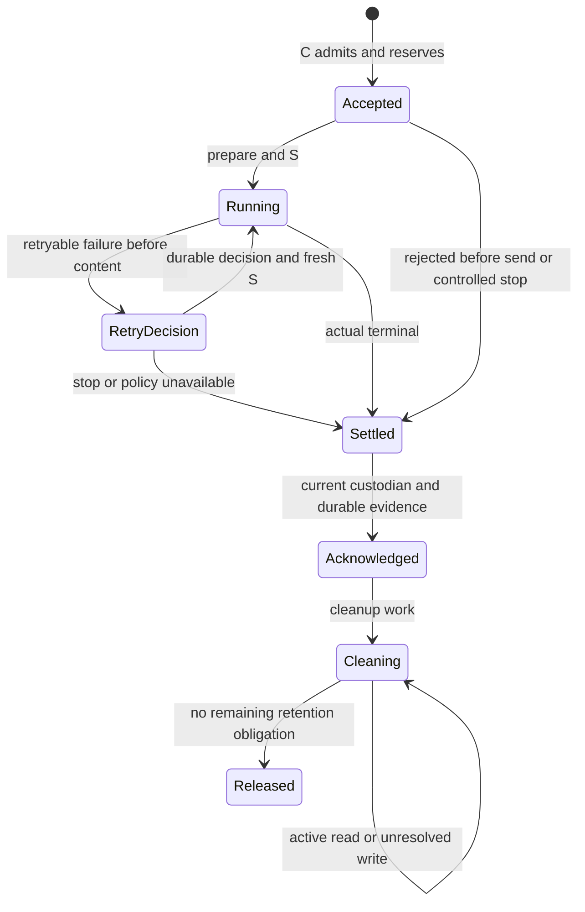

# Model 领域契约长期规格

状态：本包现有 Model 领域值、公开操作、提供者端口及行为协议已正式接受。原调用身份与受理、执行与观察边界、取消恢复、结果保管和双路径 ACK 沿用[既有技术接受](https://github.com/nemori-ai/omne-harness-lite/issues/262#issuecomment-6186972289)。通用传输、计量及 ModelTextTokenizer 契约属于已接受范围；pi-ai 的成员划分与实现细化采用范围由[组架构各节](../docs/architecture.md#成员与新增条件)维护。设计接受不表示生产实现或运行验证完成，也不补定尚缺的外部契约或具体参数值。

本页拥有 Model 领域共同的非类型行为。领域契约的已接受范围以上文为准，pi-ai 提供者细化沿组架构的采用范围执行；源码导出和运行验证分别交付。具体执行函数归 [model 实现规格](../model/SPEC.md)，Cordis 定义及登记协议归 [框架契约规格](../model-cordis-contract/SPEC.md)。

## 能力与契约拥有者

本成员提供模型档案和模态能力依据、完整请求执行、原结果查询与保管、控制、ACK、清理和实际费用事实。共同契约供全部模型提供者及消费者使用。独立消费以显式依赖满足存储、秘密取得及授权前提，无须启动 Cordis 或任何调用方的推进循环。

本页维护调用执行、档案与转换、结果承接、清理和成本的必要行为。

工作身份与推进、选择、派生输入与预算、推进循环与扩展位置、真正的工具执行都在本域之外。模型只返回工具建议，不执行。类型、配置键、服务定义及注册 API 由后续公开设计拥有，本规格不重复猜字段。

## 能力、旅程与持续验证入口

本表只连接产品能力、流程与已有行为拥有位置，不另写规则或证明实现。各入口一起组成符合性范围；没有行为运行证据的能力仍为未核实。

| 产品旅程及能力 | 对应流程 | 行为拥有位置 | 持续验证 |
| --- | --- | --- | --- |
| J-MD01，CAP-MD01、04、12 | [档案维护](../model/docs/flows.md#flow-md01) | [身份与修订](#身份修订及撤回)、[请求资格](#请求资格身份与固定输入) | [档案反例](verification/README.md#验证与待闭合输入)、[数据保护反例](verification/README.md#持续验证义务) |
| J-MD02，CAP-MD02、03、05、06 | [档案维护与选择协作](../model/docs/flows.md#flow-md01) | [同名求值](#同名求值选择及列表) | [合法选择反例](verification/README.md#验证与待闭合输入) |
| J-MD03，CAP-MD05、06、12、13 | [转换与组装](../model/docs/flows.md#flow-md02) | [模态表示](#模态投影与实际表示)、[转换契约](#转换件的共同契约)、[最终输入](#请求资格身份与固定输入) | [限额、转换及投影反例](verification/README.md#验证与待闭合输入)、[主规格反例](#观测资源与验证) |
| J-MD04，CAP-MD06、07、08、11、13 | [发出与流收场](../model/docs/flows.md#flow-md03) | [真实发出](#调用和各次真实发出)、[流式](#流式和首内容)、[策略](#重试与策略)、[故障交接](#故障交接) | [首内容、独立调用与否决反例](#观测资源与验证) |
| J-MD05，CAP-MD09、10、11、12 | [控制与恢复](../model/docs/flows.md#flow-md04) | [控制](#控制取消与晚到事实)、[换代恢复](#换代恢复和耐久) | [原身份与未知反例](#观测资源与验证)、[取消结果反例](verification/README.md#持续验证义务) |
| J-MD06，CAP-MD09、10、11、12 | [双路径 ACK](../model/docs/flows.md#flow-md05) | [ACK](#ack-的前提与效果)、[清理](#清理范围与读写保护) | [保管、完成、回执未知及竞态](verification/README.md#持续验证义务) |
| J-MD07，CAP-MD04、11、12、13 | [费用与查询](../model/docs/flows.md#flow-md06) | [费用](#真实费用和账目边界)、[保护](#数据保护与异常)、[观测](#观测资源与验证) | [账目及披露反例](verification/README.md#持续验证义务)、[投影缺失不放行](verification/README.md#验证与待闭合输入) |

请求表示选择与组装的实际行为在本域之外（当前组合见 [request-context 的 RQ-04](../../context/request-context/SPEC.md#rq-04-模态与可追溯表示)），本域提供档案约束及转换件共同契约。Tool 的内容 ref 与附件地址采用下节分流规则；MODEL-E01 跟踪共享类型迁移及真实发送验证，不代表该功能已实现。

## 工具声明转换与内容引用加载

Model 不依赖 Tool 的定义、结果对象、注册表或执行句柄。固定请求的 tools 采用 Model 自己的 ToolDeclaration，只含名称、已组装说明和参数 schema。上层请求组装者消费工具定义、组合 description 与 programmable 的含义，并保存声明到原工具采用及 command 的路由。Model 不重新判断工具可用性或可编程调用资格。

ModelToolPayloadAdapter 将 ToolDeclaration 转换成供应商私有 payload，并按原请求映射供应商调用名称。名称须在该请求内唯一，参数 schema 须满足采用的 schema 版本及供应商表达能力；引用解析、支持子集和限制须在实际适配契约中固定，不能静默删约束。JsonValue 是 json-text 的值树，不能将值树包装本身编码为供应商参数 schema。

多命令选择与参数包裹由上层组装者形成声明及路由。Model 只返回声明名称与完整 JSON 参数，不选择 Tool 命令或实现。调用建议采用 common/message 的 ToolCallPart，保留 callId；结果消息使用相同消息关联，上层另行关联 Tool 的调用身份。无法无歧义映射供应商名称时返回 unsupported；模型返回未知名称或业务无效参数时保留真实响应，由动作协调者拒绝执行，不猜工具或修复成一次调用。格式适配成功不授予动作权限。

ToolMessage 由上层提交为 [共享消息值](../../common/message/docs/public-api.md)，非文本模型输入采用 [共享 ref 块](../../common/content-block/docs/public-api.md)。工具结果到消息的投影由工具侧及消费协调者完成；Model 不解析 ToolResult 或其附件区。Model 只读取消息中显式选中的模型可见 ref，不扫描附件地址文本生成 ref 或二进制。消息/请求组装保留块身份、顺序、可见性、原结果关联及完整性信息，不提前读取二进制，不自动发出程序 data 或卸载原文。已有 transcript 或派生表示可按原可见性和来源选择，未知媒体类型或未支持格式不能冒充文本。

ModelTransport.prepare 固定 adapter 和引用计划，完成可纯计算的工具 payload 转换及格式检查，不加载 Tool 内容 ref 的字节。独立入口在本次执行的 PreparedTransport.materialize 阶段、托管入口在 ModelSendBoundary.send 内的同一发送准备阶段，才通过注入的 ModelMediaReader 加载所选内容。读取携带固定请求、主体/tenant、原消息来源证据、引用和接收方；托管路径另带原 call/dispatch，独立路径明确标 independent，不虚构托管调用身份。具体独立 transport 通过构造依赖取得合法访问上下文。reader 核固定请求确实包含该来源及 ref、当前读取和外传资格，不仅检查摘要字符串。

媒体租约只属于本次发送阶段，close 与取消释放其资源，不删除原引用内容。读入须有提供者声明的容量、并发和临时存储上限；不能无限聚合到内存。先在受控暂存中完整校验字节数、digest、媒体类型，再编码实际供应商 payload。缺失、失权、不一致或读取超出提供者声明的容量时，不发送缺失所选内容的请求。校验完成到发出之间重核取消及资格条件，不能用 prepare 时的旧许可越过撤回。请求发出后的不确定性仍按原 dispatch 协议处理。

只有本次请求需要的二进制转换在该阶段执行。结果是请求私有派生表示，不修改历史消息、原 ToolResult 或其附件，不冒充消息准入时已有 transcript。转换或加载失败不重跑原工具；依据实际发送状态形成明确 not-started、失败或 unknown。其他消息来源原有的接纳前本地转换规则保持，Tool ref 路径采用本节例外。

ModelMediaReader 与 ModelToolPayloadAdapter 由具体发送/传输提供者构造注入，领域根工厂不取得原始文件、网络或全局容器。它们不是每个 Model 门面的永久服务依赖；阶段缺席按原失败协议处理。共享 ref 设计已接受，Model 通用发送读取设计已接受，pi-ai 物化与媒体读取的具体资源控制仍为候选，消息校验沿共享拥有者状态，相关实现尚未完成，不能由类型声明宣称已有二进制延迟读取保证。

## 请求资格、身份与固定输入

1. 发起者提供合法主体与租户范围、稳定调用身份、用途、当前消费者和原消费位置。Model 只要求不透明的 `ConsumerRef`，不创建原工作。
2. 实际采用档案、参数、系统提示词、组装内容、工具声明和访问依据须可解释或准确还原。临时句柄不能替代调用身份，当前档案不能覆盖原采用值。
3. 发出前固定合法最终输入，校验参数、模态、凭据、操作资格、接收方和数据传送目的。最终校验不能省掉模型前扩展改写后的复核，也不能再次执行同次扩展。Model 在准备与发送路径上不计量输入，也不检查输入大小。请求组装方在请求前判断并完成压缩。上游事后拒绝输入时，按[故障交接](#故障交接)上报。
4. 参数由统一含义交适配器处理。上游不支持某项时明确留下不支持及实际采用情况，不能静默丢弃、假称已应用或私自改到另一档案。精确参数集合和不支持时的接口结果须由参数拥有者设计。
5. 首内容前重试仍须满足本次真实接收方和当前授权条件。原请求快照不是后续供应商外传的永久许可；资格失效时不能以恢复为由取得旧权力。
6. 缺必要来源、档案声明或凭据时，说明具体失败且不发。读取暂时不可用与不存在分开。提交结果未知保留原身份核实，不能换新调用掩盖不确定。

不得借档案不是资产而取消主体、秘密、外传和读取检查，也不得另造按账号、原工作或单次调用颁发的模型执行许可。共同设置规则仍由 assets 维护。

## 调用和各次真实发出

逻辑调用有稳定身份及最终完成、失败或被中断的结局。每次真实发出单独辨认，以档案允许的单个供应商处理。供应商变更或同家重发都是新发出，不是修改旧记录。未发出失败与已经发出的拒绝分别保存。

原消费者需要记录的跨边界事实是未发出就失败、真实收场、停止尚未回报，以及消费侧已保存结果。每次重试、首内容边界、容量预留、在途块和费用金额留在本成员。记入标准归原消费者。

受理的最小对接是现行规则。租户身份是参数。缺租户或跨租户默认拒绝。结果确认的前提见[ACK](#ack-的前提与效果)。样例见[双路径 ACK](../model/docs/flows.md#flow-md05)。

| 项 | 规则 |
| --- | --- |
| 关联身份 | 登记时生成的调用身份。 |
| 必要参数 | 租户、调用身份、这次固定采用、结果容量上界。 |
| 成功 | 受理和结果容量预留在同一事务里成立。受理不等于已实际发出，实际发送另按 S 围栏记录。 |
| 拒绝 | 资格或容量不成立。不算已经发出。 |
| 未知 | 按原调用身份对账。不换身份再发。 |
| 同身份重试 | 同一调用身份和同一固定采用返回原受理。 |
| 参数冲突 | 同一调用身份配上不同的固定采用则拒绝。 |

每次发出的实际供应商、原参数采用、时刻、首内容观察、原状态码、结束原因及费用依据须可追溯。失败记录不被成功覆盖，未知费用不填零。重试和多观察者不得重复登记同一笔真实用量；两次真实发出可能各有费用。

调用终局不反转；终局后可以补账及必要事实，不恢复原执行。后续消费否决、上层失败或原工作结束不改实际模型结局。完整回复没成为消息时，记录原回复和否决责任；后续是否再试由原消费者决定，再试须另立新调用身份。

## 流式和首内容

开块、填充、封块、截断提醒、实际用量登记和流收场表达到达及事实，不成为原工作的状态；精确操作形状见 [公开流事实](docs/public-api.md)，到达事实与累计快照的关系见[流状态归约](#供应商解释与流状态归约)。

块打开时固定追加片段或整体替换模式，不在同块途中换方式。整体替换仅更新该块，不覆盖其他块及历史。封块交完整内容，分次到达与一次取得的有效结果一致。

可增长的文字、思考、工具参数及语音，以首片实际内容作为首 token。图片和文件等整交块以完整交付作为首 token。响应头、心跳、空开块及单纯状态通知都不算。不能只识别文本，从而重发已交语音或工具参数的回复。无权取得或上游未提供的思考内容不补造。

新观察者先取当前在途快照，再取后续增量。快照不是完整增量史，不表示已收场或已消费。未收齐工具参数不得作为执行指令。模型完成后，工具建议仍须经过实际动作准入及工具契约。

输出限额正常截断按真实完成和相应提醒处理。上游故障、中断或自身失联按真实原因收场。已交部分按其有效保留规则处理，不能伪造完整消息；工具执行及用户消息格式归原拥有者。

已展示在途内容可追溯义务有效。采用批量 preserve 确认后再发布，详见[展示协议](#展示诊断与实施证据)。提供者尚须验证崩溃和断电；最终 ACK 不证明逐片耐久。

## 重试与策略

| 条件 | 必须行为 |
| --- | --- |
| 本地请求、授权或凭据明确无效 | 不反复发同样无效请求，给原消费者具体原因。 |
| 上游明确拒凭据、无效请求或不接受内容 | 留实际发出事实及状态，不让策略推翻禁止同输入重试的边界。 |
| 首内容前可重试上游失败或空回复 | 由有效策略按档案声明及实际失败决定继续或收场。 |
| 首内容后故障 | 不重新发同一逻辑回复，记录故障与实际已交内容。 |
| 明确控制中断 | 走控制结局，不作为策略故障重新尝试。 |
| 适用表示不满足 | 交发起与组装协调者，不私删内容或换路由。 |
| 上游报告输入超出其限制 | 以 `input-over-limit` 收场。策略必须停止：不重发同一输入，也不回退到同档案的其他供应商。调用以 failed 交回原消费者，调用方压缩后以新 `ModelCallId` 重新发起。 |

默认策略始终有明确采用来源。允许回退时按供应商声明次序逐家至多一次；不允许回退时原供应商退避后至多再试一次。策略替换不得突破允许供应商、回退声明、首内容后不重发、`input-over-limit` 即停止及真实成本保留。具体退避数值及状态码映射不在本规格补定。状态码只是证据，不单独决定失败成因。`input-over-limit` 由传输提供者识别供应商自己的超限信号后形成。

策略读取原状态码、失败成因、档案声明和已尝试情况，决定再试或不再试并留下可接续依据。一次发出失败而整调用仍等待策略时，不能向外报整调用终局或允许最终 ACK。首内容前可重试发出结束后，由原调用沿既有模型后失败分支取得策略，触发不等待整项调用终局。策略结论回原 Model，继续发出或形成真实终局；原消费者仍等待该调用，不提前消费结果或 ACK，也不另造工作或逻辑调用。最终失败处理不再次送回策略复活终局，策略执行不依赖发起者持续在场。精确调度与适配另待，持久决定由 prepareRetry 与 decideRetry 承载（见[重试、失联与恢复](#重试失联与恢复)），不新增原消费者的位置；只观察扩展不能改重试决定，系统策略不可用时不再重试并记录不可用。

托管调用不论由谁发起，都消费同样有效的策略，不创建隐式原工作，不要求发起者一直在场。不因 ConsumerRef 的内容改变重试策略，也不发出多份逻辑回复。独立执行函数没有自动重试。

内部失败的尝试属于诊断和费用事实，不直接作为模型可读消息或改变调用方的下一步。只有真实收场后的适用交接影响原消费者。按失败成因和原状态码分别表示，不用原状态码替代业务成因，也不把本地保存失败伪报供应商不可达。

## 故障交接

首内容前整调用结束失败，或首内容后的部分结果和相应提醒，都交原消费位置。提醒即该次中断交接，不重复另立同义事实。

明确区分已下架、被范围配置排除、模态不兼容、凭据不可用、上游不接受此次内容、上游报告输入超出其限制、暂时给不出回复、首内容后断流和确实未认出的原因。未知原因带可追查依据，不用兜底掩盖可识别原因。故障形态不作封闭穷举，精确映射及错误类型随提供者与公共契约确定。

`input-over-limit` 表示上游明确拒绝了输入的大小。故障的 `reported` 只记上游实际给出的事实：超限的维度、限额和实际值。上游没有给出的写 null，不用本地估算填。原状态码与诊断另行保留。这个成因由传输提供者识别，调用以 failed 收场并交原消费位置。重试策略不得对它重发（见[重试与策略](#重试与策略)）。

被控制中断不带上游故障成因。输出限额完成不记同一层故障。原调用正常收场但消息前被否决时，消费方自行记录谁否决及后果，模型不篡改为调用失败，也不把新调用算作自己的供应商重试。

## 控制、取消与晚到事实

控制以原调用身份定位，记录到达、受理、传播及实际结果。取消关系不能只靠临时连接。取消等待不证明上游已停止或提交已回滚，适用流取消也不要求关闭全部共享连接。

取消输入不携带原因。为什么取消、由谁发起，是调用方的业务事实。调用方自己记录这些事实，并以自己生成的控制 operation 关联 Model 返回的控制事实。Model 核验主体、租户、目标调用，以及主体对目标调用的当前控制资格（由资格适配器判定）。Model 对每次控制执行同一语义：持久记录意图、传播、保管迟到结果与费用，不自动 ACK，不伪装上游故障。同一调用上的后续控制关联原控制，回复给出原控制 operation。调用方保存两者的对应。回复未知时，调用方以同一 operation 重发，认回原控制。原控制也可能是 Model 因原工作资格失效记录的控制，其 operation 由 Model 生成（见[资格、共同提交与实际发送](#342-资格共同提交与实际发送)）。

单独模型中断不自动取消工具或其他调用；不执行被中断响应里尚未发出的工具建议。一次控制只作用于目标调用。Model 不按原工作扇出控制。扇出的范围与完整性归控制协调者，逐调用的控制资格按[逐操作行为](#342-逐操作行为)的 cancel 行核验。

目标调用的控制生效后（包括 Model 因[原工作资格失效](#342-资格共同提交与实际发送)记录的控制），不为这个调用追加真实发出；原工作是否继续由原消费者决定。独立执行仍可能迟到完成，模型保存真实结果和费用，当前业务消费者不得借迟到事实恢复已取消的工作或自动创建新的工作。消费者此后的资格变化不使受到控制的调用恢复资格。能否用原材料发起新的明确工作归其产品准入，不由 Model 偷选。

控制意图与上游真实停止分别记录。上游实际完成不能被改报未发出或物理中断，业务不再采用也不能当作没有成本。清理仍须满足结果责任交接及实际读取条件。

## 换代、恢复和耐久

发起者离开或最后一个句柄释放时，模型继续原执行、输出、收场和记账。合法接手者核对当前访问、原身份、用途和消费状态，不修改原输入。仍运行就等原调用，完成且未 ACK 就承接原结果，已 ACK 就查询确认及清理并从消费方位置继续。

状态查询暂时不可用保持未知，不能推断自身失联、报告已结束或重新发出。只有可信地确认 Model runtime 自身失去连续性，才应用首内容前后规则。首内容前可按原消费位置恢复重发，保留原调用与新真实发出；首内容后记录运行时失联，不重发。可信失联及排除的已接受机制见[恢复协议](#342-重试失联与恢复)，实际宿主证据仍须验证。

恢复时不从当前档案或最新配置重写原采用。原工作资格失效或调用受到控制时，不恢复原业务推进。原调用未知提交先核实，而不是从缺消息反推出未发出。

公开持久确认须晚于所需调用、结果、承接、授权及账目事实达到耐久边界。进程崩溃、操作系统崩溃及断电后仍可读取解释。引用的模态内容及其必要保留时间满足同一承诺，临时文件地址不能当可靠唯一副本。介质损毁及灾后资格另行设计，不自动引入恢复管理员或全量人工审批。

## 观测、资源与验证

观测关联原租户、调用、各次真实发出、适用消费者（原 `ConsumerRef`）。模型 TTFT 与入口到首输出分开，真实发出、排队、组装、转换、重试和清理分别定位。不伪造上游用量、不把诊断采样当完整账目。

连接、读写、在途快照、等待、保管和清理都有资源边界，不能因无人读结果或某个清理故障拖垮其他调用。具体限额与调度尚待设计；不得丢掉未承接责任来达成低占用。故障降级仍按原规则报告未知或失败，不换接收方、不改权限、不产生无法说明的额外请求。

持续验证至少覆盖下列反例。相应流程入口见[能力旅程对应表](#能力旅程与持续验证入口)。

| 场景 | 需观察的保证 |
| --- | --- |
| 同名最具体档案缺凭据或模态不符 | 不暗退外层；列表与失败原因一致。 |
| 档案变更时 token 上限缺失、非正、无限、超过已知上游限制，或窗口、输出、百分比、模态不满足有效性规则 | 变更返回 `invalid` 并列出字段，档案不变。 |
| 上游以输入超出限制拒绝 | 以 `input-over-limit` 收场且不重试；保持历史、选择及原件；调用方压缩后以新调用重发。 |
| 只有响应头或图片开块后故障 | 未越首内容界，按策略决定。 |
| 首片工具参数、语音或整图到达后故障 | 不再发同一逻辑回复，不执行半截参数。 |
| 两次失败后成功 | 每次发出和费用真实，失败不被覆盖。 |
| 发起者离开但原 Model 仍运行 | 接续原身份，不重发或自动中断。 |
| 状态查询断开 | 未知保持未知，不按失联重试。 |
| 自身失联发生在首内容前后 | 分别允许恢复重发或收失联，不暗混。 |
| 正常回复被消息前扩展否决 | 原调用终局不改，新调用有新身份。 |
| 原工作资格失效后、消费者资格再变化时的迟到响应 | 原事实保留，旧工作不复活、不自动派生新调用。 |
| 独立调用遇重试、取消和 ACK | 无隐式原工作。取消只需原调用与控制 operation。 |
| 普通崩溃及断电发生在已确认保存后 | 原身份及事实耐久，确认丢失可核实。 |

档案、转换、输入边界、交接、清理、账目和外传的持续验证义务见[验证场景](verification/README.md#model-持续验证场景)。验证声明须绑定具体提供者、存储条件、事实范围及故障前提；mock、静态类型和文档检查不证明这些行为。

## 当前缺项

受理、提交未知、首内容窗口、稳定重试位置、结果承接及清理已有下文已接受协议。仍须完成实际提供者实现及故障验证，不能把这些状态统称未设计。具体厂商绑定与计量依据、宿主和持久提供者设计、诊断及跨领域前置由[实现架构](../model/docs/architecture.md#技术缺项与采用边界)逐项定位。共享 ref 规则和延迟读取设计不表示实际媒体传输已验证。

## 运行契约

本节维护运行接口的行为。声明只在 `src/`，[public-api](docs/public-api.md) 是它的导航，消费及失败场景归 [context](docs/context.md)。本节设计已接受，尚不表示生产支持。

本节将既有行为落实到操作、参数和提供者责任。声明只保存在 `src/`，[公开接口页](docs/public-api.md)给出导航，导出清单没有 pending 名字。`executeModel` 与 `createModelRuntime` 等由 model 成员拥有，不能从本包导入。model 已实现 executeModel 及受理、原流保存、实例观察和有限的原终局收场，具体支持边界归[实现规格](../model/SPEC.md#已实现的调用收场)。结果读取及 processed ACK 已实现；retained ACK、自动清理与生产托管宿主尚未实现。

### 能力边界

独立执行函数只执行一次真实供应商请求。调用者提供已经准备好的请求与传输能力，承担访问前提及结果。托管调用增加原身份、受理与容量、政策重试、当前资格、耐久输出、控制、ACK 和清理。两层复用请求与传输表示，但不把托管保证赠予独立函数。

Model 不执行工具建议，不决定原工作的终态，不重新运行扩展。活体目录只返回绑定特定实例的观察句柄。原事实、控制与结果领取通过独立操作访问，因此目录失效不解除原责任。普通调用者不能发布实例或传入供应商重试序号。

### 根入口的值与请求

本节的声明按顺序组成同一设计，源码位置见[公开接口页](docs/public-api.md#根入口的值与请求)。`Identity` 防止误混身份，不提供授权。边界解析器必须验证格式、所属租户和已有关系。身份分三类：多数身份是带领域前缀的非空字符串；序列与修订是十进制非负整数字符串，不能用浮点序号排序；`CredentialId` 无前缀，规则见[凭据引用与解析端口](#342-凭据引用与解析端口)。

根入口为每个品牌发布一个解码函数。函数接收 `unknown`，返回 `Outcome`，不抛异常，只核验格式。身份类为固定前缀加至少一个 `[A-Za-z0-9_-]` 主体字符；`Revision` 与 `OutputCursor` 为无前导零的十进制非负整数文本；全部不超过 256 个 UTF-16 码元，不裁剪、不折叠大小写。成功只得到品牌，不证明存在、租户或资格；所属租户和已有关系由处理该操作的提供者核验。品牌相等即文本相等。`Revision` 与 `OutputCursor` 的先后由比较函数按整数值裁定，只对同一对象的修订或同一调用流内的游标有定义。`ModelDiagnosticCursor` 的不可猜测与验证由诊断提供者承担，解码只拒绝格式错误。契约只铸造一种身份，即守卫派生的控制 operation（主体以 `--` 开头，其他铸造方不得产生）。`ModelCallId` 由调用方铸造；`ModelOperationId` 由调用方与提供者铸造；`CredentialId` 由凭据保管的配置路径上的人命名，Model 运行时不铸造；其余由提供者铸造，铸造方生成的文本须能通过对应解码函数。声明与规则见 [public-api](docs/public-api.md#根入口的值与请求)。

`Adoption` 指向可恢复的精确采用。`digest` 为所指规范化内容的 SHA-256 十六进制值；只有名称或当前版本指针不满足它。`ConsumerRef` 是消费者拥有者登记的稳定引用，不是执行许可。Model 原样保存 `ConsumerRef`，不解释其业务含义。消费者关系由为该 `ConsumerRef.owner` 声明的守卫参加者在受理点 C 核对（见[资格、共同提交与实际发送](#342-资格共同提交与实际发送)）。守卫路径以资格参加者协议闭合为前提；协议闭合前只受理免守卫 owner。把它对应到原工作的哪一部分，由消费者拥有者在自己一侧负责。Model 不导入任何消费者拥有者的实现，也不由通用字符串猜业务关联。

[本节设计定义](docs/public-api.md#根入口的值与请求)。

`P` 是装配选定的身份拥有者输入。它可能表示人或受限系统主体。泛型不证明可信；注入的资格适配器必须验证其来源、身份与当前访问。`P` 不作为请求快照写入普通日志。网络入口必须通过身份拥有者解析，不能接受反序列化后自称可信的对象。

请求值逐字段冻结并深复制。重复判断使用原值的规范化表示，不比较 JS 对象地址。供应商次序、凭据引用、参数、转换采用、源修订和消费关系均参与冲突判定。秘密值不在请求中。凭据字符串由 `decodeCredentialId` 验证并转换为 `CredentialId`，不得把任意字符串强制断言为已验证引用。从文本或存储复原 `Supplier` 的每个位置（档案来源、dispatch 记录、重试决定、恢复读取）都经该解码函数。

本设计为常用参数给出小而明确的词表。`temperature` 为有限数且在 [0,2]，`top-p` 在 (0,1]。token 限额为正十进制整数。`stop` 是非空且不重复的非空字符串序列。`reasoning-effort` 取 `none`、`low`、`medium`、`high`、`max` 之一。`seed` 为非负十进制整数。`frequency-penalty` 与 `presence-penalty` 为有限数且在 [-2,2]。每个 kind 至多一次；extension 依完整 adoption 去重。扩展参数须有可读取的含义、值 Schema、适用范围和当前 adapter 映射，不接受没有定义的任意供应商键。

温度控制采用供应商声明映射的采样温度，top-p 控制累计概率截断，max-output-tokens 限制总生成 token，stop 在命中停止序列时终止生成，reasoning-effort 指定推理强度，seed 固定采样种子，frequency-penalty 按词元已出现的次数降低其概率，presence-penalty 对已出现的词元统一降低概率。供应商不能准确表达时，在发出前返回 `unsupported`，列明字段和映射采用。省略参数表示该固定供应商采用的默认值，默认值须被解析并保存在受理采用中，不能在恢复时随供应商新默认改变。max-output-tokens 的默认值与请求显式值都不得大于档案的 `context.output.provided`。档案变更时违反返回 `invalid`，`prepare` 时违反返回 `invalid`（field 为 `max-output-tokens`）。这是参数比较，不是预算计算。没有该参数时，生成上限仍受 `context.output.provided` 限制。不得将静默丢弃参数记为成功采用。

所有数字字符串在解析时检查范围和实际提供者能力。容量三个字段是非负整数，bytes 与 blocks 必须为正。容量上界覆盖可保管的原输入、流中快照、终局及必要附件引用。提供者若无法在该上界内兑现已承诺结果，应在发出前拒绝，不能靠 ACK 前丢弃已交内容来回收容量。请求组装方在请求前用固定 meter 与 representation 判断输入大小，Model 的准备与发送路径不重复计量。扩展改写后的最终 request 必须重新通过参数、模态与资格校验，输入大小由请求组装方对改写后的输入重新判断。

`argumentsSchema` 是工具声明采用的 JSON Schema 文档，draft 和词汇由其 adoption 指定。Model 检查当前 adapter 能否准确传送，Tool 负责实际参数准入。`JsonValue` 使用现有 lossless JSON 表示，数字为 lexeme，不是 `Record<string, unknown>`。`Message` 的合法形状不证明其中工具结果已获准外传；当前数据来源、内容读取、实际接收方及用途另核。

### 结果、失败和状态

[本节设计定义](docs/public-api.md#结果失败和状态)。

`not-accepted` 只在原受理操作的排队、旧写者和数据库恢复均排除后返回。暂不可读返回 unavailable，受理提交不明返回 commit-unknown，目录没有路由不调用此分支。拒绝不披露别租户资源是否存在。身份冲突返回获准披露的修订，不回显秘密或无权读取的输入。

`recovered` 只说明认回原受理。受理成功表示容量与原调用共同成立；它不表示供应商收到请求。受理事实、发出意图、真实发送及供应商回执各自保留。外部错误、内部保存失败和策略不可用不能相互冒名。`unclassified` 必须附安全诊断定位，不覆盖已有可识别原因。

`DurableEvidence` 是耐久记录定位，摘要只校验内容一致性。ACK 携带的证据里，`owner` 填调用的 `ConsumerRef.owner`；其余字段与摘要，按该 owner 在装配声明里登记的 `evidence` 采用定义。Model 不规定摘要算法，只核证据属于该 owner，并经该 owner 的证据适配器确认其认可。确认者不能用摘要自证已处理或已保管。Model 通过该 owner 的受信证据适配器读取并验证原租户、调用、结果版本、consumer 与位置、当前承接责任及真实耐久状态。processed 记录保存该业务要求的结果和完成事实；retained 记录还保存内容或可恢复引用、必要保留期限及待交付责任。后者不能依赖即将获准清理的 Model 唯一副本。

Settlement.source 由 Model 在原结果真实收场及必要保存共同成立时产生，定位该租户、call、结果版本和真实终局。inspect 与每页结果给出同一来源，消费方不自己拼摘要。受信参加者按此证据核验原记录；来源引用本身不授予正文读取，也不解除原结果保管。

### 普通调用面与实例观察

[本节设计定义](docs/public-api.md#普通调用面与实例观察)。

`Snapshot` 是到 cursor 为止的完整在途快照。第一项一定是 snapshot 或 ended；后续 changed 给出更新快照，不宣称重放每个上游分片。游标单调，重连通过原 call 取得新快照，不能把旧实例流嫁接到后继。替换模式仅改变该 index，封块后不接受填充。Model 将传输事实映射为 common/stream-arrival 的 open/fill/close/trim/finish；共享序号、重复与续接规则继续有效，公开快照不另造业务终态。

增长中的工具参数不能变成 `ToolSuggestion`。只有完整封块、JSON 验证通过且实际模型收场允许使用时，消费者才得到可交 Tool 准入的建议。图片/文件只在完整且可恢复时作为 sealed 出现。语音片段的 value 是固定 representation 所声明编码，不能由观察者猜文本。首内容判定在原始已接受内容上完成，不能因快照合并而漏掉曾经实际到达的内容。

所有观察内容先提交对应可恢复表示及首内容标记，再发布 cursor。一次提交可以包含多个片段。提供者应按配置批量保存并背压传输；保存未确认的片段不能先向外展示。未发布的接收缓存不作为已展示内容承诺，但接收之后、持久之前的崩溃仍可能已经越过首内容界，必须按下文的 receive-window 保留 uncertain，不得据此重发。附件及原件使用满足同一耐久与保留承诺的引用。

最终 `ResultPage.parts` 按原 dispatch 发出顺序、再按 index 保留每位置至多一项。`ResultPart` 的 sealed 保存原完整 ModelBlock，partial 保存 text、thinking、voice 或 tool-arguments 的收场累计值。partial 不生成 BlockId、visibility 或 mediaType，也不成为可执行工具调用。消费者分别处理完整块与未封值，并处理每项的真实 trims 和页上的 Settlement。thinking 不因保管获得展示资格，voice 未封值不获得播放资格。声明由 [call-surface.ts](src/call-surface.ts) 唯一维护，Snapshot.blocks 与传输事实保持原义。

每位置曾接受非空填充或真实 trim 才产生 partial。曾非空后 replace 为空仍交付空字符串 partial；只 open 或始终空 fill 且无 trim 不产生结果项。trims 按接受顺序保留 removed/reason，未发生时为空数组。trim 是提醒，不再次删 value 字节，不猜 removed 单位，不由 failed/limit 合成。合法封口文字仍携带此前提醒，工具参数一经真实 trim 便不能封为可执行调用。完整 stop/tool-suggestions 的封口约束只检查该结束事实所在 dispatch，早先纯空失败不污染成功重试，早先真实 trim 仍须保留。

页按完整结果项组装，不分割字符串、块或 trims。`resultPageTargetBytes` 是规范 parts 数组 JSON 的 UTF-8 组页目标，按键递归排序、数组保序，并使用 JSON.stringify 的字符串转义。先放第一项，再在项数和目标均允许时贪心加入后项；首项超目标则独占一页。目标为1或2仍能取得进展。空结果仍有空 parts 和真实 Settlement。Settlement、next 和包装不属于组页目标，但整个 ResultPage 的同口径字节数不得超过原冻结 capacity.bytes，即 C。消费者须能处理接近 C 的页，不能将目标用作更小的硬接收缓冲。

提供者在保存新内容前预留原材料、最终有序 parts/trims、结算、最大游标包装和必要读/控制/承接元数据。纯派生投影仍须占保管额度；终局与证据在首次输入边界受明示有限上限约束，不能先接纳再永久卡在结算或 ACK。保存失败保留合法前缀及原责任，不发布后截断或伪造 limit。页配置在原结果/读源冻结，只接纳该读已发出的 after；同 after 保持同页，当前失权、到期或 ended 优先。ACK 不增加必须读完全部页的条件，原读继续保护全部 parts 和提醒，完全清理释放正文、trim、标记和无用读材料。

`beginRead` 是第一份内容读取与登记的同一操作，不是空租约申请。它与 ACK 在同一 call 修订上串行裁定。ACK 先提交则返回 acknowledged；读取先提交则 ACK 后可继续这个 read。ACK 之后用原读取 operation 重复 `beginRead` 时，先按 operation 认回原 read，再谈 acknowledged：返回原 `beginRead` 的回答，即未结束的 read 仍给首页（不是读者当前的位置；读者按自己已取得的 next 继续），已结束的 read 给出已结束状态，不再给内容；只有新 operation 才返回 acknowledged。每一页重新核验当前读取资格。一次读取只能取得同一版本，按 next 继续；重复 after 返回同一页，不移动到新结果。

读者完成或 closeRead 后释放读取关系。空闲句柄从未取得 read，不阻止清理。已经开始却长期不进展的读取，提供者先按其公布的读取期限明确结束，撤销/关闭实际输出资源，再解除保护；不能直接删正在发送的内容。权限撤销可以结束读取，不以保护半份数据为由继续向无权主体输出。read 状态保留可查询原因，不伪造完整成功。期限属于装配配置，不能在一次在途读取中偷偷缩短。

### 逐操作行为

所有受保护操作先验证 principal 的可信来源与显式 tenant，拒绝跨租户默认访问。读取调用事实、读取内容、控制、ACK 和费用各用自己的资源动作，不能因一次受理成功永久免检。异常只表示程序缺陷；可预期的拒绝、不可用、提交未知和观察结束使用上述结果。

| 操作 | 固定身份与资格 | 成功及重复 | 失败、取消及恢复 |
| --- | --- | --- | --- |
| admit | 原 call、operation、request、consumer、capacity；当前发起资格与消费者关系 | 原调用和容量同提交；同身份同值返回原受理 | 不同固定输入 conflict；未提交拒绝不留发出；未知只查询原 operation。调用方停止等待不撤受理 |
| inspect | call 与原 admission；当前事实读取资格 | found 含最新业务状态、控制及交接；同身份可重查 | 仅有权威未受理证明才给 not-accepted。读失败不推断 runtime 失联 |
| dispatches | call；当前账目及发出事实读取资格 | 按原发出顺序返回脱敏事实，费用保留 revision | 不连带授予请求/回复/秘密读取；晚到费用仍入原 dispatch |
| cancel | 原 operation、call；当前控制资格 | 持久意图及传播状态；重复认回。同 call 后续同义意图只关联原控制，不追加发出。operation 是保留值（主体以 `--` 开头）时：等于目标调用的派生值且派生控制已存在，认回原控制；其他情况返回 invalid(field='operation') | 不等待物理停机才确认意图。传播失败保存待续做。已经真实完成仍保留真实终局 |
| connect | call；当前观察资格 | 取得特定 instance 句柄，或明确 no-live-route | 失去目录依赖为 unavailable，不能变 not-accepted；销毁句柄只关观察 |
| observe | tenant/principal 与句柄原 instance | 首快照与后续 cursor 衔接，观察实际状态 | signal 只关本观察；失权/断开/实例替换结束流，原调用继续承担责任 |
| beginRead | 原 operation、call、result；当前内容资格 | 首页与真实读取登记共同成立；重复认回原 read，先于 acknowledged 判断 | 未收场 not-settled；已 ACK 返回 acknowledged，不用旧引用新领全文 |
| readNext/closeRead | call、read 与页位置；当前资格 | 同 after 返回同页；close 幂等并保留结束原因 | 读断开不重做 Model。ACK 不能截断已准入读，实际失权按原规则结束 |
| acknowledge | 原 operation、call、result、耐久证据；当前结果承接资格 | 真实收场、证据及 ACK 同一裁定中成立，清理任务一起保存；重复返回原 ACK 与当前清理 | 提前确认或伪证据拒绝；提交未知认回原 ACK；清理失败不撤确认，不要求消费者重确认 |

清理仅移除本调用无用的输入、输出和引用。真实在途写和未知写先核实；共享内容只解除本调用关系。无必要保留且真实读写完成时，恢复工作者持续推进至 released。保留准确结算必需事实，不以未知费用为由保留全部全文，也不把未知填为零。

### 独立执行与提供者操作

独立执行函数与其一次发送、取消和资源收尾行为归 [Model 实现规格](../model/SPEC.md#独立执行)。本节拥有可替换传输及托管提供者的共同协议。

[本节设计定义](docs/public-api.md#独立执行与提供者操作)。

`prepare` 可以建立无业务内容及秘密外传的连接；它不发送模型请求。`PreparedTransport.materialize` 只在本次实际请求的发送准备阶段执行，异步读取并校验选中的内容 ref、编码最终 payload，不发送业务请求，也不计量。成功给出 MaterializedTransport，固定本次 payload、来源与接收方；没有媒体的请求也经过该步骤。`MaterializedTransport.start` 在调用时立即启动不可撤回的发送并返回流，不等待媒体读取，也不能把发送延迟到第一次迭代。同一 prepared 只 materialize 一次，同一 materialized 只 start 一次，重复调用为使用错误且不得再发。`materialize` 收到的 signal 已中止时，传输可以停止读取并返回任一 `TransportFailure`，该类型没有「已取消」一种。执行方以自己持有的 signal 判断取消：start 前取消报 `not-started`，原因为 `cancelled`，不靠传输返回的失败种类判断。调用方在成功、拒绝和异常路径关闭自己取得的两级资源，先 materialized 再 prepared；close 幂等，外层兜底释放所派生的暂存资源，不声称撤回外部效果。

TransportTermination 不携带托管控制身份。托管协调者消费真实 interrupted 时，必须关联已持久的原 ControlState.operation 后才能形成 Termination.interrupted；没有有效控制关联的自发断流形成 failed。not-started/rejected 的 denied、invalid、unsupported、unavailable 分别映射为本次 dispatch 的 excluded、input-rejected、modality、upstream-unavailable 故障并保留原诊断；只允许原重试政策决定后续。托管取消在 start 前成立时不产生 dispatch 发送事实，按原控制收场。独立函数不自行生成 ModelOperationId。

实际传输返回 TransportFact 操作，执行路径归约为每个 index 的最新 VisibleBlock。增长片段按固定 mode 归并，block-seal 形成 sealed 快照；合法终止只出现一次。未终止就耗尽或抛错视为传输失联，由执行函数产出有诊断的 failed，不能报 completed。账目事件按供应商采用、dispatch 与 event 身份去重，同 event 不同值拒绝并记录矛盾。修正账目必须有新 revision 和原事件关系。纯函数本身没有足够身份时，只交事实给调用者，不自建账本。

`ModelCommands` 是深提供者接缝。它隐藏提交参加者、资格核验、流中持久、实际读写与清理步骤，普通消费者不会拿到它。它没有任意 `transaction(callback)`、任意 load/save 或外部传入的 allowed 布尔。`ExecutionRef` 是目标和代次；提供者还必须核验调用通道的受信实例身份，单凭序列化值不能写事实。

`ModelProvider` 由受信宿主使用，其 runtime 才是普通消费面。admit 同提交保存待调度责任，提交后调用 schedule 唤醒本域独立协程；唤醒失败不撤销已成功的受理。recover 使用显式租户及当前合格的恢复主体调用 scanPending，以稳定分页扫描耐久待办，再逐 call 调用 loadRecovery。分页按原身份排序，在同一轮扫描结束后重扫仍有责任的项目；扫描本身不 claim 或清除待办，新受理和并发完成不丢失原任务。limit 是正整数且服从提供者公开上界，越界拒绝。查询失败保留当前游标和原身份，不返回空完成。

RecoveryRecord 包含原请求、容量、原发起主体引用、原受理、策略决定、代次、未知操作及责任种类。ActorRef 是身份拥有者生成的可核验原事实引用，不是可继续使用的秘密或授权 token。恢复者自己的当前身份与原工作/原发起者适用资格分别检查，不从系统身份推导无限权限。保存所需身份事实不保留原 P 中的秘密。ModelSendBoundary 消费这个原引用，不能把恢复者变成新业务发起者。

schedule 按原 call 去重，不能自行取得执行代次。recover 核实原操作、控制、消费与清理责任后只负责唤醒，不直接 claim。具体提供者的 driver 是执行代次唯一取得者，也负责以有效代次推进清理。quiesce 停止新的业务受理，已受理工作仍可调度和推进，并报告真实 pending/running；它不关闭绑定、不取消业务或宣称卸载完成。绑定 close 才停止新协程派发，未派发工作留在耐久待办供后继接续。进程退出必须兑现旧进程排除条件。

| 提供者操作 | 必须在一次原子裁定中成立的事实 |
| --- | --- |
| admit | 当前身份/发起资格、适用消费者工作守卫、固定输入去重、容量与原调用。认回仍检查当前查询资格 |
| claim | 原调用与后继实例绑定、旧执行者排除证据、当前资格及新代次。首内容与原控制保留 |
| scanPending/loadRecovery | 当前恢复主体及显式租户授权、原耐久任务和固定采用。查无活体不删除任务 |
| prepareDispatch | 当前代次、未取消、未收场、首内容界、合法政策和唯一 dispatch 意图。它不记录供应商已收到 |
| recordMaterialization | 当前代次、原未发出 dispatch、供应商和固定输入一致，回执（供应商、表示采用与 payload 摘要）先持久提交；未知不得 start，详见[物化提交](#物化回执的提交与发送) |
| recordSend | 原 dispatch 的传输发起观察或未知；后到的真实结果可以补充 unknown，不能把 started 改 not-sent |
| openReceiveWindow | 有效实例/原 dispatch、唯一窗口、尚未首内容时的 uncertain 标记；提交后才允许该窗口的实际接收 |
| preserve | 有效实例/原 dispatch/窗口、顺序与去重、可恢复内容及附件引用、首内容标记、账目事件和游标，同时关闭窗口。该事务之后才发布快照 |
| recordLateFact | 当前补录资格、原 dispatch 归属、可核验来源、供应商事件去重及修订。它不 claim，也不授予新发出或业务推进 |
| decideRetry | 原失败发出、尚未首内容、原政策资格与唯一决定；重复决定认回，冲突拒绝 |
| settle | 整调用真实收场及结果版本。仍执行或等待策略时不能执行；终局后只补事实和费用 |
| control | 当前控制资格、原意图、禁止新发出的状态、传播续做责任 |
| acquireRead/nextRead/endRead | 当前读取资格、结果/页身份、实际读准入或结束。ACK 后不新建读 |
| handoff | 当前资格和承接关系、实际终局、原版本、两条证据之一、ACK 与清理任务 |
| advanceCleanup | 仅解除本调用无用关系，核实在途/未知写及真实读结束，保存每步进度；不能反转 ACK |
| query | 原操作身份的权威提交结论；not-committed 必须消费 Storage 的完整排除证明 |

写操作保留 Storage 的 committed、rolled_back、unknown、identity_conflict 和 rejected_before_accept 含义。成功映射为 Reply.ok，已知回滚或准入拒绝映射为具体失败，未知映射 commit-unknown；query 用于恢复精确原操作。`query` 的 revision 用来重新查询原业务状态，不能拿任意操作回执冒充 Admission/AckReceipt。相同 operation 不得跨方法复用，参数规范化摘要与操作名一并固定。`expected` 不符而原操作未成立时返回 conflict；不得用当前值覆盖旧写。

`ModelOperationId` 的唯一性范围是租户：同一租户内调用方与提供者共用 operation 空间。调用身份在租户内唯一。主体以 `--` 开头的 `ModelOperationId` 保留给守卫派生的控制 operation，只由 `deriveGuardControlOperation` 产生。调用方与提供者的生成器都不得产生这种主体，这是铸造方的义务，不是被拒后重铸。提供者铸造的 operation（策略 operation、claim operation、`DispatchRecord.intent`、`WriteContext.operation`、清理推进）使用不少于 128 位熵的生成器，例如 ULID 或 UUIDv4/v7，并在受理新 operation 时按（租户，operation）唯一条件提交：撞号返回 conflict，不覆盖。调用方的熵由调用方承担，撞号同样得到 conflict。

`./testing` 入口提供受控替代提供者与替代传输，声明见[公开页](docs/public-api.md#受控替代提供者)。替代提供者按本节的认回与幂等规则工作，其余结果由测试脚本给出，不核验证据与请求，不保存耐久状态。脚本给出的 `not-committed` 不是 Storage 的完整排除证明，脚本给出的任何结果都不是生产提供者的证明。

同一入口提供提供者符合性断言：对一个被测方，按本章与前面各章在公开面上可观察的义务逐条检查，报告每条义务通过、失败或不适用，声明与义务清单见[公开页](docs/public-api.md#符合性断言)。需要装配方才能做的准备（让调用收场、给出耐久证据、撤除或替换实例、撤销资格）由被测方的可选钩子提供，缺钩子、缺传输，或结果只有一页而无法检查读取的义务（`read-page-stable-for-same-after`、`acknowledge-keeps-open-read-readable`、`revoked-reader-gets-no-page`）报告不适用，不算通过。`waitMs` 是套件对被测方每一次等待的上限，超时只让当条义务失败；工厂或释放失败同样只让当条失败，其余义务照常检查。受控替代提供者通过全部义务。本章没有给出失败 kind 或判据的地方，套件只做较弱但确定的断言，不替契约定 kind：跨租户与不存在的失败形态，提前确认与伪证据的失败 kind，已开始读取的期限，观察者落后时的结束原因，重复 materialize 与 start 的形态，媒体读取器的注入方式，`quiesce` 之后受理的失败 kind，取消后 `upstream` 的初值，同一 operation 跨方法复用的失败 kind，首内容前断流的故障原因。套件没有让替代传输以上游拒绝收场并观察重试的入口，因此不检查「上游超限以 `input-over-limit` 收场且不重试」。这些缺口待契约拥有者补全，补全后再收紧断言。另有两处判据明确但公开面看不到，同样只做较弱断言：已收场调用的终局经深接缝被覆盖，以及取消后收场的终局值（它由套件经钩子给出）。

Model 公开面上接受调用方提交的 `ModelOperationId` 的每个方法，在收到保留值时返回 invalid。字段名取该方法输入里承载 operation 的字段：多数方法是 `operation`，`inspect` 与认回入口是 `admission`。唯一例外是 `ModelCalls.cancel` 及其落到的 `ModelCommands.control`：保留值等于目标调用的派生值，且派生控制已经存在时，认回原控制。派生控制存在后，派生值用于其他方法仍返回 invalid，不返回 conflict，因为调用方从未提交过这个 operation。外部实现的端口（例如 `ModelRetryPolicy` 收到的 `position.operation`）收到的是 Model 已核过的值，不另作拒收要求。

### 参数与注入的裁定

| 值或能力 | 分类与取得 | 缺席、换代和释放 |
| --- | --- | --- |
| principal、tenant、call、operation、consumer、request、capacity | 本次操作参数。受理时冻结实际采用 | 资格不合法拒绝；request 缺项拒绝。当前值不覆盖原快照 |
| 消费者 owner 声明（`work` 与 `evidence`） | 装配声明，由承载受理提交的 ModelCommands 实现持有。受理点 C 先按（租户，operation）认回已有受理：认回时不因当前装配缺这个 owner 而拒绝，返回原受理。只有新受理才核声明，未出现的 owner 返回 invalid(field='consumer.owner') | 受理时冻结进受理事实，规则同「受理时冻结实际采用」。S 点、策略点与 ACK 读冻结值，不读当前装配：删除该 owner、改为免守卫或换参加者版本，都不影响已受理调用。冻结值是提供者自己的耐久事实，不进 `CallState` 或 `RecoveryRecord` 的公开形状，替代提供者同样冻结并在恢复后使用。参加者保留到该调用收场，证据适配器保留到该调用的 ACK 提交。冻结值要求的参加者或证据适配器缺席时，该点按依赖不可用处理，不发出、不跳过守卫、不改按免守卫处理 |
| commands | 受信提交能力。提供者拥有本域存储、当前资格及提交组合 | 不可用时不能认成功；替换先排除旧写者并接续原操作，不靠清空缓存恢复 |
| send | 实际发送能力。组合当前授权、[#279](https://github.com/nemori-ai/omne-harness-lite/issues/279) 凭据、真实传输和发送围栏 | 缺席不发；在途连接的资源与未知归旧传输负责，新边界不得复制旧 dispatch |
| retry | 重试策略能力；原 request 的采用和允许范围约束每次决定 | 不可用则不再试并以 policy-unavailable 收场；替换不能重做已持久的决定 |
| instances | 实例宿主能力。登记能力只供 Model 提供者，目录供消费者 | 宿主退出撤路由；事实/保管不消失。后继先接管原责任再发布新实例 |
| clock | 时间与等待能力；时间值为 UTC instant | 时钟不可用不虚构超时或许可；取消等待不取消原调用 |
| signal、PreparedTransport、MaterializedTransport、handle | 临时资源 | 创建者释放，不能序列化；观察 signal 不取消原执行 |

共同协议要求输出队列有界，满时背压；观察者落后时结束该观察并允许快照重连，不能无限保存重复快照。最终结果按完整 sealed/partial 项和目标字节组页，超目标单项独页，整个 ResultPage 仍不得超过原容量 C。已有媒体引用只适用于其合法已封媒体；本协议不承诺任意文字、工具调用或未封值的通用附件化。具体工厂的依赖组合、配置字段、默认值与分页机制归 [model 实现规格](../model/SPEC.md#工厂与配置)。替代提供者满足上述行为，不必采用同一构造形状。

### 资格、共同提交与实际发送

本采用资格参加者与 Model 的领域提交，再用共同发送围栏排列实际发送和撤权。它是提供者组合条件，不新建按调用颁发的模型执行许可。资格判断仍由身份与授权及消费者工作守卫拥有。

受理点 C 是资格、为 `ConsumerRef.owner` 声明的消费者工作守卫、Model 原调用及容量的同一次提交。Storage Worker 内只执行已登记参加者的版本化 JSON facts，不接收主线程闭包。资格参加者必须验证事实来源并读取本事务可见的权威资格。主线程之前得到的 allowed 结果不能替代这个检查。不能参加同一事务的远端资格源，需要其拥有者提供等价串行协议后才可采用该组合。

消费者工作守卫是 Model 定义、消费者拥有者实现的端口。守卫按原调用及其 `ConsumerRef` 回答当前是否合格。守卫对某一调用一旦回答不合格，此后对该调用恒回答不合格。消费者此后的资格变化，不使已失去资格的调用恢复资格。Model 不能检测守卫违反这一条，兑现由[组合验证](verification/README.md#持续验证义务)承担。守卫事实形状随资格参加者协议声明，该协议是前置依赖；在它闭合前，受守卫 owner 的装配被拒绝，见下文。owner 到守卫或免守卫的装配声明见 [public-api](docs/public-api.md#消费者-owner-的装配声明)。

受理点 C 读到不合格时拒绝受理，返回 denied(action='admit')，不形成调用，也不披露原工作是否存在。策略点指 prepareRetry 与 decideRetry 两次提交。发送点 S 或策略点首次读到不合格时，守卫读取与该次提交在同一次裁定中完成：S 不发出，策略点不保存新的策略位置或再试决定。Model 在同一提交内为该调用持久记录一次控制。这次记录不经 ModelCommands.control，不核验主体或控制资格，因为它是 Model 依据守卫读数形成的自身事实。控制 operation 由调用身份按固定规则派生：`deriveGuardControlOperation` 返回 `mop_--` 加调用身份去掉 `mcall_` 前缀后的主体，性质见 [public-api](docs/public-api.md#消费者-owner-的装配声明)。重复读到不合格认回同一控制。调用方以派生值调用 cancel，且派生控制已存在时，认回原控制。派生控制尚不存在时，或派生值用于 cancel 与 control 以外的方法时，返回 invalid(field='operation')，字段名按方法取承载 operation 的字段，见[独立执行与提供者操作](#342-独立执行与提供者操作)末尾的 operation 规则。此后该调用按[控制](#控制取消与晚到事实)处理，各点读这条控制记录，不再依赖重读守卫。

装配为每个可受理的 owner 声明工作守卫参加者，或明确声明免守卫。两种声明都必须指明该 owner 的受信证据适配器（见[结果、失败和状态](#342-结果失败和状态)）。未声明的 owner 一律拒绝受理，返回 invalid(field='consumer.owner')。免守卫 owner 的消费者关系只核发起者对 `work` 的当前资格。声明的形状与冻结规则见 [public-api](docs/public-api.md#消费者-owner-的装配声明) 与[参数与注入的裁定](#342-参数与注入的裁定)。

上文守卫路径（受理点 C 读守卫，S 与策略点记录控制）以资格参加者协议闭合为前提。该协议是前置依赖，拥有者为存储契约拥有者与 Model 契约拥有者共同。协议要定的是守卫读数的提交内载体、载体拥有者和参加者先后保证。闭合前适用下列规定：

- 装配声明里 `work.kind = 'guarded'` 的 owner，Model 提供者构造时失败。失败值指明该 owner 与资格参加者协议未就绪。不得降级为免守卫，不得忽略。
- 可受理的只有免守卫 owner。
- 对某一调用的单调失格、`verification/README.md` 中场景一节的资格先恢复竞态保护，以及已业务取消的调用不复活，在协议闭合前没有保护点。要求单调失格的 owner 声明为免守卫，并不提供这条性质。需要该性质的消费者组合，在协议闭合前不能上线这一路径。

守卫或证据适配器不可用时，不可用不当作不合格，也不记录控制：

- 受理点 C：返回 `unavailable`，`dependency` 为 `consumer-work-guard` 或 `consumer-evidence`，不形成调用。`diagnostic` 不带 `work` 的信息。
- 发送点 S：整次提交回滚。调用相位不变，dispatch 保持 prepared，不改成 not-sent。不记 ModelFault，不咨询重试策略，不消耗再试机会。driver 稍后重做同一次提交。
- 策略点（prepareRetry、decideRetry）：整次提交回滚，不保存新的策略位置或再试决定。原失败 dispatch 与 retry-decision 相位不变。
- ACK 点（证据适配器不可用）：返回 `unavailable`，`dependency` 为 `consumer-evidence`，不记故障。结果保管与清理状态不变，消费者以同一 operation 重试。
- Model 不设上界，也不以超时收场。调用方需要放弃时用控制（cancel）。是否增加上界与对应收场原因尚未裁定，归 Model 契约拥有者。

守卫参加者对不存在、跨租户或与问题不符的 `work` 一律答不合格；不可用只表示守卫自身依赖失败。这样受理点 C 不会泄露 `work` 是否存在。该义务随资格参加者协议并入协议正文。

撤权/取消点 R 是相应权威事实提交。发送点 S 是已准备传输在受控入口不可撤回地启动本次业务请求。所有能改变该需求资格的撤权、原工作资格失效、控制与换代，以及 S，都进入同一个提供者协调的围栏。原工作资格失效指守卫对该调用回答不合格；S 或策略点首次读到时，Model 按上文记录控制。媒体物化和必要转换先在围栏外完成。围栏内重读权威状态，核对已经物化的实际内容、接收方、用途、当前工作资格和凭据，再同步调用 MaterializedTransport.start。之间不得 await、调用不受信回调或排队等待未来发送。

R 先于 S 则不发；S 先于 R 则是已经启动的在途请求，撤权触发控制而不能声称未发出。准备连接与等待资格在围栏外完成，凭据解析后的具体请求不得转交一个稍后自行发送的无约束队列。操作系统网络缓冲不提供撤回保证；本契约不以供应商收到字节的时刻作为本地线性化点。S 附近崩溃保留发送未知，既不能称未发，也不能凭数据库里没有 started 就重发。

首版可由唯一协调进程持有围栏并拥有全部发送入口。多进程只能通过同一协调入口修改适用资格或发出；进程内 Mutex 不覆盖绕行的另一个进程。所有写者不能遵守时，该装配不符合本设计，不以单机名义豁免。替换协调进程前须由宿主确认旧发送进程终止，或撤销其全部真实发送能力；数据库代次和租约超时只阻止旧写，不能阻止旧进程发送。未来分布式需要独立的发送排除协议，不复用本地锁作证据。

[#279](https://github.com/nemori-ai/omne-harness-lite/issues/279) 的 `CredentialPort.resolve` 在 S 前最后检查内同步调用。`authorized` 和 `official` 由受信边界构造，普通调用者不能传入。只在没有租户绑定且确为官方档案时使用 factory。已绑定但缺失、不可读、拒绝或不可用不回退 factory。秘密仅在本次发送资源内存在，不能写到 request、dispatch、失败、扩展或遥测。采用精确源与映射须随装配记录；本设计不改变凭据协议。

查询、观察及分页在实际披露前核验当前读取资格。需要先 await 准备数据时，准备完成后再次通过受保护输出入口核验，不能把准备前的授权缓存当作长期许可。ACK 的当前承接守卫与 handoff 提交共同成立，不能先授权再在任意时间执行清理。实现不得在一个数据库内使用相互独立的提交来冒充同提交保证。

### 凭据引用与解析端口

本节是凭据纯契约的行为条款：引用、查询、存在性、五种解析结果、持有者语义和端口。保管格式、轮换协议与磁盘布局不在本包，归保管实现。凭据秘密不进入请求、调用记录、诊断、日志、错误消息和遥测，这些只携带引用。

`CredentialId` 是由人命名的不透明身份，在凭据保管的配置路径上命名，Model 不铸造它。它无前缀，误混由类型阻止。`decodeCredentialId` 返回 `Outcome`，不抛异常，按 `type`、`empty`、`length`（超过 `MODEL_IDENTITY_MAX_LENGTH`，即 256 个 UTF-16 码元）、`character`（含任一 Unicode 空白、控制字符、格式字符或孤立代理码元）的顺序返回第一个失败，不裁剪、不折叠大小写。成功只证明格式，不证明存在或归属。

引用由 `CredentialId`、租户 `TenantId` 和用途组成。用途只有 `MODEL_SEND`。持有引用不授予读取或发送资格。`CredentialQuery` 的用途是普通字符串，用途不符的查询，`present` 与 `resolve` 都返回 `denied`。

`present` 不判断发送资格，结果是 `known`（带 `present` 布尔值）、`denied`（查询租户未铸造、保管已关闭或用途不符）或 `unavailable`（保管或存储整体不能判断）。`resolve` 在获准发送时返回五种结果之一：

| 结果 | 含义 | 发送端行为 |
| --- | --- | --- |
| `value` | 当前资格允许。`scope` 为 `tenant` 或 `factory` | 发出，只用于这一次发送 |
| `absent` | 没有这份凭据 | 不发送 |
| `unreadable` | 引用在，值暂时读不出 | 不发送 |
| `denied` | 跨租户、用途不符、无发送资格、已撤销或保管已关闭 | 不发送 |
| `unavailable` | 保管或存储暂时不能判断 | 不发送，不得报成 `absent` |

官方默认凭据（`factory` 范围）是唯一的例外：只在本租户没有任何绑定、本次档案确为官方档案、且发送已获准时使用。已绑定但缺失、不可读、被拒绝或不可用，都不回退 `factory`。`authorized` 与 `official` 由受信边界构造。

`sameCredentialHolder` 定义持有者语义：`id` 精确相等且 `tenantEquals` 为真；未经 legal-identity 铸造的租户值返回 `false`。判定方、保管方与替代提供者共用这一个函数，不各自比较。一个保管实现判断「没有任何持有者匹配」时，不得把它当作「本租户没有任何行」。

两条进程内前提：`resolve` 在发送围栏内同步调用，见[资格、共同提交与实际发送](#342-资格共同提交与实际发送)；`TenantId` 的相等依赖同一个 legal-identity 实例的铸造记录，所以跨进程的保管实现必须在其边界重新铸造租户值，不能传递另一个进程里的租户对象。

声明见 [public-api](docs/public-api.md#凭据引用与解析端口)。

### 重试、失联与恢复

原实例在输出前记录 dispatch 意图。真实发送与数据库提交不能成为同一事务，因此 recordSend 未确认时保留原 dispatch 并查询，不另造 dispatch。运行中的供应商流即使观察者全部退出仍由 Model 宿主消费并保存。

首内容前合法失败进入 retry-decision，原消费者仍等待同一个 call。策略决定持久之后才准备下一 dispatch。允许 fallback 时按原供应商顺序各至多一次；不允许时只允许首供应商退避后再试一次。具体实现决定退避配置，策略不能突破次数、接收方和首内容边界。策略自身超时/失去依赖按不可用终止重试，不能让最后一个调用方句柄负责触发。

prepareRetry 为该 dispatch 保存唯一策略 operation、固定 retryPolicy 及原策略消费位置，再调用 retry.decide。RetryPosition.consumer 是策略拥有者的原内部位置，关联原 call/dispatch，不借用已失效发起者的推进资格。decide 同身份同输入认回原判断，内部非确定读取、调用和必要经过由该策略协调者保存；pending 不代表失败，也不提前让原消费者消费。响应丢失或恢复时 inspect 原 position，不能重新生成策略身份付费判断。decided.source 核验原位置及真实决定后由 decideRetry 保存，源未知保持核对。

策略协调者的寿命归 Model 宿主或其独立依赖，发起者离开不卸载它。策略需要系统托管数据时仍以当前受信主体和显式 tenant 核权，内部效果有自己的可恢复调用身份；它不能借策略位置发与原判断无关的工作。目标调用受到控制（包括 Model 因原工作资格失效记录的控制，见[资格、共同提交与实际发送](#342-资格共同提交与实际发送)）、原调用终局或当前准入撤销后，不再进行新的策略业务效果；已开始的原内部调用可收场保管。采用缺失或确证策略不可用才按不再试收束，纯查询故障保持未知。已决定但提交未知先查认，不让替换的策略覆盖旧结论。后继实际 send 仍独立核当前围栏，不以决定为永久许可。

为覆盖首片已接收而未保存的窗口，提供者在任何可能观察内容的接收动作前调用 openReceiveWindow。其提交把尚无首内容的状态从 none-proven 改为 uncertain。传输不得在窗口开始之前后台预读；无法禁用预读时，须在 start 前打开覆盖整个预读期间的窗口。仅打开网络连接但未接收模型内容，不自行算首内容。

ModelSendBoundary 的 started 结果必须同时交出已确认打开的原 window 和唯一 facts 流。消费者直接使用结果中的 window 调用 preserve，不从测试计划或隐藏共享状态推导窗口。window 只标识原接收范围，不授予访问权；Commands 仍核 tenant、call、execution、dispatch 与 window 绑定。start 已取得流而 recordSend 未确认时，发送器保留原窗口、原流、资源与写参数。认回原写后只交出一次原窗口与原流，不再次 start。此行为不提供跨进程恢复保证。

preserve 保存该窗口全部已接收事实并关闭窗口。包含任何实际内容时永久改为 observed；确认只有非内容事实时可以回到 none-proven，但前提是接收已暂停且没有未纳入的预读缓冲。发送/接收失败先以终止事实关闭窗口，再进行策略判断。崩溃留下的 open window 不能靠数据库里缺少内容来关闭为 none-proven；无法从可信接收记录恢复其完整事实时，以 uncertain 保持不重发并形成 runtime-lost 收场，明确未能判定首内容是否发生。这个保守结果不把真实内容谎报为未出现，也不禁止能证明首内容前的合法恢复。

可信失联由独立宿主生成 continuity 证据。证据必须说明原实例/发送进程已终止或已失去全部执行能力、旧写已结束、数据库已恢复且原操作查询完成。查询超时、目录为空、心跳迟到、租约到期均不单独足够。claim 在验证证据及当前资格后提交新代次；旧实例不能继续写，也不能靠迟到撤除删除后继路由。

首内容后或首内容无法排除时失联以 runtime-lost 收场，不重新生成同一逻辑回复。仅当接收窗口已被可靠闭合且首内容为 none-proven 时，才可以按原政策恢复新的真实发出，仍保留旧发送未知和可能费用，不宣称只有一次上游请求。若不能排除旧执行者，保持未知及责任，不恢复发送。

迟到供应商账目或实际停止/完成事实通过 recordLateFact 补录。调用者可以是当前合格恢复者或供应商回执适配器，无须持有旧 ExecutionRef。该端口核验 source 指向的可信回执与租户、call、dispatch、供应商绑定；只允许账目修订和实际终结事实。相同事件同值认回，异值拒绝，新账目 revision 记录原事件关系。它不改变逻辑调用终局、结果版本、ACK 或 cleanup，也不接受输出块、新 request、策略或控制。ACK 后继续补原账，不重新申请全文。

控制之后而实际收场之前到达的输出，仍由原独立执行者或依法接手的当前实例通过 preserve 保存。它不能因发起者离开而被丢弃。运行时失联且原发送者已排除后，若另有完整内容到达的异步供应商模式，该 adapter 必须在原受理中明确其回执与内容保管协议；recordLateFact 不承载这种额外内容协议，也不能将未知支持默认为允许重新输出。实际采用 adapter 未提供所需协议时在发送前拒绝 unsupported，不缩小已受理调用的保管责任。

ACK 后恢复只续做清理、在途/未知写核实和账目，不复活全文读取或原执行。读关系恢复须检查实际输出端是否仍存活；已经失去进程的输出读明确结束，不能让历史读者名单永久阻止清理。资料保留责任尚在时继续报告 blocked 和具体责任，不按期限擅自丢弃。

### 协议状态图与证据边界

控制意图、在途发送、消费确认及费用状态是正交事实，不由这张图压成一个状态。发送未知不新增一条可随意重发的转移。真实 dispatch 的收场与逻辑 call 收场分别记录；控制不抹去后来确定的实际完成。

类型消费和序列证据见[消费与反例](docs/context.md)。ConsumerRef、工具声明及共同提交边界须由域外的工作与编排的具体消费验证。Cordis 实例宿主、调用者 fiber 登记与换代须有真实机制证据。当前公开形状、协议和类型通过都不证明生产持久性、授权提供者或网络围栏已经实现。

## 档案、模态与转换行为

本节 Model 专有行为已接受，具体提供者仍须实现并验证；外部拥有者的采用范围不变。

本节承接 CAP-MD01..06、CAP-MD12、CAP-MD13，旅程映射见[能力对应表](#能力旅程与持续验证入口)。选择的保存归调用方，本域维护合法档案及相容依据。

## 身份、修订及撤回

档案身份为所在范围加不可变路由名，来源产生时确定不可改。同一范围只能有一行同名档案，在册与撤回均占该身份。再次需要已撤回名字时恢复原行，不另建重复身份。不同范围可同名。

允许供应商有序且非空，回退声明显式，输入输出模态分别为非空能力集合，成员取自 Model 本阶段支持的 `text`、`image`、`voice`（类型 `ModelModality`）。`video` 是模态，但本阶段不支持，档案不能把它声明为输入或输出。档案声明上下文限制 `context`：输入与输出共用的最大上下文窗口、可选的供应商单列最大输入、最大输出，均为正的有限值，另有触发压缩的窗口默认百分比（见[上游限制与提供上限](#上游限制与提供上限)）。输入模态必须含文本。图片输入档案还须有正的有限单图字节上限。参数以统一业务含义声明，不猜 TypeScript 字段或上游词表。

有资格者修订参数、供应商、模态与限额；撤回保留身份、历史可查询及恢复资格。恢复者具备撤回该范围档案的资格。官方档案由各厂商包提供与发布，Model 契约不定义发布或导入清单的接口。组织超级管理员和租户分别维护自身层自建档案，不从这些规则授予跨层编辑资格。能发起调用不等于有资格建改、撤回或恢复档案，或配置、解绑凭据；代表他人执行明确合法切换不等于拥有这些配置权。

`ModelProfile.updatedAt` 是该档案最近一次成功变更的时刻，为 RFC 3339 UTC 时刻文本，比较按时刻值而不按文本。时间由档案维护的实现方给出，`ProfileChange` 不携带它，调用方不能传入。同一档案身份的每次成功变更（create、revise、withdraw、restore），新的 `updatedAt` 不早于上一次。违反时 `change` 返回 `unavailable`（dependency 为 `clock`）且不保存任何变更，原档案不变。这个失败不是调用方输入错误，所以不用 `invalid`，调用方也无法靠改输入越过它。谁取时钟、精度和时区显示属于业务实现，不归本契约。

修订和撤回不改原请求采用记录，恢复同名也不把原失败或取消改成成功。确认保存档案变更后，普通进程、操作系统崩溃及断电恢复仍识别原身份与新状态。并发同名创建不能形成两行；恢复与修订、撤回的顺序须由拥有者裁定，不靠时钟排序证明。

## 同名求值、选择及列表

求值的输入是当前范围链、档案状态、配置规则和所选路由。先去掉已撤回及当前范围配置排除的候选，再按租户、组织、官方取最具体。模态不相容、凭据缺失或不可读不触发重新向外找同名行。

范围资格与允许配置分别沿既有身份和设置契约。组织锁定路由名，不能据此锁定档案物理行。请求前扩展若获准改写候选，仍须满足有效锁定、身份、模态与外传条件，并保留实际改写依据。

调用方保存的选中值与每次求值出的有效档案分开。调用方尚无保存的选中值时沿既有设置规则得初值；后续切换改变保存的选中值并追加事实。真正生效以保存确认为边界，未知提交可按原操作核实。合法切换不因窗口小或系统认为模型差而拒绝，不取消原在途调用；下一请求使用重新求得的有效档案。

链上全部同名档案撤回时具名已下架。仍有在册而全部被配置排除时表示配置排除；资料不可取得时保留未知，未知名字不能伪装成已下架。外层同名按既定筛选胜出不算暗换路由。因缺凭据或模态不符改换外层才违背固定求值。

合法目标先满足范围和锁定，再按胜出档案输入模态覆盖历史模态投影。缺调用凭据不剔除合法目标，提供缺失标注。列表包含合法名字、当前选择及它们所带被覆盖同名条目；被覆盖条目只作来源说明，不能单独选择。当前选择失效也不消失，原因与来源可见。

列表、点查询及请求发起读取须识别投影覆盖范围和当前配置。允许展示延迟不允许以过期资格作为正确性依据。投影缺失或不可读不能当作空历史从而放行。精确一致读取、版本及更新协议由协调者设计。

## 上游限制与提供上限

上游限制由证据声明，未知与已知无限、已知有限、不适用分开。本档案提供上限必须明确有限，不能把本地提供值冒充上游能力，也不能将总量事实冒充单图事实。

档案变更时检查提供上限。适用提供上限缺失、非正、无限或超过对应供应商已知的有限上游限制时，`ModelProfileMaintenance.change` 返回 `invalid` 并列出字段。支持图片输入的档案缺 image-bytes 时同样返回 `invalid`。所有适用上限共同满足，不以模态支持替代大小或总量检查。

`context` 含三项 token 上限和一个百分比。`window` 是输入与输出共用的最大上下文 token 数。`input` 是供应商单列的最大输入 token 数，供应商不单列时为 null，此时输入上界取 `window` 减去本次输出上限。`output` 是最大输出 token 数。每项上限的 `upstream` 按每个允许供应商分别记录已知上游值。`compactionTriggerPercent` 是触发压缩的窗口默认百分比。压缩方在请求前读取它，可以按自己的配置覆盖它。Model 自己不读它。契约不规定默认数字，`window` 与 `compactionTriggerPercent` 是档案的配置项，由档案发布方或维护方配置，压缩方读取。初值由配置给出。

怎样由百分比得出触发线、触发线与什么比较、怎样取整、是否计入计量余量，以及一个档案有多个供应商时取哪家的计量，都归压缩拥有者，Model 不规定。Model 只校验档案数据本身：百分比是 1 至 100 的整数，各上限为正，输入上限与输出上限不大于窗口（见下列规则 1、2、4）。Model 不规定触发线与输入上界之间的关系。

档案变更时的有效性规则如下。

1. `window`、`input`（若有）、`output` 的 `provided` 是正十进制整数。
2. `output.provided` 与 `input.provided`（若有）不大于 `window.provided`。
3. 每个 `provided` 不大于对应供应商已知的有限上游值。
4. `compactionTriggerPercent` 是 1 至 100 的十进制整数。
5. 参数里 `max-output-tokens` 的默认值不大于 `output.provided`。
6. 输入模态含 `text`。

违反任一条时，`change` 返回 `invalid` 并列出字段。

字节、图数及精确可计量限制，由请求组装方在请求前按最终实际表示判断。恰好达到上限算满足，超过算不满足。token 有适用准确计数或可靠上界时使用它；否则按模型适用方法对完整请求估算并纳入明确配置余量。计量输入包含提示词、消息、提醒、工具定义和所有实际模态。这些判断归请求组装方与压缩方，是计量报告对硬上限的判定，不是压缩触发线的比较（触发线见上文）。Model 的准备与发送路径不计量，也不以计量结论作为发出条件（见[分词与完整请求计量](#分词与完整请求计量)）。

缺适用方法、必要配置或遗漏组成时，计量能力返回具名失败，压缩方不得把它当作已满足。估算加余量超过限额只说明估算不通过，不等于上游实际超限。估算通过不保证上游接受或计数相同。上游若拒绝输入，按 `input-over-limit` 上报。实际用量和费用按真实响应取得，不能拿估算填账。

上游实际限制变化后须复核档案和适配器，复核义务归档案维护者。一次接受只证那次请求成功，不能证明未知无限；上游拒绝保留原发出和原因。具体数值、方法、余量、输出参数和校验资源按供给及真实协议设计，不用通用固定数填所有模型。

## 模态投影与实际表示

模态由内容媒体类型识别，文件块不是另一种模态。模态共四种：`text`、`image`、`voice`、`video`，词表与「媒体类型属于哪种模态」的判定归 [`@omne-harness/modality`](../../common/modality/SPEC.md#判定媒体类型)，由它的 `judgeMediaType` 决定，映射表归该成员 SPEC，本域不重抄。思考和工具调用是用途，不因此新增模态。非模态文件附件只交引用；能处理文本引用不意味着取得或理解附件正文。

Model 本阶段支持其中三种：文字、图片和语音是本设计的原生支持目标。视频是模态，Model 本阶段不支持：没有档案能声明视频输入，所以投影含 `video` 时合法集合为空，Model 以没有档案可选作答，不当成放行。视频的转换件是合法的转换件，见[转换件的共同契约](#转换件的共同契约)。

没有历史时，初始模态约束为文本，只有实际支持文本且满足其余准入条件的档案才进入合法集合。投影的形成、提供与重建归域外信息源。Model 把所接收的投影读作「原历史中模型可读、无 transcript 的块出现过的模态」：只给人看的块与已有 transcript 的块不在其中，压缩排除不改变这项历史事实。Model 只按这个含义使用投影，不验证投影的计算过程。

在固定档案能力及范围规则时，历史新增无 transcript 模态会收紧合法目标。配置、在册状态、档案模态都可变化，当前合法集合不保证只减。不能仅据历史投影单调推出：候选只有在没有历史时才恢复。

实际表示选择与组装在本域之外（当前组合见 [request-context 的 RQ-04](../../context/request-context/SPEC.md#rq-04-模态与可追溯表示)）。本域提供以下相容及档案约束，不另定义组装算法。组装方按实际能力取原件或适用派生，均取不到时取已有 transcript，最终仍检查模型接纳该文本表示。多个表示都可读时，采用具名组装策略并留下实际表示依据；不静默丢不兼容块。原件超大小上限时同样必须取得合规表示，未能取得就明确失败，不能按模态错误归类。

模型实际读取派生内容时，交付面能标明读的具体表示。转换损失不能隐藏；原件保持可按其资格读取。图片、语音、链接及 transcript 同样受读取与外传限制，转换不获得额外授权。

## 转换件的共同契约

Tool 结果采用独立分流。附件区只成为地址文本，不进入媒体读取或模态约束；消息内容中的模型可见 ref 保留原引用，在 Model 真正请求时才加载二进制及完成必要转换。消息准入、历史投影和请求组装不得为了产生 transcript 提前读取这些字节。其他消息来源继续使用下述接纳前转换规则。发送阶段的资格与完整性归 [Model SPEC](#工具定义转换与内容引用加载)；发送阶段不计量预算。

转换件由系统装配按模态或文件媒体类型键选择，同键只一件生效。模态键取自 [`@omne-harness/modality`](../../common/modality/SPEC.md) 的全部四种模态，含 `video`。媒体类型键须是规范形式，即 `isCanonicalMediaType` 为真（小写 `type/subtype`，无参数与空白，见[判定媒体类型](../../common/modality/SPEC.md#判定媒体类型)），否则装配拒绝该键。键按精确相等匹配，不经规范化。媒体类型到模态的判定同样用 `judgeMediaType`。文件同时命中具体媒体类型和一般模态时，只采用媒体类型件，形成一份确定派生及 transcript。未采用本次具体件之前不得任意并行调用两件后拼合输出。

输入是一个模型可读非文本模态块或文件块。输出包含至少一个不同模态的非文件块及纯文本 transcript。只有 transcript、无 transcript、文件派生块或执行报错都不合约。结果挂在原块上，不进入消息主块序列、不改原块，不形成另一独立业务对象。

非 Tool ref 路径的转换在消息接纳前完成。转换件不根据当前模型决定是否转换，因为该处可能没有在途的原工作；有件且适用就按契约转换，模型取哪份属于随后组装。已接纳原块的派生与 transcript 不随转换件更换更新，不以转换更新改历史。

本设计的转换边界为本地完成，不主动发模型请求，transcript 来自本地识别。转换件不成为资产，组织或租户不取得按持有或分享替换它的权力。装配生命周期及自身资源释放仍由集成契约负责。

未登记适用件时，原块依消息准入可原样接纳，无 transcript 则参与相应模态约束。已登记但不可用按失败，不当成未登记默默原样通过。仅供人读的块不触发面向模型转换。

| 原消息来源 | 转换失败的共同结果 | 保留责任 |
| --- | --- | --- |
| 输入 | 拒绝此次接纳并通知发送方，历史投影不改变 | 输入入口保留真实拒绝及原因，不伪称已受理消息 |
| 模型回复 | 原回复不成为消息，原调用照常收场，记录否决。后续是否再试由原消费者按其规则决定；再试须用新 `ModelCallId` | Model 保留原结果，不算供应商内部重试 |
| 归属仍有效、原工作尚未终结的工具结果 | 按原消费契约处置，指出转换件及块 | Tool 保存全文、执行和效果，不因未成为消息删除或自动重做 |

后台、独立或原工作已终结的结果按原消费契约处理转换失败，不修改原终态、不默认挂到新的工作。没有有效的原工作时不造一个，已取消业务不得凭本条恢复推进或取得新入队资格；未定旁路后果仍由原消费拥有者明确。

不存在失败后改成没有 transcript 而放行的补偿分支。拒绝消息与删除真实执行结果不同，转换失败不撤销实际工具副作用。独立程序未走消息接纳时仍消费真实原模型结果；不能硬造消息转换分支。

## 结果承接、清理与成本行为

本节 Model 专有行为已接受，具体提供者仍须实现并验证；外部拥有者的采用范围不变。

本节承接 CAP-MD09..13 及凭据使用的 CAP-MD04，不另建通用能力 ACK 标准。J-MD05..07 的流程与验证入口见[能力对应表](#能力旅程与持续验证入口)。

## 原结果及消费关系

模型拥有逻辑调用、真实发出、原输出、真实终局及确认前保管。调用方拥有业务采用、原用途和消费位置。两者不能合并成一个"已收到"状态。完整到达、展示、消息准入、可靠保存、已消费、ACK、已释放及账目结算分别可辨认。

原模型结果未进入聊天不意味着未执行。扩展判断、压缩结果及独立程序结果回原位置，不强制写成消息。模型不能以原工作已终结、发起者离开、句柄为零或经过一段时间代确认。

消费者需要多个去处时，自行完成处理或可靠保管，再代表当前承接责任确认。模型不收集所有历史观察者的同意，也不将观察者升级为消费者。原调用身份和租户边界继续适用。

## ACK 的前提与效果

ACK 同时要求整调用已真实收场，以及确认者在原租户内具备当前访问及承担当前结果承接责任。旧消费者、只读观察者、获得引用者及其他租户都不能代确认。秘密、结果读取与 ACK 资格分别校验，不从持有句柄推出权限。

消费完成路径保存其契约需要的处理结果和完成事实，无须额外永久保存原全文。尚需后续处理的路径先可靠保存内容或必要期限内可恢复的引用，以及原身份、所属范围、用途、消费位置和待交付责任。普通进程、操作系统崩溃及断电后仍能从这里继续，不能保存失效临时地址后宣称接好。

| 调用与处理状态 | 行为 |
| --- | --- |
| 真实收场且当前消费者已处理完或可靠保存所需内容 | 接受 ACK，转消费侧后续责任，启动模型侧清理 |
| 已到完整结果但仍未处理及未可靠保存 | 不具备确认条件，模型继续保管 |
| 仍输出、接续或重试 | 拒绝提前确认，不取消执行，也不丢后续结果 |
| 单次发出失败但调用等待重试决定 | 不当整调用终局确认，保留继续工作所需内容 |
| 调用已真实失败或中断且相应结果已处理 | 可确认，失败或中断保持，不重发 |
| ACK 结果未知 | 按原调用查询或重复确认，不改成确定失败或清理成功 |

确认生效后，禁止新的完整结果领取，不能借原引用恢复或重发执行。原消费者从自己的完成或保管依据继续，不能再依赖已授权清理的生产侧全文。ACK 不要求原工作结束、所有结果成为聊天消息或发起者始终在场。

重复确认返回原确认及当前清理状态。读取、等待和旧引用在相应查询授权下能辨认已确认或副本已释放，不能伪"从未找到"、制造空成功或重新执行。确认生效、实际清理和费用结算分别可见。

## 清理范围与读写保护

模型须清理本次无用的创建输入、结果副本及仅为它们保留的引用。没有 ACK 后默认永久保存完整副本的模式。消费方内容、已形成的不可变业务记录、其他调用数据及真实账目不属于这次清理。

ACK 前已经开始的真实读取不能被截成半份。读取完成或按既有访问规则明确结束后，不再阻止清理；闲置句柄不能永久阻止释放。读取许可变化的处理沿原访问契约，不能为保护读取而恢复已失效主体的权限。

真实在途写入和结果未知的写入尚需核实，保留对应内容及续做责任，不能提前报告全部释放。其他调用仍使用共享内容时，只解除本次无用关系，不删除对方必需内容。确认与新读、写入、清理竞争由拥有者裁定顺序，不能靠"同一个数据库"宣称保证成立。

确认后清理失败，仍明确已确认、待清理、原因及负责者。模型承担恢复后续做，不退回未确认，不要求消费者在线或重确认。恢复识别原清理状态及未知提交，不复活完整副本，不重发模型。每项等待指向实际未结束的读取、写入或所需保留责任，不能按历史句柄名单永久等人回来。

在清理无故障、真实读写收口且没有必要保留内容的前提下，每个已确认调用都能达到本次模型副本已释放。长期占用不能因已确认调用无界累积。尚未满足条件时报告真实阻碍，不强行丢未交接数据来满足指标。

## 真实费用和账目边界

各次真实发出的实际用量、费用或未知值关联原调用、实际凭据绑定与原 `ConsumerRef`。秘密值不能当追踪键。单次流重复事件或多个观察者不重复登记同一实际费用；合法重试和恢复重发可能产生多笔真正费用，不能按"一调用一费"去掉它们。

未知实际费用保持未知，不写零，不以估算或采样替代。迟到回执可在原工作已终结或调用受到控制后补齐，仍归原工作。账目查询不重新执行模型，也不使原工作复活。

确认及清理不得改变完成、失败、中断、已发出或未发出事实。费用尚未知时保留正确结算必需的信息；可以独立延续费用责任后，清理无关完整输入和输出。若特定内容仍为准确结算必需，保留相应部分并说明，不能声称已全释放。

租户读取自己成本账目，组织管理员读取全组织账目及明细。账目可见不授予请求、回复、私人内容或凭据的访问权；模型和账目提供者共同保证原租户归属，而具体查询由身份与接入契约限制字段、用途和范围。

## 数据保护与异常

发出前按主体、目的、内容及真实接收方检查外传资格，供应商变化重新满足接收方条件。原件、派生、附件、音频和链接均纳入，不用可读权限替代外传授权。结果读取、观察、ACK 与导出各自按当前资格判断。

凭据不进入普通消息、扩展、错误或遥测。错误原状态码在存在时保留，秘密和无权披露内部信息在形成外部或普通持久记录前筛掉；不能先写不可变秘密再依靠界面遮挡。首版主机管理员及原始数据、备份持有者的保护边界沿系统安全架构，不宣称已抵御这类直接读取或自动全量加密。

存储或秘密来源不可用时，保留真实未知及责任，不改为未找到、未配置或另租户默认。未确认的保管义务不能被读取故障解除；已确认的清理责任不能因消费方退出转成无人负责。

调用受到控制后，Model 仍记录实际执行收场、已发生结果和费用；业务是否继续采用由原消费者决定。迟到原结果不能因消费者此后的资格变化就自动进入新的待处理队列。处理已取消调用的结果责任交接仍按合法消费者和真实保存状态设计，不能凭控制或原工作资格失效自动 ACK，也不能要求已撤权者回来同意。

## 档案与请求准备协议

本节是 CAP-MD01 至 CAP-MD06 已接受的技术设计。类型唯一归 [公开接口](docs/public-api.md#档案与请求准备)，不改变已接受的产品行为。

ModelProfileMaintenance.change 先核当前范围维护资格。create 在同范围与路由名上执行唯一条件创建；撤回行仍冲突。revise、withdraw、restore 必须匹配 expected revision。每个成功操作形成新修订、新的 `updatedAt` 和耐久结果。相同 operation、同方法和规范化输入认回原结果；不同输入返回 conflict。inspect 先核查询资格再返回 committed、rolled-back、not-committed 或 unknown。未知时不能换操作另建档案。资格变化与条件提交必须由提供者的同一提交排序协议裁定，不能只在 UI 核验。官方档案由各厂商包提供与发布，发布通道与维护者维护通道分开，不因 scope=factory 授维护者写权。

ModelProfiles 取得同一次求值的档案、当前配置及历史覆盖依据。source 记录这些拥有者的版本集合并可向原拥有者核实，不能以本地 digest 自证一致。缺来源或读取不可用返回 unavailable，不伪造 absent。同名筛选顺序沿本页既有规则；胜出后才说明相容性和凭据。list 只将合法路由作为 choices，selected 保留当前不合法项；shadowed 只作来源展示。resolve 可以返回 selectable=false 的胜出行供解释，但 prepare 拒绝该行。不以缺凭据或窗口小否决合法切换，不以凭据可用授发送权。

ModelRequestPreparation.prepare 接受固定档案、模态依据和已经完成扩展的完整 AssembledModelInput。提供者核档案来源、当前可选条件、参数与 schema、模态及适用供应商能力。它不计量输入，不补历史、不压缩、不执行工具，也不重跑模型前扩展。输入大小由请求组装方在请求前判断并压缩。上游事后以 `input-over-limit` 拒绝时，调用方压缩后以新调用重新发起。无法满足时由原消费路径处理失败。

准备固定供应商有序列表和合法绑定引用，不保存秘密。绑定不可读与缺失分别拒绝；只在官方档案的适用部署例外且不存在租户绑定时选择 factory。恢复不得把 tenant 绑定引用替换为默认。每个实际发送仍按 [#279](https://github.com/nemori-ai/omne-harness-lite/issues/279) 契约核当前绑定和取得秘密，准备时的 credential 可用性不是许可。

所有显式请求参数和默认采用必须展开为 parameterAdoptions。

每项记录供应商和实际值。origin=explicit 记录请求值和来源，origin=default 只记录默认来源，不伪造 requested。省略参数与显式指定相同默认值仍可分别解释。显式无法表达的参数在发出前 unsupported，不静默移除。扩展参数的 definition 必须有固定 schema、含义和供应商映射。temperature 与 top-p 必须是有限数且满足该供应商采用的范围。max-output-tokens 为正十进制整数且不大于 `context.output.provided`；seed 为非负十进制整数；frequency-penalty 与 presence-penalty 为有限数且在 [-2,2]；reasoning-effort 取词表中的值；stop 的空值、数量、长度和编码按适配采用声明校验。ToolDeclaration 名称不重复，schema 的 JsonValue 值树先解码再转供应商形式，不能把 AST 包装编码为参数。

ModelLimit 的 provided 为正有限十进制值。metric 在一份定义内唯一，支持 image 输入时 image-bytes 必须存在。token 上限由 `context` 声明，不在 `limits` 里。其他适用的已知上游限制必须进入约束集合。upstream 按每个允许供应商的固定 adoption 分别记录，不把 A 的能力当成 B 的上限。每个 finite 需证据且不得小于提供上限；未查明的供应商明确 unknown，不冒充 unlimited。缺少某供应商的条目不能当未知放行，须先补齐声明。

image-bytes 的 subject 为每个实际图片，image-count/request-bytes 为整请求；不得拿总量通过替代单图检查。voice-duration-ms 按实际编码和采用方法验证，不把文件字节数当持续时间。

RequestBudget 是计量能力交给请求组装方的报告，不是固定请求的一部分。RequestBudget.inputDigest 固定完整输入、参数、工具声明、表示采用、约束及引用完整性信息。每个 BudgetCheck 绑定实际供应商、维度、被测对象、档案采用及该供应商的上游依据。exact/upper-bound 分别表示准确计量或有依据的可靠上界，estimate 必有显式 margin 及 marginSource。估算值加余量与上限比较，恰好上限通过。这是计量报告对硬上限的判定，不是压缩触发线的比较，后者归压缩拥有者。字节、图片数不能用 token 估算代替。检查覆盖集合由采用的 adapter/meter 声明并由请求组装方核实，空 checks 不能代表完成。`input-tokens` 维度对应输入上界：`context.input.provided`，不单列时为 `window` 减去输出上限。

含有尚未读取的模型可见媒体 ref 时，budget 为 deferred-media，并列出所有待物化引用。已检查项可以保留，但不得把元数据或占位值写成实际媒体计量。没有待核实物理输入且所有要求已校验时才标 complete。

ModelInputMeter 不负责获取二进制或批准发出。它接收明确档案采用、`context`、`limits`、实际参数采用和 MeterRepresentation，不能暗读调用上下文。pending-media 不得伪造媒体事实。materialized 须有实际 requestBytes；图片须有实际尺寸，语音须有时长、采样率和声道，不能用文件大小推断时长。

tokenInput 是该 representation adoption 声明 schema 的 json-text 值树，覆盖供应商实际接收的系统内容、消息、工具、参数和媒体计量信息；它不包含凭据，也不复制原二进制。格式适配器负责从实际编码生成并校验这些事实，计量器拒绝缺项或不匹配的 representation。

实际发送的物化阶段取得受控字节后编码完整供应商 payload，通过 MaterializedTransport.receipt 交出供应商、表示采用和 payload 摘要。托管发送边界以 recordMaterialization 将回执和 payloadDigest 写入原 dispatch，取得耐久 source 后才可进入最终 S 围栏。未持久提交不得 start。物化阶段不计量，也不重算预算。每次换供应商重新编码自身 payload，不复用另一家的编码结果。

计量报告不是权限令牌，也不是发出条件。发送重核当前主体、档案、配置、取消、外传接收方和凭据。当前档案修订不把在途输入替换成新定义；已固定旧修订的可执行资格仍按当前撤回/排除规则检查。改变输入后须重新准备，不能复用旧的固定请求。

## 转换与历史投影协议

ModelMessageConversion 在消息准入前核原来源及可见性。仅给人看的块返回 unchanged/human-only，文本返回 unchanged/text。Tool 输出中的模型可见媒体 ref 返回 deferred，保留引用且零二进制读取。附件地址文本沿文本路径。origin 由受信消息准入适配器对照原结果核实，普通调用者不能靠改字符串取得权限或跳过检查。

其他适用来源按媒体类型与模态取得转换件。ModelConverterCatalog 先匹配具体媒体类型，再匹配模态，同键只允许一份有效贡献。命中但暂不可用返回 unavailable，不回退为 absent 或另一转换件。只有确定未登记时才返回 absent 并允许原件走原准入规则。acquire 收到非规范形式的媒体类型或未知模态时返回 invalid 并指明字段，不查找也不出借；规范形式由调用方经 `judgeMediaType` 取得，目录不替调用方规范化。acquire 固定转换采用及其资源责任，release 幂等；释放资源不撤销已完成转换或已接纳消息。

ModelConverter 使用本地识别，不能调用模型。converted 须保留同一 original、至少一个不同模态的非文件派生块及 transcript；派生不得扩大原可见性、遗失来源或包含未声明可恢复的临时引用。不满足返回 invalid。转换执行异常返回具名 unavailable 或 invalid，不把部分结果伪装为成功。

signal 已取消或执行中取消时返回 ConversionFailure.cancelled，不抛一个未声明的 AbortError。消息尚未接纳。该次操作结束，不把取消当作模型回复转换否决。成功与取消竞争时，以转换操作完成点裁定一次结果。后到取消不撤销已交出的成功值，接纳仍须按当前资格提交。异常与取消均释放读取和转换资源。

消息准入者将原块、派生、transcript 和 converter adoption 在一次准入事实中固定。本地失败可以再次尝试尚未接纳的操作，已经接纳的消息按原身份认回，不重新转换。转换升级仅影响后续消息。Tool ref 的发送期转换只形成请求私有表示，不能补写历史 transcript。

历史模态投影随调用方提供的运行时上下文到达 Model，即 `ModalityRequirement` 及其来源。投影可带全部四种模态，含本阶段不支持的 `video`。Model 只按胜出档案声明的输入模态（`definition.input`）与它比对，不统计、不保管、不推进、不重建。投影缺失或不可读不能当作空历史放行，见[同名求值、选择及列表](#同名求值选择及列表)。

模型回复转换否决保留原 Model 终局与被否决事实。后续是否以新调用身份再试，由原消费者按其规则决定；再试须用新 `ModelCallId`。工具结果的否决沿其原消费契约处理，不重跑工具、不复活取消工作。原调用保管与 ACK 仍需当前承接者完成处理或可靠保存。

## 展示、诊断与实施证据

托管输出先经 preserve 持久确认再发布给观察者。允许有界批量保存，具体批次配置归 [model 实现规格](../model/SPEC.md#工厂与配置)；未确认批次不交给观察者展示。游标只指向已保存事实。receive-window 在读取供应商内容前先记 uncertain；首内容判断不能只看已保存批次。崩溃后未确认窗口不可证明无内容，因此不能重发同一逻辑回复。批次恢复不要求重放已确认给同一观察者的全部事件，快照和后续游标须无遗漏且去重。

上述规则不证明实际提供者具备断电耐久。独立 executeModel 不提供保管保证，调用者若展示须自行满足对应保留责任。纯迭代器消费不能冒充托管展示协议。

执行者记录 prepare、materialize、实际 start、供应商首内容、持久发布、收场及清理阶段。供应商 TTFT 为 start 到首内容；端到端首输出包括排队、组装、转换、保存及交付。时间由同一可靠时基测量，跨进程无法校准时不能直接相减声称精确值。敏感正文、秘密、附件地址不进入普通遥测。

成本读取沿 call-account 和接入/身份拥有者的范围查询，Model.dispatches 仅提供有权访问某原调用的事实。组织账目查询不能借道 Model 结果读取以扩大权限。账目更正按可信事件和原 dispatch 去重，不能把晚到金额覆盖成第二次执行。清理后保留结算必需最小关联；正文不因费用未知默认永久保留。

供应商诊断采用下文[最小查询协议](#诊断查询与保留)，不提供任意 JsonValue 全文导出。字段、分页和清理机制已有设计；具体保留时限及披露资格映射仍须由相应拥有者采用。CAP-MD12/13 的承诺保持。设计可消费性检查、UML 解析和文档检查不能代替上述存储、供应商或权限故障验证。

## 物化回执的提交与发送

MaterializationReceipt 只记录本次供应商、实际表示采用和无秘密 payload 的摘要，不含预算。物化对象及其租约持有该实际内容，start 必须发送与回执匹配的内容。生成回执不授发出权，也不意味着已向供应商发送。

托管 ModelSendBoundary 注入 ModelCommands，以原 execution、当前 revision、独立 operation 和 dispatch 调用 recordMaterialization。Commands 核执行代次、原 dispatch 尚未发出、供应商和固定请求摘要，然后条件持久提交。回执来源由可信 adapter 核验，不接受普通调用者自报的内容。成功返回新 revision 与 DurableEvidence，DispatchRecord.materialization 可恢复地返回原回执及依据。

recordMaterialization 的幂等、参数冲突和提交未知沿 ModelCommands 通用协议。未知时先按原 operation 查询并读取原 dispatch；未能确定已提交且内容匹配前，不得 start。明确未提交才重试同操作。receipt 提交后发生取消或撤权，最终 S 围栏仍拒绝发送，保留已准备但 not-sent 的事实；物化提交不把控制排序提前到实际发送之前。

崩溃后丢失临时物化资源时，旧回执不能直接授权新资源发送。恢复先依法排除旧执行者并核实该 dispatch 没有 started/unknown；重新取得相同固定内容并重新编码，不重新计量。相同 payloadDigest 可以认回原回执；内容或编码不同不得覆盖旧回执，而应依据原调用重试/恢复规则建立新的 dispatch 并记录旧 dispatch 未发出。不能借重建媒体绕过首内容不确定或恢复限制。

独立 executeModel 可检查物化对象的 receipt，但不调用 ModelCommands 或提供持久保管。其传输提供者仍负当前资格和立即发送义务。需要可恢复发送依据的消费者使用托管路径或自己承担独立保管契约。

## 分词与完整请求计量

本节规则约束 Model 对外提供、由请求组装方在请求前调用的计量能力。压缩方用它判断输入大小并压缩。Model 的准备与发送路径不调用它，也不以它的结论作为发出条件。ModelTextTokenizer 只计所给编码序列，ModelInputMeter 负责完整请求计量依据与报告，压缩方负责覆盖、阈值和是否压缩。Tokenizer 不读档案、不取得凭据、不处理费用，也不裁定请求可否发出。计量提供者以组合取得 tokenizer、模板渲染和媒体算法，不要求它们继承同一模型基类。

count 的 text 段始终按普通内容处理，即使包含形似控制 token 的文字。只有具名模板渲染器生成 special-token 段；调用者文字不得据字符串形状提升为控制符。相邻普通文本段先按固定编码规则组成同一段计量，不能假定分段 token 数可相加。特殊 token 只能来自固定 configuration 的声明表，未知项返回 unsupported-token。空序列计数为零，计数结果为非负十进制整数。规范化与 Unicode 非法输入处理由 configuration 精确声明，不能静默增加 trim、大小写转换或编码替换。

TokenizerDefinition 同时固定代码、词表及配置。相同显示名不代表同一 tokenizer，同一 tokenizer 也不代表同一聊天模板。提供者在发布计量能力前完成资源加载、完整性检查与必要初始化；count 不执行网络请求或临时下载词表。资源缺失或摘要不符时明确 unavailable，不能换另一套编码或使用任意字符倍率。普通消费者没有加载本地任意路径的入口。

ModelCountingBasis 将精确供应商/物理模型及适配、计量算法、tokenizer、模板、投影、媒体变换和回放依据作为一个不可变组合。预算报告持有该组合，不只记模型显示名。换模板、schema 投影、codec、图片策略或 replay 规则都使受影响的旧结论失效，不能只比较 tokenizer 名字。恢复必须取得原组合或明确不可用，不以最新算法重写旧计量事实。

本地分词结果准确不等于供应商输入计量准确。模板包装、角色标记、工具声明、媒体处理和回放只要有估算组成，最终输入结果保持 estimate 并带明确余量。upper-bound 须有覆盖所有组成的可靠界，不能把样本中未超估升级为上界。exact 须有适用于当前完整输入的证据。缺完整依据时返回 unsupported 或 unavailable；未知项不得按零计。字节、图数及单图限制仍逐项检查。

tokenInput 由固定表示适配器从实际将发送的内容生成。普通文本、工具 schema 和控制 token 的边界保留，模板包装和媒体贡献不能重复加入。计量报告里的 `amount`、`margin` 与 `limit` 以十进制整数字符串给出，不用 JavaScript 浮点数表示，使恰好限额和超限不会因舍入交换。压缩触发线的比较与取整归压缩拥有者。估算余量在完整计量结果上按采用规则应用，不把每块余量重复累加。RequestBudget.inputDigest 与 counting 的组合共同识别可复用结论，压缩方核当前输入、约束及实际供应商一致后才复用结论。

## 可选校准及不可解释的历史

本节规则同样约束压缩方在请求前使用的计量能力。完整计量是 ModelInputMeter 必须能明确回答的路径，回答可以是具名不可用。增量计量和上游观测校准是具体提供者内部的可选策略，不增加普通消费者的调用顺序，也不要求调用方调用 measureReplay/measureNew。提供者不能为了复用校准让调用方交出历史所有权。

只有来源可核验的原请求和响应、明确的实际模型/供应商、已知 usage 统计口径、适用的计量组合及可证明的原前缀关系同时成立，才能使用历史观测。系统提示、工具声明、可见性、压缩、模板、媒体处理或回放变化后须重新判断适用性。相同摘要或模型名称不能单独证明统计口径及前缀关系。不能把前次 input_tokens 与本次新增文本计数直接相加，也不能普遍把原 output_tokens 当下一请求的输入量。

条件不满足先回完整计量；完整计量也无法解释实际输入时，计量能力返回具名不可用，不删除历史或捏造零贡献。部分输出组不继承整组计数，重复选中的内容不重复抵扣。校准中存在估算贡献时，组合结果仍为估算；不得因一个准确锚点升级为 exact。最终结果不得为负，余量按整体规则应用。

不透明、签名或加密的供应商历史数据不能按其密文长度做文本分词，也不能为了满足上限而去掉该数据。当前共享消息没有被本节扩展为任意 opaque 通道；支持这类回放须先明确共享表示、归属、隐私、精确供应商映射及计量契约。未具备这些条件的适配器明确不支持，不能借一个 JsonValue 字段绕过消息设计。

账目事实和计量校准依据分别判断。供应商返回用量可以按原费用契约保存，但缓存口径、继承上下文范围或实际供应商未知时，不具备校准资格。估算不写回真实费用。旧响应没有可恢复校准证据时，消费者从完整计量继续，不为优化长期保留本应清理的全文。新增持久校准机制须随实际提供者设计明确记录及清理协议，本契约不授予永久保存权限。

## 供应商解释与流状态归约

具体 ModelTransport 组合请求编码、响应解码和计量，不把 ModelToolPayloadAdapter 扩成处理所有责任的基类。供应商固定采用描述须能解析到能力、参数/schema 映射、请求/响应协议版本及计量组合。ModelProfile 是维护者提供的范围和设置；adapter 的固定定义是实际格式能力，二者不能互相冒充。具体字段校验与支持子集由实际提供者补齐并验证。

TransportFact 的 block-open 固定块 index、种类及 append/replace 模式。block-delta 只表示新片段，block-replace 只表示该块的新完整在途值；不得在同块切换填充方式。Snapshot 中 growing.value 始终是归约后的累计当前值，不能把它再当 delta 追加。流事实和快照分别使用 TransportFact 与 VisibleBlock，不以同一字段兼任增量与累计值。

响应归约器按原 dispatch 维护块表和首内容状态。index 依原顺序唯一，不把相同文本片段当重复事件丢弃。未开块填充、错误模式、已封块修改或不相容封口均为 upstream-protocol；拒绝该非法转换并保留已合法保存的部分，不返回空成功。文字/思考封口须与当前累计值一致，工具参数封口须完成 JSON 解码并与共享 ToolCallPart 一致。语音的片段编码和最终块关系由固定 adapter 协议校验。图片/文件等整交块可以用未使用的 index 直接 block-seal，不虚构文本开块。

block-open、空 delta 和纯状态不算首内容。有内容的填充及整交块按既有首内容规则记事实；首内容不确定仍约束恢复。输出被截断时可保留未完成参数的在途状态，但不得构造可执行 ToolCallPart。trim 只报告真实截断及原因，不把未收齐内容补成完整块。工具参数块一旦报告实际截断便保留不完整标记，即使剩余字符串能解析为 JSON，也不能将该块封为可执行 ToolCallPart。

供应商 finish_reason 不自动等于整个传输已结束。解码器按固定协议处理同请求的合法用量尾帧，在 provider 声明的有界等待及取消约束内结束。坏帧、取消或传输异常不为等待未来费用无限排空。保留已经取得的用量，缺失值仍未知。TransportFact.ended 只有一次，之后不再交输出；可信迟到费用走 recordLateFact，不反转终局。完整结果、拒绝文本、故障和内容过滤的映射须由实际供应商协议明确，不能以“有文本”判成功或以拒绝措辞判技术失败。

TransportFact 是供应商传输与 Model 执行路径之间的事实，不替代 [STREAM-T01](../../../docs/architecture/runtime/streaming-and-consumption.md#stream-t01) 的共享到达语法。Model runtime 以原调用加 dispatch 为目标，映射到 common/stream-arrival；用量和费用不进入共享步骤。

| 传输事实 | 共享到达映射 |
| --- | --- |
| block-open | open，保留 index 和 mode；head 的 kind 由 content 映射，tool-arguments 对应 tool_call |
| block-delta / block-replace | fill，分别按已固定 append/replace 模式解释 chunk；runtime 为该块分配 seq |
| 已开块的 block-seal | close，交完整共享内容或 ToolCallPart；先验证累计值及封口相容 |
| 未开块的图片/文件等整交 block-seal | 同一原子映射内生成 replace 的 open 和含完整 block 的 close；没有填充，不伪造文本内容 |
| trim | 同 index 的 trim，保留实际 removed 和 reason；工具参数的不可执行标记由 Model 持有 |
| completed/stop 或 completed/tool-suggestions | 至少一个有效块且均合法封口后映射 finish；费用尾帧在传输终止前收取，不成为内容步骤 |
| completed/limit、failed 或 interrupted | 分别以共享 end 的 stopped、failed、cancelled 收场；不伪造 finish 或完整消息 |
| account | 走原 dispatch 账目协议，不分配共享内容步骤 |

index 是共享契约规定的非负十进制安全整数，新开块递增；每块首个 fill.seq 为 0，后续递增。runtime 在保存批次中固定映射后的目标和序号，按原提交/游标认回，重放不得重新编号。不同 seq 的相同文本是不同片段；同目标、同步骤身份及同内容的重复按共享契约认回，冲突拒绝。共享 judge/assembler 不负责分配序号，也不替代 Model 的首内容、截断参数和持久顺序检查。

当前共享 assembler 不直接消费 TransportFact，ref 内容和候选 ToolCallPart 的接纳也必须随共享消息/块迁移验证。实施须验证上述适配、字段校验、重复和恢复，见 [迁移边界](../model/docs/architecture.md#model-e01)；不能绕过共享校验或据类型联编声称运行已兼容。没有消费者消息身份的独立调用可返回原事实，不暗建原工作或已接纳消息；进入共享消息交付时，由该交付拥有者提供目标身份并保持原 call/dispatch 去重范围。

流归约器是每次 dispatch 的内部状态对象，ModelCommands 才是耐久权威。归约成功也须经 preserve 确认才向观察者发布。结果保管、消费消息是否接纳和账目资格仍由各自对象承担，不把它们合并成一个携带调用方控制权的响应对象。

## 固定适配资源的寿命

prepare 捕获同一供应商适配采用。PreparedTransport、MaterializedTransport 及实际读取共享这次固定采用；版本更新只影响后续取得，不在 start 或读取中途替换编码器、tokenizer 或 decoder。具体提供者内部持有资源引用，不新增全局 Service 定位器。

退休先停止新取得，再排空已取得的工作。取消信号只请求停止；网络、识别器或 native codec 实际结束后才释放其资源。close 幂等，已取得的临时资源在成功、拒绝和异常路径均有拥有者。共享 tokenizer/codec 由其装配拥有者按所有使用者状态关闭，单次请求不销毁借来的实例。清理失败保留原拥有者及待清理责任，不以换版本或换作用域掩盖泄漏。

可选缓存只复用精确采用、内容及权限范围相容的纯计算结果。缓存键须覆盖实际表示、计量组合和影响结果的配置。跨租户复用须有独立合规的内容/权限依据，不能由内容摘要相同推断。实现须声明容量与退役释放条件；缓存命中不跳过当前授权或发送围栏。

## 宿主绑定与驱动协议

ModelDriver 是受信提供者的推进入口，普通调用者只持有 runtime。ModelDriverHost.bind 在启动扫描和公开受理前完成。每个宿主只允许一个有效绑定；同一 driver 对象重复绑定认回原 binding，其他对象返回 ModelBindingFailure.conflict，不伪造业务 operation 或 revision。已关闭宿主拒绝新绑定，换代创建新宿主。bind 不执行 driver，不重置持久事实。未绑定或已关闭时 schedule 返回 unavailable，不能认作已排队。

schedule 只接受原 tenant/call，表示唤醒已持久工作，不创建新的业务受理。成功是本地唤醒被接受，不是耐久入队；原 Commands 待办仍是恢复来源。宿主按 tenant/call 合并唤醒，同一绑定下同一调用最多一个 drive 执行。执行期间新增唤醒设置待处理位，当前 drive 退出后重新检查，不能在删除队列项时丢掉并发唤醒。局部队列满时返回明确 unavailable，已有受理不回滚，恢复扫描补排。

宿主通过 ModelHostAuthority.resolve 取得当前主体、实例及 continuity。authority 在受信宿主的耐久接管记录中为同一 tenant/call/instance 保存一份 claim operation 及原 continuity，重复唤醒和提交核实都认回它，不每次分配新 operation。实例换代才建立新的接管记录，并核旧执行者排除。authority 核原受理关联和当前宿主资格，不能只根据队列字符串重建可信主体。

drive 是 claim 的唯一拥有者。它先核实未决提交，再以该稳定 operation 调用 Commands.claim；重复调用认回原 ExecutionRef，不递增代次，也不把自己的有效实例当待排除对象。认回仍核当前代次和资格，已被后继替换返回 stale-instance。首次执行没有前驱时，continuity 须证明原调用尚无执行者；不能伪造一次旧进程终止。输入证据仍由 Commands 验证。recover 不先 claim，schedule 不携带临时 ExecutionRef，清理和继续执行均从这一入口取得合法代次。

drive 的 signal 表示本地驱动退出要求，不是控制取消。准备阶段可停止尚未发送的资源取得；发送后须保留事实接收和持久保管，直至真实终结或由宿主确认旧进程/发送能力已排除。返回成功表示本次驱动已交还资源且可解释剩余待办，不保证整个调用已终局。失败或异常不能删除待办。

binding.close 停止新的 schedule 与派发，通知并等待已启动 drive 交还，条件撤除本绑定贡献；重复关闭认回原结果。尚有在途接收或资源未交还时，关闭保持等待或返回明确 unavailable，不能报告成功。计划换代先 quiesce 停新受理，再完成原调用或明确交接，最后 close。强制停进程后由重启协议处理未知，不用 disposer 的返回值证明网络终止。

## 档案和准备提供者的组合协议

ModelProfileSource 的快照由合法身份、设置及档案来源组成。precedence 对同一查询固定；候选身份不得重复且须属于允许范围。被更高层同名档案遮蔽的低层项不能在高层撤回时自动顶替。来源无法证明当前范围或快照组合时返回 unavailable，不使用半份目录。profile 列表只说明当前可选性，不能替代发前资格核验。

createModelProfiles 对固定快照按既有层序求同名胜出，计算 required 模态相容和 locked 原因。selected 只解释传入选择，不写调用方的选择记录。凭据状态来自来源元数据，missing 与 unreadable 保持区别，不暴露秘密。ModelProfileMaintenance 的权威提供者在同一提交核当前维护资格、expected 修订、身份占用、定义校验及 `updatedAt` 不倒退，inspect 认回原 operation。查询算法的事前检查不替代该提交检查。

ModelPreparationResources 按固定 profile 一次取得全部供应商的精确 rules 和 meter。返回顺序及采用必须与档案相同，credential 只带引用。部分失败释放已取得资源，不能删掉失败供应商后形成更窄档案。规则计划输出的参数采用和表示均绑定原输入；每个 meter 对应同一供应商及档案定义的 `context` 与限额。meter 供请求组装方在请求前使用，prepare 不调用它。请求组装方合并逐供应商检查和 counting 时，任何适用检查缺项都算未完成计量。

prepare 对每个供应商执行 rules.plan，形成参数采用。它不调用 meter.measure，不读取二进制，不发送请求。请求组装方在请求前另经 ModelPreparationResources.acquire 取得自己的租约，用其中的 rules 形成表示、用 meter 计量，用完释放；两份租约按同一档案采用解析到同一实现。存在未读取的媒体 ref 时，请求组装方按媒体元数据计量，结果保留 deferred-media；最终是否超限以上游响应为准。成功形成 FixedModelRequest 后释放算法租约，固定采用描述继续保留。实际发送无法重新取得该采用时明确不可用，不能改用最新实现。租约的 `release` 返回结果而不是只能抛出：释放钩子失败时结果带 `failure`（kind 为 `unavailable`，`dependency` 指明释放失败的资源提供者，诊断安全，不含提供者私有内容），提供者仍欠这次释放，不把未完成的资源清理当作成功结束。重复 `release` 返回同一结果。异常只表示程序缺陷。

ModelContentAuthority 先验证来源、块及当前访问资格，再决定 human-only、text、tool-ref 或 convertible。只有可信 Tool 原事实且块是模型可见 ref，才适用发送期延迟转换。convertible 按具体媒体类型优先、模态次之取得唯一 converter。命中后失败不能回退另一件或伪装 absent。原件、派生及 transcript 的关系在交出前校验，finally 释放租约；转换结果仍须由消息准入者执行当前准入提交。

## 诊断查询与保留

ModelDiagnostics.list 每次核当前主体、租户、原调用及诊断读取资格。普通调用读取资格、成本账目资格或组织管理员身份不自动授予该资格。没有调用级诊断权限时整次拒绝，不先返回存在性、条目数量或部分字段。允许读取的主体只得到 public-api 白名单；另有更敏感的调查面须由其拥有者另立契约，不能加一个任意全文字段绕过本限制。

诊断行来自原 dispatch 已确认事实和安全归一化结果，与对应业务提交一致，不能先写原始 HTTP payload 再靠读取时过滤。一次调用最终成功也保留之前失败尝试的合法摘要。send 的 unknown、首内容 uncertain 和未知持续时间原样投影；本地意图不证明 sent，网络断开不证明 stopped。错误原因与上游状态码分别保存，状态码只允许有效 HTTP 整数；原始错误字符串只在边界解析，不能写进普通诊断。已知持续时间是非负十进制毫秒，同一单调计时源测量；跨进程重启或证据不足返回 unknown。

limit 是有服务端有限上限的正安全整数。首屏取得耐久快照，后续游标固定租户、调用、快照修订、顺序和保留采用；游标不可猜测且须验证，不能携带或替代权限。每页重新授权，按 dispatch 的原分配顺序读取快照内最新版本，不遗漏或重复行。后续新事实留给新的首屏。权限失去返回 denied，游标无效或快照已淘汰返回 invalid，不静默换成新快照。空页不证明从未发出；coverage 明确区分完整到快照与已清理前缀。

诊断保留采用记录拥有者、适用范围、字段版本、最大期限、容量、分页快照期限及合法清理依据。发行装配须提供经过接受的有限正值；缺少采用时该查询面 unavailable，不能默认永久保留。容量达到时先清理已满足期限及其他合法条件的诊断快照；无法合法回收则明确不可用，不删除仍承担保管、提交核实或费用责任的事实。诊断 TTL 不控制结果、操作核实和账目记录的期限。

存储按原 call/dispatch 维护精简保留边界和原记录修订，清理诊断内容后仍能解释 expired-prefix；不得为保留索引重新留下正文。游标快照和诊断摘要可以较早过期，底层未 ACK 内容及有效读写保护继续由保管协议负责。遥测只导出同一白名单中经额外出口资格允许的字段，指标默认聚合且不把任意租户、调用或模型名作为无界标签。采样日志不能作为完整尝试、费用或保管账本。
