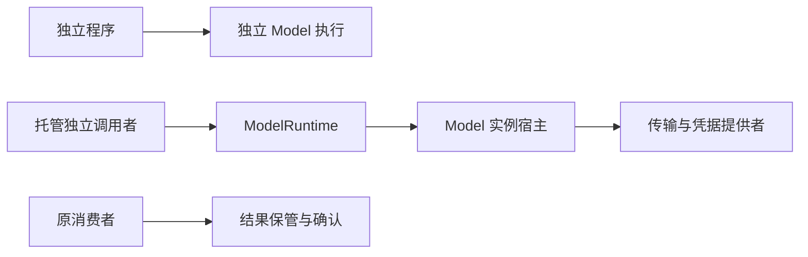
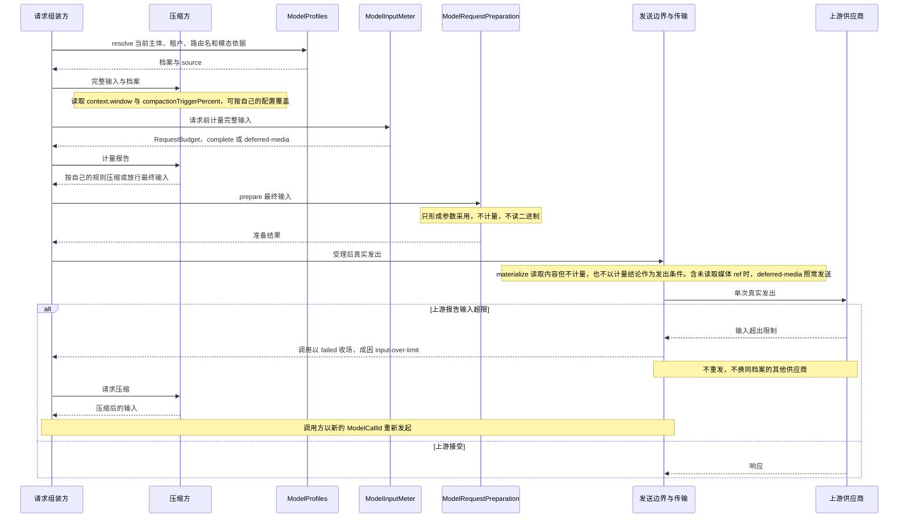

# Model 消费与系统定位

本页描述已接受的非 pi-ai 运行契约。pi-ai 细化的采用范围见[组架构各节](../../docs/architecture.md#成员与新增条件)，图表不表示运行实现或真实提供者验证已完成。

## 系统位置与消费入口

本包面向托管独立调用者和直接使用传输适配器的独立程序，承担模型调用与各次真实发出、原输出及结果保管。以下图示只投影本包消费关系，系统保证仍归[运行架构](../../../../docs/architecture/runtime/README.md)，组内责任归[组入口](../../README.md)。



独立消费与 Harness 接入的设计形状见 [public-api](public-api.md)，当前实际导出与设计分开标明。需要托管状态的路径必须具备相应提供者，纯独立路径不暗建原工作。装配依赖和资源撤除见 [Cordis](../../model-cordis-contract/docs/index.md)。

调用者可直接提供 Model.ToolDeclaration，无须安装 Tool 包。Harness 请求组装者另行从工具定义构造声明，并保存原采用和命令路由。Model 输出共享 ToolCallPart，上层按路由提交 Tool 准入；工具结果经投影成为共享 ToolMessage 后进入下一次请求。Model 不在这条链中调用工具或读取工具注册表。

## 安装与导入选择

model-contract 的根入口已导出全部 160 个类型声明（含引用共享 `ToolCallPart` 的声明）与 22 个运行值，`./testing` 入口导出受控替代提供者与替代传输（给领域外的协调者练习失败路径，不是生产提供者）和提供者符合性断言 `checkModelProviderConformance`（提供者作者用它检查自己的提供者是否守住公开面上可观察的契约义务）；model-cordis-contract 已导出十五个抽象 Service（含凭据）、实例目录与转换目录。model 的凭据判定消费 model-contract 的凭据契约，createModelRuntime 已支持受理、原流保存、最小实例观察与[有限的原终局收场](../../model/SPEC.md#已实现的调用收场)，结果读取及 processed ACK 已实现，retained ACK 与生产宿主尚未实现；本地凭据保管及其插件在 model-host-local。下表描述托管运行接口实现后的消费路径，现有凭据入口见 model 的公开文档。

| 使用任务 | 安装与导入 |
| --- | --- |
| 查询档案、准备请求、调用、观察或消费结果 | 从 model-contract 取得类型及必要纯函数，实际能力由宿主注入 |
| 编写传输、计量、tokenizer 或持久化提供者 | 从同一 model-contract 取得对应端口，不安装默认 Model 实现 |
| 编写 Cordis 消费插件 | 从 model-cordis-contract/cordis 取得唯一键、类和增补，不从运行提供者取定义 |
| 选择可复用运行或独立 executeModel 实现 | 从 model 取得工厂或执行函数，另装选中的 adapter |
| 装配单机 Cordis 宿主 | 从 model-host-local/cordis 取得具体插件 |

普通调用者不导入 createModelRuntime，不接触本地 ModelConfiguration；装配者才选择它们。独立程序选择 executeModel 属于选择实现，不能据“独立调用”宣称不安装该实现依赖。模型契约不要求安装 Tool。完整安装保证须满足[共同闭包前置与验证](../../docs/architecture.md#安装闭包与共同依赖前置)，目前不宣称已实现。

## 原消费场景的前提

本页配合[运行契约](public-api.md)，设计已接受。以下是消费协议、有限状态检查和后继实现的验证输入，不代表生产 runtime 已存在。普通 TypeScript 示例只检查接口能否接合，不代替实际资格、耐久或网络证据。

## 独立执行与托管独立调用

独立程序先准备 FixedModelRequest 和显式 ModelTransport，再消费 executeModel 返回的事实。它不创建原工作，不获得自动重试、保管和 ACK。请求含有托管附件或凭据时，传输适配器继续满足原资源访问规则。

prepare 固定引用计划但不读媒体。实际发送准备时调用 materialize，读取并校验内容 ref，附件地址文本不读取。prepare 或 materialize 拒绝时，流以 not-started/rejected 交回原失败，start 不发生。成功物化后复核当前资格和取消，才调用 MaterializedTransport.start。start 前取消返回 not-started/cancelled；开始之后 signal 只请求停止。收到真实停止确认才得到 ended/interrupted，失联则得到 ended/failed，完成与取消竞争时保留实际 completed。上述独立结果没有伪造的托管控制身份。

托管独立程序先登记自己的 consumer owner、work、position 和 purpose。它用当前主体、明确租户、原 call、受理 operation、固定 request 与容量调用 admit。成功之后即使暂时找不到活体，也只用原 admission 查询事实。commit-unknown 同样只按原身份认回；不得换 call 再发。

受理 operation、读取 operation 和 ACK operation 必须分别固定，各自重试复用。实例 ID 只用于核对活体，不代替 call。主体、租户或结果版本缺失属于边界拒绝，不靠零值或默认原工作补齐。

| 路径 | 观察及责任 |
| --- | --- |
| admit 成功、目录 live | 观察特定实例，原执行者保存内容并收场 |
| admit 成功、目录 no-live-route | 查询原调用；恢复宿主接续持久任务，消费者不创建替代调用 |
| admit commit-unknown | 查询原 operation；无法确认仍保留未知及原身份 |
| inspect not-accepted | 仅在 Storage 已排除原受理后，按原 operation 重新提交相同输入 |
| 原输入改变 | 使用新的明确业务调用；旧 call 配新参数必须 conflict |
| 只取消 observe | 该观察结束；原 Model 继续保存、重试、收场及记账 |

## 先处理后确认

1. 消费者等待整调用 settled。单个 dispatch 失败并不满足这个条件。
2. beginRead 取得首页和实际 read，后续按页读取。每页仍检查当前资格。
3. 消费者完成本用途的处理，可靠保存处理结果及完成事实，形成可验证的 DurableEvidence。
4. 消费者以原结果版本和 processed 证据调用 acknowledge。无需额外永久保留原全文。
5. 若 ACK 回执未知，查询原操作或以相同 ACK 身份和证据重复确认。不能重新领取 Model 全文来猜 ACK 是否生效。
6. Model 续做清理。消费者从自己的完成记录继续。

处理失败且未形成完成记录时，不得伪造证据。Model 继续保管。原工作是否结束与 ACK 是否合格分别判断。

## 先保管后确认

1. 消费者在原 consumer 位置可靠保存所需内容或独立可恢复引用，同时保存原 call、结果版本、用途、待交付责任及保留条件。
2. 保存不得仅指向 Model 即将释放的唯一副本。临时文件名和进程内句柄不满足可恢复条件。
3. retained 证据由其 owner 可核验的记录给出。Model 在当前承接资格下核验后提交 ACK 及清理任务。
4. 消费者崩溃后从自己的原位置继续处理。Model 的 ACK 回执丢失不要求复制第二份结果，也不恢复已获准清理的生产侧读取。

两条路径均允许真实失败或中断结果被依法处理后确认。业务已取消时由当前合格承接者处理原责任，不要求已撤权的旧主体回来同意。

## 竞争与恢复场景

| 初始条件与交错 | 合同要求的结果 | 事实拥有者与后继责任 |
| --- | --- | --- |
| 受理提交成功，schedule 前崩溃 | recover 按显式租户 scanPending，loadRecovery 取原请求/主体引用/容量/操作，再依法 claim | ModelCommands 保有待办；宿主不靠缓存或发起者存活 |
| 资格检查后原工作资格失效，随后欲 start（守卫路径，以资格参加者协议闭合为前提） | 原工作资格失效 R 与发送 S 在同一围栏排序；R 先则拒发，S 先则保留在途和控制 | 消费者工作守卫与授权参加适用守卫；send 边界守住实际发起 |
| 首片语音到达，preserve 前崩溃 | 已持久 receive-window 为 uncertain；不能以没有已保存内容重发 | 当前恢复者排除旧执行者并核实窗口，无法还原则 runtime-lost |
| 策略决定已保存，应答丢失 | 查询原操作和 loadRecovery，沿原决定继续，不再次运行策略 | Model 决定记录与 dispatch 原身份 |
| 首内容已保存后断流 | 真实部分与原因保留，不生成第二份逻辑回复 | Model 原结果和消费者原位置 |
| beginRead 先提交、ACK 后提交 | 已开始的读受保护；新的 beginRead 返回 acknowledged | Model 读登记与清理；实际撤权仍可以结束读 |
| ACK 先提交、beginRead 后到 | 禁止新完整领取，不伪装未找到 | Model 返回确认与清理状态 |
| ACK 成功、清理失败且消费者退出 | ACK 不回滚，任务保留原因并由 Model 恢复续做 | Model 清理拥有者，不依赖消费者重确认 |
| 未知写与 ACK 竞争 | ACK 可成立，但清理保留未核实写的责任，不报告 released | 提供者查询原写并保护所涉内容 |
| 旧实例排除、后继 claim 后收到费用 | recordLateFact 验证原 dispatch、可信来源及事件，补原账 | 独立事实通道，不授旧实例推进权 |
| 原工作资格失效后消费者资格再变化，原响应晚到 | Model 保存实际结果；受到控制的调用不复活，不自动派生新调用 | Model 保管，原消费者裁定业务去向 |
| 旧实例撤除晚于后继发布 | withdraw 仅移除同 registration/instance 的贡献 | 本域目录；原调用事实持续可查 |

这些序列要求提供者验证最末受保护动作的资格。把检查移到工厂构造、缓存 allowed，或仅依赖撤权通知，均不能满足竞争场景。


## 验证边界

类型消费与并发模型的前提及未覆盖见[验证资源](../verification/index.md)。消费示例不表示生产实现、资格或耐久保证已经通过验证。

## 先求值、再组装和准备

以下是普通调用顺序的伪代码。对象字段的精确定义见公开接口设计。resolved 的档案和 source 是固定依据，不是发送许可。

```text
求值 = ModelProfiles.resolve(当前主体, 租户, 选中路由名, 原历史模态依据)
如果求值不可用或目标不可选：向原用途返回明确失败

完整输入 = 组装方.组装(求值.档案, 原历史, 提醒, 工具声明)
如果当前用途存在获准扩展：
  完整输入 = 原发起协调者.执行本位置扩展(完整输入)
  如果需要重组装：交组装方处理，不重触发同次扩展
压缩方读取求值.档案的 context 与 compactionTriggerPercent（可按自己的配置覆盖）
计量报告 = 组装方在请求前用 ModelInputMeter 计量完整输入
如果压缩方按自己的规则，依计量报告判断需要压缩：压缩方按自身压缩策略处理，再判断最终输入
如果压缩后仍装不下：原消费者处理失败，或独立调用方收到输入拒绝
准备 = ModelRequestPreparation.prepare(当前主体, 租户, 求值.档案, 模态依据, 最终输入)

受理 = ModelCalls.admit(固定 call, 固定 operation, 原 consumer, 准备结果, 结果容量)
如果受理未知：只查询原 operation
否则：沿原调用观察、领取结果、可靠处理或保管，再 ACK
```

怎样由百分比得出触发线、比较对象、取整、余量与多供应商取值，都归压缩拥有者；Model 只校验档案数据本身，不规定这些，见 [SPEC](../SPEC.md#上游限制与提供上限)。

prepare 不计量，也不执行模型前扩展。压缩后重新判断不重跑同一次扩展位置。含未读取媒体 ref 的输入，计量结果为 deferred-media；受理成功不表示供应商已经收到请求，发送提供者在物化阶段读取内容但不计量。

上游事后以输入超出限制拒绝时，调用以 failed 终局，成因为 input-over-limit。Model 不重发同一输入，也不换同档案的其他供应商。调用方压缩后，以新的 ModelCallId 重新发起。

下图只表现上文已写的规则，不新增承诺。



发起协调者发起主路径的调用；压缩、扩展内部调用和独立程序使用自己的原消费位置，不为调用模型启动调用方的推进循环。

调用方在这条路径之前保存合法切换。小窗口目标仍可切换，下一请求按压缩方自己的规则需要压缩时由压缩方处理，不撤销已保存选择。缺凭据的合法目标可在列表中显示并选中，prepare 或实际发送会报告当前不可调用原因。

## 消息转换的消费责任

普通输入和模型输出的准入者调用 ModelMessageConversion.prepare，核原来源，将转换结果随原块提交。无登记件允许保留原件；已登记但不可用或输出无效则拒绝接纳。消息已经接纳后，不因新转换器上线重算 transcript。

Tool 内容 ref 沿 deferred 结果保留，准备和历史投影不读二进制。实际发送阶段的转换只影响这次请求。模型回复被消息准入否决时，消费者仍处理原终局及保管。后续是否再试由原消费者按其规则决定，再试使用新的调用身份。

## 诊断消费

诊断使用独立注入的 ModelDiagnostics。调用者显式给主体、租户、原 call、页长和首屏 after=null。继续读取只传原 next 游标，不自行拼接；每页都可能因当前撤权而 denied。invalid 游标由调用者明确重新开启查询，不悄悄合并两个快照。coverage=expired-prefix 表示保留前缀已经清理，不表示此前没有物理尝试。

普通 ModelRuntime 句柄不附带诊断权，也不包含受信 driver。运行提供者和应用装配者沿[宿主协议](../SPEC.md#宿主绑定与驱动协议)管理 binding；观察者取消订阅不关闭 binding。


### 最终结果消费

从 beginRead/readNext 按页序遍历 parts。sealed 使用原 ModelBlock，partial 保管原累计 value；两者都处理 trims 与真实 Settlement。partial 不是可执行工具调用，也不自动具有展示或播放资格。可靠保管须独立于可以清理的 Model 唯一副本。页字节目标不是硬报文上限，完整页可接近原容量 C。类型、预算和消费边界见 [公开指导](public-api.md#最终结果项与页预算)。

实际调用教学见 model 的[四个独立脚本](../../model/examples/README.md)。它们使用真实 runtime、产品 sender 和内存测试端口，不证明生产耐久或厂商发送。
