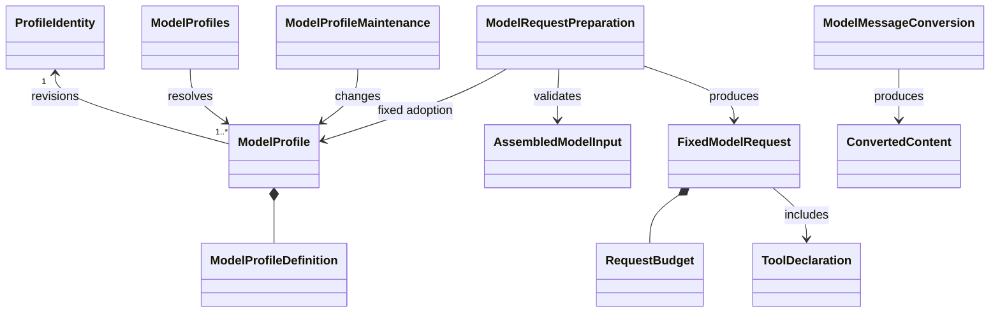
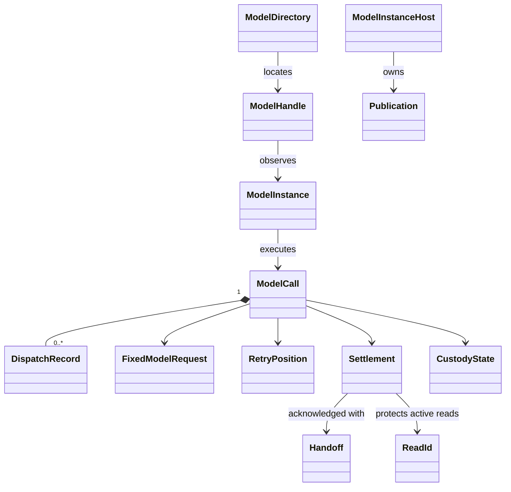

# Model 契约对象模型

本页拥有公开对象、职责及不变量；具体构造、算法和资源组合见[实现对象模型](../../model/docs/object-model.md)。图中的逻辑对象不要求实现为 class，也不新增同名源码导出。类型仍以[唯一设计定义](public-api.md)为准，行为归[SPEC](../SPEC.md)。

## 消费者与职责

| 消费者 | 消费的能力 | Model 内部隐藏的责任 |
| --- | --- | --- |
| 档案管理入口 | ModelProfileMaintenance | 同范围唯一身份、条件修订、撤回恢复和未知提交核实 |
| 选择列表的调用方 | ModelProfiles | 配置筛选、同名求值、模态相容和凭据可用性说明 |
| 组装方 | ModelProfiles、ModelRequestPreparation | 固定档案依据、参数采用及完整请求校验；组装和压缩仍由组装方拥有 |
| 消息准入协调者 | ModelMessageConversion | 本地转换件选择、固定采用、结果校验和两种转换时点 |
| 托管调用的发起者 | ModelCalls、ModelConsumption、ModelDirectory | 原调用执行、控制、结果保管、观察及承接 |
| 不要求托管的独立程序 | model 的 [executeModel](../../model/docs/public-api.md)、ModelTransport | 单次实际发送与规范化输出，不暗建原工作 |
| 恢复宿主 | ModelCommands、ModelInstanceHost | 原身份认回、执行者排除、待办恢复及目录登记 |
| 租户和组织账目入口 | 原账目拥有者的查询能力 | Model 提供每次真实 dispatch 的归属及用量事实，不授正文访问权 |

ModelRuntime 组合调用、消费和目录三个窄接口，消费者可仅持有所需接口。档案维护和转换不加入该门面。ModelCommands 是受信提供者的提交协议，普通调用方不获得它。

## 长期配置与请求值

| 对象 | 身份和不变量 | 寿命及所有者 |
| --- | --- | --- |
| ProfileIdentity | 范围加不可变路由名，同范围撤回行仍占身份 | Model 档案权威，长期保存 |
| ModelProfile | 身份、修订、可用状态与固定定义；定义无秘密 | 修订产生新快照，旧采用继续可辨 |
| ModelProfileDefinition | 有序供应商、回退、模态、参数、限额与算法采用 | 档案内容，由合法维护者管理 |
| ProfileResolution | 一次同名求值结果及来源，选中后才判断相容和凭据 | 查询值，不是调用方保存的选择或永久许可 |
| ModalityRequirement | 模态集合及历史覆盖依据 | 历史拥有者维护投影；Model 核来源和相容性 |
| AssembledModelInput | 完整系统内容、消息、工具声明、参数及表示来源 | 由组装方产生，Model 不补写遗漏的历史 |
| FixedModelRequest | 受理后固定输入、供应商、参数采用、预算与来源 | 原调用保管，重试不改用途或路由 |
| RequestBudget | 完整计量或明确待媒体物化，各维度具有方法与上限，并固定 ModelCountingBasis | 准备记录与每次实际发送记录分别保留 |
| MaterializationReceipt | 本次供应商、完整预算、实际表示和 payloadDigest | ModelCommands 先持久提交到原 dispatch，再进入发送围栏 |
| ToolDeclaration | 名称、已组装说明及参数 schema | Model 的请求值，不是 ToolDefinition |
| ConvertedContent | 原块、其他模态的派生、transcript 和转换采用 | 消息拥有者随原块接纳，接纳后不回填 |

ToolDeclaration 的说明由上层组装。ModelToolPayloadAdapter 只把它转换成供应商格式。ToolSuggestion 复用 common/message.ToolCallPart，ToolMessage 与内容块使用共享消息和共享内容契约。Model 不接触工具注册表、工具执行句柄或 ToolResult。

## 逻辑调用与执行对象

| 对象 | 身份和职责 | 状态及寿命边界 |
| --- | --- | --- |
| ModelCall | ModelCallId，原请求、用途、消费者与终局 | 独立于发起者和观察者存在 |
| DispatchRecord | DispatchId，某一次真实发出及原费用 | 一个调用可有多次，未知费用不合并成零 |
| RetryPosition | 稳定策略位置及原失败关联 | 先保存位置再执行策略，未知按原位置核实 |
| ModelInstance | ModelInstanceId 和 generation，拥有当前执行推进权 | 可替换；后继必须先排除旧执行者 |
| ModelHandle | 指向特定实例的观察能力 | 只订阅，关闭观察不取消工作 |
| Publication | 原执行者与 registration 的登记回执 | 仅条件撤除本贡献，晚到释放不能删后继 |
| Snapshot | 已保存游标与当前块、控制和保管状态 | 可重建投影，不授确认资格 |
| Settlement | ResultVersion、原结局、游标和耐久依据 | 整调用一次终局，迟到费用不翻转结局 |
| ReadId | 一次真实完整结果读取及进度 | ACK 保护已开始读；闲置、撤权或宿主失联可明确结束 |
| Handoff | processed 或 retained 的外部可核验事实 | 当前承接者取得的证据，不是 saved 布尔值 |
| CustodyState | Model 仍保管，或已交接且清理有进度 | ACK 后不回滚，清理责任独立延续 |

实例目录只回答是否有当前活体。不存在活体不代表不存在调用。持久查询回答原调用事实；目录、通知和内存快照不能替代它。执行状态、控制状态、保管状态分别建模，避免用一个 running/done 标志混合外部停止、业务完成和副本释放。

## OOP 与 SOLID 的约束

对象模型用组合表达协作。供应商适配器、计量器和转换器实现接口，不继承一个同时拥有档案、权限、网络与存储的模型基类。纯算法可用函数实现，持久对象和临时资源才有各自状态。

单一责任通过维护、求值、准备、执行、消费和目录的分别拥有实现。供应商新增只替换相应 adapter 和能力声明，不改变调用方或组装方的业务职责。可替换性要求相同错误分类、首内容、取消、预算和释放语义，不仅方法同形。接口隔离使只读列表不依赖维护写入，使结果领取不依赖媒体转换。依赖倒置让 Model 使用窄能力端口，Cordis 和数据库在提供者一侧适配。

新增端口须指向真实可替换行为。一个仅转发另一个方法的层不因“符合 OOP”就保留。不同供应商适配器和可控故障提供者应能经同一消费入口验证；测试不得直接修改调用内部状态来绕过协议。

## 跨领域协作

Session 保存选择及切换事实，Context 选择实际表示并组装/压缩，Agent 保存原调用用途与消费位置。Model 提供能力与校验，拥有实际发出和保管。历史拥有者将准入转换结果和模态投影一起推进，Model 不另建历史库。账目和诊断入口沿自身查询资格，Model 只提交原 dispatch 的真实事实。

共同关系见[四成员对象模型](../../../../docs/architecture/runtime/runtime-contract-model.md#对象与身份)。本页对象的生命周期不从 Cordis 树推导，具体装配见 [Cordis](../../model-cordis-contract/docs/cordis.md)。

## 提供者与独立查询

ModelDriver 与普通 ModelRuntime 分开。driver 只交受信执行宿主绑定；队列只保存租户及原调用身份，ModelHostAuthority 从原耐久事实解析当前推进资格。ModelDriverBinding 拥有该绑定的关闭责任，不拥有调用的控制权。

ModelProfileSource 交同次求值快照；ModelPreparationResources 交完整固定算法与合法绑定引用。前者不取得发送秘密，后者不把租约变成发送许可。ModelContentAuthority 核内容来源及处理方式，converter 只拥有本次转换。

ModelDiagnostics 是独立授权的只读投影。它不继承 ModelRuntime，不公开持久写端口，也不因成本账目资格授予诊断访问。诊断保留、结果保管与账目保存是三个不同责任，具体机制见 [诊断协议](../SPEC.md#诊断查询与保留)。
