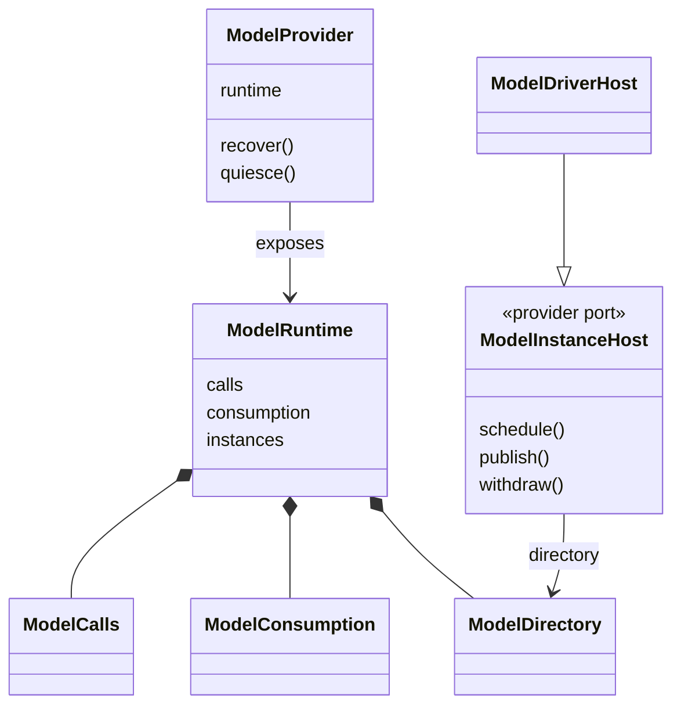
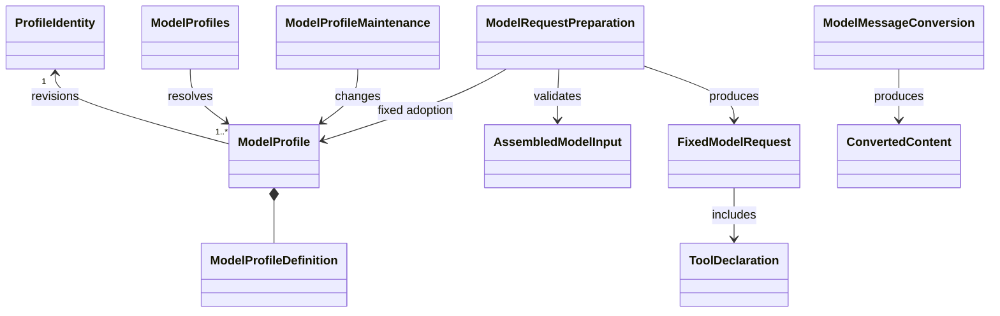
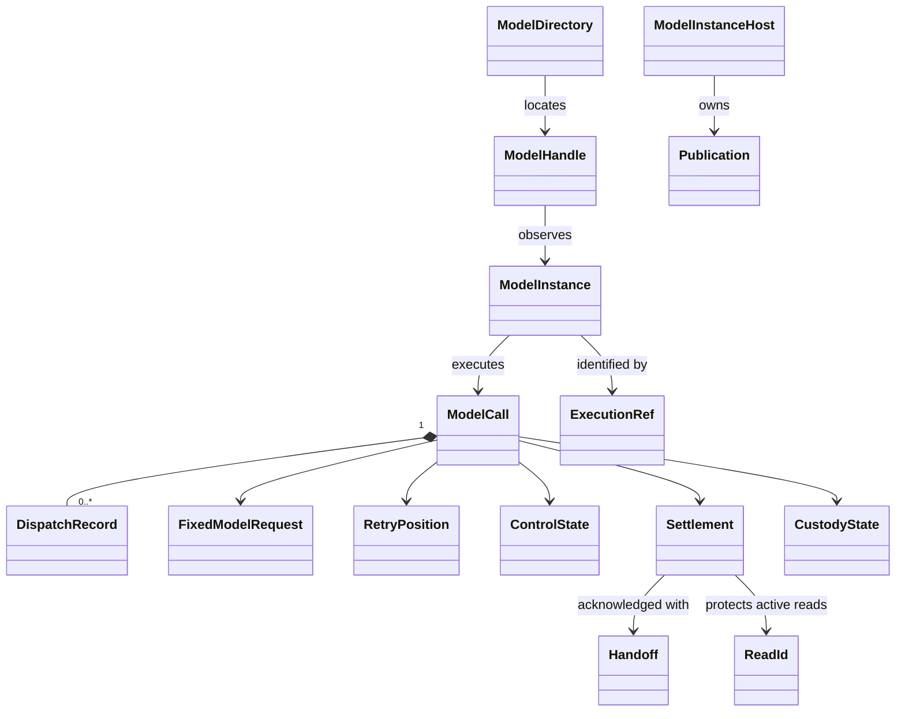
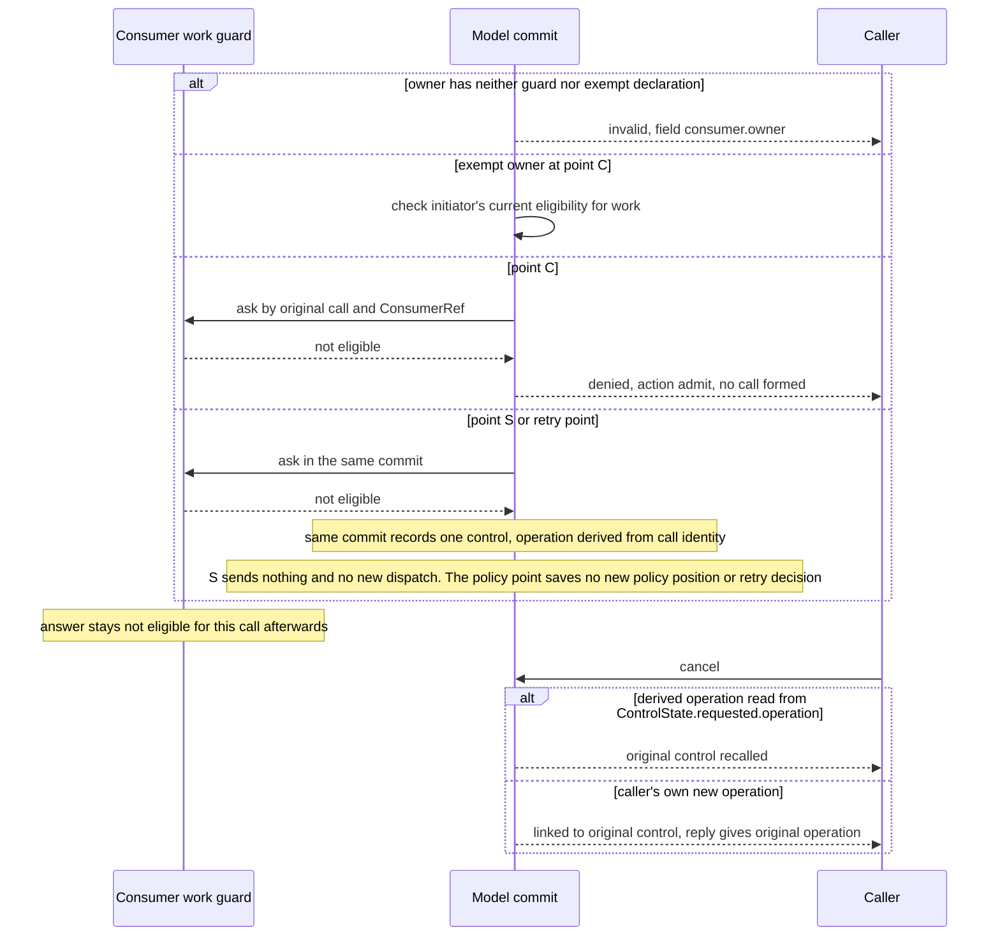

# Model 契约对象模型

## 引言

本页拥有 Model 契约的公开对象、职责与不变量。类型归 [public-api](public-api.md)，行为归 [SPEC](../SPEC.md)，构造、算法与资源组合归[实现对象模型](../../model/docs/object-model.md)。本页不复述 SPEC 的规则。形状全称（可对 public-api 类型核对的，如「没有 cancelled 相位」）可直接写；行为句只带 SPEC 自己的量词，并在同一句链接该条款，或把主语缩到具名对象或字段。本页自己归纳的对应关系标「本页的对象层对应」。

图中的逻辑对象不要求实现为 class，也不新增同名源码导出。设计已接受，不等于生产实现或运行验证已经完成。model-contract 的根入口已导出全部类型声明与运行值；model-cordis-contract 的 `./cordis` 已导出抽象 Service、实例目录与转换目录。

Model 的对象分三组。长期配置与请求值描述档案、固定请求和计量报告。逻辑调用与执行对象描述原调用、各次真实发出、结果与保管。提供者端口描述传输、计量、转换目录、持久提交和实例宿主。Cordis 登记另见 [Cordis 对象关系](../../model-cordis-contract/docs/object-model.md)。

## 调用方怎样使用

下例是职责伪代码，按调用顺序列出各角色。每一步都要处理成功、拒绝与未知。「拒绝」含 unavailable 与 commit-unknown 以外的 ModelFailure，以及成功分支中的否定结果（absent、no-live-route、acknowledged 等）。unavailable 与 commit-unknown 列在「未知」。它不表示当前包已有运行导出。

```text
维护者 提交档案变更 ModelProfileMaintenance.change（自己的 operation、修订条件）
    成功：返回新修订，已耐久保存。相同 operation、同输入重复提交认回原结果
    拒绝：无维护资格。expected 不符，或同 operation 配不同输入，返回 conflict
    未知：commit-unknown。用同一 operation 调 inspect，不换 operation 另建档案

调用方 求值选择列表 ModelProfiles.list / resolve（主体、租户、历史模态依据）
    成功：choices 只含合法路由。当前选择即使不合法也保留。选择的保存归调用方
    拒绝：absent（未知名、已撤回、被配置排除）。resolve 可返回不可选的胜出行，仅供解释
    未知：unavailable。不当作 absent，不放行

组装方 组装完整输入。请求前读取档案的 context.window 与 compactionTriggerPercent，用 ModelInputMeter 计量，按压缩方自己的规则判断是否压缩，再经 ModelRequestPreparation.prepare 取得 FixedModelRequest
    成功：固定请求。prepare 不计量，固定请求不带预算
    拒绝：返回具体失败，不发（参数、模态或档案不满足）。输入大小不在此检查
    未知：来源或资源不可用时返回 unavailable。不当作空历史放行

调用方 受理 ModelCalls.admit（call、operation、固定请求、ConsumerRef、结果容量）
    成功：返回原受理。原调用与容量同提交成立。受理不表示供应商已收到
    拒绝：denied(action='admit')（原工作资格失效，不披露原工作是否存在）
          invalid(field='consumer.owner')（该 owner 既无守卫声明也无免守卫声明）
          conflict（同 call 配不同固定采用）、capacity
    未知：commit-unknown。用 inspect 按原 operation 查询，不换 call 再发
          只有权威未受理证明才得到 not-accepted，此后才可按原 operation 重新提交相同输入

调用方 收到调用以 failed 终局，成因为 input-over-limit
    成功：ModelFault.reported 记上游给出的维度、限额与实际值，未给出的为 null
    拒绝：Model 不重发同一输入，也不回退到同档案的其他供应商
    后续：调用方压缩后，以新的 ModelCallId 重新发起

调用方 观察 ModelDirectory.connect，再 ModelHandle.observe
    成功：live 句柄。先收快照，再收后续变化
    拒绝：no-live-route 不表示没有调用。改用 inspect 查原调用
    未知：unavailable。观察结束不取消原调用

原消费者 读取并确认 ModelConsumption.beginRead / readNext / acknowledge
    成功：started 取得首页，按页读取。处理或保管后，以原结果版本和证据确认
    拒绝：not-settled（未收场）。acknowledged（已确认，不能再领全文）
          提前确认、伪证据或无承接资格，返回具体失败，结果保持原状
    未知：ACK 提交未知时，以相同 ACK operation 与证据重复确认。不重新领取全文

调用方 控制 ModelCalls.cancel（自己生成的 operation，不带原因）
    成功：返回 ControlState。意图与传播状态已保存，不等待物理停机
    拒绝：主体、租户或控制资格不成立
    未知：以同一 operation 重发，认回原控制。取消的原因由调用方自己记录

独立程序 准备 FixedModelRequest 与 ModelTransport，调用 executeModel
    成功：得到事实流，结束为 completed、failed 或 interrupted
    拒绝：not-started（rejected），start 不发生。start 前取消得到 not-started（cancelled）
    未知：独立路径没有这一分支，失联是明确的 ended/failed。不获得托管的保管与 ACK
```

求值到准备的逐步顺序见[消费路径](context.md#先求值再组装和准备)。结果读取、观察和控制的操作规则见 [SPEC 逐操作行为](../SPEC.md#342-逐操作行为)。消费路径的竞争场景见[竞争与恢复场景](context.md#竞争与恢复场景)。

观察者与原调用是两件事。流断开、句柄释放或目录没有路由，都不结束原调用。控制入口不依赖观察者在线。

## 跨域概念与内部可见范围

Model 只建模自己承担的责任。决定档案是否可选、请求是否合法、调用怎样发出与收场、结果怎样保管，需要的外部事实才进入模型。对方的原身份和契约含义保持不变，Model 不复制对方的状态。判定方法是：本域要做成自己的事，是否必须理解这个外部概念。

| 分类 | Model 内的表示 | 原拥有者保留的责任 |
| --- | --- | --- |
| 上游公布语言：身份与授权 | principal 参数、显式 TenantId、资格适配器的判定结果。`Identity` 品牌只防误混，不授权 | 组织与角色关系（组织超级管理员、组织管理员、租户）、授权算法、主体的可信解析。档案维护与账目读取先核这些角色关系（见 [SPEC 身份、修订及撤回](../SPEC.md#身份修订及撤回)；[真实费用和账目边界](../SPEC.md#真实费用和账目边界)） |
| 上游公布语言：共享消息值 | Message、ContentBlock、ContentReference、ToolCallPart（即 ToolSuggestion）、ToolMessage。只引用，不复制，不改义 | 值形状、校验归共享消息与内容契约的拥有者，消息接纳归消息准入者 |
| 上游公布语言：其他共享值 | JsonValue（无损，数字为 lexeme）、Outcome、CallAccount（DispatchRecord.account）、Modality（四种模态的词表）、common/stream-arrival（Model 把传输事实映射为其共享到达步骤，见 [SPEC](../SPEC.md#供应商解释与流状态归约)） | json-text、operation-result、call-account、modality、stream-arrival 的拥有者。账目查询范围归接入与身份拥有者 |
| 上游公布语言：存储提交词汇 | committed、rolled_back、unknown、identity_conflict、rejected_before_accept 的含义，以及 not-committed 的完整排除证明 | 存储拥有提交结论与排除证明。见 [SPEC](../SPEC.md#342-独立执行与提供者操作) |
| 上游公布语言：工具调用词汇 | ToolDeclaration（Model 自己的请求值：名称、已组装说明、参数 schema）、ToolSuggestion、内容来源 `tool-output`、处理 `tool-ref`。这些值命名来源类别，不是调用者身份 | 工具定义、注册表、执行和结果的保留归工具域。Model 不解析 ToolResult 或其附件区，不执行工具建议 |
| 本域定义的值与端口：凭据 | CredentialId、CredentialReference、CredentialQuery、CredentialPresence、CredentialResolution、CredentialPort 的纯契约和持有者比较函数 sameCredentialHolder 由本包定义。CredentialId 由人在凭据保管的配置路径上命名，Model 不铸造。Model 只持引用：Supplier.credential 为 tenant 或 factory，档案供应商没有凭据字段 | 凭据绑定的配置与解绑资格，以及秘密值的解析。秘密只在发送点 S 前最后检查内同步取得 |
| 本域定义的端口：ConsumerRef | 引用 owner、work、position、purpose。原样保存，不解释其业务含义。它不是执行许可 | 消费者拥有者登记并解释它，把它对应到原工作的哪一部分。Model 不导入任何消费者拥有者的实现 |
| 本域定义的端口：消费者工作守卫 | Model 定义的端口，按原调用及其 ConsumerRef 回答当前是否合格。对某一调用一旦不合格，此后恒不合格。受理点 C 读到不合格时拒绝受理；S 或策略点首次读到时记录一次控制，见 [SPEC 资格、共同提交与实际发送](../SPEC.md#342-资格共同提交与实际发送)。守卫路径以资格参加者协议闭合为前提，闭合前受守卫 owner 的装配被拒绝 | 消费者拥有者实现守卫并保证不可逆。兑现由组合验证承担。owner 的装配声明见 [public-api](public-api.md#消费者-owner-的装配声明)。守卫问答事实的形状待资格参加者协议，该协议是前置依赖 |
| 本域定义的端口：资格与证据适配器 | 资格适配器核 principal 的来源、身份和当前访问，包括控制资格。受信证据适配器读取并验证 DurableEvidence 所指的原记录。资格参加者在 Storage Worker 内以已登记的版本化 JSON facts 参加受理提交 | 资格与耐久记录归各自的权威拥有者。摘要只校验内容一致，不能自证已处理或已保管。不能参加同一事务的远端资格源，须由其拥有者提供等价的串行协议，见 [SPEC](../SPEC.md#342-资格共同提交与实际发送) |
| 本域定义的提供者端口 | 传输与读取（ModelTransport、ModelSendBoundary、ModelMediaReader、ModelToolPayloadAdapter）、计量与分词（ModelInputMeter、ModelTextTokenizer、ModelCountingBasis）、转换目录（ModelConverterCatalog、ModelConverter）、档案来源与准备资源（ModelProfileSource、ModelPreparationResources、ModelContentAuthority）、实例宿主（ModelInstanceHost、ModelDriver、ModelHostAuthority、Publication），以及 ModelRetryPolicy、ModelClock、ModelCommands。各端口交接的事实见[提供者与独立查询](#提供者与独立查询) | 供应商连接与协议、内容读取与外传资格、分词与计量依据、范围链与历史覆盖依据，归提供者与各自的拥有者。转换目录与实例目录的登记与撤除归框架契约 model-cordis-contract。旧进程排除与 continuity 证据归独立宿主 |
| 域外的工作与编排 | 不进入类型、字段、条件或持久事实。只有 ConsumerRef，Model 不解释其业务含义 | 外部用自己提交、由 Model 认回的 call 与 operation 身份，在自己一侧关联。ControlState 中的控制 operation，或由提交 cancel 的主体生成（[SPEC 控制](../SPEC.md#控制取消与晚到事实)），或由 Model 为守卫触发的控制按调用身份派生（[SPEC 资格](../SPEC.md#342-资格共同提交与实际发送)），派生函数见 [public-api](public-api.md#消费者-owner-的装配声明)。是否再试、怎样推进、扩展放在哪里，都由它们决定。再试须用新的 ModelCallId |
| 域外概念：归档与取消原因 | 取消输入不带原因。Model 对每次控制执行同一语义，不按原因分支，也不按原工作扇出控制 | 调用方记录为什么取消、由谁发起，并用自己的 operation 关联。扇出的范围与完整性归控制协调者 |
| 域外概念：请求组装与压缩算法 | AssembledModelInput 只是输入值。prepare 不计量，不补历史，不压缩，不执行工具，不重跑模型前扩展 | 组装方和历史拥有者。压缩方在请求前判断大小并压缩；上游事后报告 input-over-limit 时，调用方压缩后以新调用重发 |
| 域外概念：选择的保存与历史模态投影 | ProfileResolution 和 ModelChoices 只是同次求值结果。Model 只接收投影，按胜出档案声明的输入模态（`definition.input`）比对 | 选择的保存归调用方。投影的形成与提供归域外信息源 |
| 域外概念：Cordis 树 | 无。对象的生命周期不从 Cordis 树推导，本包不依赖 Cordis | Cordis 与 model-cordis-contract 拥有框架键、登记与撤除 |

本域内部也分三层。纯算法层包含同名求值、请求规则、计量和分词，它们不读环境，不执行 I/O。效果协调层承担受理、发出、流归约、重试、控制和保管，经 ModelCommands 等端口取得耐久事实。宿主集成层包含实例宿主、目录、驱动绑定和 Cordis 契约包。三层是责任划分，不是必须采用的类结构。Model 不解释 ConsumerRef 的业务含义。它按 `owner` 查装配声明：守卫 owner 把完整引用交守卫，免守卫 owner 核发起者对 `work` 的当前资格（[SPEC 资格](../SPEC.md#342-资格共同提交与实际发送)）。守卫 owner 以资格参加者协议闭合为前提，闭合前装配被拒绝。冲突判定比较其规范化值（[SPEC 参数与注入](../SPEC.md#342-参数与注入的裁定)）。

## 对象与生命周期

### 能力面

ModelRuntime 组合 calls、consumption、instances 三个窄接口，消费者可只持有所需接口。档案维护和转换不加入该门面。ModelCommands 是受信提供者的提交协议，普通调用方不获得它。

| 调用角色 | 消费的能力 | Model 内部隐藏的责任 |
| --- | --- | --- |
| 维护者 | ModelProfileMaintenance | 同范围唯一身份、条件修订、撤回恢复和未知提交核实 |
| 调用方（求值与选择） | ModelProfiles | 配置筛选、同名求值、模态相容和凭据可用性说明 |
| 组装方 | ModelProfiles、ModelRequestPreparation | 固定档案依据、参数采用及完整请求校验。组装和压缩仍由组装方拥有 |
| 消息准入者 | ModelMessageConversion | 本地转换件选择、固定采用、结果校验和两种转换时点 |
| 发起者 | ModelCalls、ModelConsumption、ModelDirectory | 原调用执行、控制、结果保管、观察及承接 |
| 独立程序 | model 的 [executeModel](../../model/docs/public-api.md)、ModelTransport | 单次实际发送与规范化输出，不暗建原工作 |
| 恢复宿主 | ModelCommands、ModelInstanceHost | 原身份认回、执行者排除、待办恢复及目录登记 |
| 租户和组织账目入口 | 原账目拥有者的查询能力 | Model 提供每次真实 dispatch 的归属及用量事实，不授正文访问权 |



### 长期配置与请求值

| 对象 | 身份和不变量 | 寿命及所有者 |
| --- | --- | --- |
| ProfileIdentity | 范围加不可变路由名，同范围撤回行仍占身份 | Model 档案权威，长期保存 |
| ModelProfile | 身份、修订、最近一次成功变更的时刻 updatedAt、可用状态（active 或 withdrawn）与固定定义。定义无秘密 | 修订产生新快照，旧采用继续可辨。updatedAt 由维护的实现方给出，调用方不能传入，同一身份上不倒退；时钟、精度和时区显示不归契约 |
| ModelProfileDefinition | 有序供应商、回退、输入模态 `definition.input` 与输出模态 `definition.output`（分别声明，各为非空集合，成员取自 Model 本阶段支持的文字、图片、语音）、上下文限制 context、其余限额、参数与算法采用 | 档案内容，由合法维护者管理 |
| ContextLimits | 最大上下文窗口、可选的单列输入上限、输出上限，以及触发压缩的窗口默认百分比 | 由档案发布方或维护方配置，压缩方读取，Model 自己不读百分比 |
| ProfileResolution | 一次同名求值结果及来源，同名筛选胜出后才判断相容和凭据 | 查询值，不是调用方保存的选择或永久许可 |
| ModalityRequirement | 模态集合（四种模态的任意非空子集，含本阶段不支持的视频）及历史覆盖依据 | 调用方随运行时上下文提供。Model 核来源和相容性 |
| AssembledModelInput | 完整系统内容、消息、工具声明、参数及表示来源 | 由组装方产生。Model 不补写遗漏的历史 |
| FixedModelRequest | 受理后固定的输入、供应商、参数采用与来源，不含预算 | 原调用保管，重试不改用途或路由 |
| RequestBudget | 完整计量或明确待媒体物化。各维度具有方法与上限，并固定 ModelCountingBasis | 计量能力给请求组装方的报告，不进入固定请求，也不进入物化回执 |
| MaterializationReceipt | 本次供应商、实际表示和 payloadDigest，不含预算 | ModelCommands 先持久提交到原 dispatch，再进入发送围栏 |
| ToolDeclaration | 名称、已组装说明及参数 schema | Model 的请求值，不是 ToolDefinition |
| ConvertedContent | 原块、其他模态的派生、transcript 和转换采用 | 消息准入者随原块接纳，接纳后不回填 |



ToolDeclaration 的说明由组装方形成。ModelToolPayloadAdapter 只把它转换成供应商格式。ToolSuggestion 复用 common/message.ToolCallPart。ToolMessage 与内容块使用共享消息和共享内容契约。Model 不接触工具注册表、工具执行句柄或 ToolResult。

### 逻辑调用与执行对象

| 对象 | 身份和职责 | 状态及寿命边界 |
| --- | --- | --- |
| ModelCall | ModelCallId，原请求、用途、原 ConsumerRef 与终局 | 独立于发起者和观察者存在 |
| CallState | 一次读取得到的调用状态：phase、revision、consumer、control、custody | 读取值。phase 之外的正交状态见[状态与转移](#状态与转移) |
| DispatchRecord | DispatchId，某一次真实发出及原费用 | 一个调用可有多次，未知费用不合并成零 |
| RetryPosition | 稳定策略位置及原失败关联 | 先保存位置再执行策略，未知按原位置核实 |
| ControlState | 控制意图的 operation、传播状态与上游实际停止状态 | 意图与上游真实停止分别记录。Model 因原工作资格失效而记录的控制也用它表示 |
| ModelInstance | ModelInstanceId 和 generation，拥有当前执行推进权 | 可替换。后继必须先排除旧执行者 |
| ExecutionRef | 租户、调用、实例与代次 | 目标与代次，不单独授权。提供者还须核验调用通道的受信实例身份 |
| ModelHandle | 指向特定实例的观察能力 | 只订阅，关闭观察不取消工作 |
| Publication | 原执行者与 registration 的登记回执 | 仅条件撤除本贡献，晚到释放不能删后继 |
| Snapshot | 已保存游标与当前块、控制和保管状态 | 可重建投影，不授确认资格 |
| Settlement | ResultVersion、原结局、游标和耐久依据 | 整调用一次终局，迟到费用不翻转结局 |
| ReadId | 一次真实完整结果读取及进度 | ACK 保护已开始读。闲置、撤权或宿主失联可明确结束 |
| Handoff | processed 或 retained 的外部可核验事实 | 当前承接者取得的证据，不是 saved 布尔值 |
| CustodyState | Model 仍保管，或已交接且清理有进度 | ACK 后不回滚，清理责任独立延续 |
| RecoveryRecord | 原请求、容量、原发起主体的 ActorRef、原受理、策略决定、代次、未知操作与责任种类 | 恢复宿主读取的耐久事实。ActorRef 是可核验的原事实引用，不是秘密或授权 token |



实例目录只回答是否有当前活体（[SPEC 能力边界](../SPEC.md#342-能力边界)）。不存在活体不代表不存在调用。持久查询回答原调用事实。目录、通知和内存快照不能替代它。

执行状态、控制状态、保管状态分别建模。这样不会用一个 running 或 done 标志，混合外部停止、完成、副本释放。

## 无状态性与有状态性

| 类别 | 对象 | 规则 |
| --- | --- | --- |
| 纯值与纯算法 | 请求值、同名求值、ModelRequestRules、ModelInputMeter、ModelTextTokenizer | 不读环境，不取二进制，不批准发出。请求值逐字段冻结并深复制，重复判断用规范化表示。纯函数没有足够身份时，只交事实给调用者，不自建账本 |
| 持久对象 | ProfileIdentity、ModelProfile，以及 ModelCall 的持久事实（CallState 是其读取视图）、RetryPosition、DispatchRecord、Settlement、CustodyState、ReadId、Handoff、RecoveryRecord | ModelCommands 是耐久权威。Snapshot 是可重建投影，不授确认资格 |
| 运行实例 | ModelInstance、驱动绑定、策略协调者、流归约器 | 实例可替换，后继先排除旧执行者。每宿主一个有效绑定，同一调用最多一个 drive。策略协调者的寿命归 Model 宿主或其独立依赖，发起者离开不卸载它。流归约器只是每次 dispatch 的内部状态 |
| 目录 | ModelDirectory、Publication | 只返回特定实例的观察句柄。目录失效不解除原责任。登记状态归 model-cordis-contract，不拥有原调用的持久事实 |
| 租约与临时资源 | ModelMediaLease、PreparedTransport、MaterializedTransport、转换租约、ModelPreparationLease、signal、handle | 创建者释放，不能序列化。同一 prepared 只 materialize 一次，同一 materialized 只 start 一次。release 幂等，释放不撤销已完成的转换、已接纳的消息或已固定的采用。观察 signal 不取消原执行 |
| 时间 | ModelClock | now 与 waitUntil 是时间读取。时钟不可用时，不虚构超时或许可 |

纯算法层只读完整的固定事实，不读当前环境，不执行 I/O。内部失败的尝试属于诊断和费用事实，不直接改变调用方的下一步，见 [SPEC 重试与策略](../SPEC.md#重试与策略)。参数与注入规则见 [SPEC 参数与注入](../SPEC.md#342-参数与注入的裁定)。

## 状态与转移

协议状态图归 [SPEC](../SPEC.md#342-协议状态图与证据边界)，本页不重画。SPEC 明确：控制意图、在途发送、消费确认与费用是正交事实，不压成一个状态。本节只给对象层视图：每个对象持有哪组状态，状态名取自 public-api。

| 状态集 | 持有对象 | 状态名 | 对象层说明与权威条款 |
| --- | --- | --- | --- |
| CallState.phase | ModelCall | accepted、running（带 dispatch 与 firstContent）、retry-decision（带 dispatch）、settled（带 settlement） | 没有 cancelled 相位，控制由 ControlState 表示。本页的对象层对应：协议图中的 Acknowledged、Cleaning、Released 由 CustodyState 的 acknowledged 及其 cleanup 值表示。见 [SPEC 协议状态图](../SPEC.md#342-协议状态图与证据边界) |
| firstContent | ModelCall（running 时）与 DispatchRecord | none-proven、observed、uncertain | 接收窗口打开使 none-proven 变为 uncertain。保存任何实际内容后永久为 observed。崩溃留下的窗口保持 uncertain。见 [SPEC 重试、失联与恢复](../SPEC.md#342-重试失联与恢复) |
| ControlState | ModelCall | none；requested（operation、propagation 为 pending、sent、unavailable，upstream 为 unknown、stopped、completed） | 意图与上游真实停止分别记录。上游已完成不能改报未发出。见 [SPEC 控制](../SPEC.md#控制取消与晚到事实) |
| CustodyState | ModelCall | producer；acknowledged（cleanup 为 pending、running、blocked、released） | ACK 后不回滚。保留责任尚在时报告 blocked 与具体责任。见 [SPEC ACK](../SPEC.md#ack-的前提与效果) |
| DispatchRecord.send | DispatchRecord | prepared、started、unknown、not-sent | 后到的真实结果可补充 unknown，不能把 started 改成 not-sent。见 [SPEC 提供者操作](../SPEC.md#342-独立执行与提供者操作) |
| Termination | Settlement | completed（stop、limit、tool-suggestions）、failed（fault）、interrupted（control） | 整调用一次终局。迟到费用与事实不翻转它。见 [SPEC 调用和各次真实发出](../SPEC.md#调用和各次真实发出) |
| RetryResolution | RetryPosition | pending、decided | pending 不代表失败。见 [SPEC 重试、失联与恢复](../SPEC.md#342-重试失联与恢复) |
| ReadState | ReadId | reading；ended（complete、closed、denied、stalled、owner-lost） | ReadStart 为 started 或 acknowledged。ACK 先提交则新读返回 acknowledged。见 [SPEC 普通调用面](../SPEC.md#342-普通调用面与实例观察) |
| Observation | ModelHandle | snapshot、changed、ended（observer-closed、stale-instance、denied、unavailable） | LiveRoute 为 live 或 no-live-route。观察结束不影响原调用 |
| ModelProfile.availability | ModelProfile | active、withdrawn | 撤回行仍占身份，恢复沿原行。见 [SPEC 身份、修订及撤回](../SPEC.md#身份修订及撤回) |
| ProfileResolution | ProfileResolution | resolved（selectable、reasons、credential、shadowed）、absent（unknown-name、withdrawn、excluded） | 见 [SPEC 同名求值](../SPEC.md#同名求值选择及列表) |
| RequestBudget.kind | RequestBudget | complete、deferred-media | 待物化的媒体不得伪造计量。见 [SPEC 档案与请求准备协议](../SPEC.md#档案与请求准备协议) |
| CommitQuery | 提供者的写操作 | committed、rolled-back、unknown、not-committed | 未知按原操作身份查询。见 [SPEC 提供者操作](../SPEC.md#342-独立执行与提供者操作) |
| 实例代次 | ModelInstance（ExecutionRef.generation） | 无命名状态 | 只有文字规则：claim 提交新代次，重复 claim 认回原 ExecutionRef，被后继替换返回 stale-instance。见 [SPEC 宿主绑定与驱动协议](../SPEC.md#宿主绑定与驱动协议) |
| 宿主绑定 | ModelDriverBinding | 无命名状态 | 每宿主一个有效绑定。未绑定或已关闭时 schedule 返回 unavailable。见 [SPEC 宿主绑定与驱动协议](../SPEC.md#宿主绑定与驱动协议) |

真实 dispatch 的收场与逻辑调用的收场分别记录。控制不抹去后来确定的实际完成。

## 值、参数与依赖

| 分类 | 内容 | 决定时点 |
| --- | --- | --- |
| 档案定义值 | 有序非空供应商、回退声明、含文本的输入模态集合与输出模态集合（成员取自文字、图片、语音）、上下文限制、限额、参数、表示与计量采用、重试策略采用 | 档案维护时校验，规则见 [SPEC 上游限制与提供上限](../SPEC.md#上游限制与提供上限)。修订产生新快照，不改原采用 |
| 参数词表与容量 | temperature、top-p、max-output-tokens、stop 的取值范围。容量三字段为非负整数，bytes 与 blocks 必须为正 | 解析时检查范围，每次受理时校验 |
| 受理时冻结的采用 | 供应商次序、凭据引用、参数采用（含解析后的默认值）、转换采用、源修订、ConsumerRef | 受理时冻结。恢复时不随当前档案、配置或供应商默认值改变 |
| 受理时冻结的消费者 owner 声明 | 该调用适用的 `work` 与 `evidence`，见 [public-api](public-api.md#消费者-owner-的装配声明) | 受理点 C 冻结进受理事实，是提供者自己的耐久事实，不进 `CallState` 或 `RecoveryRecord` 的公开形状。S 点、策略点与 ACK 读冻结值，不读当前装配（[SPEC 参数与注入](../SPEC.md#342-参数与注入的裁定)） |
| 每次操作参数 | principal、tenant、call、operation，以及各操作自己的输入：request、consumer、capacity、result、read、after 等 | 每次调用。受理、读取和 ACK 的 operation 分别固定，各自重试复用 |
| 装配声明 | 每个可受理 owner 的守卫参加者或免守卫声明，以及受信证据适配器。形状见 [public-api](public-api.md#消费者-owner-的装配声明) | 装配时。未声明的 owner 一律拒绝受理。受守卫 owner 以资格参加者协议闭合为前提，闭合前构造失败（[SPEC 资格](../SPEC.md#342-资格共同提交与实际发送)） |
| 构造注入的依赖 | commands、send、retry、instances、clock 五项能力。ModelMediaReader 与 ModelToolPayloadAdapter 由具体发送提供者注入。 | 构造时。缺席沿原失败协议报告：commands 不可用不能认成功，send 缺席不发，retry 不可用则以 policy-unavailable 收场 |
| 提供者端口 | ModelProfileSource、ModelPreparationResources、ModelContentAuthority、ModelInputMeter、ModelTextTokenizer、ModelDiagnostics、ModelConverterCatalog | 装配时注入或提供。ModelConverterCatalog 装配时提供给消息转换，Model runtime 不永久依赖它。取得与释放按各自协议 |
| 配置 | 估算余量（须有显式 margin 与 marginSource）、读取期限、批量保存与背压、诊断保留 | 装配时。缺少诊断保留采用时，该查询面返回 unavailable |
| 临时资源 | 观察 signal、媒体租约、PreparedTransport、MaterializedTransport、句柄 | 操作期。成功、拒绝和异常路径都有释放拥有者 |

下列值尚未确定，本页不补定：重试的退避数值与状态码映射、读取期限的具体值、批量保存的批次配置、媒体读取的容量与并发上限、诊断保留的具体数值。具体字段与默认值归 [model 实现规格](../../model/SPEC.md#工厂与配置)。

受理冲突判定的规范化表示见 [SPEC 参数与注入](../SPEC.md#342-参数与注入的裁定)。

## 结果保管、控制与恢复

下表只给对象层责任和不变量，行为条款归 SPEC。

| 责任 | 权威对象 | 对象层不变量 | 行为条款 |
| --- | --- | --- | --- |
| 终局与结算 | Settlement | 整调用一次终局。终局后只补账和必要事实，不恢复原执行。完整回复没成为消息时，原调用终局不改。再试须用新 ModelCallId | [调用和各次真实发出](../SPEC.md#调用和各次真实发出)、[故障交接](../SPEC.md#故障交接) |
| 交接与 ACK | Handoff、AckReceipt | 真实收场、承接资格与证据在同一裁定中成立。确认后禁止新的完整领取，重复确认返回原确认 | [ACK](../SPEC.md#ack-的前提与效果)、[先处理后确认](context.md#先处理后确认)、[先保管后确认](context.md#先保管后确认) |
| 保管与清理 | CustodyState、ReadId | 确认前的保管归 Model，业务采用与消费位置归调用方，两者不合并成一个已收到状态。清理不反转 ACK | [原结果及消费关系](../SPEC.md#原结果及消费关系)、[清理范围与读写保护](../SPEC.md#清理范围与读写保护) |
| 控制 | ControlState | 取消输入不带原因。调用方的 operation 与 Model 返回的控制事实关联。一次控制只作用于目标调用，不追加真实发出。控制意图与上游真实停止分别记录 | [控制、取消与晚到事实](../SPEC.md#控制取消与晚到事实) |
| 原工作资格失效 | 守卫端口、ControlState | 守卫对某一调用回答不合格即视为原工作资格失效。Model 在受理点 C 拒绝受理，在发送点 S 或策略点记录控制。此后各点读这条记录，不再依赖重读守卫。守卫路径以资格参加者协议闭合为前提 | [资格、共同提交与实际发送](../SPEC.md#342-资格共同提交与实际发送) |
| 重试与策略位置 | RetryPosition | 先保存位置再执行策略。同身份同输入认回原判断。决定持久后才准备下一次真实发出。策略协调者的寿命归 Model 宿主或其独立依赖 | [重试、失联与恢复](../SPEC.md#342-重试失联与恢复)、[重试与策略](../SPEC.md#重试与策略) |
| 换代与恢复 | ModelInstance、ExecutionRef、RecoveryRecord | 发起者离开不影响原执行。可信失联须有独立宿主生成的 continuity 证据。首内容后或无法排除首内容时，以 runtime-lost 收场，不重发 | [换代、恢复和耐久](../SPEC.md#换代恢复和耐久)、[重试、失联与恢复](../SPEC.md#342-重试失联与恢复) |
| 迟到事实 | LateDispatchFact | 只补账目修订和实际终结事实。不改终局、结果版本、ACK 与清理，不授推进权 | [重试、失联与恢复](../SPEC.md#342-重试失联与恢复) |
| 未知与提交查询 | CommitQuery | 未知按原调用身份对账，不换身份再发。读失败不推断运行时失联 | [调用和各次真实发出](../SPEC.md#调用和各次真实发出)、[逐操作行为](../SPEC.md#342-逐操作行为) |

原工作资格失效时，对象之间的责任划分如下。守卫由消费者拥有者实现，Model 只记录自己的反应。图中的守卫分支以资格参加者协议闭合为前提。闭合前只有免守卫 owner 可受理，受守卫 owner 的装配在构造时失败。



调用方经 inspect 或 observe 在 ControlState 中看到 Model 记录的控制。以 `ControlState.requested.operation` 读到的派生 operation 调 cancel，认回原控制（派生函数见 [public-api](public-api.md#消费者-owner-的装配声明)）。以自己新生成的 operation 调 cancel，则关联到原控制，回复给出原控制的 operation，调用方保存两者的对应（见 [SPEC 控制、取消与晚到事实](../SPEC.md#控制取消与晚到事实)、[逐操作行为](../SPEC.md#342-逐操作行为)）。用于 cancel 与 control 以外的方法时，返回 invalid(field='operation')。此后的迟到响应由 Model 保存，调用不复活，也不自动派生新调用。

## 提供者与独立查询

| 提供者 | 交接的事实 | 不拥有 |
| --- | --- | --- |
| ModelProvider | runtime、recover（返回 scheduled）、quiesce（返回 pending 与 running） | 业务采用。quiesce 不取消业务，不宣称卸载完成 |
| ModelCommands | 受信的提交与读写能力：受理、claim、发出记录、保存、结算、控制、读取、交接、清理、查询 | 没有任意 transaction(callback)、任意 load 或 save、外部传入的 allowed 布尔。普通消费者不获得 |
| ModelDriver、ModelHostAuthority、ModelDriverBinding | 受信宿主的推进入口、当前主体与 continuity、关闭责任 | 调用的控制权。队列字符串不能单独重建可信主体，ModelHostAuthority 核原受理关联和当前宿主资格 |
| ModelProfileSource | 同次求值快照：层序、候选、来源 | 发送秘密。来源无法证明当前范围时返回 unavailable，不使用半份目录 |
| ModelPreparationResources | 按固定档案一次取得全部供应商的规则、meter 与合法绑定引用 | 发送许可。部分失败整体释放，不能删掉失败供应商形成更窄档案 |
| ModelContentAuthority | 核内容来源与当前访问，给出 human-only、text、tool-ref 或 convertible | 本次转换。converter 只拥有本次转换 |
| ModelDiagnostics | 独立授权的只读投影，按调用和 dispatch 的耐久事实形成白名单字段 | 不继承 ModelRuntime，不公开持久写端口。成本账目资格或组织管理员身份不授予诊断访问 |

诊断保留、结果保管与账目保存是三个不同责任。诊断期限不控制结果、操作核实和账目记录。精确协议见 [SPEC 诊断查询与保留](../SPEC.md#诊断查询与保留)。普通消费路径见[诊断消费](context.md#诊断消费)。

跨调用及组织范围的成本经原账目拥有者查询；dispatches 只给有权访问的单个调用的发出与费用事实；都不借道结果读取（[SPEC 真实费用和账目边界](../SPEC.md#真实费用和账目边界)、[展示与诊断](../SPEC.md#展示诊断与实施证据)）。

**独立消费与组合（组合说明）。** 独立程序经 executeModel 与 ModelTransport 执行一次真实供应商请求。它不获得托管调用增加的保证，如原身份、受理、政策重试、耐久输出、控制、ACK 和清理。托管调用不论由谁发起，都经 admit 登记 ConsumerRef，并消费同样有效的重试策略（见 [SPEC 重试与策略](../SPEC.md#重试与策略)）。托管调用的发起者自己登记 ConsumerRef，并在自己一侧把它对应到原工作。Model 不创建原工作，也不提供这类映射。需要具体消费者的组合验证义务见 [SPEC 协议状态图与证据边界](../SPEC.md#342-协议状态图与证据边界)。

## SOLID 与扩展边界

| 原则 | 具体选择 | 必须防止的反例 |
| --- | --- | --- |
| 单一职责 | 维护、求值、准备、执行、消费和目录分别拥有实现。诊断是独立的只读投影（[SPEC 诊断](../SPEC.md#诊断查询与保留)） | 一个对象同时拥有档案、权限、网络与存储。诊断资格继承自成本账目资格 |
| 开闭原则 | 新增供应商只替换相应 adapter 与能力声明。扩展参数须有含义、值 Schema、适用范围和 adapter 映射 | 为新供应商改变调用方或组装方的业务职责。接受没有定义的任意供应商键 |
| 里氏替换 | 替代实现保留相同的错误分类、首内容、取消和释放语义，不必采用同一构造形状（[SPEC 参数与注入](../SPEC.md#342-参数与注入的裁定)） | 只验证方法同形，不验证未知、取消和释放。测试直接修改调用内部状态以绕过协议 |
| 接口隔离 | ModelRuntime 只组合 calls、consumption、instances。档案维护、转换、诊断、ModelCommands 和驱动分别授予 | 只读列表依赖维护写入。结果领取依赖媒体转换。普通调用方取得 ModelCommands 或发布实例 |
| 依赖倒置 | Model 定义窄端口，Cordis 和数据库在提供者一侧适配。不导入任何消费者拥有者的实现 | 在端口上暴露任意事务回调或外部 allowed 布尔。纯契约依赖框架或具体存储 |

对象模型用组合表达协作。供应商适配器、计量器和转换器实现接口，不继承同时拥有档案、权限、网络与存储的模型基类。纯算法可用函数实现，持久对象和临时资源才有各自状态。

新增端口须指向真实可替换的行为。仅转发另一个方法的层不因符合 OOP 而保留，例如档案的权威提供者直接实现 ModelProfileMaintenance，不加只转发 change 的工厂层。不同供应商适配器和可控故障提供者，应能经同一消费入口验证。

## 产品能力覆盖与验收

各能力的建模落点、必须验证的反例与剩余证据归[覆盖说明](../verification/README.md#model-产品能力与设计覆盖)，本页不重复。能力到行为条款的映射归 [SPEC](../SPEC.md#能力旅程与持续验证入口)，持续场景归[持续验证场景](../verification/README.md#model-持续验证场景)。消费者工作守卫与 owner 声明的反例同样登记在覆盖说明，不在本页另列。

另须验证：观察者全部退出后原调用仍收场与记账；ACK 与新读、未知写、清理的竞争；资格检查之后、发送之前撤权；替代提供者与实际提供者经同一符合性套件。这些是后继实现的验收义务，文档检查和类型检查不证明运行行为。

可保存引用是调用与操作身份的规范文本。它不拥有调用状态或资格。ModelInvocationRef 在受理前可构造，Admission.reference 认回同一身份。ModelOperationRef 仍须与原 result/evidence 共同保存。格式及失败归 [SPEC](../SPEC.md#可保存调用引用)。
