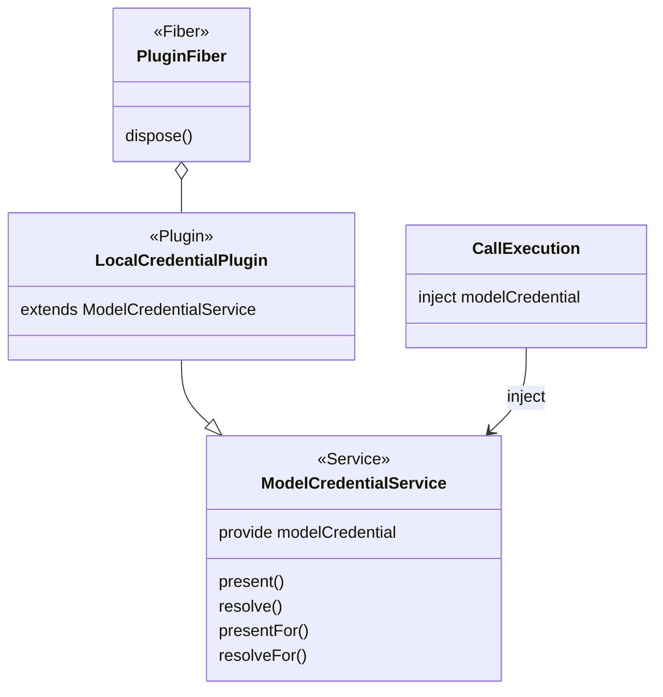

# Cordis 集成

本文件说明本包的 Cordis 集成。绑定只从 [cordis.ts](../src/cordis.ts) 导出。共同集成规则见仓库的 IC 约定，本包采用 Cordis 4.0.4。

## 集成入口

`./cordis` 导出 `LocalCredentialPlugin`、`deliverInjected`、`ModelInstancesLocalPlugin`、`ModelConvertersLocalPlugin`、`createModelRuntimeLocalPlugin`、`createConfiguredModelRuntimeLocalPlugin`、`createModelStreamLocalPlugin`、`createMemoryResultPushLedger`、`createModelRequestPreparationPlugin`、`createModelSendStagePlugin` 与 `ModelProfilesLocalPlugin`。`deliverInjected` 在 [deliver-injected.ts](../src/deliver-injected.ts)，不导入保管库；插件在 [src/plugins/](..)。`ModelProfilesLocalPlugin` 在 [plugins/profiles.ts](../src/plugins/profiles.ts)，是本包唯一导入家族包的文件。

| 插件                                                            | 静态 inject                                                       | 提供与寿命                                                                                                                                                                                   |
| --------------------------------------------------------------- | ----------------------------------------------------------------- | -------------------------------------------------------------------------------------------------------------------------------------------------------------------------------------------- |
| `ModelInstancesLocalPlugin`                                     | `modelPublicationAuthority`                                       | 构造唯一 `ModelInstancesService`；权威换代时随 fiber 卸载与重装，后继目录从空开始                                                                                                            |
| `ModelConvertersLocalPlugin`                                    | `modelConverterAuthority`                                         | 构造唯一 `ModelConvertersService`；独立于运行时与结果查询                                                                                                                                    |
| `createModelRuntimeLocalPlugin` 造出的类                        | `modelCommands`、`modelClock`、`modelHostAuthority`；配置四项上限 | `await bind` 成功后，在同一个子插件里发布 `modelInstanceHost`，提供者带 `runtime` 时也发布 `modelRuntime`。`modelRuntime` 持有结果接收登记表，推送按冻结的 `consumer.owner` 从表里解析接收方 |
| `createModelRequestPreparationPlugin` 造出的类                  | `modelCommands`；配置 `maxCitedCalls`                             | 在同一 fiber 发布 `modelRequestPreparation` 与 `modelPreparationResources`；后者的租约与 `prepare` 出自同一份准备资源，随 fiber 撤除后拒绝新租约                                             |
| `ModelSendStagePlugin`（`createModelSendStagePlugin` 造出的类） | `modelCredential`、`modelCommands`；配置 `maxRetainedAttempts`    | 发布 `modelSendBoundary`；发送路径随 fiber 建立与关闭，凭据端口先于关闭撤回                                                                                                                  |

三个造类的工厂交出对象选项，因为运行提供者、观察资格、推送账本、家族绑定、凭据补全、协调器与网络配置不是可序列化配置。宿主状态全在闭包里：消费者看到的实例只有 `schedule`、`publish`、`withdraw` 与 `directory`，`bind` 留在插件里。

## 首次通道与同源观察

入口从 records 的 `sendStage` 第二参数取得 initial 和 observation 配对。只开一个 channel，并让 host 与 send-stage 的 `executionChannel` getter 返回它。宿主还须提供 `releaseExecution`，发送阶段可通过 `installMaterialization` 安装真实 reader。`materialization.maxRecords` 与当前 execution 核验为必需对象选项，上限须覆盖 `maxRetainedAttempts`。完整行为归 [SPEC](../SPEC.md#首次执行与公共观察接线)。

宿主的 observation.commands 保留真实 records Service 原体。装载时与 `Reflect.get(ctx.modelCommands, symbols.original)` 比较，同形对象与另一服务均不相等。不要比较 Cordis 每次产生的代理。配对通过后宿主取得 source 租约，以同一 contribution 发布 runtime 与两个观察服务。`createModelStreamLocalPlugin({ source })` 只转发该租约，抽象服务与键仍从 model-cordis-contract 取得。configured host 工厂原样转发这些对象选项，不把它们放进 JSON 配置。

没有 getter 的旧装配继续采用原路径。采用首次机制时，缺真实 channel 或同源 pair 不能借公共命令或空观察替代。应用拥有真实主体映射、发行接线与跨行相等约束，成员支持本身不证明这些组合成立。

## 有序关闭

宿主插件在 `Service.init` 里先建运行阶段与未绑定宿主，把运行阶段的命令端口交给提供者，`await host.bind(provider.driver)` 成功后在同一个 `try` 里创建发布子插件。子插件创建失败（例如 fiber 在启动窗口里被卸载）时，已绑定的宿主关闭。一个外层 effect 的列表按逆序等待本宿主的关闭流程与贡献撤除。关闭开始同步退役观察，再 quiesce、停派发并等待 drive、停推送。配置 channel 时随后 await 入口 `releaseExecution`，最后撤贡献。

入口回调须 dispose 自己捕获的真实 send 子 fiber，等资源关闭后再 channel.close，期间保留 commands 父 fiber。HOST 在 finally 再幂等关闭 channel。回调失败只报告安全诊断，不宣称资源成功释放。这个跨 fiber 次序归入口组合者，不能由一个宿主 fiber 或多个并发 effect 推导。正文释放不关闭 channel；异常失效时立即撤权仍归入口绑定拥有者。

未派发的唤醒在关闭时留给后继，计数写进诊断。取不到 drive 输入的调用不驱动，原待办留在 `ModelCommands`。停推送时在途推送收到中止信号；未完成的推送、ACK、清理与晚到账目留在装配给出的推送账本里，拿同一账本的后继插件继续。账本同一时刻只有一个写者。装配给出 `results.recovery` 时，推送启动后扫描耐久的 `ModelCommands`，拿空账本的新进程也接续已收场、未结清的调用（[SPEC](../SPEC.md#运行门面与结果推送)）。

## 发送阶段的装载与退出

发送阶段插件静态注入 `modelCredential` 与 `modelCommands`。两者缺一个，fiber 停在等待，不建发送路径，也不发布 `modelSendBoundary`。凭据服务或命令服务撤除时，Cordis 连同插件一起卸载。

构造时，插件用 `assembleLocalModel` 建发送路径。凭据经插件自己的端口交给发送边界。端口转发 `present`、`resolve` 及服务已有的可选 `presentFor`、`resolveFor`，不缓存值。缺少的新方法保持缺席，不回退旧方法。撤除先切断端口，捕获的新方法随后返回 `unavailable`，再等待发送路径关闭。服务实例只有 `send`，发送路径在构造函数的闭包里。

退出由挂在 fiber 上的一个 effect 完成，次序是：撤回凭据端口与已安装的物化 reader，再关闭发送路径。撤 reader 失败仍继续关闭。关闭等待网络上在途的交换停止，不抛出，失败时只记一条不含原因的警告。退出时在两步之间的发送因凭据不可用以 `not-started` 收场，传输没有被启动。仍持旧引用的调用方对没有开始过的 dispatch 得到 `not-started`，诊断为 `send-resources-closed`。已经发出的请求不由卸载收回。

| 东西     | 在本包里是什么                                                                                                        | 不是什么                                               |
| -------- | --------------------------------------------------------------------------------------------------------------------- | ------------------------------------------------------ |
| 服务     | 抽象 `Service`，键 `modelCredential`，由 [model-cordis-contract](../../model-cordis-contract/docs/cordis.md) 唯一拥有 | 本包不导出，也不另写键                                 |
| 插件     | `LocalCredentialPlugin`，继承该服务，自己实现 `present` 和 `resolve`；保管库只在构造时创建的闭包里                    | 不是域外工作与编排的子插件，也不进它的作用域           |
| fiber    | 装载该插件的那条 fiber，关闭挂在它的撤除上                                                                            | 不是域外工作的生命周期，不是模型执行器，也不是一次发送 |
| 档案插件 | `ModelProfilesLocalPlugin`，继承 model-cordis-contract 的 `ModelProfilesService`，键 `modelProfiles`，无静态 `inject` | 不读 settings，不读 `modelCredential`，不是档案维护者  |

同一个 isolate 里这道接缝只有一个提供者。`deliverInjected` 用 model-cordis-contract 导出的键 `modelCredentialKey` 写入 `inject`，再调用 model 的 `deliver`。租户、用途和是否获准发送都是 `resolve` 的参数，不从 `ctx`、插件实例或谁装了这个插件来推断。服务不转发诊断，诊断留在保管库句柄上。

## 生命周期与清理

插件配置是保管库路径、工厂秘密，以及可选的锁等待策略与诊断容量，都是可序列化数据。`path` 必须是非空字符串。`factorySecret` 可以省略，给出时必须是字符串（空字符串合法）。省略时插件不新建保管库，路径上没有文件就答 `unavailable`。`lock.waitMs`、`lock.backoffMs` 与 `diagnosticsCapacity` 是数字；配置不合格时插件加载失败。不新增 Cordis 事件。

路径上没有文件时，插件用配置里的工厂秘密新建保管库；已有文件时打开并使用文件里的工厂秘密。文件损坏时插件仍然注册 `modelCredential`，四个凭据方法均返回 `unavailable`，不改文件，撤除时没有可关闭的保管库。

`LocalCredentialPlugin` 也实现 `presentFor` 与 `resolveFor`，仍通过闭包转发，不公开保管库。资格路径只核同步租户绑定与 `official` 工厂选择。受信发送边界负责在受理点 C 核验 `access`，提供者不核主体与档案事实的来源。新方法不读取 `SendFace`，旧方法保持原行为，见 [兼容期资格凭据路径](../SPEC.md#兼容期资格凭据路径)。

`createLocalCredentialPlugin()` 建一个受管插件类，并把它的绑定管理交给装配。插件类提供的 `modelCredential` 与 `LocalCredentialPlugin` 相同，服务上没有管理成员。`custody` 跟随当前存活的那一次装载：撤除时先放开 `custody`，再关闭保管库，所以撤除之后的写操作答 `not-written`，不会落到已关闭的保管库上。后装载的插件先装上时，前一次装载的撤除不放开后者。规则见 [SPEC 绑定管理](../SPEC.md#绑定管理)。

fiber 撤除把本进程标成关闭，随后的四个凭据方法返回 `denied`，服务随插件撤除而不可用。没有另做在途等待；关闭不删除绑定，不改写文件，也不改写已经交给发送端的值。保管库文件上的外部副作用不因撤除而撤回。

保管库不放在实例属性上：Cordis 把实例的代理交给消费者，`#private` 字段经代理失败，实例属性也可被任何能读 `ctx.modelCredential` 的插件取得。注入到的对象不是 `ModelCredentialService` 时，`deliverInjected` 的结果是 `{ sent: false }`。

`modelCredential` 是可选成员，缺席与更替的结果见 [SPEC 注入发送](../SPEC.md#注入发送)。

## 档案插件的配置与寿命

`ModelProfilesLocalPlugin` 的配置经 Standard Schema 在入口一次解析，只含可序列化值：`retryPolicy`（Adoption）、`compactionTriggerPercent`（字符串，1 至 100）、`updatedAt`（RFC 3339 UTC 文本）。没有默认值，非法配置使插件加载失败。`list` 与 `resolve` 是构造时创建的闭包成员，不放 `#private`，原因同保管库：Cordis 把实例的代理交给消费者。

插件没有资源要等待关闭，也不登记需要等待的 effect。它在则 `ctx.modelProfiles` 在，撤除则消失；仍被持有的旧句柄返回 `unavailable`（`plugin-removed`）。换代不改在途采用：在途请求已固定档案 `adoption`。规则与具名偏离见 [SPEC 官方档案读取](../SPEC.md#官方档案读取)。
