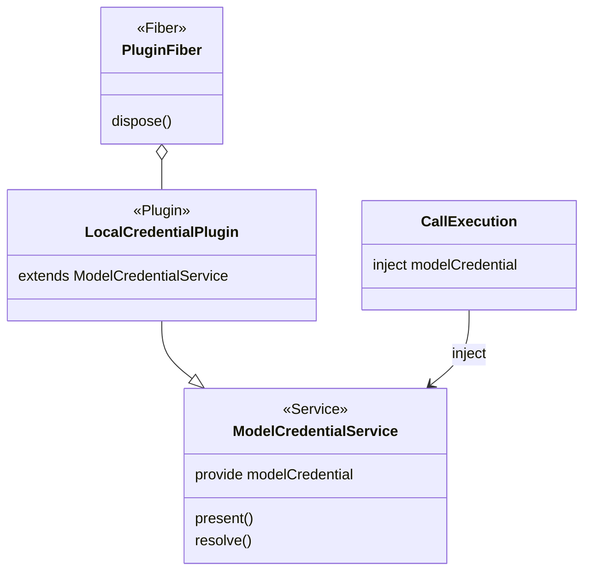

# Cordis 集成

本文件说明本包的 Cordis 集成。绑定只从 [cordis.ts](../src/cordis.ts) 导出。共同集成规则见仓库的 IC 约定，本包采用 Cordis 4.0.4。

## 集成入口

`./cordis` 导出 `LocalCredentialPlugin` 与 `deliverInjected`。后者在 [deliver-injected.ts](../src/deliver-injected.ts)，不导入保管库。

| 东西 | 在本包里是什么 | 不是什么 |
| --- | --- | --- |
| 服务 | 抽象 `Service`，键 `modelCredential`，由 [model-cordis-contract](../../model-cordis-contract/docs/cordis.md) 唯一拥有 | 本包不导出，也不另写键 |
| 插件 | `LocalCredentialPlugin`，继承该服务，自己实现 `present` 和 `resolve`；保管库只在构造时创建的闭包里 | 不是 Agent 的子插件，也不进会话作用域 |
| fiber | 装载该插件的那条 fiber，关闭挂在它的撤除上 | 不是 Session，不是模型执行器，也不是一次发送 |

同一个 isolate 里这道接缝只有一个提供者。`deliverInjected` 用 model-cordis-contract 导出的键 `modelCredentialKey` 写入 `inject`，再调用 model 的 `deliver`。租户、用途和是否获准发送都是 `resolve` 的参数，不从 `ctx`、插件实例或谁装了这个插件来推断。服务不转发诊断，诊断留在保管库句柄上。

## 生命周期与清理

插件配置是保管库路径和工厂秘密，两者都是可序列化数据。`path` 必须是非空字符串，`factorySecret` 必须是字符串（空字符串合法），配置不合格时插件加载失败。不新增 Cordis 事件。

路径上没有文件时，插件用配置里的工厂秘密新建保管库；已有文件时打开并使用文件里的工厂秘密。文件损坏时插件仍然注册 `modelCredential`，`present` 与 `resolve` 返回 `unavailable`，不改文件，撤除时没有可关闭的保管库。

fiber 撤除把本进程标成关闭，随后的 `present` 与 `resolve` 返回 `denied`，服务随插件撤除而不可用。没有另做在途等待；关闭不删除绑定，不改写文件，也不改写已经交给发送端的值。保管库文件上的外部副作用不因撤除而撤回。

保管库不放在实例属性上：Cordis 把实例的代理交给消费者，`#private` 字段经代理失败，实例属性也可被任何能读 `ctx.modelCredential` 的插件取得。注入到的对象不是 `ModelCredentialService` 时，`deliverInjected` 的结果是 `{ sent: false }`。

`modelCredential` 是可选成员，缺席与更替的结果见 [SPEC 注入发送](../SPEC.md#注入发送)。
