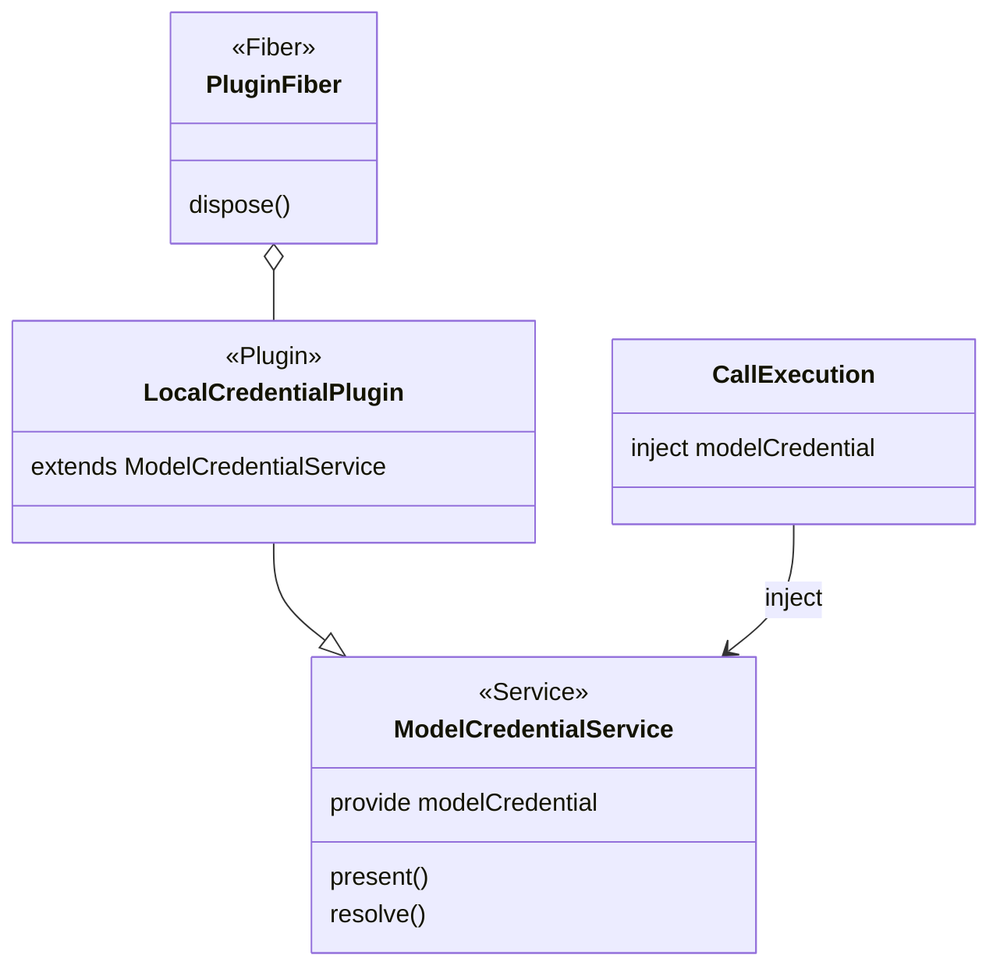

# Cordis 集成

本文件说明本包的 Cordis 集成。绑定只从 [cordis.ts](../src/cordis.ts) 导出。共同集成规则见仓库的 IC 约定，本包采用 Cordis 4.0.4。

## 集成入口

`./cordis` 导出 `LocalCredentialPlugin`、`deliverInjected`、`ModelInstancesLocalPlugin`、`ModelConvertersLocalPlugin`、`createModelRuntimeLocalPlugin`、`createMemoryResultPushLedger` 与 `createModelRequestPreparationPlugin`。`deliverInjected` 在 [deliver-injected.ts](../src/deliver-injected.ts)，不导入保管库；插件在 [src/plugins/](..)。

| 插件                                           | 静态 inject                                                       | 提供与寿命                                                                                                                                                                                   |
| ---------------------------------------------- | ----------------------------------------------------------------- | -------------------------------------------------------------------------------------------------------------------------------------------------------------------------------------------- |
| `ModelInstancesLocalPlugin`                    | `modelPublicationAuthority`                                       | 构造唯一 `ModelInstancesService`；权威换代时随 fiber 卸载与重装，后继目录从空开始                                                                                                            |
| `ModelConvertersLocalPlugin`                   | `modelConverterAuthority`                                         | 构造唯一 `ModelConvertersService`；独立于运行时与结果查询                                                                                                                                    |
| `createModelRuntimeLocalPlugin` 造出的类       | `modelCommands`、`modelClock`、`modelHostAuthority`；配置四项上限 | `await bind` 成功后，在同一个子插件里发布 `modelInstanceHost`，提供者带 `runtime` 时也发布 `modelRuntime`。`modelRuntime` 持有结果接收登记表，推送按冻结的 `consumer.owner` 从表里解析接收方 |
| `createModelRequestPreparationPlugin` 造出的类 | `modelCommands`；配置 `maxCitedCalls`                             | 发布 `modelRequestPreparation`；同一份准备资源交给装配作计量租约来源                                                                                                                         |

两个造类的工厂交出对象选项，因为运行提供者、观察资格、推送账本、家族绑定与凭据补全不是可序列化配置。宿主状态全在闭包里：消费者看到的实例只有 `schedule`、`publish`、`withdraw` 与 `directory`，`bind` 留在插件里。

## 有序关闭

宿主插件在 `Service.init` 里先建运行阶段与未绑定宿主，把运行阶段的命令端口交给提供者，`await host.bind(provider.driver)` 成功后在同一个 `try` 里创建发布子插件。子插件创建失败（例如 fiber 在启动窗口里被卸载）时，已绑定的宿主关闭。子插件的撤除、推送的停止与有序关闭放在同一个外层 effect 的列表里：Cordis 对一个 effect 的撤除按逆序逐个等待，所以 quiesce → 停派发并等待每个 drive 交还 → 停推送 → 撤贡献按这个次序发生。分成两个顶层 effect 会被并发撤除，次序就没有保证。shutdown 不抛出：它之后那一项若因异常被跳过，贡献就撤不掉。

未派发的唤醒在关闭时留给后继，计数写进诊断。取不到 drive 输入的调用不驱动，原待办留在 `ModelCommands`。停推送时在途推送收到中止信号；未完成的推送、ACK、清理与晚到账目留在装配给出的推送账本里，拿同一账本的后继插件继续。账本同一时刻只有一个写者。

| 东西  | 在本包里是什么                                                                                                        | 不是什么                                               |
| ----- | --------------------------------------------------------------------------------------------------------------------- | ------------------------------------------------------ |
| 服务  | 抽象 `Service`，键 `modelCredential`，由 [model-cordis-contract](../../model-cordis-contract/docs/cordis.md) 唯一拥有 | 本包不导出，也不另写键                                 |
| 插件  | `LocalCredentialPlugin`，继承该服务，自己实现 `present` 和 `resolve`；保管库只在构造时创建的闭包里                    | 不是域外工作与编排的子插件，也不进它的作用域           |
| fiber | 装载该插件的那条 fiber，关闭挂在它的撤除上                                                                            | 不是域外工作的生命周期，不是模型执行器，也不是一次发送 |

同一个 isolate 里这道接缝只有一个提供者。`deliverInjected` 用 model-cordis-contract 导出的键 `modelCredentialKey` 写入 `inject`，再调用 model 的 `deliver`。租户、用途和是否获准发送都是 `resolve` 的参数，不从 `ctx`、插件实例或谁装了这个插件来推断。服务不转发诊断，诊断留在保管库句柄上。

## 生命周期与清理

插件配置是保管库路径、工厂秘密，以及可选的锁等待策略与诊断容量，都是可序列化数据。`path` 必须是非空字符串，`factorySecret` 必须是字符串（空字符串合法），`lock.waitMs`、`lock.backoffMs` 与 `diagnosticsCapacity` 是数字；配置不合格时插件加载失败。不新增 Cordis 事件。

路径上没有文件时，插件用配置里的工厂秘密新建保管库；已有文件时打开并使用文件里的工厂秘密。文件损坏时插件仍然注册 `modelCredential`，`present` 与 `resolve` 返回 `unavailable`，不改文件，撤除时没有可关闭的保管库。

fiber 撤除把本进程标成关闭，随后的 `present` 与 `resolve` 返回 `denied`，服务随插件撤除而不可用。没有另做在途等待；关闭不删除绑定，不改写文件，也不改写已经交给发送端的值。保管库文件上的外部副作用不因撤除而撤回。

保管库不放在实例属性上：Cordis 把实例的代理交给消费者，`#private` 字段经代理失败，实例属性也可被任何能读 `ctx.modelCredential` 的插件取得。注入到的对象不是 `ModelCredentialService` 时，`deliverInjected` 的结果是 `{ sent: false }`。

`modelCredential` 是可选成员，缺席与更替的结果见 [SPEC 注入发送](../SPEC.md#注入发送)。
