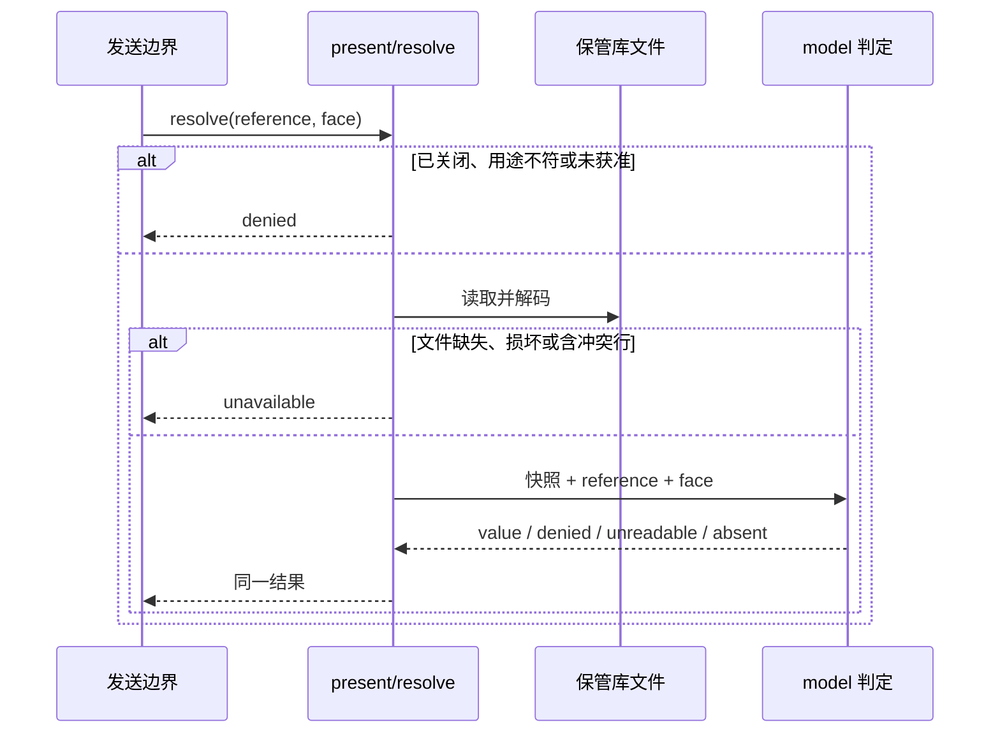

# 关键流程

本文件描述保管库解析与插件撤除两条流程。前提：调用者在受信的发送边界内同步调用 `resolve`，租户值与发送资格由调用者报告。

## 流程

### 解析一次发送

`present` 同理，但没有发送资格，只在已关闭或用途不符时直接拒绝。

### 管理操作

`put`、`rotate`、`revoke`、`markUnreadable` 取文件锁，读盘刷新，在快照上修改，原子发布，然后更新内存快照并释放锁。取不到锁超过 30 秒、刷新失败或发布前失败都抛出异常，不改变已发布状态。`put` 在取锁之前先拒绝未经铸造的租户，同样抛出异常，不写盘。

## 失败与生命周期

- 文件损坏：读取返回 `unavailable`，管理操作抛出异常，文件不被改写。
- 重命名后确认失败：抛出 `confirmation incomplete`，新状态可能已发布。
- 插件撤除：关闭保管库，本进程后续解析返回 `denied`。没有等待在途解析，文件与已交出的值不变。
- 持锁进程崩溃：锁文件残留，其他写者等待到超时，由人工清理。
