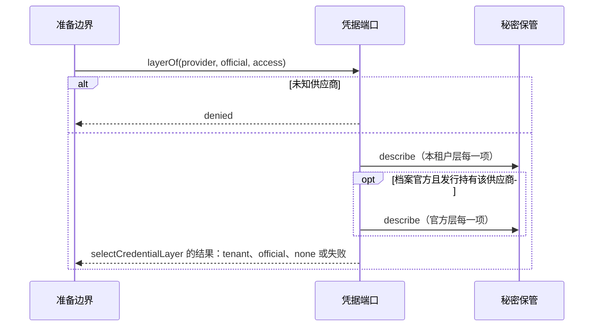
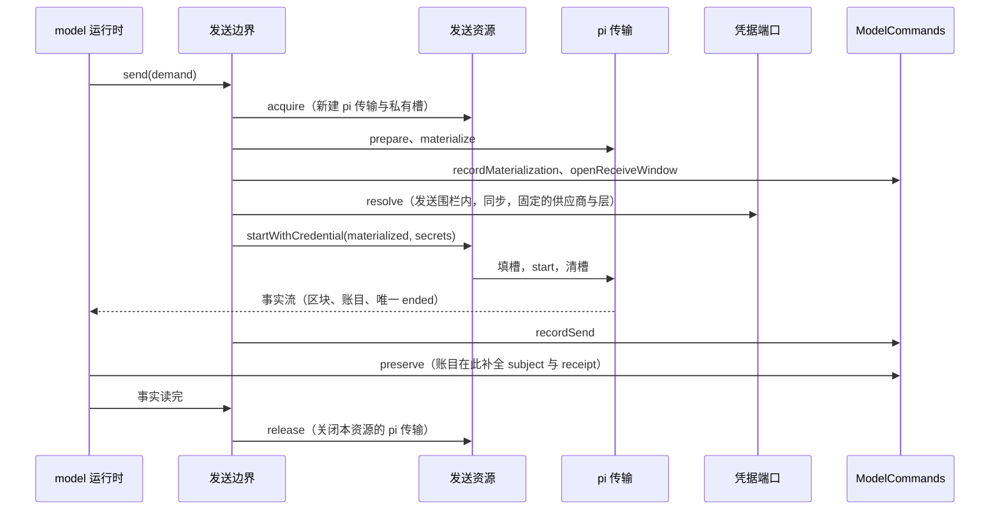

# 关键流程

本文件描述选层、取秘密与本地发送三条流程。受信的准备与发送边界调用凭据端口，租户只取 `access.tenant`。受理点 C 已核验 `access`，`official` 取自档案事实。端口不核这两项的来源。

## 流程

### 选层

本租户层有任何一项时就选本租户层，层内缺项是 `incomplete`，不回退官方层。供应商没有凭据项时选 `none`。

### 取一层的秘密

`resolve(provider, layer, purpose, access)` 只读这一层：用途不是 `model-send` 或供应商未知时答 `denied`；层是 `official` 而发行不持有该供应商时答 `denied`；否则按 `readCredentialLayer` 判读每一项的状态，全部可用时逐项经使用面取秘密，返回项到秘密的映射。层是 `none` 时，只有供应商没有凭据项才成功，映射为空。

### 本地发送一次

端口只把秘密交给发送边界；秘密进入私有槽，传输按路由的 `auth` 取所需的项，槽在 `startWithCredential` 返回前清空，秘密不进入事实、发出记录或失败。

## 失败与生命周期

- 秘密保管答 `unavailable` 或 `denied`：端口原样返回，不改写秘密。
- 读面与使用面之间绑定变了：`resolve` 答 `unavailable`。
- 服务撤除：Cordis 撤回 `modelCredential`，发送阶段插件的端口随后答 `unavailable`。秘密与已交出的值不变。
- 异物或释放后的物化传输：`startWithCredential` 抛出 `SendResourceDefect`，不填槽也不发送；发送边界把这次开始记为未知。
- 装配关闭：先释放仍打开的发送资源，再关闭网络资源并等待在途交换停止。一个失败不跳过另一个，两者都失败时抛出 `AggregateError`。已经发出的请求与上游费用不可撤回。关闭开始后，计量准备资源拒绝新的租约，返回 `unavailable`（`model-host-local`，`assembly-closed`）。关闭前取得的租约不受影响，仍可计量，由取得它的调用方释放。
