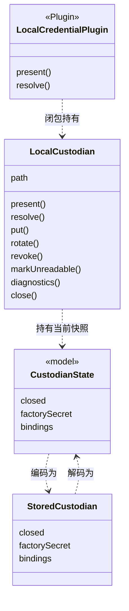

# 对象模型

本包内部有两组对象。保管侧是保管库句柄、保管状态快照和磁盘记录。发送侧是发送资源集合、每次 `acquire` 的发送资源和本地装配。判定、服务定义、发送边界与传输不在本包。

## 对象与关系

- 保管库句柄：同步操作的对象，身份是 `path`。它持有最近一次刷新的快照和一份诊断列表。
- 保管状态快照：model 公开的形状。本包只构造它，不扩展它的字段。
- 磁盘记录：JSON 文本，租户以组织与账户文本存放。解码拒绝格式不符、未知寿命、非 `model-send` 用途或同一持有者重复的行，整份文件按不可用处理。编码总是写 `closed: false`，进程内的关闭不落盘。
- 插件：继承 `ModelCredentialService`，只对外暴露 `present` 与 `resolve`。
- 发送资源集合（`PiSendResources`）：持有共享的网络资源与家族贡献的引用、配置探针和仍打开的资源。
- 发送资源（`SendResource`）：持有一个 pi 传输、它的私有凭据槽和它交出的物化传输集合。槽只在 `startWithCredential` 的同步调用内有值。
- 本地装配（`LocalModel`）：持有它创建的网络资源、发送资源集合、model 的发送边界与计量准备资源。`ModelCommands`、`SendCoordinator`、家族与保管库归调用方。准备租约归取得它的调用方。

## 生命周期

句柄由 `createLocalCustodian` 或 `openLocalCustodian` 创建，由调用者调用 `close()` 结束。插件创建或打开句柄，撤除时关闭它；文件损坏时没有句柄，因此没有可关闭的对象。关闭不销毁文件。

发送资源由发送边界经 `acquire` 取得，在尝试结束时由发送边界 `release`；释放后它拒绝开始。发送资源集合与网络资源由 `assembleLocalModel` 创建，由装配的 `close()` 依次关闭。
