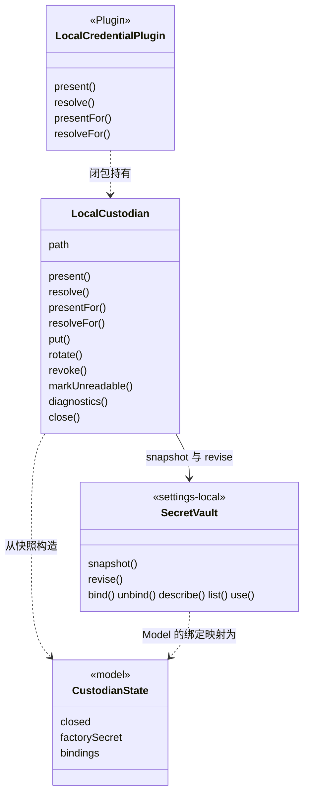
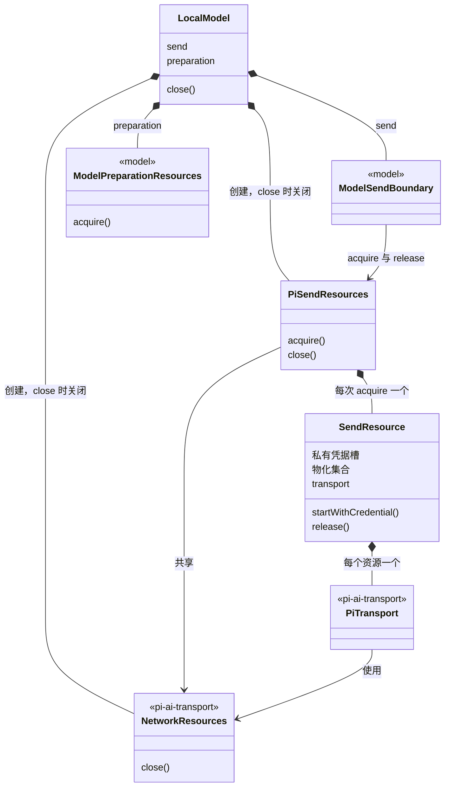

# 对象模型

本包内部有两组对象。保管侧是保管库句柄、保管状态快照和 settings-local 的秘密保管库。发送侧是发送资源集合、每次 `acquire` 的发送资源和本地装配。判定、服务定义、发送边界与传输不在本包。

## 对象与关系

发送侧的对象与它们指向的发送边界、准备资源和网络资源：

- 保管库句柄：同步操作的对象，身份是 `path`。它持有 settings-local 保管库的句柄、最近一次刷新的快照和一份诊断列表。
- 保管状态快照：model 公开的形状。本包只构造它，不扩展它的字段。
- 秘密保管库：settings-local 的文件保管。本包从它的快照取 Model 的绑定（官方工厂绑定与租户凭据绑定），经它的锁内修订写回；租户目标键不是凭据 id 时整份快照按不可用处理。进程内的关闭不落盘。
- 插件：继承 `ModelCredentialService`，对外提供 `present`、`resolve`、`presentFor` 与 `resolveFor`。后两项是共同服务定义的可选资格方法，本地插件实现它们，不公开保管管理操作。
- 发送资源集合（`PiSendResources`）：持有共享的网络资源与家族贡献的引用、配置探针和仍打开的资源。
- 发送资源（`SendResource`）：持有一个 pi 传输、它的私有凭据槽和它交出的物化传输集合。槽只在 `startWithCredential` 的同步调用内有值。
- 本地装配（`LocalModel`）：持有它创建的网络资源、发送资源集合、model 的发送边界与计量准备资源。`ModelCommands`、`SendCoordinator`、家族与保管库归调用方。准备租约归取得它的调用方。

## 生命周期

句柄由 `createLocalCustodian` 或 `openLocalCustodian` 创建，由调用者调用 `close()` 结束。插件创建或打开句柄，撤除时关闭它；文件损坏时没有句柄，因此没有可关闭的对象。关闭只合上本进程的 Model 门，不销毁文件。

发送资源由发送边界经 `acquire` 取得，在尝试结束时由发送边界 `release`；释放后它拒绝开始。发送资源集合与网络资源由 `assembleLocalModel` 创建，由装配的 `close()` 依次关闭。一个关闭失败不跳过另一个，两者都失败时抛出 `AggregateError`，见 [SPEC“发送路径的所有权”](../SPEC.md#发送路径的所有权)。计量准备资源也由装配创建，装配的 `close()` 开始后它拒绝新的租约。租约由准备资源经 `acquire` 交出，由取得它的调用方 `release`；装配的 `close()` 不释放租约。
