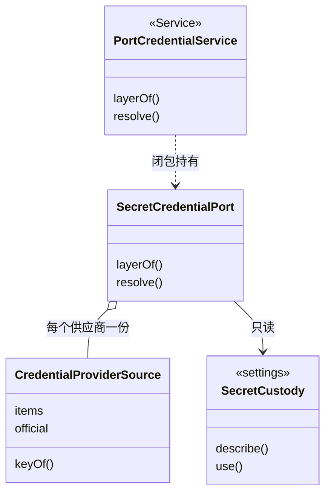
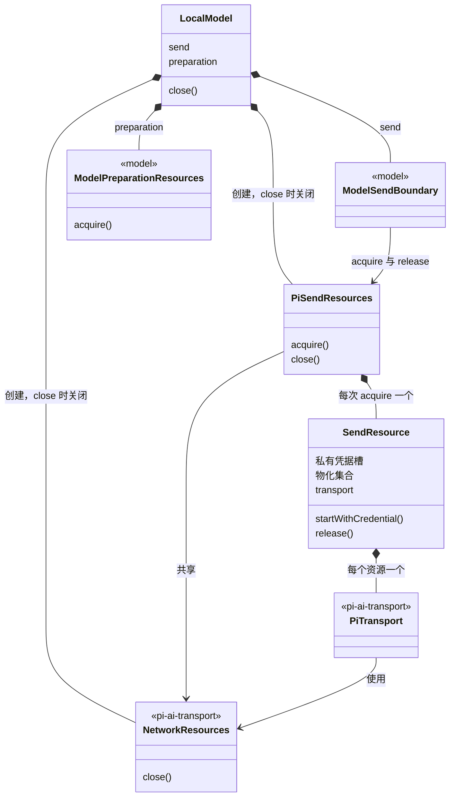

# 对象模型

本包内部有两组对象。凭据侧是凭据端口与提供它的服务实例。发送侧是发送资源集合、每次 `acquire` 的发送资源和本地装配。选层规则、服务定义、秘密保管、发送边界与传输不在本包。

## 对象与关系

发送侧的对象与它们指向的发送边界、准备资源和网络资源：

- 凭据端口：`createSecretCredentialPort` 返回的 `CredentialPort`，没有自己的状态，只持有调用方交入的秘密保管两个面与供应商来源表。
- 供应商来源（`CredentialProviderSource`）：一个供应商声明的凭据项、发行是否持有它，以及一项在一个层的绑定键。它由装配从供应商资产得出，身份是供应商名。
- 秘密保管：设置域的端口，由保管提供者（例如 settings-local 的保管库）实现。端口只用读面与使用面，不写。
- 服务实例：`serveModelCredential` 建的 `ModelCredentialService`，只有 `layerOf` 与 `resolve`，端口在闭包里。
- 发送资源集合（`PiSendResources`）：持有共享的网络资源与家族贡献的引用、配置探针和仍打开的资源。
- 发送资源（`SendResource`）：持有一个 pi 传输、它的私有凭据槽和它交出的物化传输集合。槽只在 `startWithCredential` 的同步调用内有值。
- 本地装配（`LocalModel`）：持有它创建的网络资源、发送资源集合、model 的发送边界与计量准备资源。`ModelCommands`、`SendCoordinator`、家族与凭据端口归调用方。准备租约归取得它的调用方。

## 生命周期

凭据端口没有生命周期：它不打开文件，也没有 `close()`。端口背后的秘密保管由建它的调用方关闭。服务实例随 `serveModelCredential` 的 `ctx` 的 fiber 撤除。

发送资源由发送边界经 `acquire` 取得，在尝试结束时由发送边界 `release`；释放后它拒绝开始。发送资源集合与网络资源由 `assembleLocalModel` 创建，由装配的 `close()` 依次关闭。一个关闭失败不跳过另一个，两者都失败时抛出 `AggregateError`，见 [SPEC“发送路径的所有权”](../SPEC.md#发送路径的所有权)。计量准备资源也由装配创建，装配的 `close()` 开始后它拒绝新的租约。租约由准备资源经 `acquire` 交出，由取得它的调用方 `release`；装配的 `close()` 不释放租约。
