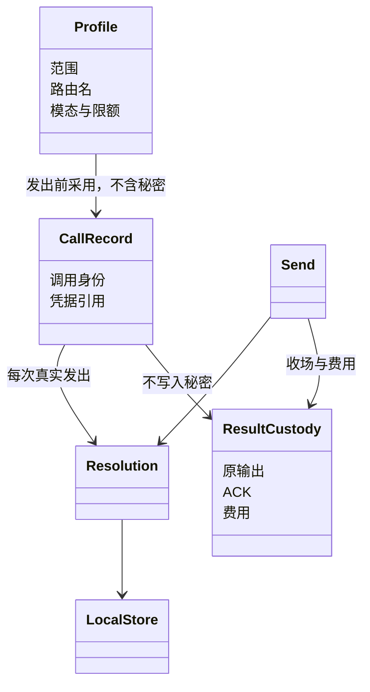

# model 包内架构

状态是待审。本页拥有本成员里模块怎么摆、各自守什么。对象形状见 [model](model.md)。Cordis 的服务、插件和 fiber 见 [cordis](cordis.md)。顺序见 [key-flow](key-flow.md)。行为承诺仍在 [SPEC](../SPEC.md)。档案与模态的行为正文在 [profile-and-modality](profile-and-modality.md)。结果、ACK 和费用的行为正文在 [consumption-and-cost](consumption-and-cost.md)。

身份提供当前租户和资格。档案求值不把秘密放进档案。Runtime Context 负责派生输入，不在这张图里。Session 保存选择，不拥有调用寿命。

## 从选择到发出

[档案与选择](key-flow.md#flow-md01)、[转换及最终输入](key-flow.md#flow-md02)和[真实发出与首内容](key-flow.md#flow-md03)共同承接 J-MD01 到 J-MD04。请求发起者固定输入。本成员不保存 Session 的选择，也不代替 Context 组装。

求值、最终采用和发出分别有责任。档案缺必要上限时不发出。估算不能冒充准确计数或上游已经接受。一次输入里的系统提示词、消息、工具声明和模态来自同一次采用。模型前扩展改写之后，最终输入再校验一次，不把同一次扩展再跑一遍。

撤回、档案修订、选择切换和权限变化作用于后续准入。在途请求保留已经采用的值。更换实现不等于调用换代。

## 调用与真实发出

一个调用身份在 Agent 更换之后仍然保留。每一次供应商请求有自己的发出身份。关联里有租户、消费者、用途和原处理位置。Session、Run、attempt 只在它们存在时写入。独立调用不补造这些对象。

首内容是已经交付的物理输出。界面刷新、响应头和心跳都不是首内容。每一次发出的错误和费用单独留下。重试策略还允许下一次发出时，调用还没有终局，不能做最终 ACK。

首内容前的可重试发出结束时，决定回到本成员，由本成员继续发出或收场。主 Loop 不提前处理最终结果。独立消费也要能使用同一策略，不以启动 Agent Loop 或隐式 Session 为前提。

中断、故障和正常完成分别收场。输出限额截断不是供应商故障。消息前否决是消费决定，不改原调用已经成功的事实。Loop 的新请求使用新的调用身份。

## 接续与取消

控制、未知停止和原身份恢复的顺序见 [key-flow](key-flow.md#flow-md04)。

Agent 是消费者，不拥有原调用的物理寿命。恢复时先查询原身份和消费状态。仍在运行就继续等待。已经收场就承接结果。已经 ACK 的从消费保存侧继续。状态查询不可用，不能当成模型自己失联。

确认模型执行失去连续性之后，首内容前可以按原用途恢复重发，首内容后不再发。恢复不改原用途。

Session 归档取消的是业务依赖，并传播停止意图。本成员拥有请求取消、实际收场、结果保管和费用。不必先等所有物理执行停下。迟到事实不能推进已经取消的工作。

## 结果保管与凭据保管

结果保管和凭据保管是两个角色。结果保管保存原输出、ACK 条件和费用。凭据保管保存秘密和当前绑定。调用记录只保存凭据引用。

ACK 的前提、清理范围和费用边界见 [consumption-and-cost](consumption-and-cost.md)。顺序见 [key-flow](key-flow.md#flow-md05) 和 [key-flow](key-flow.md#flow-md06)。

已确认的调用、发出、采用依据、收场、确认和账目按各自确认边界持久保存。存储不可用时不报成未找到，也不靠新发请求补数据。凭据不进入扩展参数、正文或遥测。

尚未闭合的技术缺口见 [open-questions](open-questions.md)。
