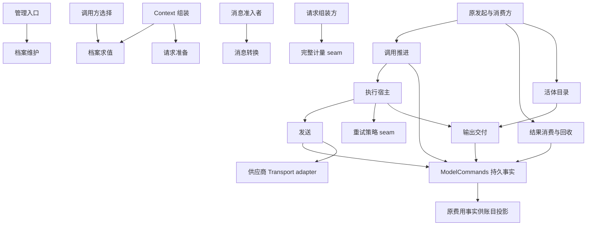
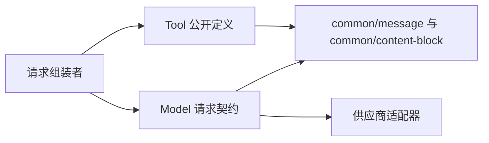
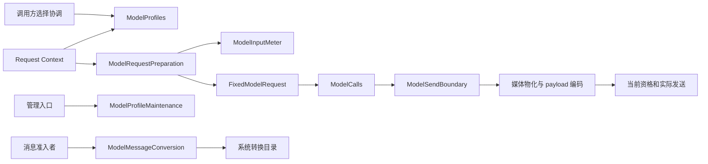
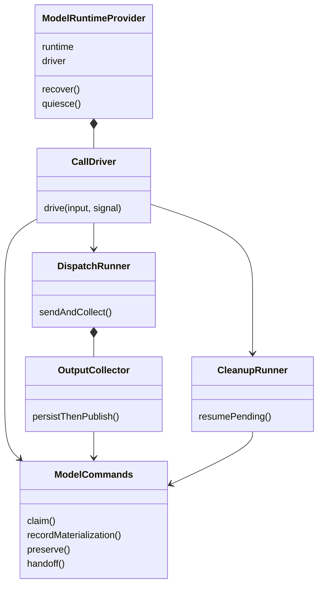

# Model 内部架构

本页描述已接受的非 pi-ai 运行契约。独立 executeModel 已由 [execute.ts](../src/execute.ts) 实现，受理、原流保存、最小实例观察及可独立调用的产品 sender 已实现，已确认调用的收场支持范围见[实现规格](../SPEC.md#已实现的调用收场)，其余完整托管运行仍是目标设计。pi-ai 细化的采用范围见[组架构各节](../../docs/architecture.md#成员与新增条件)，图表不表示运行实现或真实提供者验证已完成。

本包负责模型调用与各次真实发出、原输出及结果保管。公开结果和失败的唯一行为源是 [SPEC](../../model-contract/SPEC.md)，具体设计定义见 [public-api](../../model-contract/docs/public-api.md)。

领域角色归[责任交接](../../../../docs/domains/model-invocation/architecture.md)，工程邻接归[组设计](../../docs/architecture.md)。本页维护机制和理由，不据当前实现降低行为承诺。产品影响及阶段选择见[产品未决事项](../../../../.meta_harness/design/product/model-invocation/design.md#未决问题与待定事项)。

## 内部 module 与 interface

一个 module 以消费者需要学习的完整 interface 为界，包括输入、状态、顺序、失败及资源义务。以下是逻辑分解，不要求每行变成 class、目录或独立包。类型的唯一定义仍在 [public-api](../../model-contract/docs/public-api.md)，行为在 SPEC。

| Module | Interface 与消费者 | Implementation 隐藏的复杂度 | 状态拥有者 |
| --- | --- | --- | --- |
| 档案维护 | ModelProfileMaintenance，管理入口 | 同范围身份占用、条件写、修订、撤回恢复和未知认回 | 档案权威；不写凭据或调用方的选择 |
| 档案求值 | ModelProfiles，调用方与请求组装者 | 范围筛选、同名胜出、合法列表、模态及凭据元数据 | 读取固定快照；历史模态投影由调用方随运行时上下文提供，Model 只接收 |
| 消息转换 | ModelMessageConversion，消息准入者 | 选件、固定资源、本地转换、结果校验及释放 | 单次转换；接纳后的原块/派生归消息拥有者 |
| 请求准备 | ModelRequestPreparation，请求组装者或发起者 | 参数采用、schema、供应商相容和参数上限比较；不计量输入 | 固定请求值，无调用方历史写权 |
| 准备资源 | ModelPreparationResources，请求组装者（[preparation/](../src/preparation/)） | 逐供应商绑定取得与全有全无释放、按访问依据经 `dispatches` 读一次被引用调用的事实、锚点与来源的纯判决、把数字交给家族的 `measureCalibrated` 并报告判决 | 租约；事实视图随租约消失，家族计量器仍是纯函数 |
| 调用推进 | ModelCalls 与受信 ModelProvider 生命周期，原发起者/恢复宿主 | 可靠受理、实例取得、逐次发出、有限重试、控制和终局 | 原 call/dispatch；执行者可换代 |
| 发送 | ModelSendBoundary，执行者 | 物化、回执提交、当前资格围栏、真实 start 和未知发送；不计量 | 每次 dispatch 的固定采用及临时资源 |
| 输出交付 | ModelHandle.observe，观察者 | 供应商解码、共享到达映射、合法归约、保存后发布及有界缓冲 | 归约状态按 dispatch 隔离；持久事实仍归 Commands |
| 结果消费与回收 | ModelConsumption，当前消费者 | 分页读取、双路径承接核验、ACK、读写保护与异步清理 | CustodyState 独立于执行终局 |
| 持久事实 | ModelCommands，受信运行提供者 | 条件提交、operation 认回、执行代次排除、恢复扫描与迟到事实 | 唯一耐久调用权威；不由目录或内存替代 |

ModelRuntime 是 ModelCalls、ModelConsumption、ModelDirectory 的消费组合。目录只定位活体，不加入业务权威。ModelCommands 的写方法只交受信实现，普通调用者无需知道 prepareDispatch、preserve 或清理推进顺序。费用解释和原 dispatch 事实分别由供应商 adapter 与 Commands 承接，账目查询投影属于账目拥有者，不为它再造平行执行模块。

箭头表示使用关系。调用推进 module 编排执行、发送和策略，不将重试循环交给调用方；结果消费隐藏清理进度，不要求消费者先停全部 reader 才 ACK。删除这两个 module 会把恢复、重试或清理顺序分散到每个调用者，因而具有 depth。单纯把同名方法再转发一次的 module 没有这一收益，应省去。

## 依赖分类与测试 surface

| 依赖类别 | 具体责任 | Seam 与验证方式 |
| --- | --- | --- |
| In-process | 范围排序、参数采用、流归约 | 包内函数/module，通过所属 interface 的结果验证；不为每个纯函数注入端口 |
| Local-substitutable | 档案持久存储、调用保管、内容资源 | 提供者内部替换 seam；选定本地替身后用同一接口验证条件写、重启和清理。内存替身不能证明断电耐久 |
| Remote but owned | 分离部署时的身份、设置、凭据及内容访问 | 消费各拥有者的 interface，注入本地或远程 adapter；本阶段不因此新增 RPC 或进程 |
| True external | 模型供应商、其 SDK/网络与真实计量口径 | ModelTransport 和 meter seam；确定响应的故障 adapter 验证消费行为，真实供应商符合性验证其映射 |

多供应商和可控故障来源说明替换需求，不能声称已有两个生产 adapter。本地存储替身和实际引擎尚未采用，测试环境的可用性由提供者兑现。现有类型探针只检查 interface 可连接，不冒充这些实现证据。

普通消费者测试从 resolve/prepare/admit/read/ack 进入；提供者符合性测试从 Commands、Transport 等其实际消费的 seam 进入。不得为测试公开内部队列、块表或缓存。内部重构应保持可观察结果；由完整 interface 测试替代的小函数镜像测试不再保留。具体持续场景见[验证](../../model-contract/verification/README.md#model-持续验证场景)。

## 持久状态与恢复责任

| 状态或资源 | 必须保存的事实 | 重新装配或故障后的处理 |
| --- | --- | --- |
| 档案及采用 | 身份、修订、来源、撤回与固定定义 | 原修订可辨；后继配置不改在途输入 |
| 受理与执行 | 原 call、operation、消费者/用途、容量、execution generation | 查询原提交；排除旧执行者后才 claim 后继 |
| 真实发送 | 原 dispatch、物化回执、发送状态、接收窗口与首内容依据 | started/unknown 不当 not-sent；首内容 uncertain 不当无内容 |
| 策略 | 稳定 RetryPosition、原失败、决定及来源 | 未知先 inspect 原位置，不重执行可能产生费用的策略 |
| 输出 | 已保存事实、游标、块状态与原结局 | 由持久事实重建快照，只发布已确认批次 |
| 消费与清理 | ResultVersion、有效 ACK、真实读写保护、待清理与未知写 | ACK 不回滚；宿主从原待办续做清理 |
| 费用 | 每次 dispatch 的真实用量/金额、来源、未知及更正关系 | 迟到仍补原工作；查询或重放不再发模型请求 |
| 临时资源 | 连接、内容租约、转换件租约、目录贡献和 observer | 不序列化句柄；原拥有者释放，重建不授旧请求发送资格 |

稳定事实由原存储契约保障，资源寿命由取得者保障。租户/组织成本投影只需要最小归属与账目事实，不默认保留完整输入输出。消费者的业务完成、Model 的物理终止和清理完成是三个事实，不能用一个 done 标志替代。

## 与 Tool 的依赖边界

Model 的根契约和 Cordis 装配都不依赖 Tool。Model 使用 common/message 表达调用建议及 ToolMessage，使用 common/content-block 表达内容。请求组装者分别消费两个领域的公开契约，保存工具定义到模型声明的投影与路由。Model 内只处理声明和消息，不解析工具资产或选择执行者。

箭头表示契约使用方向。请求工具声明由 Model 自己拥有，common 不复制 Tool 的命令、配置、许可和运行对象。组装者将这些业务含义投影为名称、说明与参数 schema，响应再按原路由交工具准入。精确字段仍见 [公开接口设计](../../model-contract/docs/public-api.md)，共同消息值见 [message](../../../common/message/docs/public-api.md)。

## 从选择到发出

[档案与选择](flows.md#flow-md01)、[转换及最终输入](flows.md#flow-md02)和[真实发出与首内容](flows.md#flow-md03)共同承接 J-MD01..04。请求发起者固定输入，模型域不保存调用方的选择或代替 Context 组装。

求值、最终采用和发出分别有责任。档案变更时缺必要上限、窗口与输出上限矛盾等返回 invalid；估算检查不能冒充准确计数或上游接受保证，上游事后以 input-over-limit 上报。输入包含系统提示词、实际消息、工具声明和全部模态，不拼混不同采用版本。模型前扩展的改写重校验一次最终输入，不自触发重走同一位置。

撤回、档案修订、选择切换和权限变化面向后续准入，在途请求保留实际采用值。稳定能力入口内部更换实现不自动等于捕获提供者换代；实际装配重建按业务交接处理，不能以重跑插件证明调用连续。

## 调用与真实发出

一个调用身份跨消费者拥有者更换保留，真实发出身份区分每次供应商请求。关联包括适用租户、消费者、用途和原处理位置，域外工作的身份仅在存在时关联。独立调用不得补造这些对象。

首内容是物理输出已交付的边界，不由界面刷新、响应头或心跳决定。每次发出的错误状态和费用单独保留；一次失败后仍有重试策略时，调用未终局，不能触发最终 ACK 或上层重复处理。

默认重试按已定次序和次数有限收束。首内容前单次可重试发出结束时，原调用尚未终局，沿已有模型后失败分支取得有效策略及记录决定。决定回原 Model，由 Model 继续真实发出或收场；原发起者的主流程不提前处理最终结果或 ACK，策略不等待最终收场，也不依赖原发起者持续运行。已终局失败的消费扩展不能反向恢复原调用；独立消费也须能应用有效策略，不以启动域外的工作与编排或隐式的工作身份为前提。独立策略采用 prepareRetry/inspect/decideRetry 的协议；实际提供者仍须验证持久决定和崩溃接续。

中断、故障、正常完成分别收场。输出限额截断不是供应商故障；消息前否决是消费决定，不改原调用成功。后续的新请求使用新调用身份，不放进原调用的内部重试记录。

## 接续与业务取消

J-MD05 的控制请求、未知停止、原身份核实及首内容前后恢复见[控制与恢复流程](flows.md#flow-md04)。

调用方只是消费者，不拥有原调用物理寿命。恢复先查询原身份和消费状态；仍在运行继续等待，已收场承接结果，已 ACK 从消费保存侧继续。状态查询不可用不是模型自身失联证据。

确认 Model runtime 自身失联后，首内容前允许原用途按恢复规则重新发出，首内容后不再发。前者可能有未知或多个真实成本，不承诺外部恰好一次。恢复不改原用途，扩展、压缩及其他旁路都回原位置。

域外工作的归档在治理提交点取消业务依赖并传播停止意图，模型拥有适用请求取消、实际收场、结果保管和费用。无需先等所有物理执行停下。迟到事实不能推进取消工作；撤销归档不使旧调用取得新消费资格。控制传输及物理停止的不确定保持可见。

## 可靠交接、ACK 与清理

[双路径 ACK 与清理流程](flows.md#flow-md05)同时表达先完成处理和先可靠保管两条路径，承接 J-MD06；[费用查询](flows.md#flow-md06)另行表达结算与权限。

整项调用终局及当前承接资格是 ACK 前提。可靠保存的内容或引用须在必要期限内可读取，模态附件不指向随实例消失的唯一临时文件。ACK 生效与真实清理、费用结算分别存在。清理失败不撤回确认，由模型侧继续处理；独立消费者退出也不解除它。

已开始读取和真实在途写入受到保护，闲置句柄不是永久锁。副本清理不删除其他调用内容、原历史或消费保存侧。成本可以独立结算时不保留无关全文。确认及读取竞态、提交未知和清理重启由模型与存储协调者验证，不能由同库位置推断原子性。

## 持久、隐私与验证

原调用与真实发出、原采用依据、已收场结果、有效确认、待清理及账目按各自确认边界持久保存。已确认事实覆盖进程、操作系统崩溃及断电。连接、句柄和可重建投影另行处理；存储不可用不返回伪未找到，也不靠新发请求补数据。

流中已展示内容可追溯是现行承诺。采用 preserve 批次持久确认后发布，receive-window 另行记录首内容不确定性。收场 ACK 不证明逐片耐久，提供者须验证该发布顺序与普通断电恢复。

实际外传按接收方重新授权，凭据不进入普通扩展参数、正文或遥测。租户账目及组织账目明细资格不等于读取他人请求内容。TTFT、端到端首输出、各次真实发出与清理原因分别可观测。

组合验证覆盖档案和输入同次采用、重试过程不提前 ACK、消费者换代、ACK 后清理失败、已取消工作迟到结果、独立调用与普通断电耐久。具体规格见[目标成员](../../model-contract/SPEC.md)。局部技术缺项见[待细化事项](#技术缺项与采用边界)。

## 请求准备的职责划分

ModelProfiles 隐藏当前配置筛选、同名求值和能力说明。ModelProfileMaintenance 另行拥有合法条件写，读取者不因使用相同档案而获得维护入口。ModelRequestPreparation 接受 Context 已组装的完整输入，隐藏参数采用、schema 和供应商相容检查，不计量输入。它不取得历史组装策略或调用方选择的写入能力。

每个公开入口对应实际不同消费者。内部档案排序、参数合并和限制比较仍是普通实现函数，不各加抽象Service。准备和发送共享确定的校验规则，但依赖和输入事实不同。准备只能验证已经取得的内容，发送阶段才能确认实际媒体和供应商编码。

RequestBudget 是计量能力给请求组装方的报告，用 complete 与 deferred-media 区分已完成计量和待物化事实。Token、单图字节、图数和整次请求大小分别检查，报告绑定原输入摘要和供应商。估算保留方法与余量，不写入真实账目。这不禁止校准以真实账目上的输入合计为锚点：租约只读取账目，不改写账目，见[准备租约与调用事实视图](object-model.md#准备租约与调用事实视图)。修改已组装输入须重新计量。准备与发送路径不调用计量能力。

## 接缝及实际替换理由

| 接缝 | 替换来源 | 责任与验证 |
| --- | --- | --- |
| 档案权威与设置读取 | 生产持久提供者、受控并发/故障提供者 | 相同条件写、版本、当前资格和未知提交语义 |
| ModelInputMeter | 不同供应商计量、可核对的边界样本 | 适用模型、全输入覆盖和方法来源 |
| ModelConverter | 不同媒体类型的本地识别实现 | 不调用模型，固定 transcript，失败不接纳 |
| ModelTransport | 不同供应商、可控真实传输故障 | 同一首内容、终局、上游超限收场和取消契约 |
| ModelCommands | 耐久存储提供者、故障注入适配器 | C/S 排序、提交认回和保管，不以内存假装耐久 |
| ModelMediaReader | 对象存储、文件系统等内容提供者 | 原引用完整性、当前访问和外传、临时资源释放 |

上表是替换和接受要求，尚无这些生产实现。公开抽象不要求每个实现单独成为 Cordis 插件。调用逻辑不反向依赖具体数据库、识别器或供应商 SDK。

## 契约与运行提供者

目标包边界由[组架构](../../docs/architecture.md#契约包的公开边界)维护。model-contract 拥有公共操作和可替换端口；本页的具体协调模块归 model。内部模块不是新的契约包。ModelDependencies 与 ModelConfiguration 只约束该实现的工厂，其他提供者遵守共同操作与协议，不必采用相同构造器。

model-cordis-contract 拥有托管运行的唯一 Service、键与定义自有登记表；model-host-local/cordis 装载目录并组合业务插件依赖。提供者工厂不从纯契约转导出。公开值身份、发送/保管不变量和资源退出责任不随物理分包改变。当前实现设计正文仍唯一存放本成员，真实切片再按组架构移动。

## pi 技术栈的提供者分解

本节说明 pi-ai 提供者的职责分工，采用范围由所引用的组架构各节维护。通用 Model 契约按其已接受范围执行。

阶段采用项目维护的 pi-ai 技术栈，具体包和依赖方向由[组架构](../../docs/architecture.md#成员与新增条件)拥有。Model 根 interface 保持供应商无关，pi 共享传输与厂商家族 adapter 在提供者侧组合。

公共 pi 传输隐藏 HTTP/SSE、连接/取消、单次请求规划和资源释放；厂商包隐藏型号定义、精确路由、参数/工具/消息规则、模板与完整计量、响应/usage 解释。家族交出相容的固定绑定，不要求 Context 或调用方自行拼装各子算法。模型厂商不等于实际发送接收方，外传仍核本次实际接收方。

Tokenizer 的 interface 仍归 ModelTextTokenizer，具体引擎 implementation 分在 tiktoken 与 Hugging Face adapter。固定词表/配置/模板归家族；meter 负责模型适用性和完整计量。共享传输不加载所有家族，领域核心不加载所有引擎；发行装配显式提供选中的贡献。

这些提供者包不取得档案维护、调用方选择、调用重试、ACK 或保管权。迁移沿当前 prepare/materialize/start 和共享消息/流契约，不能把源技术栈的旧领域依赖带进 Model。初始化和逐型号证据要求归组架构，不以目标路径声明生产实现存在。

## 计量组合与适配资源

本节的通用计量组合、预算依据、响应解码分工及资源生命周期设计已接受。具体 pi 家族、Tokenizer 引擎与资源适配的采用范围见[组架构](../../docs/architecture.md#tokenizer-的资源与计量分工)。

完整请求计量隐藏供应商格式差异。ModelTextTokenizer 仅作为具体 meter 的窄依赖，固定编码资源并回答 count；Runtime 不取得它，Cordis 不新增全局 tokenizer 键。采用这一组合是因为同一编码器可服务不同模板，而有些计量方法不使用本地分词。把 tokenizer 放进 Runtime 会让普通调用者承担与执行无关的选择和资源责任。

ModelCountingBasis 绑定模板、投影、媒体处理、回放、模型及算法，RequestBudget 保存实际依据。相同 tokenizer 名字不足以复用报告。请求组装方在请求前沿固定组合计量，含未读取的媒体 ref 时按元数据计量，结果为 deferred-media；准备和发送不计量，最终是否超限以上游响应为准；适用性和精度规则归 [SPEC](../../model-contract/SPEC.md#分词与完整请求计量)。

响应解码器只解释供应商协议，流归约器只维护本次 dispatch 的合法块状态。解码器归 ModelTransport，归约与共享到达映射归 Model 执行路径，不扩大 ModelToolPayloadAdapter，也不要求每个函数拥有服务键。保留旧采用的资源到其真实使用结束，可以避免热替换中途改变编码或销毁在途 reader；具体释放责任见 [装配](cordis.md#计量与传输资源的装配)。

历史校准、编码缓存和媒体缓存是可选优化。完整计量是共同消费入口；优化失败退回完整计量，后者无法解释输入则明确失败。当前不增加历史校准公共协议、全局适配器目录或依赖调用方私有历史的响应大对象。新增供应商的具体模板、算法和 usage 口径须由提供者证明，不能从共享接口形状推断准确性。

## 技术缺项与采用边界

本页维护技术义务和来源缺证，不授予新产品政策或默认机制。原问题 ID 保持。非 pi-ai 机制已接受，pi-ai 细化的采用范围沿[组架构各节](../../docs/architecture.md#成员与新增条件)；具体未定输入和实现证据分别跟踪。完整行为仍读成员 SPEC。

## MODEL-E01 引用式工具结果与附件地址的迁移验证

ToolResult.content 的模型可见多模态 ref 表示直接感知，attachments 只投影为文本地址供消费者按需取回。内容 ref 不要求重复登记附件。消息和请求组装不加载二进制，Model 实际请求阶段只加载明确选中的内容 ref，不扫描地址文本。

产品边界已经明确。唯一共享值及其采用状态归 [content-block](../../../common/content-block/docs/public-api.md)，投影与保管归 [Tool 契约的附件引用与模型交付](../../../tool/tool-contract/SPEC.md#p14-附件引用与模型交付)，发送时读取归 [Model SPEC](../../model-contract/SPEC.md#工具定义转换与内容引用加载)。任意嵌套容器不在许可集合，不能从过程帧或共享类型库存推定支持。

共享 ref 的基础形状及校验归 content-block，不能由此推断 Model 流适配和结果交付已完成。实施必须同步消息投影、保管和 Model adapter，并验证附件仅文本且零媒体读取、无附件的内容 ref、混合结果、可见性、当前权限、长度/摘要核验、取消和实际预算。缺失或失权不能成为空白成功，失败不能重跑工具。

本项以稳定身份跟踪技术实现和真实行为验证。这两种结果路径的产品来源已明确。本域设计已接受，类型检查不代表实际实现或跨领域提供者验收。

## MODEL-M01 输入和适配器的精确契约

档案能力、有限提供范围、首内容及参数规则的通用公开形状已接受。具体供应商数值、实现采用与符合性证据尚待落实，pi-ai 细化的采用范围沿[组架构各节](../../docs/architecture.md#成员与新增条件)。

[准备接口](../../model-contract/docs/public-api.md#档案与请求准备)已接受参数、上下文限制和预算报告的通用设计。具体供应商仍须固定 schema 支持子集、状态码映射、计量方法、余量与真实事件，并提供符合性证据。通用 interface 和共享机制已接受，缺的是具体 adapter 的采用与符合性，不是将完整能力延期。

已定边界如下。

- Model 的准备与发送路径不计量，也不以计量结论作为发出条件；请求前的计量与限额判断归压缩方或请求组装方，余量与压缩触发线归压缩拥有者
- 上游报告输入超限时，调用以 `failed`、成因 `input-over-limit` 收场；Model 不重发、不换供应商，由调用方压缩后以新的 `ModelCallId` 重新发起
- 首内容后不重发
- 参数不支持须说明实际采用

pi-ai 专用适配保持候选。具体数值须以实际模型和传输证据确定并验证，不给所有模型填统一限额。

影响范围。实现及符合性仍缺精确输入；当前行为承诺完整保留。

## MODEL-M02 可靠承接、独立策略与清理接续协议

消费者替换、整调用重试中断、ACK和真实读写并发、费用迟到及清理重启须按原身份恢复。

稳定引用、提交未知、读写保护、费用去重及策略协议归纯契约；本页的持久记录与调用对象落实其内部机制，单机关闭和旧执行排除见 [Cordis 装配](cordis.md#本地调度与执行者排除)。

已定边界如下。

- 整调用收场后当前合法消费者才ACK
- 已确认不回滚
- 清理由模型侧续做
- 独立调用不造域外工作身份
- 真实多次发出可能多笔费用

稳定策略位置、提交核实、读写保护及清理接续已接受，见 [SPEC](../../model-contract/SPEC.md#342-重试失联与恢复)。实际提供者实现及可复跑并发/故障验证仍缺。

影响范围。未运行跨进程或存储验证；不降低耐久、结果保管和首内容限制。

## MODEL-M03 已展示在途内容的恢复兑现

用户已看见内容须可追溯，未收场内容同样受此约束。内存快照不满足普通崩溃和断电后的恢复义务。

由流式、Model、存储和交付面技术设计对齐展示与保留责任；仅技术确需改变用户可见保证时另行提出具体决策。

已定边界如下。

- 不默认允许已展示内容丢失
- 不以收场ACK证明逐片耐久
- 不默认指定逐片同步落盘
- 首内容后自身失联不重发

采用[保存后展示](../../model-contract/SPEC.md#展示诊断与实施证据)。该设计已接受，真实存储/交付面故障验证仍缺，不能从类型检查推断无丢失。

影响范围。尚不能声称已验证该故障范围无丢失；不重问整套流式设计。

## MODEL-M04 新接入方式的凭据具体形状

旧单通道一个秘密值的形状不能成为所有未来模型接入的数量与通道约束。

实际接入采用时由契约拥有者设计所需通道、键、数量与选择，当前不凭迁移补新政策。

已定边界如下。

- 档案不存秘密
- 租户合法绑定及实际调用归属
- 本阶段不提供组织共用凭据
- 官方部署默认只在既有例外适用
- 存在但不可读绑定不退默认

已接受的约束不固定全局通道数量，并保持现行租户秘密边界。新接入方式尚无精确字段可采用，由实际接入与凭据拥有者设计。

影响范围。当前设计不定义新接入的通道字段和数量；独立提供者实施前仍须精确设计。

## 供应商尝试诊断的披露与保留

Model、诊断接入与存储拥有者须补足供应商尝试诊断的读取资格、可披露内容及保留范围与条件的精确契约。原问题的产品影响和责任见[Model 产品承接位置](../../../../.meta_harness/design/product/model-invocation/design.md#identity-neighbor-diagnostics)。

已有[数据保护与异常](../../model-contract/SPEC.md#数据保护与异常)、[费用和账目边界](../../model-contract/SPEC.md#真实费用和账目边界)及[清理范围](../../model-contract/SPEC.md#清理范围与读写保护)继续有效。成本账目资格不替代诊断披露资格，秘密及无权披露信息不能先写入普通持久记录再靠界面遮挡；最终成功不覆盖真实尝试，诊断也不能成为永久保留无关全文的理由。

诊断字段、分页、授权与清理机制已有[查询协议](../../model-contract/SPEC.md#诊断查询与保留)。具体期限、容量和身份权限映射仍待 Model、诊断与存储拥有者接受，运行实现与真实越权验证尚缺。机制已接受不表示诊断已可查询。

## 持久提供者的记录与提交

ModelCommands 是持久边界。以下是提供者内部的逻辑记录，不要求对应相同数量的数据表，也不规定数据库引擎。每个键都包含 tenant；跨域引用保留原拥有者身份，不把邻域事实复制成另一权威。

| 记录 | 唯一键与必要关联 | 原子变更及访问路径 |
| --- | --- | --- |
| Call | tenant、call；固定 request、consumer、capacity、revision | admit 与容量占用及原 operation 同提交；按 call 点查 |
| Operation | tenant、call、operation；动作、固定输入指纹、结果或未决位置 | 同身份同输入返回原结果；不同输入 conflict；结果与业务写一起提交 |
| Execution | tenant、call、generation；instance、宿主来源、排除证据 | claim 条件递增；所有推进写核当前代次；旧代次不能再写执行状态 |
| Dispatch | tenant、call、dispatch；supplier、物化回执、send状态、首内容 | prepareDispatch、recordMaterialization、recordSend 分步条件写；send未知不能回退未发送 |
| Output | tenant、call、dispatch、连续序号；window、块事实、游标 | 批次、归约快照、首内容依据及revision同提交；按游标读取，不扫全历史 |
| Retry | tenant、call、retry operation；原失败dispatch、position、decision | 同位置只落一决定，未知先inspect；外部策略副作用不在事务中重试 |
| Read / Custody | tenant、call、read或result version；活动租约、ACK、保留责任 | acquireRead、handoff及清理准入共同排序；ACK提交后拒绝新全文读取 |
| Late fact / Cleanup | tenant、call、dispatch、可信event；各资源清理项与保留依据 | 账目报告补上本次调用的 subject 与 receipt 后按原事件去重，流内与补录的同一事件只登记一次；待清理索引持续扫描，逐资源幂等释放 |

Operation 输入指纹涵盖动作及业务参数，绑定公开格式的固定 codec adoption。主体验证证据在提交时重新核验，不用旧许可参与指纹替代授权。JSON 值树按采用的 codec 编码，拒绝重复键、不可表示值和未声明字段；不能直接以对象地址、默认 JSON.stringify 顺序或当前配置生成幂等身份。摘要只用于冲突检测，持久结果仍保存原固定参数或可核实引用。

提供者将一个 Commands 操作编成已登记、版本化的存储动作及 JSON facts。Storage Worker 内不调用主线程闭包、网络、Cordis 或不受信插件。当前资格与调用写入需要同提交时，由拥有者采用的参加者核源并共同提交；提供者不能先授权再用普通独立事务冒充原子性。尚无相容参加者的组合明确拒绝装配，不退化为缓存 allowed。

提交顺序是读取当前版本、验证原操作/代次/资格及状态、写业务记录和 operation 结果、达到存储承诺的耐久点，再返回 DurableEvidence。连接丢失等无法判断提交结果时返回 commit-unknown，随后只查询原 operation。后端必须区分不存在与不可读取；模糊错误不映射 not-committed。耐久点须覆盖普通进程、系统崩溃和断电，内存替身不能提供相同证据。

更新 Call 时同时维护 pending 索引和通知 outbox。outbox 仅携带 tenant/call/revision。通知丢失由扫描恢复，不影响原提交；发通知失败不重执行业务动作。输出按序号分页，read绑定原result version和游标；慢观察者只失去其内存队列，可从已保存快照接回。热点调用与不同租户不共享全局执行锁，只有实际共同资格/发送围栏进入同一排序域。

## 调用执行对象与所有权

这些类名表示内部角色，不是新增公开导出。CallDriver 只依据原恢复记录推进任务，DispatchRunner 拥有一次发送，OutputCollector 拥有单次dispatch的归约状态及持久批次。CleanupRunner 处理已ACK保管责任。重试算法只返回决定，不自己发送；调度器只安排工作，不裁定资格。

派发前先 prepareDispatch 和物化；物化回执提交未知则不start。接收窗口在会发生内容接收的动作前持久标记 uncertain，包含启动发送可能同步收到内容的情况。物理首内容已到但批次尚未保存时不能宣称无内容。preserve 按原window和事实序号保存；只发布返回的已持久游标。保存失败暂停有界读取，不能继续展示或把发送再试一次。

在最终发送围栏中，当前资格核实与 start 之间不让出执行。发送事实的持久记录发生在真实发送之后时存在崩溃窗口；恢复按旧dispatch的准备、接收窗口及发送未知处理，不能因为缺 started 记录重发。物理请求是否到达供应商无法由本地数据库反推。取消竞争中的真实完成、迟到费用和部分输出继续保存原事实。

内部资源归属如下。PreparedTransport 拥有固定规划；MaterializedTransport 拥有媒体暂存、最终编码和已预约容量；流收集器拥有在途 reader；宿主拥有协程与绑定；提供者拥有共享连接和算法租约。每层 finally 释放自己取得的资源，不关闭上层共享资源。清理异常留下可重试责任及安全诊断，不能因另一条业务异常把它静默丢掉。

## ModelCommands 的持久化与一致性边界

本节依据[提供者接口](../../model-contract/src/provider.ts)和[独立执行与提供者操作](../../model-contract/SPEC.md#342-独立执行与提供者操作)分析持久边界，服务于[内存 Commands #450](https://github.com/nemori-ai/omne-harness-lite/issues/450)及[运行实施 #446 的阶段 7.2](https://github.com/nemori-ai/omne-harness-lite/issues/446)。已有逻辑记录和内部角色分别沿用[持久提供者的记录与提交](#持久提供者的记录与提交)和[调用执行对象与所有权](#调用执行对象与所有权)。本节不增加接口、表结构或跨域协调者决定。

### 方法归组与每次提交

以下五组用于分析。调用是共同身份根，五组不对应五张表或五个独立事务域。跨组事实是否共同提交，仍由各方法契约决定。六个查询核验当前相应资格，其余十六个方法变更状态。每个状态变更方法在自己的裁定中原子核对条件并保存领域事实，不能将连续调用串成覆盖网络等待的长事务。

| 方法 | 唯一分析组 | 读或状态变更 | 必须一起成立的事实 | 机制及其拥有者 | 依据 |
| --- | --- | --- | --- | --- | --- |
| `admit` | 调用与终局 | 状态变更 | 当前发起资格、适用工作守卫、固定输入、调用、消费者关系、容量和待调度责任 | Model 的原 operation 去重及 owner 固定采用；资格参加者核权 | [提供者操作](../../model-contract/SPEC.md#342-独立执行与提供者操作)、[资格提交](../../model-contract/SPEC.md#342-资格共同提交与实际发送) |
| `recall` | 调用与终局 | 查询 | 原 admission 与调用认回，当前事实读取资格 | Model 的 call/admission 关联；不可读不等于未受理 | [逐操作行为](../../model-contract/SPEC.md#342-逐操作行为) |
| `settle` | 调用与终局 | 状态变更 | 整调用实际终局与完整结果版本，执行或策略等待已经结束 | Model 的 operation、expected/revision 及 execution generation | [提供者操作](../../model-contract/SPEC.md#342-独立执行与提供者操作) |
| `control` | 调用与终局 | 状态变更 | 当前控制资格、原意图、禁止新发出状态和传播续做责任，真实终局继续保留 | Model 的 operation 认回、条件修订及派生控制例外 | [逐操作行为](../../model-contract/SPEC.md#342-逐操作行为)、[控制与晚到事实](../../model-contract/SPEC.md#控制取消与晚到事实) |
| `query` | 调用与终局 | 查询 | 当前资格与原 operation 的权威提交结论 | Model 保留原身份；Storage 构造完整排除证明，revision 仅用于重查业务状态 | [提供者操作](../../model-contract/SPEC.md#342-独立执行与提供者操作)、[Storage 查询](../../../storage/docs/storage-contract/SPEC.md#查询) |
| `dispatches` | 调用与终局 | 查询 | 当前账目及发出事实读取资格，按原发出顺序返回脱敏事实 | Model 的 dispatch 身份、费用 revision 及披露边界 | [逐操作行为](../../model-contract/SPEC.md#342-逐操作行为) |
| `prepareDispatch` | 发出尝试与重试 | 状态变更 | 当前代次、尚未控制且尚未收场、首内容界、合法政策和唯一 dispatch 意图 | Model 的 operation、expected/revision、generation 与 dispatch；意图不证明已发送 | [提供者操作](../../model-contract/SPEC.md#342-独立执行与提供者操作) |
| `recordMaterialization` | 发出尝试与重试 | 状态变更 | 当前代次、原未发出 dispatch、供应商、固定输入与物化回执 | Model 固定 supplier/representation/payload 摘要；Storage 耐久确认后才形成 source | [物化提交](../../model-contract/SPEC.md#物化回执的提交与发送) |
| `recordSend` | 发出尝试与重试 | 状态变更 | 原 dispatch 的真实启动观察或发送未知，started 不倒退 not-sent | Model 的 operation、expected/revision 与 generation；本地记录不能推断网络未发送 | [提供者操作](../../model-contract/SPEC.md#342-独立执行与提供者操作)、[恢复](../../model-contract/SPEC.md#342-重试失联与恢复) |
| `recordLateFact` | 发出尝试与重试 | 状态变更 | 当前补录资格、原 dispatch 归属、可信 source、事件去重和账目修订（账目报告补上 receipt late）或实际终结事实 | Model 的 operation、dispatch/event 与 DurableEvidence；无须新 claim，不取得执行权，不改逻辑终局、结果版本、ACK 或 cleanup | [恢复与晚到补录](../../model-contract/SPEC.md#342-重试失联与恢复) |
| `prepareRetry` | 发出尝试与重试 | 状态变更 | 原失败 dispatch、尚未首内容、当前策略资格、唯一策略 operation 和固定策略消费位置 | Model 固定 RetryPosition；策略拥有者保存自身经过，调用前先提交位置 | [重试协议](../../model-contract/SPEC.md#342-重试失联与恢复)、[资格提交](../../model-contract/SPEC.md#342-资格共同提交与实际发送) |
| `decideRetry` | 发出尝试与重试 | 状态变更 | 原失败、原政策资格、原 position、可核验决定 source 和唯一决定 | Model 的条件修订与 position 认回；策略拥有者按原身份 inspect，不重做付费判断 | [重试协议](../../model-contract/SPEC.md#342-重试失联与恢复) |
| `openReceiveWindow` | 接收/读窗口与承接 | 状态变更 | 有效实例、原 dispatch、唯一 window 与首内容 uncertain 标记 | Model 的 generation、window、operation 和条件修订；提交后才可接收 | [提供者操作](../../model-contract/SPEC.md#342-独立执行与提供者操作)、[接收窗口](../../model-contract/SPEC.md#342-重试失联与恢复) |
| `preserve` | 接收/读窗口与承接 | 状态变更 | 原实例/dispatch/window、完整有序批次、可恢复内容、首内容、账目（账目报告补上 subject 与 receipt received）、随发出保存的诊断事实、游标和窗口关闭 | Model 按 window/序号去重及 revision 提交；提交后发布快照 | [提供者操作](../../model-contract/SPEC.md#342-独立执行与提供者操作)、[接收窗口](../../model-contract/SPEC.md#342-重试失联与恢复) |
| `acquireRead` | 接收/读窗口与承接 | 状态变更 | 当前读取资格、实际终局、原 result version、首页及真实读取登记；与 ACK 排序 | Model 的 operation 先认回原 read；新 operation 在 ACK 后不能取得全文 | [读准入与分页](../../model-contract/SPEC.md#342-普通调用面与实例观察)、[逐操作行为](../../model-contract/SPEC.md#342-逐操作行为) |
| `nextRead` | 接收/读窗口与承接 | 查询 | 当前读取资格、原 read、同一 result version 和原 after 对应页 | Model 的稳定页身份；同 after 返回同页，不消费或暗移游标 | [读准入与分页](../../model-contract/SPEC.md#342-普通调用面与实例观察) |
| `endRead` | 接收/读窗口与承接 | 状态变更 | 当前读取资格、原 read 的实际资源结束及保护关系解除，保留结束原因 | Model 的 read 身份和幂等结束；公开输入没有 operation，内部适配见下文假设 | [提供者接口](../../model-contract/src/provider.ts)、[逐操作行为](../../model-contract/SPEC.md#342-逐操作行为) |
| `handoff` | 接收/读窗口与承接 | 状态变更 | 当前承接资格和关系、实际终局、原版本、有效证据、ACK 与清理责任 | Model 的 operation/result version 和 owner 证据适配；ACK 不回滚，活动读仍受保护 | [ACK 前提](../../model-contract/SPEC.md#ack-的前提与效果)、[提供者操作](../../model-contract/SPEC.md#342-独立执行与提供者操作) |
| `advanceCleanup` | 清理义务 | 状态变更 | 有效代次、原 ACK、真实读结束、在途/未知写核实及每步清理进度 | Model 的 generation、operation 和资源责任；外部释放不因数据库回滚而撤回 | [清理范围](../../model-contract/SPEC.md#清理范围与读写保护)、[恢复](../../model-contract/SPEC.md#342-重试失联与恢复) |
| `scanPending` | 恢复认领 | 查询 | 当前恢复主体、显式租户授权、原耐久待办与稳定分页 | Model 的原身份排序、正整数 limit 和公开上界、after/next；查询失败保留游标 | [恢复扫描](../../model-contract/SPEC.md#342-独立执行与提供者操作) |
| `loadRecovery` | 恢复认领 | 查询 | 当前恢复资格、原调用事实、固定采用与未决责任 | Model 保存原 initiator、admission、execution、策略位置与未知 operation；空目录不清待办 | [恢复记录](../../model-contract/SPEC.md#342-独立执行与提供者操作) |
| `claim` | 恢复认领 | 状态变更 | 原调用、后继 instance、旧执行者排除、当前资格及新 generation；首内容和控制保留 | Model 条件递增 generation，可信宿主给 continuity；Storage 证明旧写终止和恢复完成 | [提供者操作](../../model-contract/SPEC.md#342-独立执行与提供者操作)、[恢复证据](../../model-contract/SPEC.md#342-重试失联与恢复) |

领域身份与提交机制分别承担下列责任。

- `tenant/call` 固定调用归属，`dispatch/window` 固定真实发出及接收范围，`instance` 标识运行实例。这些身份不能被数据库连接或当前进程替代。
- `operation` 防止同一领域动作重复生效。Model 按租户保证 operation 唯一，相同方法同输入认回，跨方法或异输入冲突。Storage 的完整操作身份形状更宽，不能因此允许 Model 在同租户按 call 或方法重复使用 operation。
- `expected/revision` 排列条件写，`execution generation` 排除旧执行者。两者不能互代，也不能把 generation 套在不取得执行权的 `recordLateFact` 上。
- `read/after` 和 `result version` 固定同版本分页及实际读取关系。`scanPending` 的 limit/cursor 只界定恢复查询，不取得执行权。
- `DurableEvidence/continuity` 是须核验来源的提交或排除证据，不是内容身份或授权布尔值。retry position 固定原策略判断位置，不能靠生成新身份绕过未知决定。

所有入口保留显式租户、当前可信资格和固定 owner 采用。控制不能抹掉真实晚到事实，首内容 observed 或不能排除的 uncertain 禁止重发。实际终局、结果版本、ACK、活动读和清理的顺序继续由[结果承接与清理](../../model-contract/SPEC.md#结果承接清理与成本行为)拥有。`endRead` 按原 read 结束资源和保护关系，不新增调用方 operation 参数。内部如何认回重复结束尚须适配，不能改写接口填补这个实施输入。

### 领域、应用协调与基础设施

Model 决定调用事实、不变量及领域结果，ModelCommands 隐藏仓储、参加者和提交。应用协调者组织多个拥有者各自的责任，不能直接写 Model 内部记录。Storage 承载登记组合、版本化 JSON facts、同事务参加者、原操作回执和查询，不决定 Model 资格、首内容、ACK 或清理的含义。共同事务的边界沿[数据与状态](../../../../docs/architecture/data-and-state.md#事务与一致性)。

| 跨组用例 | 必须强一致的本地事实 | 数据库事务外的效果 | 未知与恢复 | 协调位置候选，未选定 |
| --- | --- | --- | --- | --- |
| 分派与发送 | 每步分别固定 dispatch、物化回执和接收窗口；最终资格与同步 start 由共同围栏排序 | 媒体读取、编码及真实网络发送；网络效果不能 SQL 回滚 | 回执提交未知不 start；任何可能同步收到内容的 start 前先提交 uncertain 窗口。recordSend 缺失不证明未发送，查询原 operation，保留原 dispatch 与可能费用 | 既有 driver/send boundary 职责的应用装配。内部执行拥有者已定，不因本表重新选择 |
| ACK 与消费方 | 可靠消费或副本证据、Model ACK 及清理责任满足现行可靠交接条件。同事务域可登记组合共同提交各方事实 | 复制字节、外部内容读取及事务域外消费效果 | 同事务参加能力不足时，沿已接受的两条证据路径保留责任。跨域组合尚须明确协议，不能以“最终一致”代替不丢结果；ACK 未知查原 operation，未认回前不能释放最后可靠副本 | 消费应用或集成协调者，由应用层具名；本节不选具体成员 |
| 恢复认领 | 旧执行排除、原调用、当前资格、后继 instance 与新 generation 一次条件提交 | 扫描唤醒与通知可重扫，不把通知送达放进认领事务 | 查询失败保持原身份和游标；不能排除旧执行者则保留未知。recover 仅核实和唤醒，不直接 claim；driver 仍是代次唯一取得者 | 应用恢复协调与既有 driver 的组合；driver 的已定职责继续有效 |

分派和认领的既有内部责任见[调用执行对象](#调用执行对象与所有权)与[驱动协议](../../model-contract/SPEC.md#宿主绑定与驱动协议)。ACK 的两条证据及保留后果见[ACK 前提](../../model-contract/SPEC.md#ack-的前提与效果)和[可靠交接](../../../../docs/architecture/data-and-state.md#可靠交接与消费确认)。候选位置只说明装配所需输入，不授予新的跨域写权。

### Storage 承载与资格协议

Model 自有 tenant/call/operation、dispatch、版本和 owner 采用保留在其领域 facts 中。Storage 的[操作身份](../../../storage/docs/storage-contract/SPEC.md#操作身份)另含事务域、操作、协议版本和操作键。适配必须同时维护两套约束，不能因 Storage 比较完整五项而削弱 Model 的租户 operation 唯一性。

提交协调者按[登记](../../../storage/docs/storage-contract/SPEC.md#登记)固定参加者与组合版本；Model 提供者把方法编成[提交](../../../storage/docs/storage-contract/SPEC.md#提交)接受的版本化 JSON facts。Worker 通过[参加者端口](../../../storage/docs/storage-contract/SPEC.md#参加者端口)在同一受管事务内执行。Worker 不接主线程闭包、Cordis Context、数据库句柄或网络等待。Model 的 codec、动作版本与组合注册映射属于[阶段 7.2](https://github.com/nemori-ai/omne-harness-lite/issues/446)的提供者适配，不在本节指定公开仓储或 transaction callback。

[Storage 提交结果](../../../storage/docs/storage-contract/SPEC.md#提交)在适配中分别保留含义。

| 结果 | Model 可以认定的事实 |
| --- | --- |
| `committed` | 采用范围内的事实和原操作回执已同提交，达到采用的耐久点后才返回领域成功及相应 DurableEvidence |
| `rolled_back` | 明确回滚回执已持久保存，映射具体领域失败；不表示已发生的外部效果回滚 |
| `unknown` | 尚不能认定提交或回滚，映射 commit-unknown，继续查询原身份 |
| `identity_conflict` | 同一 Storage 身份绑定不同摘要，保留已有回执；不能改身份覆盖，Model 仍须核自己的跨方法冲突 |
| `rejected_before_accept` | 该提交未进入受理队列且没有提交回执；不据此推断此前未知提交或外部效果不存在 |

[Storage 查询](../../../storage/docs/storage-contract/SPEC.md#查询)的 `not_committed` 只能由提供者构造。旧写代际排除、旧事务终止、数据库恢复完成、权威读取成功，以及原操作未进入受理队列，五项证明缺一不可。无回执、读取失败或连接失败都不足以证明未提交。未知不能换 operation 重做有副作用的动作，Model query 的 revision 也不能冒充受理或 ACK 回执。

资格参加者在本次提交内读取权威事实，核验来源和适用消费者关系。提交前在主线程获得的 allowed 不能作提交资格。资格判断及守卫仍归其原拥有者，Model 仅消费相应裁定。[资格协议](../../model-contract/SPEC.md#342-资格共同提交与实际发送)由 Model 与 Storage 契约拥有者共同负责，尚未闭合的是守卫读数的提交内载体、载体拥有者及 participant 先后保证。

协议闭合前，现行临时规则有效：guarded owner 在提供者构造时失败，只受理免守卫 owner，需要单调失格保护的消费者组合不能上线该路径。免守卫声明不提供单调失格性质。[owner 声明](../../model-contract/docs/public-api.md#消费者-owner-的装配声明)仍由承载受理的 Commands 实现持有并冻结，免守卫也须声明受信证据适配器。按[参数与注入的裁定](../../model-contract/SPEC.md#342-参数与注入的裁定)，受理把实际 owner 声明冻结进提供者的耐久事实，S、策略点与 ACK 读取原冻结值。删除或修改当前装配声明不能改变已受理调用的采用。

守卫或证据适配器不可用不等于 false，也不记录控制。受理不形成调用；发送或策略点回滚本次裁定并保留原责任；ACK 的保管与清理状态不变，由消费者按同一 operation 重试。冻结值要求的参加者或证据适配器缺席时，按依赖不可用停在原责任，不发出、不跳过守卫、不改按免守卫处理。跨事务域远端资格须由拥有者给出等价串行协议，不能借本分析宣称资格协议已闭合。

### 大块字节与图片尺寸的外部需求

Storage 的 SQL facts 只承载 Model 的引用和责任，不能凭引用已提交推断原字节已经可靠保存。[耐久边界](../../../../docs/architecture/data-and-state.md#已确认保存的耐久边界)和[媒体读取](../../model-contract/SPEC.md#工具声明转换与内容引用加载)要求对象或文件存储拥有者提供以下输入。

- 受权引用带明确租户与来源，固定内容身份、摘要、字节数和媒体类型，读取时核当前资格。
- 实际字节具有与已确认事实相符的耐久及保留保证。引用寿命、来源保留和失效处理有明确责任，不能只存临时路径或即将失效地址。
- 读取、并发、暂存和容量有有限上限，读取中完成字节数、摘要及媒体类型校验。可靠副本证据须能核实其覆盖内容和保留责任。
- 释放 ModelMediaLease 只释放本次读取资源，不删除来源原件。未知读取、复制或释放保留原身份和恢复责任，未核实前不宣布 released。

本节不指定字节后端、内容寻址方案或新 API。图片实际尺寸只能来自合法元数据或 `execution/image` 的有界读头，依据见[图片迁移条目](../../docs/migration.md)。不能从 URL、文件名猜尺寸，也不能为计量无限读取或全量解码图片。[父卡 D-02](https://github.com/nemori-ai/omne-harness-lite/issues/446)只作为阶段 4.4、6.1 真实媒体与副本工作前置，不阻断 #450 的内存 Commands。

### Legacy 的历史实现证据

下列代码只说明过去的真实做法，不是当前聚合、接口、schema 或接受依据。

| 历史文件与范围 | 观察到的做法 | 当前分析可消费的事实 |
| --- | --- | --- |
| [original-issue.ts](../../../../packages.0.0.1.legacy/model/model-request-runtime-local/src/original-issue.ts) 第 141–236、296–343 行；[migration](../../../../packages.0.0.1.legacy/model/model-request-runtime-local/src/original-issue-migrations.ts) 第 1–35 行 | AtomicStorage unit 内核 authority，按原 dispatch/JSON 认回，追加 SessionLog 并写 ownership；先保留 pending，只有观察到 rollback 才撤。两张实现表按 session/call/dispatch 设键 | 原事实与承接责任曾通过显式参加者共同提交。当前 Worker JSON facts 不复用旧回调或 SessionLogBinding |
| [settlement-work-store.ts](../../../../packages.0.0.1.legacy/model/model-request-runtime-local/src/settlement-work-store.ts) 第 39–66、179–184、234–260 行 | 独立 staging 表按 organization/account/session/call/response 保存完整 staged JSON；回执丢失只以 exact row read-back 认回 | 完整批次暂存和原输入认回可作为实施取证。旧 row read-back 不替代当前 Storage 的五项未提交证明 |
| [model-obligations.ts](../../../../packages.0.0.1.legacy/model/model-request-runtime-local/src/model-obligations.ts) 第 17–37、46–110 行 | 固定 tenant、有界 limit；合并 retention 和 original issue 键并 join 状态，按 session/call 游标逐页读，视图不另持久化 | 恢复扫描需明确来源范围及分页，不因此给当前 Commands 增加 Session 身份或旧义务接口 |

### 已有存储契约能承载的承诺

- 已登记组合内版本化 facts、原操作回执及待交接责任可以共同提交，支持 Model 各方法内部的条件裁定及跨组共同事实。它们是承载能力，不表示生产 ModelCommands 已实现。
- 同身份同输入认回、异输入冲突、明确回滚、未知及原身份查询都有 Storage 契约承载。Model 的租户 operation 唯一、状态与资格仍由 Model 参加者维护。
- 受管 Worker 事务端口、旧写代际排除及权威查询要求，可承接恢复所需证明。Storage 已定的耐久义务继续有效，memory 的原子状态变化不能作为同等证据。

### 需要修改或落实才能成立的假设

这些是具体适配、协议或证据缺口，不因实现尚缺就判为契约冲突。它们不降低前文的已定承诺。

| 假设与缺口 | 受影响方法 | 后续工作与性质 |
| --- | --- | --- |
| 资格 participant 能把本次权威守卫读数和 Model 事实放在同一裁定中；载体、载体拥有者及次序保证尚未闭合 | admit、prepareRetry、decideRetry，以及实际发送点；handoff 仍须当前承接资格与证据 | [#446 阶段 7.2 与资格集成点](https://github.com/nemori-ai/omne-harness-lite/issues/446)，由 Model 与 Storage 契约拥有者闭合协议。现行 guarded 构造失败及上线限制继续执行 |
| Commands 到 Storage 的 codec、动作/组合版本、租户 operation 唯一约束与查询映射能够保持领域身份，目前尚无具体适配 | admit、claim、prepareDispatch、recordMaterialization、recordSend、openReceiveWindow、preserve、recordLateFact、prepareRetry、decideRetry、settle、control、acquireRead、handoff、advanceCleanup、recall、query；endRead 另见下一行 | [#446 阶段 7.2](https://github.com/nemori-ai/omne-harness-lite/issues/446)的提供者实施输入。不能依 Storage 较宽身份放松 Model 唯一性，#450 先遵循领域原子性 |
| endRead 的实际结束及重复认回能够映射到内部存储操作；内部身份及重复结束到原操作的映射尚未精确采用 | endRead | [#450](https://github.com/nemori-ai/omne-harness-lite/issues/450)保留公开 read 身份和幂等语义；[#446 阶段 7.2](https://github.com/nemori-ai/omne-harness-lite/issues/446)落实持久适配。不得为此新增 caller operation 或在本节指定算法 |
| 消费方可靠消费或副本事实与 ACK 可以按现行证据路径组合；具体应用协调者和不能同事务时的集成协议尚未选定 | handoff、acquireRead、endRead、advanceCleanup | [#446 阶段 6.1、6.2 及 ACK 集成点](https://github.com/nemori-ai/omne-harness-lite/issues/446)。这是跨拥有者组合缺口，不把可靠交接承诺重新列为待定 |
| 真实提供者能交出采用范围内的耐久回执、明确回滚及完整旧执行排除证据；目前尚无对应生产实现和故障证据 | [方法表](#方法归组与每次提交)中标为“状态变更”的全部十六个方法，以及 query、loadRecovery、scanPending；特别是物化后发送及清理恢复 | [Storage #280](https://github.com/nemori-ai/omne-harness-lite/issues/280)与[#446 阶段 7.2、D-03](https://github.com/nemori-ai/omne-harness-lite/issues/446)。真实运行等可装配提供者；断电另按[SQL-T01](../../../../docs/architecture/deployment/infrastructure-policy.md#sql-t01)取证，#450 不能证明这些性质 |
| 真实字节的保留、读取资格、可靠副本和资源释放能满足引用承诺；对象或文件存储契约及具体图片读头额度尚缺 | recordMaterialization、preserve、handoff、acquireRead、nextRead、advanceCleanup | [#446 阶段 4.4、6.1 与 D-02](https://github.com/nemori-ai/omne-harness-lite/issues/446)，由内容存储及图片读取拥有者落实。#450 不据替身声称真实字节保管通过 |

### 交给其他拥有者的需求

| 拥有者 | 必须接续的需求及边界 |
| --- | --- |
| Model 与 Storage 契约拥有者 | 共同闭合资格 participant 的载体、拥有者及次序保证，采用前保留临时装配限制；Model 的身份、资格与领域结果不转交 Storage 决策 |
| 消费应用及集成设计拥有者 | 具名选择消费/ACK 协调者，按现行可靠交接条件组织本地组合及跨事务域协议，验证真实 Session/Agent 承接；本节不选成员 |
| 对象或文件存储拥有者、`execution/image` 拥有者 | 提供真实字节身份、受权读取、耐久保留、可靠副本、有限资源、未知恢复与原件删除边界；图片尺寸沿合法元数据或有界读头，不把图片来源交给计量器猜测 |
| 真实 Storage 提供者与装配拥有者 | 交付 #280 及阶段 7.2 所需可装配实现，兑现部署前提、旧写排除、权威原操作查询及真实故障证据；明确进程、系统、断电各自覆盖，内存验证不能代替 |

## 诊断投影与跨领域前置

持久提供者在原业务提交中维护安全诊断摘要，ModelDiagnostics 从同一事实源读取。它是可独立装配的查询实现，既不通过 runtime 读取内存状态，也不为普通调用者暴露 ModelCommands。分页快照、保留边界和清理索引由该存储提供者负责。缺少接收窗口、真实回执或计时证据时保持 unknown，不从最终成功倒推之前尝试。

诊断的最小摘要不含正文或凭据。错误归一化发生在 HTTP、解码、存储和身份适配边界；内部代码只处理已定义原因与安全定位。吞吐、首内容和故障指标从已确认事实投影，不改变原调度或重试决策。逐调用诊断须授权，外部观测出口另核允许的字段及目的。

| 前置 | 本域已定义的边界 | 仍需哪个拥有者落实 |
| --- | --- | --- |
| 共同 Outcome 的生产闭包 | 纯契约不得安装 Cordis，不复制 Outcome | Model 实施者从 operation-result 唯一入口引用并验证完整安装闭包，见[组架构](../../docs/architecture.md#安装闭包与共同依赖前置) |
| 凭据与身份集成 | 档案只含引用；准备读状态元数据；发送时核当前合法来源与接收方 | 凭据引用、解析和内存同步发送适配已有实现；生产装配的当前资格共同事务及发送围栏仍须兑现，不复制凭据规则 |
| 内容引用与存储读取 | 只读取模型可见 ref，原来源和当前权限必需，附件只作文本地址 | 共享内容及存储拥有者提供真实解析器、媒体读取与消息适配的联合证据 |
| 诊断接受 | 最小字段、独立授权、期限机制、分页与过期语义已接受 | 相应拥有者采用具体权限映射、有限期限与容量，再以真实存储验证 |
| 官方厂商绑定 | 固定版本、精确 leaf/route、完整计量及失败协议 | pi/家族提供者补具体资源和合法路由符合性；目录存在不表示验证 |

这些前置不阻止本域独立设计和受控替代提供者验证。正式采用、源码导出或真实发送依赖具体前置时，必须在该切片核实；不得把占位适配器标为生产可用。

## 已实现的凭据模块

凭据保管与调用执行是不同角色。调用记录只保存引用，秘密由保管角色持有。身份与授权提供当前租户和资格；档案与 Runtime Context 不保存秘密。结果保管继续负责原输出、ACK 与费用，不复用凭据存储。

| 模块 | 已有责任 |
| --- | --- |
| [credential.ts](../src/credential.ts) | 存在性与解析取舍的判定，以及判定读取的状态快照形状。判定只读快照，不读文件。引用、五种结果和端口的类型归 model-contract |
| [deliver.ts](../src/deliver.ts) | 只依赖 CredentialPort，在发送前解析；不导入存储实现 |

凭据的对象模型、顺序和装配分别归[对象](object-model.md#已实现的凭据对象)、[流程](flows.md#凭据解析)和[装配](cordis.md#凭据服务)。executeModel 已实现独立单次执行，createModelRuntime 已实现受理、查询、取消意图、原流保存、最小实例观察和[有限原终局收场](../SPEC.md#已实现的调用收场)。产品 sender 经内存同步适配实现发送围栏，driver 唯一消费原事实流并确认保存。生产宿主及外部授权共同事务尚未验证。

凭据引用与解析分属四处：保管实现在 model-host-local，契约在 model-contract，判定在本包。createModelRuntime 支持受理、查询、取消意图、原流保存、最小实例观察和有限原终局收场，结果读取及 processed ACK 已实现，retained ACK、策略循环、生产宿主和跨进程恢复尚未实现。服务定义在 model-cordis-contract。包清单不声明 Cordis、proper-lockfile 与 model-cordis-contract，也没有 `./cordis`、`./execute` 入口。判定与保管的接口是状态快照：host-local 构造快照并调用本包的判定，本包不依赖 host-local。精确归属见[组架构](../../docs/architecture.md#凭据的现有装配边界)。

receiver 保留终止批次的原确认 Snapshot。观察回调失败时，内容确认屏障和投影待办继续保留；后续 drive 只重试投影，不重读原流或重复 preserve。投影成功后才交回终止证据供 driver 收场。已成功投影的快照不再次发布，后续状态刷新仍按 epoch 与 revision 护栏保持单调。

发送适配器在可信内部构造 authorized 与 official，并核对固定的 tenant/factory 选择。普通调用者传入的布尔值不构成 ModelSendBoundary 的授权证据。凭据通用解析允许的官方默认回退不能覆盖托管协议对 tenant 引用失效时禁止转 factory 的要求。当前独立 sender 和内存协调适配兑现这些检查；其行为测试不证明生产装配已满足资格共同事务。

## 当前发送机制

产品 [send.ts](../src/send.ts) 管理输入固定、当前访问及有界尝试；[attempt.ts](../src/send/attempt.ts) 保存原写和推进顺序；[lifetime.ts](../src/send/lifetime.ts) 拥有唯一事实消费者及逆序释放。产品不导入 testing。具体内存后端持有跨 sender 共享的认领，与资格、控制、代次检查共用同步排他区。testing/send 只取得脚本传输资源和计数，不调用业务 Commands。

物化与窗口确认之后才解析实际凭据并同步 start。回执和原窗口不是发送许可；最终资格仍须当前有效。开始后记录未知保留原流而不预取或关闭，后续仅认回原写，不重新物化或再次 start。driver 已作为真实消费者接入本边界，确认 preserve 后才发布快照。公共 started 结果直接交出同一尝试已确认的原 window 与唯一 facts 流。消费者使用 result.window 保存原流，Commands 仍核绑定。当前实例确认屏障、批量边界与观察额度见 [实现规格](../SPEC.md#当前构造支持与本地模拟)。

## 当前实例的确认投影

[driver.ts](../src/driver.ts) 持有每 tenant/call 的原 claim、发送需求和接收阶段，保护同调用单写，直到原接收与释放 Promise 完成。[receive.ts](../src/receive.ts) 唯一推进原 iterator，保留未确认 open/preserve 的完整原参数。[observation.ts](../src/observation.ts) 只保存确认 Snapshot 和版本，不归约业务事实。Commands 继续拥有 blocks、首内容、游标及权威状态。

内容 epoch 在 preserve 发出前推进。未确认内容写阻止 state-only 拼接；控制成功本身仍可立即返回。认回原 Snapshot 后再刷新权威状态。新观察者先取得当前完整快照，变化通知只携带版本，可合并但不留下快照与订阅之间的缺口。观察核权后同步选择快照，中间不再 await。

正数批延迟采用软触发，挂起 next 不迁移窗口。观察登记和未读通知使用有限逻辑额度，并发 next 不排队。精确取值、失效与沉默读取限制归 [SPEC](../SPEC.md#工厂与配置)。本阶段不读取测试后端根对象，也不增加恢复快照读口。

附带投影刷新不承担接收或释放的准入责任。原流交接、保存确认与明确拒绝均先固定活动阶段，再安排刷新。接收与控制各合并本调用的刷新请求，避免沉默读取积累等待或挡住取消投影；过时 revision 回包不能覆盖较新的确认状态。

## 当前消费实现

runtime 的现有 consumption 对象直接调用四个 Commands，不保存第二份 read、ACK 或 operation 账本。Commands 独占当前资格、原操作认回、读 ACK 排序、证据验证及清理状态。ACK 确认后仅请求原 driver 刷新观察，不等待投影或发出清理 schedule。支持范围见[实现规格](../SPEC.md#结果消费支持)。
