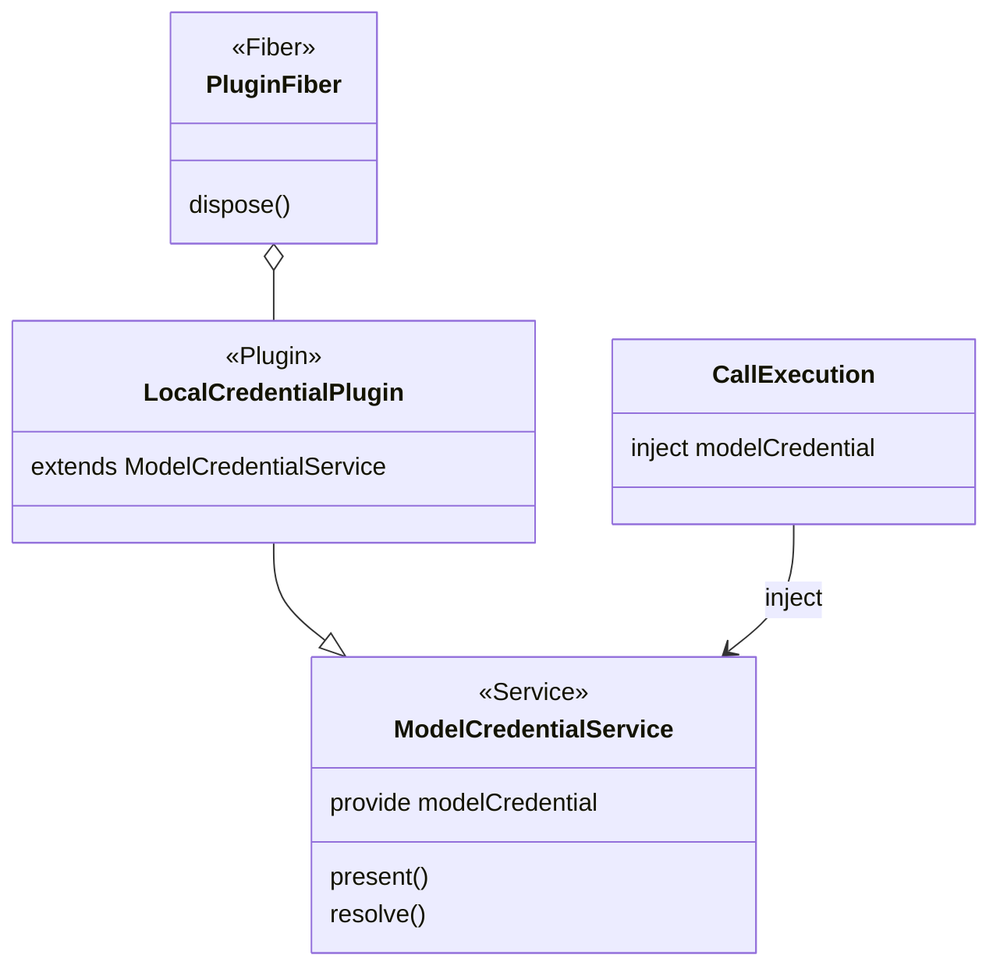

# 模型凭据的 Cordis 接缝

状态是待审。本页只说明面向 Cordis 集成时，本包交出的是什么。领域模型见 [model](model.md)。包内关系见 [architecture](architecture.md)。独立调用可以不启动 Cordis，直接使用根入口。两种入口看到的五种结果相同。

调用执行、结果保管和费用还没有单独的服务键。本交付只定义凭据这一道接缝。

## 服务、插件和 fiber

| 东西 | 在本包里是什么 | 不是什么 |
| --- | --- | --- |
| 服务 | 抽象 `Service`，键 `modelCredential`。它实现根入口的 `present` 和 `resolve` | 不是保管库的表，也不是调用记录 |
| 插件 | `src/cordis.ts` 导出的本地保管插件。它 `extends` 上面的服务，不另写键 | 不是 Agent 的子插件，也不进会话作用域 |
| fiber | 装载该插件的那条 fiber。关闭挂在这条 fiber 的撤除上 | 不是 Session，不是模型执行器，也不是一次发送 |

定义拥有者是 `packages/model/model`。根入口 `src/index.ts` 导出引用类型和操作类型，不导入 `@deepseek-ai/cordis`。`src/cordis.ts` 上的服务类标注 `@owner packages/model/model`。本交付尚未另立契约 ID。

同一个 isolate 里这道接缝只有一个提供者。调用执行把 `modelCredential` 写入 `inject`，不导入保管库模块。租户、用途和是否获准发送都是 `resolve` 的参数。不从 `ctx`、插件实例或谁装了这个插件来推断租户。

模型执行器不是 Agent 的子 Fiber。跨边界只传业务身份和这次发送任务，不传 Context 或 Fiber。

插件配置只放可序列化的数据，例如保管库位置。回调和已经打开的存储对象由装配入口 provide，不写进插件树。配置无法校验时插件加载失败。本交付不新增 Cordis 事件。诊断留在操作结果里。

fiber 撤除时停止新的 `present` 和 `resolve`，并等待已经在途的解析结束。关闭不删除绑定，不改写已经交给发送端的值。
