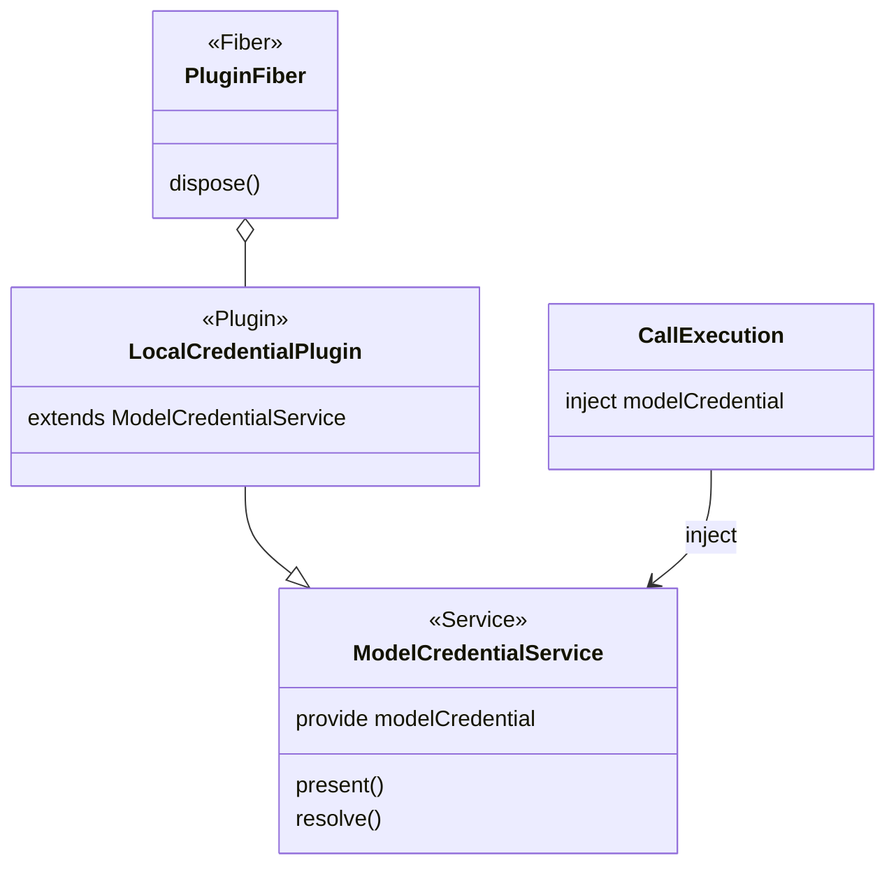

# 模型凭据的 Cordis 接缝

凭据引用与解析规则已由 D-04 接受，并写入 [SPEC](../SPEC.md)。本页说明面向 Cordis 集成时，本包交出的是什么。领域模型见 [model](model.md)。包内关系见 [architecture](architecture.md)。独立调用可以不启动 Cordis，直接使用根入口。两种入口看到的五种结果相同。

调用执行、结果保管和费用还没有单独的服务键。本交付只定义凭据这一道接缝。

## 服务、插件和 fiber

| 东西 | 在本包里是什么 | 不是什么 |
| --- | --- | --- |
| 服务 | 抽象 `Service`，键 `modelCredential`。它实现根入口的 `present` 和 `resolve` | 不是保管库的表，也不是调用记录 |
| 插件 | `src/cordis.ts` 导出的本地保管插件。它 `extends` 上面的服务，不另写键 | 不是 Agent 的子插件，也不进会话作用域 |
| fiber | 装载该插件的那条 fiber。关闭挂在这条 fiber 的撤除上 | 不是 Session，不是模型执行器，也不是一次发送 |

定义拥有者是 `packages/model/model`。根入口 `src/index.ts` 导出引用类型和操作类型，不导入 `@deepseek-ai/cordis`。`src/cordis.ts` 上的服务类标注 `@owner packages/model/model`。本交付尚未另立契约 ID。

同一个 isolate 里这道接缝只有一个提供者。`src/execute.ts` 的 `deliverInjected` 把 `modelCredential` 写入 `inject`，再调用 `deliver`。该文件不导入保管库模块。租户、用途和是否获准发送都是 `resolve` 的参数。不从 `ctx`、插件实例或谁装了这个插件来推断租户。

根入口同时导出 `createLocalCustodian(path, factorySecret)` 和 `openLocalCustodian(path)`，不要混用：

- `createLocalCustodian` 用于初始化新保管库，会覆盖 `path` 处已有的文件。
- `openLocalCustodian` 用于重开已有保管库；文件缺失、损坏或含冲突行时返回 `{ kind: 'unavailable' }`，不会创建文件。

独立消费示例见 [README](../README.md#独立消费入口)。

模型执行器不是 Agent 的子 Fiber。跨边界只传业务身份和这次发送任务，不传 Context 或 Fiber。

插件配置是保管库路径和工厂秘密。两者都是可序列化的数据。回调和已经打开的存储对象不写进插件树。`path` 必须是非空字符串。`factorySecret` 必须是字符串，空字符串可以通过。配置无法校验时插件加载失败。不新增 Cordis 事件。诊断不在这道服务上。服务只转发 `present` 和 `resolve`。诊断留在本地保管自己的列表里。

路径上还没有文件时，插件用配置里的工厂秘密新建保管库。`openLocalCustodian` 对缺失文件返回 `unavailable`，不新建。路径上已有文件时，打开使用文件里的工厂秘密，不用这次配置里的值。文件损坏时插件仍然注册 `modelCredential`。`present` 和 `resolve` 都返回 `unavailable`，不改文件，也不在撤除时关闭。注入到的对象不是这个服务时，发送结果是 `{ sent: false }`。

解析是同步的。`present` 和 `resolve` 每次从磁盘刷新当前状态，因此已注入的 `ctx.modelCredential` 能观察到其他进程或管理句柄造成的轮换、撤销或文件损坏。fiber 撤除把当前进程标成关闭，随后的 `present` 和 `resolve` 返回 `denied`。没有另做一次在途等待。关闭不删除绑定，不把这次停止写进保管库，也不改写已经交给发送端的值。

管理操作写盘前先刷新，持有文件锁完成“读当前状态—修改—发布”，并采用唯一临时文件 + `fsync` + 重命名的方式原子写入。写入失败时抛出异常，不发布新状态，已确认的旧快照保持不变。关闭后的管理操作仍会尝试持久化。下一个进程按打开时的绑定读取。
