# Model 业务与数据流

本页描述已接受的非 pi-ai 运行契约。pi-ai 细化的采用范围见[组架构各节](../../docs/architecture.md#成员与新增条件)，图表不表示运行实现或真实提供者验证已完成。

下图只给出主要阅读次序，不穷举控制优先级、状态或并发交错。完整行为和失败条件归 [SPEC](../../model-contract/SPEC.md)，各参与者只通过自己的公开能力交接。

流程承接[产品旅程](../../../../.meta_harness/design/product/model-invocation/design.md#关键用户旅程)，表达逻辑角色的顺序、守卫与交接。图表不定义公开 API、字段、提供者或存储事务。

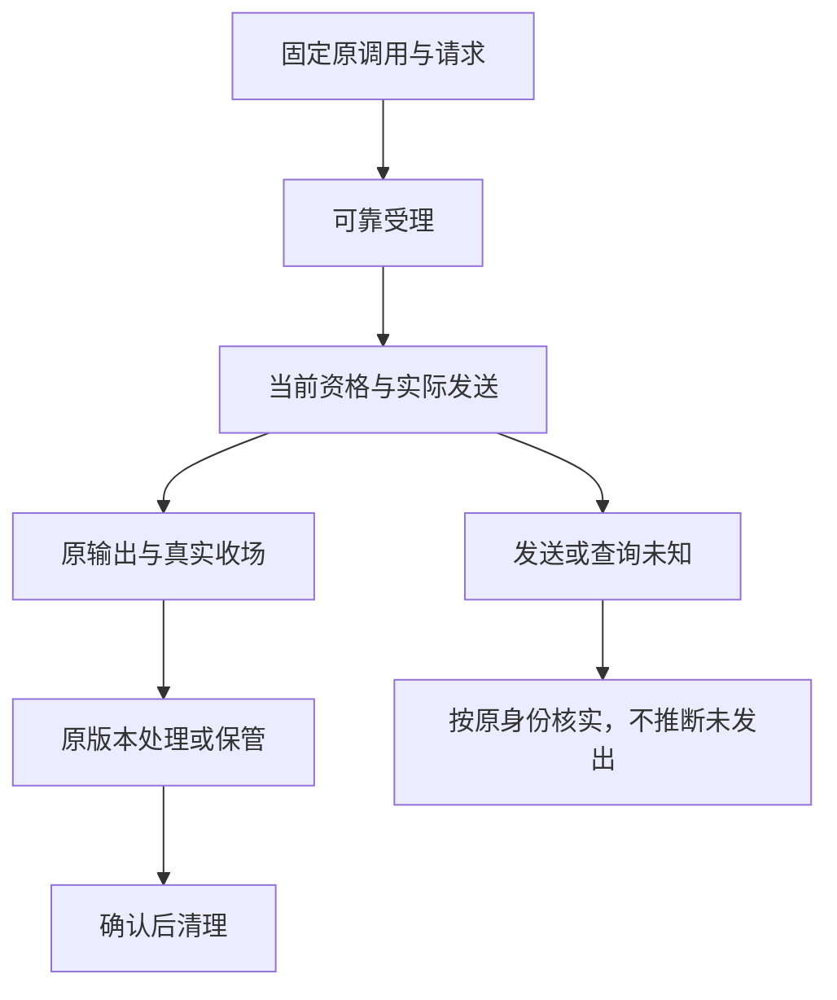

## 责任、机制源与图的读法

模型档案、真实发出、首内容、原结果、控制事实、保管和费用归 model/model；选择事实归调用方；表示选择、组装、预算分配和压缩归 request-context，Model 提供供应商计量能力并校验参数、模态与资格，发送路径不计量；消息接纳归消息准入者，模型后消费归消费者拥有者。独立程序承担自己的业务状态与消费，不建立隐式的域外工作身份。授权判断归 identity，设置与锁定归 assets，存储兑现各确认边界。

图中实线为请求、控制或保存意图，虚线为结果和事实返回，文字标明交接性质。参与者是逻辑角色，不表示同进程、同步事务或共同寿命。模型终局只引用[主规格的调用和真实发出](../../model-contract/SPEC.md#调用和各次真实发出)，不复制为域外工作的状态机。开块、填充、封块、截断、记费与流收场是流到达及结算事实。

本域的语义依据归[产品规则](../../../../.meta_harness/design/product/model-invocation/design.md#产品需求描述)及[主架构](../../../../docs/domains/model-invocation/architecture.md)。转换件的共同规则归[SPEC](../../model-contract/SPEC.md#转换件的共同契约)；请求表示组装消费该规则，不另定义。ACK、读取保护和清理的必要行为归[结果承接契约](../../model-contract/SPEC.md#结果承接清理与成本行为)，本页只画应用路径。

提交、围栏、消费承接和控制已有 [SPEC](../../model-contract/SPEC.md#342-资格共同提交与实际发送)。流程按其顺序展开，实际提供者仍须兑现并验证跨进程和耐久保证，不以同库位置推断原子性。

## 档案维护与会话选择

承接 J-MD01、J-MD02，能力为 CAP-MD01..04、CAP-MD05、CAP-MD06、CAP-MD12。模型域提供合法档案及采用依据；调用方是列表和切换的协调者，模型域不写选择。

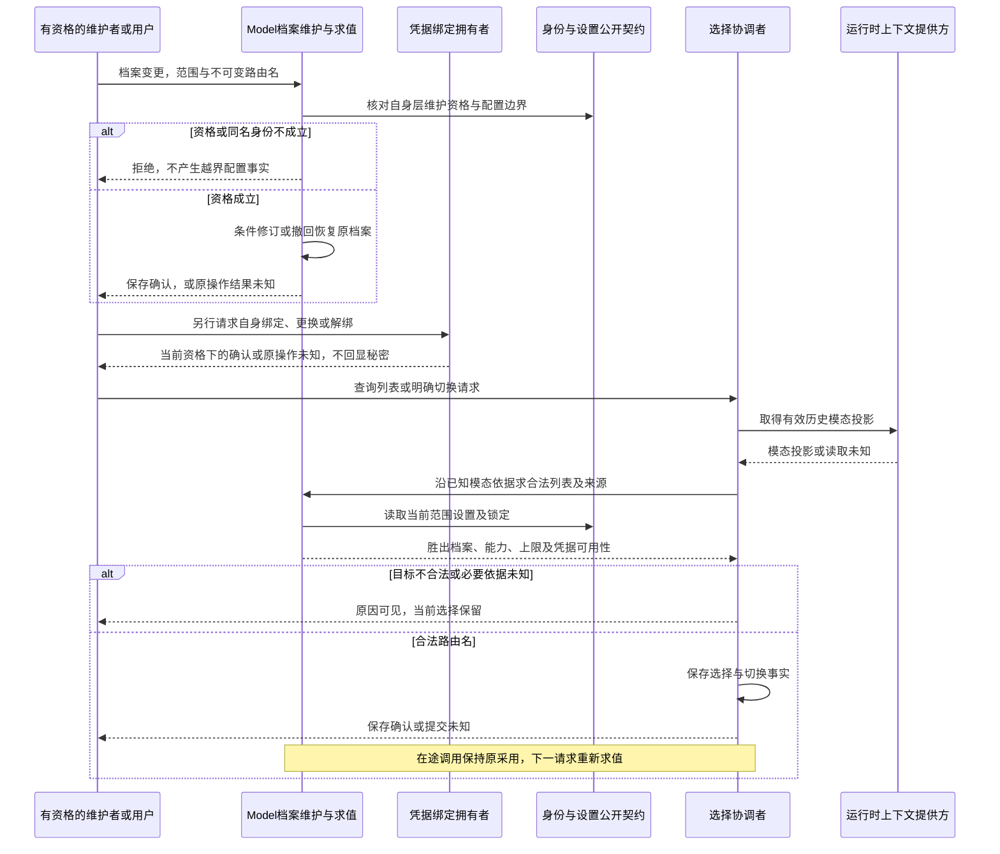

维护者角色必须与操作匹配，不能让普通选模型用户获得建档资格。官方发布、组织超级管理员自身层和租户自身层分别限权，域外的工作与编排只可代理明确合法切换。凭据请求不回显秘密。撤回保留身份；原行恢复不恢复取消执行。以上请求无需共同提交。

| 守卫或异常 | 可观察后果与原位置 |
| --- | --- |
| 最具体档案缺凭据或模态不兼容 | 不退外层；缺凭据合法目标仍可选并标注；模态不兼容不合法。 |
| 最具体同名撤回但外层仍有效 | 同名求值按既定筛选胜出，选中路由名不变。 |
| 链上全部撤回、配置排除、未找到或不可读 | 分别报原因，不可读不当已下架。 |
| 小窗口合法切换 | 调用方保存；下一请求失败不回滚已确认选择。 |
| 保存确认丢失、维护者退出或请求取消 | 查询原配置操作或切换事实，未知不宣称成功或回滚；在途调用寿命独立。 |
| 凭据解绑或读取故障 | 后续请求缺凭据或未知；既有发出与费用不改，存在但不可读不退默认。 |

对应规格为[身份及修订](../../model-contract/SPEC.md#身份修订及撤回)、[同名求值与选择](../../model-contract/SPEC.md#同名求值选择及列表)。持续验证定位[档案验证](../../model-contract/verification/README.md#验证与待闭合输入)，凭据精确键和接入数量继续依 MODEL-M04。

## 转换、表示选择与固定输入

Tool 内容 ref 路径不经过接纳前二进制转换，附件只产生地址文本；Model 实际发送时加载选中 ref，规则归 [SPEC](../../model-contract/SPEC.md#工具定义转换与内容引用加载)。以下转换图适用于其他消息来源，Tool 消息准入否决仍沿原消费责任。

承接 J-MD03，能力为 CAP-MD05、CAP-MD06、CAP-MD12、CAP-MD13。消息准入者应用转换契约；请求上下文选择表示，在请求前用 Model 的计量能力判断并决定必要压缩；发起协调者固定采用，模型执行校验实际发出，不计量输入。转换失败不能抹除原模型或工具执行。

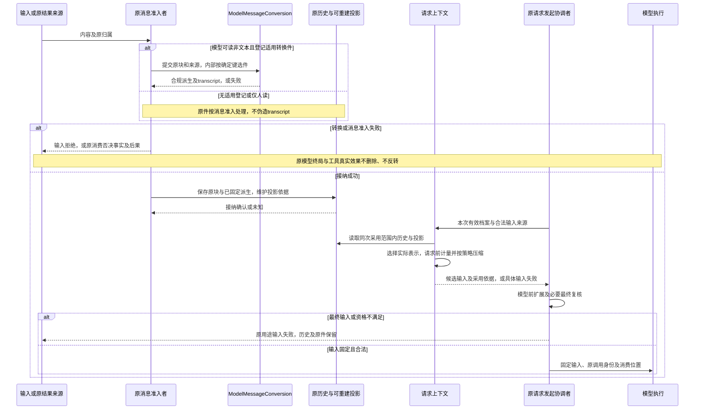

取消转换操作返回具名 cancelled，释放本次资源且不接纳消息，不把取消当作模型回复转换否决来触发新一轮调用。无转换件与命中但不可用分别处理；后者不能降级成无件或换一个实现重算。

这里的原结果来源不指一律绑定仍在进行的域外工作。输入失败拒绝接纳；模型回复否决回原发起位置，原调用照常收场。后续是新调用。连续否决不设次数上限。工具失败仅由仍有效、未终结的域外工作的原消费契约使该工作失败。后台、域外工作之外或已终结的结果回自身原消费者，取消业务不得取得新入队资格。独立调用未走消息接纳时不硬造转换消息。

表示选择、预算分配和压缩的唯一源继续是 [request-context 规格](../../../context/request-context/SPEC.md)。Model 提供供应商计量能力，Context 在请求前调用它并决定是否调整候选；Model 的准备与发送不以计量结论作为发出条件。模型前扩展改写后需复核，不能混用不同采用版本、重复执行同次扩展或靠删除固定要求装入窗口。已发出请求不随后续选择或配置改写，后续外传资格另核对。

档案缺必要声明、来源不可读和实际不兼容都阻止发送；输入大小由压缩方在请求前判断，估算超限称估算检查失败，字节及图数按实际量检查。超限表示可按已有策略改取合规表示，不能隐瞒原件或当模态错误。上游事后以 input-over-limit 拒绝时，调用以 failed 收场，Model 不重发同一输入，调用方压缩后以新调用重发。输入仍装不下则原工作失败、历史保留，独立路径返回原调用方。

精确参数与计量依 MODEL-M01，Tool ref 迁移与发送验证依 [MODEL-E01](../../../../.meta_harness/design/product/model-invocation/design.md#model-e01)。不开放任意嵌套语法。持续验证见[档案验证](../../model-contract/verification/README.md#验证与待闭合输入)及[请求资格](../../model-contract/SPEC.md#请求资格身份与固定输入)。

## 真实发出、首内容重试与流收场

承接 J-MD04，能力为 CAP-MD06、CAP-MD07、CAP-MD08、CAP-MD11、CAP-MD13。本图不复制调用终局状态机，只表示一次逻辑调用内的真实发出、策略和消费先后。每次发出沿原调用身份关联，换供应商不是域外工作的新一次尝试。

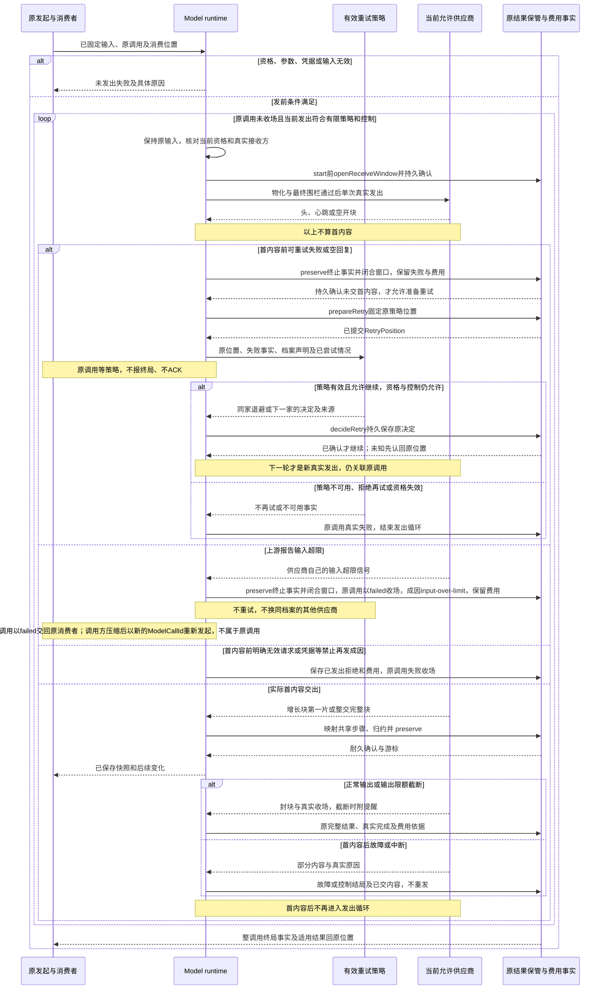

图中先开接收窗口再 start，以覆盖 transport 可能预读的情形；窗口未确认则不能读取或发出。能证明 start 不接收或预读内容的 adapter，才可按 SPEC 在 start 后、首次读取前开窗。

失败分支只有在 preserve 已保存该窗口全部已接收事实并闭合窗口、可证明未交首内容后才进入 prepareRetry。无法证明完整闭合时保持 uncertain，先核实原操作，不用空快照放行重试。

图中后续发出可再次经历首内容前失败，但循环必须被有限策略收束。允许回退按档案次序逐家至多一次；不允许回退原家退避后至多再试一次。替换策略不能跨首内容边界、改路由名或不透明换供应商。上游明确请求或凭据无效不反复发送同一输入；本地保管故障不报成供应商故障。

开块固定追加或整体替换模式，替换只改该块。封块提供完整内容，增量与一次取得有效结果一致。截断提醒、实际用量登记和 finish 各有事实，finish 不结束原域外工作。重连先取快照后取增量，未收齐工具参数不可执行；完整工具建议也只交消费者拥有者做工具准入。

首内容前最终失败回原用途失败位置；首内容后部分及提醒回原消费位置，不增加第二份同义上交事实；压缩、扩展及独立用途回原位置。后续消息否决不把完成改失败，不送回策略复活终局，后续的新调用用新身份。

重试位置、持久决定和独立适配已有 SPEC；MODEL-M02 跟踪提供者兑现。保存后发布已有顺序，MODEL-M03 跟踪实际故障验证。精确流事实及共享步骤映射归 [流协议](../../model-contract/SPEC.md#供应商解释与流状态归约)，图不另造事件定义。验证见[主规格持续验证](../../model-contract/SPEC.md#观测资源与验证)。

## 控制、取消与原身份恢复

承接 J-MD05，能力为 CAP-MD09、CAP-MD10、CAP-MD11、CAP-MD12。控制关系、真实物理执行与消费资格分别判断；模型与域外的工作与编排及其他执行不共享寿命。

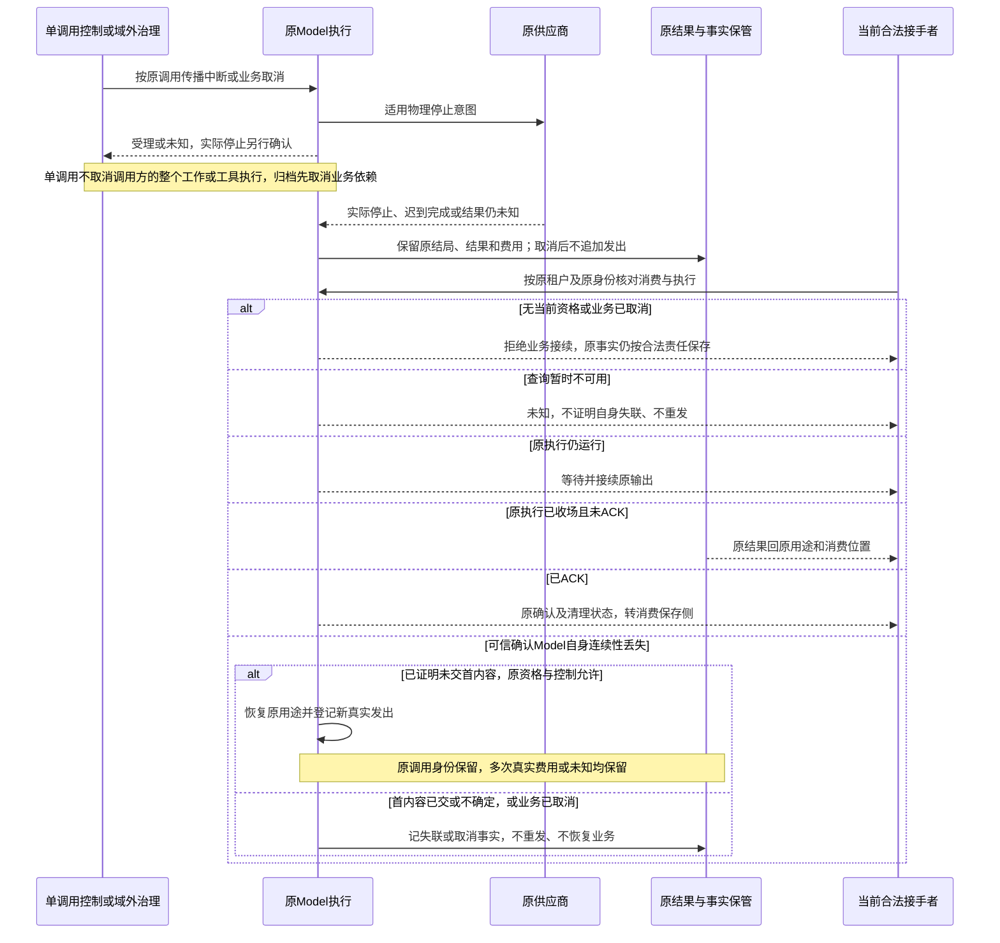

消费者退出或最后句柄释放不是自身失联，控制超时也不证明物理全停或提交回滚。真正 Model 连续性丢失的判据仍依 MODEL-M02，图不指定检测器。恢复使用原采用依据，不用新档案改原输入；取消和已失效授权阻止旧业务恢复。

单调用中断生效后，原消费者在工具准入前核原控制事实，阻止原响应中尚未发出的工具建议，包括参数已经完整的建议。已经独立发出的 Tool 由自己的控制契约处理，不从 Model 中断推定一并停止。

归档与撤销归档不反转原终局，迟到事实不进入新待处理队列、不默认派后继工作。取消调用的结果责任由当前有资格承接者处理，不能自动 ACK 或要求已撤权消费者回来确认。首内容后失联不重发，已展示内容可追溯仍依 MODEL-M03 兑现。

验证见[控制规格](../../model-contract/SPEC.md#控制取消与晚到事实)、[恢复规格](../../model-contract/SPEC.md#换代恢复和耐久)及[消费验证](../../model-contract/verification/README.md#持续验证义务)。

## 双路径 ACK、未知回执与清理

承接 J-MD06，能力为 CAP-MD09、CAP-MD10、CAP-MD11、CAP-MD12。Model 的保管责任不能因域外工作结束、无人读或句柄为零解除。ACK 必须晚于整调用真实收场和当前合法消费者可靠承接。

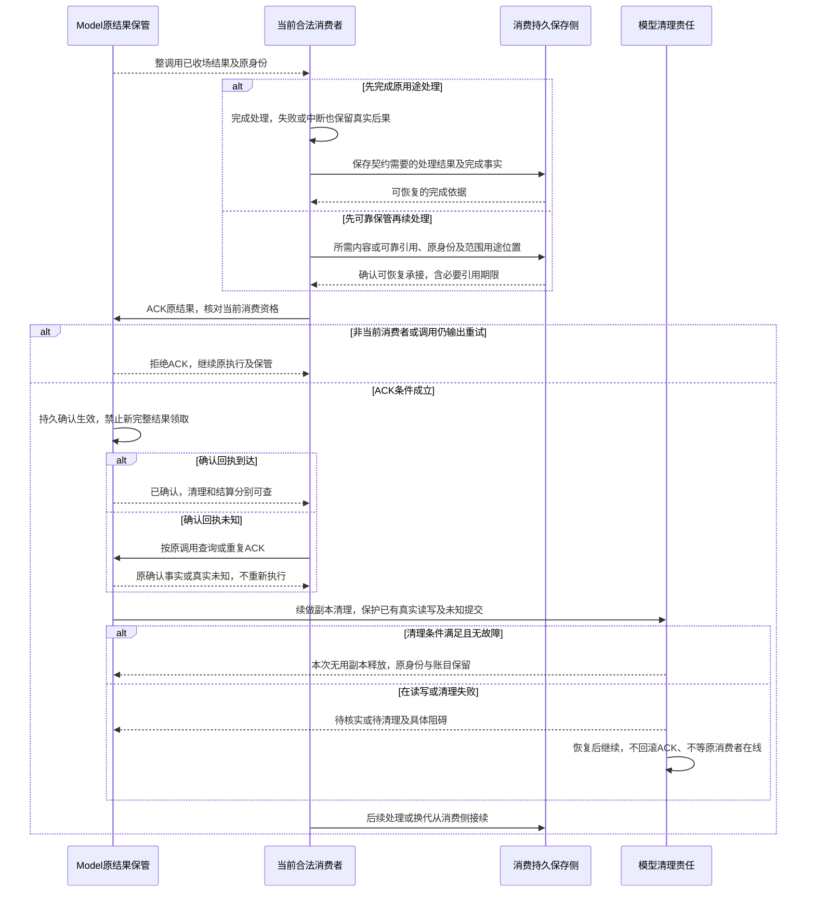

消费者在处理或保管失败时不能走 ACK，模型继续保管；完成处理路径不强制永久保存原全文。ACK 两路径均无强制聊天消息或域外工作终局门槛。模型侧新的完整结果领取在确认后禁止，已开始真实读取不能被截半；权限变化仍依原访问契约，不能恢复已撤权者。

未知 ACK 先核实原身份，持久确认丢失不能当未保存。真实写入未知时不能报告全部释放。清理只释放本次无用副本及引用，不删消费侧、原历史、别的调用内容和正确结算需要的资料。闲置句柄不永久占用，未知费用已能独立续结时不扣住无关全文。确认、物理清理与结算独立可查。

提交与读写竞态顺序、消费认领和稳定引用依 MODEL-M02，存储须兑现已确认事实的进程、操作系统崩溃及断电耐久；介质损毁另验。验证见[交接与清理场景](../../model-contract/verification/README.md#持续验证义务)。

## 真实费用、资格查询与诊断

承接 J-MD07，能力为 CAP-MD04、CAP-MD11、CAP-MD12、CAP-MD13。账目拥有者从原调用和各次真实发出投影费用，诊断不代账。这里的账目角色不指定包、后台服务或数据库。

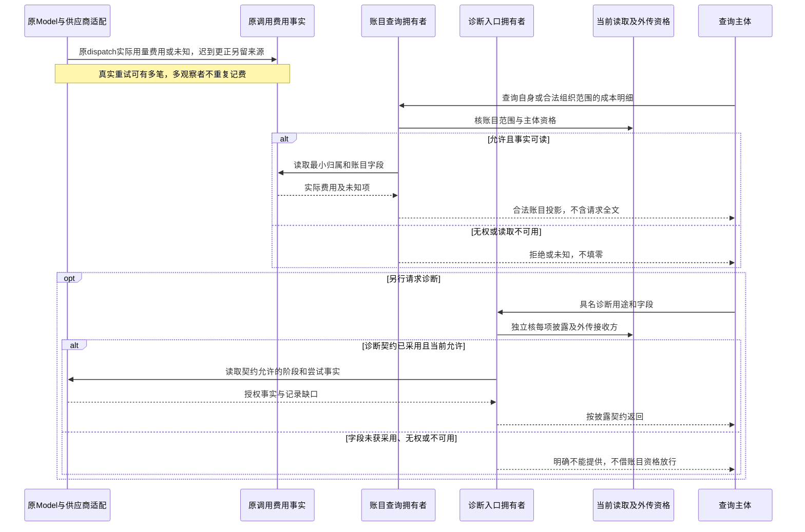

组织成本及明细可见不授请求内容权，遥测接收方改变需重新满足外传条件。凭据只保留合法绑定关联，不用秘密值作追踪键。费用迟到不受域外工作终局阻止，清理不抹必要结算资料；账目恢复和重复查询不重执行、不复活业务。

完整列表和物化按实际量评价。模型 TTFT 与端到端首次输出分开，排队、转换、组装、发出、重试和清理分别有定位事实。具体指标尺度与后端不在图中补定。

持续验证见[费用及保护](../../model-contract/verification/README.md#持续验证义务)、[合法选择与投影缺失](../../model-contract/verification/README.md#验证与待闭合输入)与[观测规格](../../model-contract/SPEC.md#观测资源与验证)。费用去重及清理接续继续依 MODEL-M02；秘密绑定精确形状继续依 MODEL-M04。

## 请求准备与发送复核

本图细化 [flow-md02](#flow-md02)。F 是原发起协调者，持有扩展位置；压缩、扩展内部调用和独立程序各保留自己的原位置，不因此启动新的主流程。Context 的职责是组装及压缩，不执行扩展或受理 ModelCall。

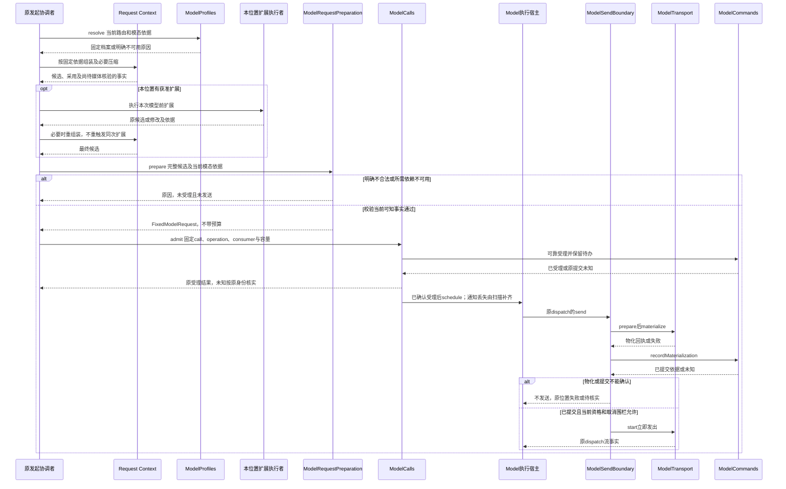

Context 在请求前使用同一计量规则来选择或压缩表示。最终 prepare 失败若仍能按已有策略调整，由原协调者交回 Context，再判断最终输入；不把预算策略交给原发起者，也不循环执行同次扩展。无合规候选则回原用途失败，原历史不删。

deferred-media 只表示已经检查可知事实且列出了必要待核验引用，不表示完整请求已通过。Model 受理后，发送提供者读取内容并按实际 payload 重计；失败仍是未发出失败，不删除历史、不擅自改输入或重跑工具。准备结果和物化回执都不是永久发送许可。

目录和通知不参与授权。实际 start、首内容接收及 preserve 分别有时点；未知发送不转换成 not-sent，接收窗口不确定继续约束恢复。原消费者只依赖 admit/inspect/observe/read/ack，不驱动内部发送步骤。

## 两种独立调用

承接 J-MD04..07。独立程序选择是否需要托管，二者都不创建隐式的域外工作身份。两种路径的输入合法性、当前访问和真实发送规则一致，恢复与保管责任不同。

非托管 executeModel 已实现。下面的完整托管路径仍是目标行为。createModelRuntime 已实现受理、查询、取消意图、原流保存与最小实例观察，已支持[有限的原终局收场](../SPEC.md#已实现的调用收场)，结果读取与 processed ACK 已实现，retained ACK、自动清理及恢复仍未实现。

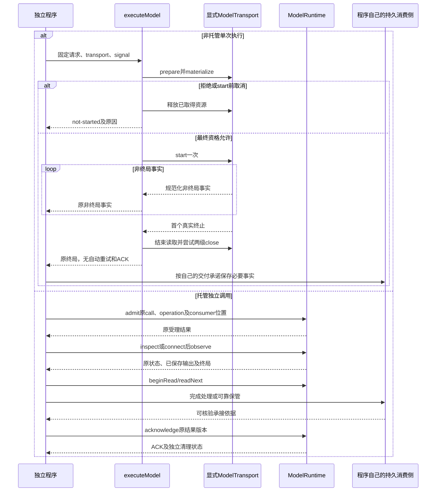

非托管调用的 signal 取消只请求实际停止，完成竞争保留真实结局，失联不冒充停止已确认。需要发布给用户的独立程序自行兑现保留责任；需要故障恢复、有限重试和结果保管时选择托管路径。流迭代器提前退出须结束本次读取并释放所持资源，不能证明已撤回供应商执行；实际资源终止仍沿传输协议。

独立执行在终局交付前完成全部清理尝试。清理失败保留原业务终局，后续 next、return 或 throw 报固定安全异常；消费者早退则在该次推进报告。原生 generator 的 return 等待已排队的 next，不提供抢占或关闭时限。具体边界归 [独立执行规格](../SPEC.md#独立执行)。

托管程序退出不取消调用。恢复用原 admission/consumer 找回，不以新 call 重试未知受理。两条路径都按真实费用记账，未获得托管身份的事实由调用者持有独立关联，不能伪造 dispatch 进入他人原调用。

## 宿主启动、接续与退出

承接 CAP-MD07、09、10、11、12。调用、控制、保管、清理和账目任务可以由后继宿主接续；活体目录不是恢复清单。

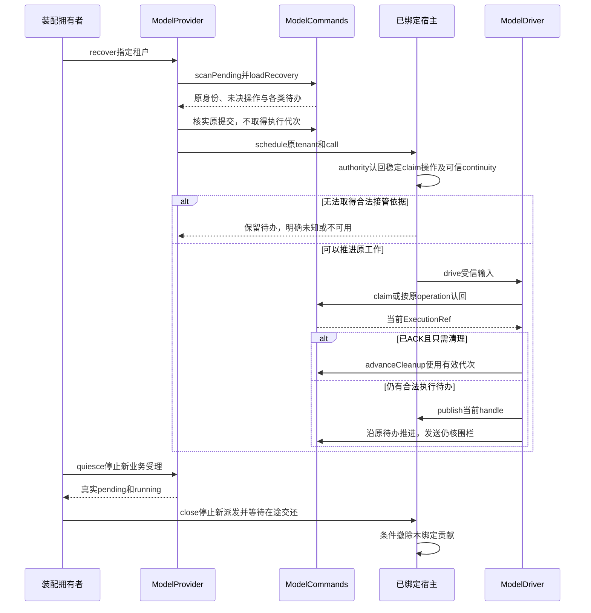

清理推进和模型再次发出是不同责任。后继清理同样须取得有效 execution generation，不复用被排除的旧实例；取得清理推进权不使已终局调用重新可发送。recordLateFact 只核当前访问和可信原来源，不授旧执行者推进权。

已受理但 schedule 通知丢失，由持久待办扫描补齐。recover 不从 ModelDirectory 的空结果推断原工作不存在。策略已有决定则恢复原决定，未决先 inspect 原 RetryPosition；没有策略能力时明确不再试，不能阻塞原结果查询。控制先成立时不再发送，已 ACK 只推进清理与必要账目。

quiesce 后已受理工作仍可派发。装配者可以先排空，也可关闭绑定并把未派发工作留给后继；后一种情形须报告未完责任，不称排空成功。quiesce 不等于取消、ACK、清理完成或真实外部停止。依赖突然丢失按原操作返回未知/不可用并保留责任；计划退出按 [Cordis 装配](../../model-cordis-contract/docs/cordis.md)释放本贡献。后继使用同一耐久权威，不能用空内存实现宣称已恢复。

## 模态投影与性能观测

承接 CAP-MD05、12、13。运行时上下文提供方交出历史模态投影，Model 接收它并按档案求合法列表；调用方用它查询合法模型。投影的形成、保管和重建在 Model 之外。

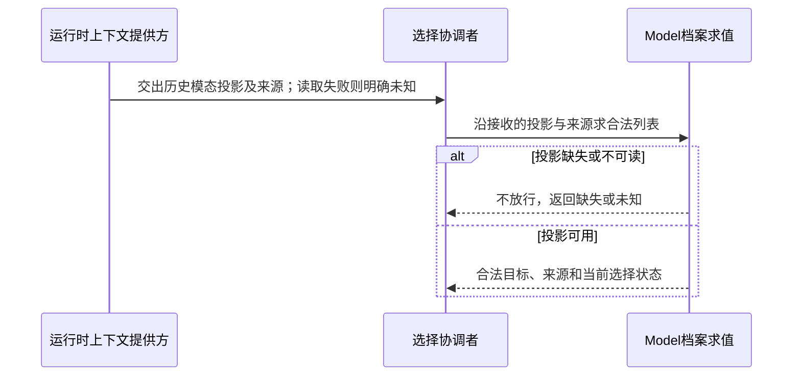

投影缺失或不可读时，Model 不把它当作空历史放行。Tool 内容 ref 只用元数据参与相容性；附件地址不增加媒体模态。

观测按原 call/dispatch 关联 prepare、排队、物化、start、供应商首内容、持久发布及清理。供应商 TTFT 与入口到首输出分别计量；跨时基不能直接相减。费用/阶段事实供合法投影，原文、秘密及附件地址不进入普通遥测。记录缺项返回未知；详尽诊断字段与保留策略的缺项见[诊断约束](architecture.md#identity-neighbor-diagnostics)。

## 完整计量与流归约

请求组装方在请求前按供应商固定计量组合，将完整组装输入转换为该表示的 tokenInput。具体 meter 按需调用 tokenizer，并计入模板、工具声明与媒体贡献。缺媒体事实时明确 deferred-media。实际发送阶段取得内容后只编码 payload，不重新计量。物化回执提交后沿发送围栏推进。

可选历史校准只有在原请求/响应、统计口径、完整输出组和相同适用依据均可证明时才使用。条件失效先回完整计量；不要求 Context 或原发起者驱动另一套增量 API。失败及精度规则见 [计量协议](../../model-contract/SPEC.md#可选校准及不可解释的历史)。

一段 append 文本的正常顺序是 block-open、block-delta("你")、block-delta("好")、block-seal("你好")。每步归约后的快照依次为 ""、"你"、"你好"、完整文本块。replace 块每次交新的完整在途值，不能走 append 路径。解码、runtime 映射共享步骤并固定序号、合法性归约、持久 preserve、观察发布按此顺序进行；供应商 finish_reason 后的合法用量尾帧仍属于原 dispatch。

## 家族适配的装配与一次发送

此图细化已采用 pi 技术栈的提供者路径，包职责见[组架构](../../docs/architecture.md#厂商适配的内聚范围)。家族名称不代替精确型号或实际服务商绑定。普通调用者与 adapter 作者消费 model-contract；选择实际工厂是装配者的责任，契约导入不触发装配。

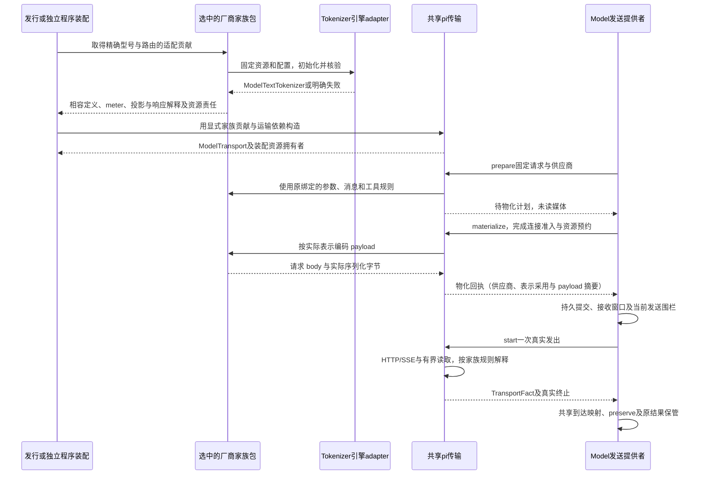

不需要本地 tokenizer 的 meter 明确采用对应方法，装配不虚构 count 实例。家族解释不执行隐藏网络调用或重试。发送资格、费用归属、控制、首内容和 ACK 继续沿本成员契约；包边界不另造这些规则。

## 契约消费与运行装配

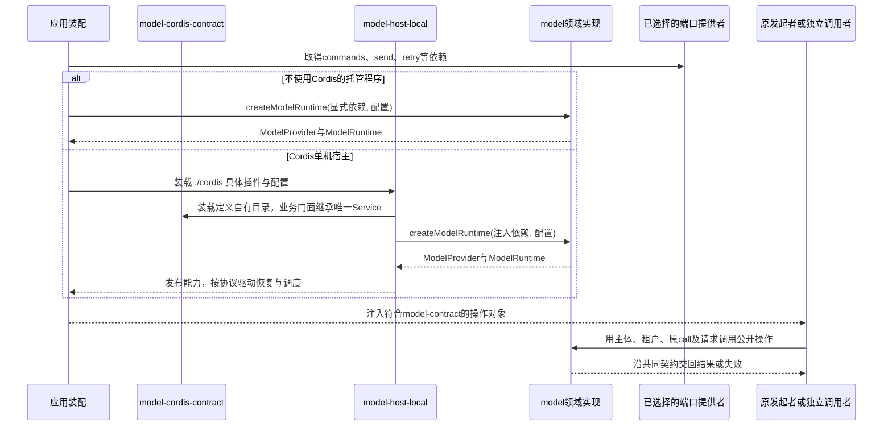

ModelDependencies 和 ModelConfiguration 是 model 工厂的构造输入；每次请求、主体、租户和原调用身份是操作参数，不藏入全局 Context。不使用 Cordis 的托管程序也必须显式提供实例宿主、时钟和持久端口，不能以空实现假装耐久。直接 executeModel 则沿原独立单次路径，不暗建托管 runtime。其他实现可以使用不同构造方式，但必须兑现 model-contract 的行为。

插件撤除沿原资源交接和登记协议退出，不消除尚未承接的保管责任。分包不改变这些时序，也不把一次物理发送变成可撤回动作。两个契约包已实现各自的公开接口，宿主与托管运行尚未实现，图是目标装配设计。

## FLOW-MD10 持久操作与流交付

图示采用同一存储提交内的资格参加者和原调用事实。后端不具备该组合时不能声称通过。

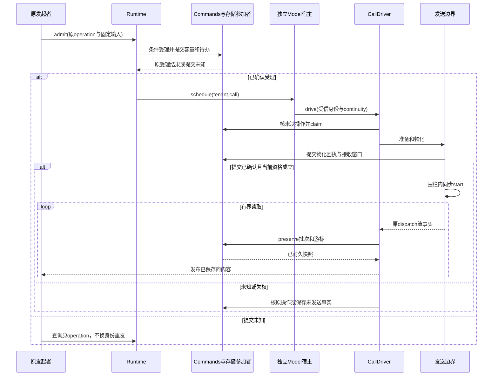

调度失败不撤销已持久受理，pending扫描负责补排。观察者退出不终止收集协程。读写背压只影响当前调用的资源；不能把未保存输出扔给观察者以腾空缓冲。

## FLOW-MD11 单机换代与清理接续

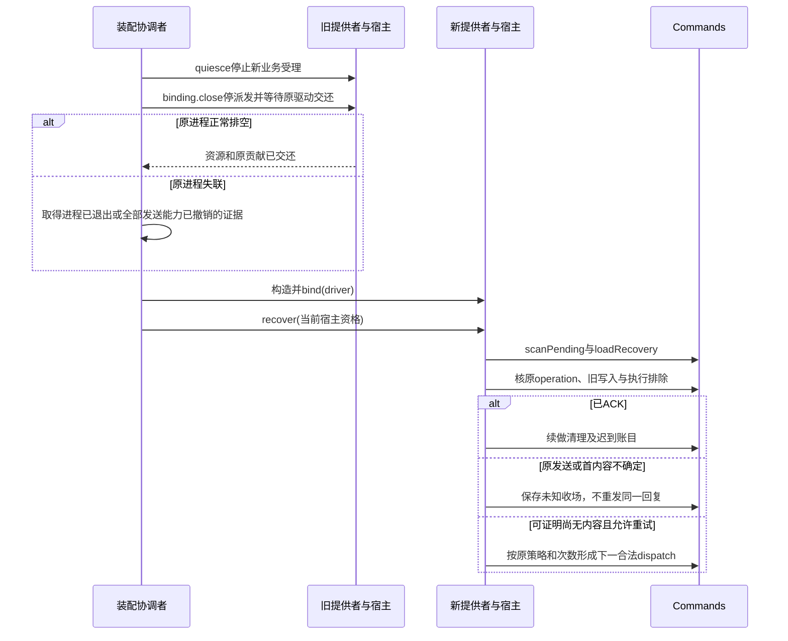

心跳超时、查询失败和锁租约到期均不足以走“旧执行已排除”分支。无证据时后继保留阻塞原因，控制、原结果查询和依法保管仍按当前能力处理。恢复不会把清理待办转换为执行待办。

## 凭据解析

承接已接受的[凭据对象](object-model.md#已实现的凭据对象)。每次获准的真实发出都重新解析。同一次发送的后续输出不再解析。存在性查询是另一次操作。发送本身只调用 `resolve`。

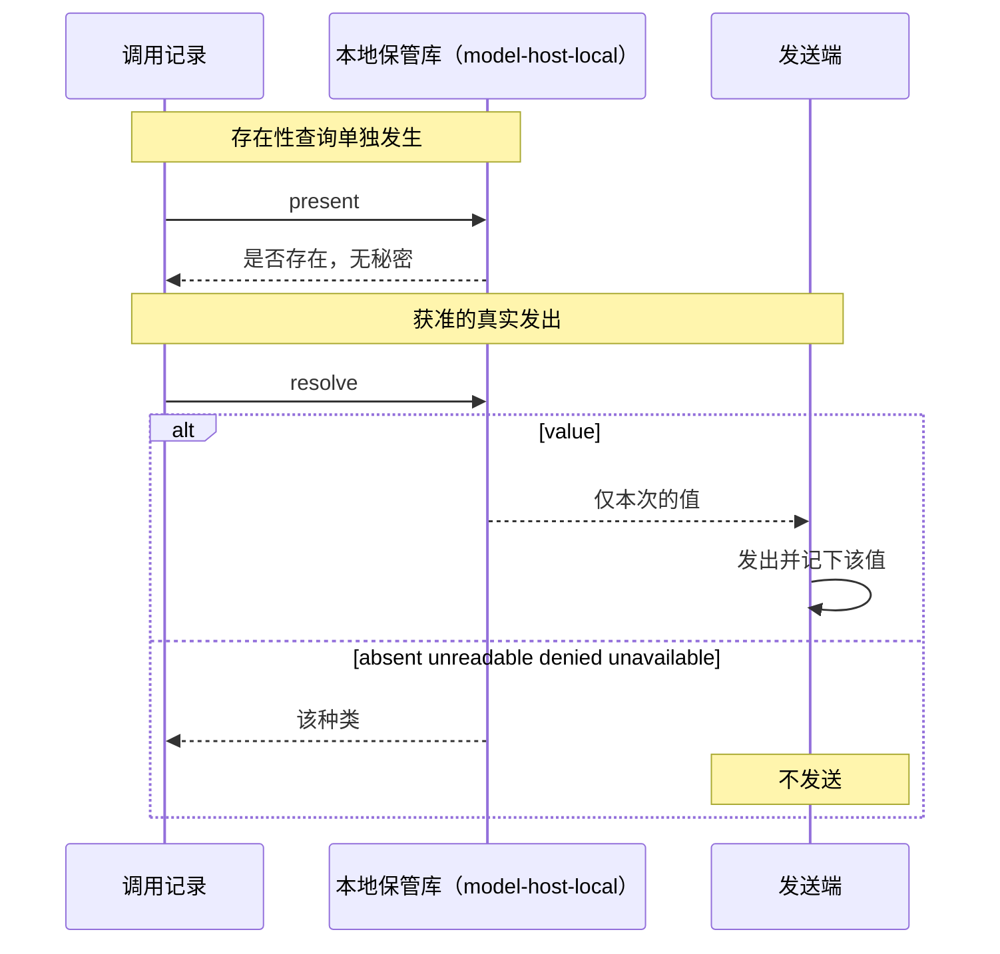

轮换后的下一次解析看到新值。撤销后的新解析是 `denied`。已经记入发送端的那一次保持已发送。进程重新打开同一保管库后，按打开时的绑定读取。关闭后的新解析停止，不改写已经发出的记录。
