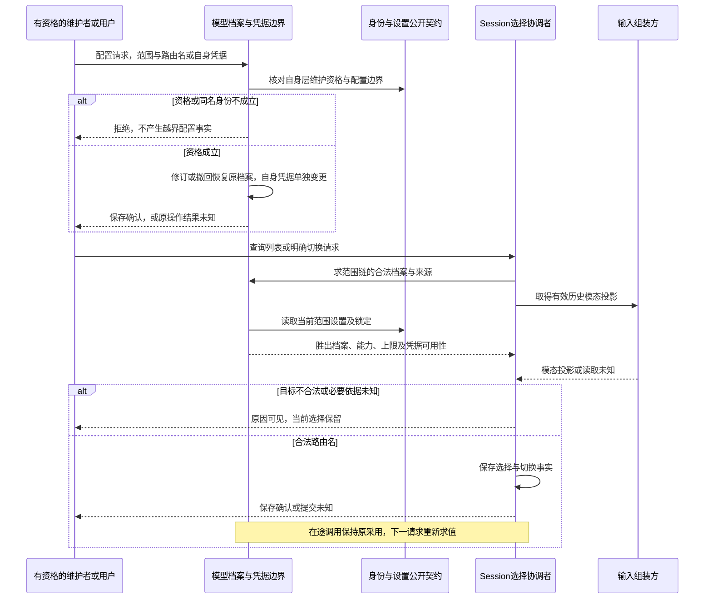
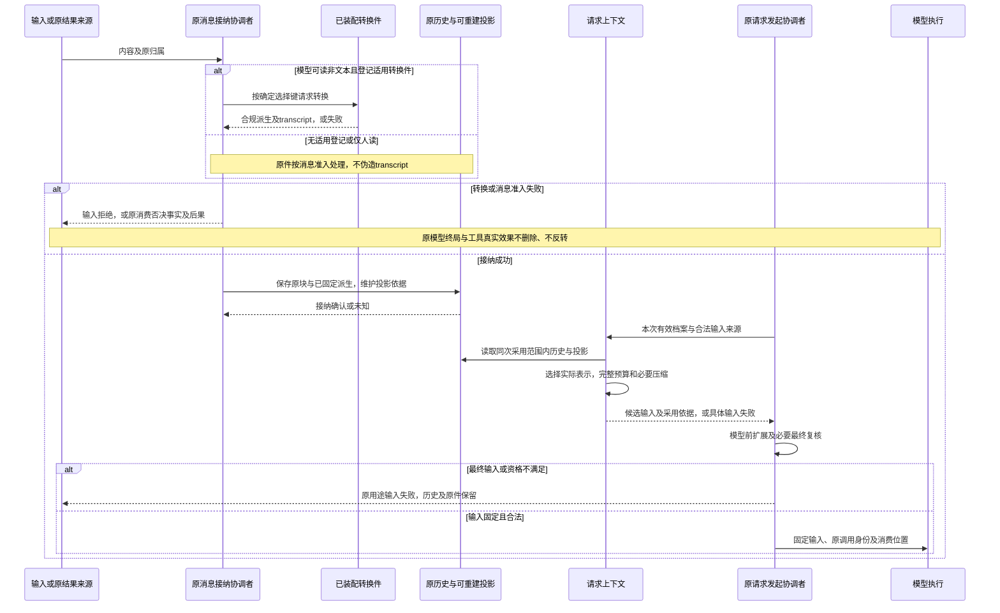
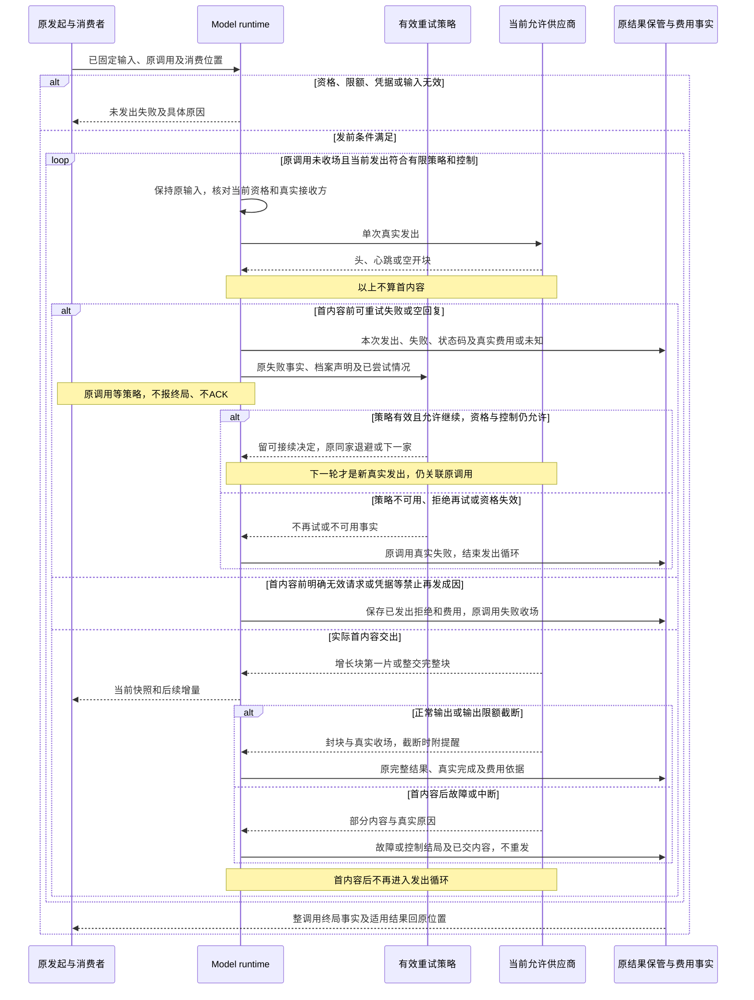
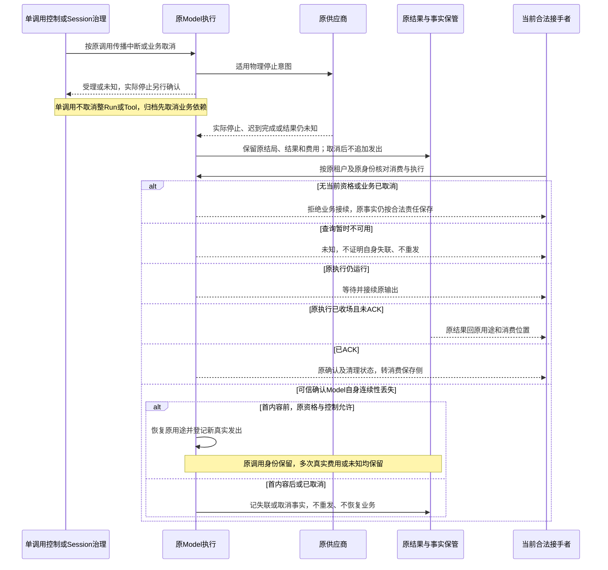
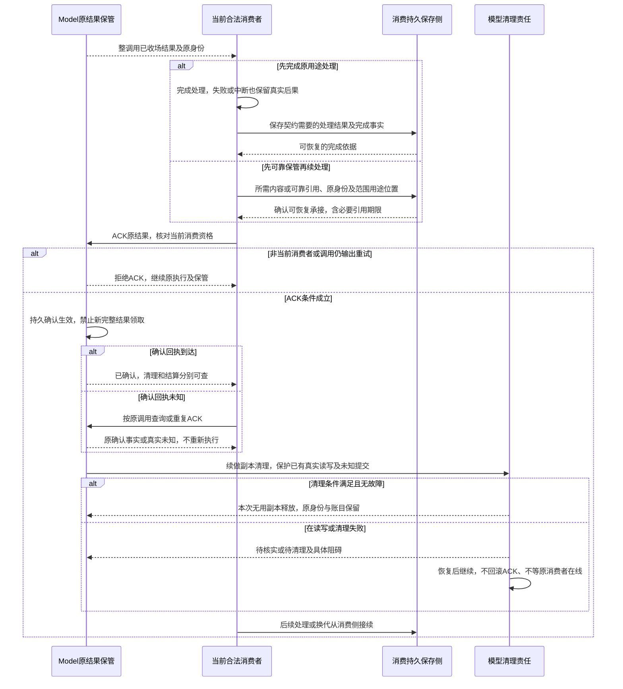
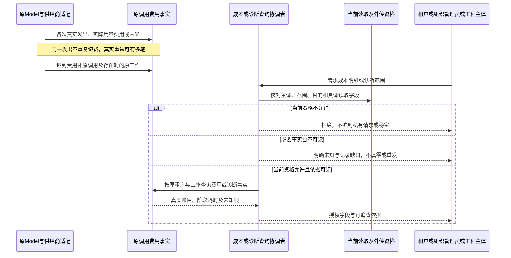
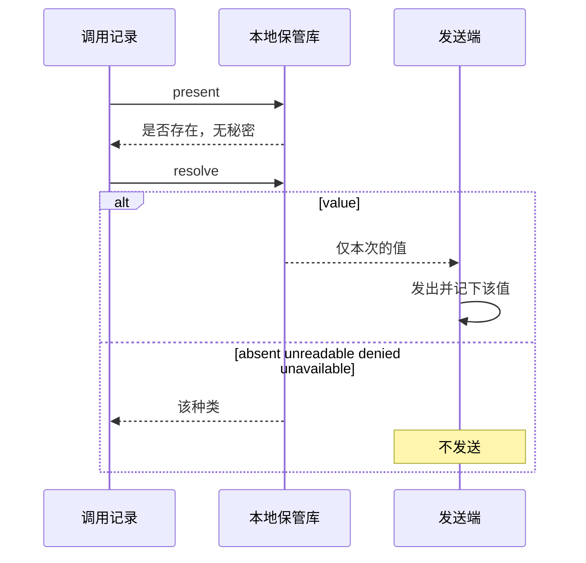

# 模型调用的关键协作流程

状态为候选，待用户确认。本页按[产品旅程](../../../../.meta_harness/design/product/model-invocation/design.md#关键用户旅程)表达逻辑角色的顺序、守卫及交接，不定义公开 API、字段、提供者或存储事务。

## 责任、机制源与图的读法

模型档案、真实发出、首内容、原结果、控制事实、保管和费用归 model/model；选择事实归 Session；最终表示、完整预算和压缩归 request-context；消息接纳及模型后消费归原 Agent 或其他消费者。独立程序承担自己的业务状态与消费，不建立隐式 Session。授权判断归 identity，设置与锁定归 assets，存储兑现各确认边界。

图中实线为请求、控制或保存意图，虚线为结果和事实返回，文字标明交接性质。参与者是逻辑角色，不表示同进程、同步事务或共同寿命。模型终局只引用[主规格的调用和真实发出](../SPEC.md#调用和各次真实发出)，不复制为 Run 状态机。开块、填充、封块、截断、记费与流收场是流到达及结算事实。

本域的语义依据归[产品规则](../../../../.meta_harness/design/product/model-invocation/design.md#产品需求描述)及[主架构](../../../../docs/domains/model-invocation/architecture.md)。转换件的共同规则归[档案与模态专题](profile-and-modality.md#转换件的共同契约)；请求表示组装消费该规则，不另定义。ACK、读取保护和清理的必要行为归[消费专题](consumption-and-cost.md)，本页只画应用路径。

尚未采用的精准提交、跨进程围栏、消费责任认领、稳定引用及控制传播按 [MODEL-M02](../../../../.meta_harness/design/product/model-invocation/design.md#model-m02)继续设计。流程只依赖已明的资格与责任关系，不以“同库”或“协调者处理”补协议。

## 档案维护与会话选择

承接 J-MD01、J-MD02，能力为 CAP-MD01..04、CAP-MD05、CAP-MD06、CAP-MD12。模型域提供合法档案及采用依据；Session 是列表和切换的协调者，模型域不写会话选择。

维护者角色必须与操作匹配，不能让普通选模型用户获得建档资格。官方发布、组织超级管理员自身层和租户自身层分别限权，Agent 只可代理明确合法切换。凭据请求不回显秘密。撤回保留身份；原行恢复不恢复取消执行。以上请求无需共同提交。

| 守卫或异常 | 可观察后果与原位置 |
| --- | --- |
| 最具体档案缺凭据或模态不兼容 | 不退外层；缺凭据合法目标仍可选并标注；模态不兼容不合法。 |
| 最具体同名撤回但外层仍有效 | 同名求值按既定筛选胜出，选中路由名不变。 |
| 链上全部撤回、配置排除、未找到或不可读 | 分别报原因，不可读不当已下架。 |
| 小窗口合法切换 | Session 保存；下一请求失败不回滚已确认选择。 |
| 保存确认丢失、维护者退出或请求取消 | 查询原配置操作或切换事实，未知不宣称成功或回滚；在途调用寿命独立。 |
| 凭据解绑或读取故障 | 后续请求缺凭据或未知；既有发出与费用不改，存在但不可读不退默认。 |

对应规格为[身份及修订](profile-and-modality.md#身份修订及撤回)、[同名求值与选择](profile-and-modality.md#同名求值选择及列表)。持续验证定位[档案验证](profile-and-modality.md#验证与待闭合输入)，凭据精确键和接入数量继续依 MODEL-M04。

## 转换、表示选择与固定输入

承接 J-MD03，能力为 CAP-MD05、CAP-MD06、CAP-MD12、CAP-MD13。消息接纳协调者应用转换契约；请求上下文选择表示、计量和必要压缩；发起协调者固定采用，模型执行校验实际发出。转换失败不能抹除原模型或工具执行。

这里的原结果来源不指一律绑定活着的 Run。输入失败拒绝接纳；模型回复否决回 Loop 原位置，原调用照常收场。后续是新调用。连续否决不设次数上限。工具失败仅由仍有效未终结 Run 的原消费契约使该 Run 失败。后台、Run 外或已终结结果回自身原消费者，取消业务不得取得新入队资格。独立调用未走消息接纳时不硬造转换消息。

表示选择和预算唯一源继续是 [request-context 规格](../../../context/request-context/SPEC.md)。模型前扩展改写后需复核，不能混用不同采用版本、重复执行同次扩展或靠删除固定要求装入窗口。已发出请求不随后续选择或配置改写，后续外传资格另核对。

限额缺项、不可读、计量无依据和实际不兼容都阻止发送；估算超限称估算检查失败，字节及图数按实际量检查。超限表示可按已有策略改取合规表示，不能隐瞒原件或当模态错误。会话输入仍装不下则原 Run 失败、历史保留，独立路径返回原调用方。

精确参数与计量依 MODEL-M01，工具最终块全集和嵌套投影依 [MODEL-E01](../../../../.meta_harness/design/product/model-invocation/design.md#model-e01)。图不承诺已经遍历所有嵌套块。持续验证见[档案验证](profile-and-modality.md#验证与待闭合输入)及[请求资格](../SPEC.md#请求资格身份与固定输入)。

## 真实发出、首内容重试与流收场

承接 J-MD04，能力为 CAP-MD06、CAP-MD07、CAP-MD08、CAP-MD11、CAP-MD13。本图不复制调用终局状态机，只表示一次逻辑调用内的真实发出、策略和消费先后。每次发出沿原调用身份关联，换供应商不是新 Agent attempt。

图中后续发出可再次经历首内容前失败，但循环必须被有限策略收束。允许回退按档案次序逐家至多一次；不允许回退原家退避后至多再试一次。替换策略不能跨首内容边界、改路由名或不透明换供应商。上游明确请求或凭据无效不反复发送同一输入；本地保管故障不报成供应商故障。

开块固定追加或整体替换模式，替换只改该块。封块提供完整内容，增量与一次取得有效结果一致。截断提醒、实际用量登记和 finish 各有事实，finish 不结束原 Run。重连先取快照后取增量，未收齐工具参数不可执行；完整工具建议也只交 Tool 准入。

首内容前最终失败回原用途失败位置；首内容后部分及提醒回 Agent 原步骤，不增加第二份同义上交事实；压缩、扩展及独立用途回原位置。后续消息否决不把完成改失败，不送回策略复活终局，新 Loop 调用用新身份。

重试持久决定与独立适配继续依 MODEL-M02；展示时点与在途保留依 MODEL-M03。具体流事件和参数形状依 MODEL-M01，不从图名发明 open、fill、close、trim、account、finish 的 API。验证见[主规格持续验证](../SPEC.md#观测资源与验证)。

## 控制、取消与原身份恢复

承接 J-MD05，能力为 CAP-MD09、CAP-MD10、CAP-MD11、CAP-MD12。控制关系、真实物理执行与消费资格分别判断；模型与 Agent、Tool 不共享寿命。

Agent 退出或最后句柄释放不是自身失联，控制超时也不证明物理全停或提交回滚。真正 Model 连续性丢失的判据仍依 MODEL-M02，图不指定检测器。恢复使用原采用依据，不用新档案改原输入；取消和已失效授权阻止旧业务恢复。

归档与撤销归档不反转原终局，迟到事实不进入新待处理队列、不默认派后继 Run。取消调用的结果责任由当前有资格承接者处理，不能自动 ACK 或要求已撤权消费者回来确认。首内容后失联不重发，已展示内容可追溯仍依 MODEL-M03 兑现。

验证见[控制规格](../SPEC.md#控制取消与晚到事实)、[恢复规格](../SPEC.md#换代恢复和耐久)及[消费验证](consumption-and-cost.md#持续验证义务)。

## 双路径 ACK、未知回执与清理

承接 J-MD06，能力为 CAP-MD09、CAP-MD10、CAP-MD11、CAP-MD12。Model 的保管责任不能因 Run 结束、无人读或句柄为零解除。ACK 必须晚于整调用真实收场和当前合法消费者可靠承接。

消费者在处理或保管失败时不能走 ACK，模型继续保管；完成处理路径不强制永久保存原全文。ACK 两路径均无强制聊天消息或 Run 终局门槛。模型侧新的完整结果领取在确认后禁止，已开始真实读取不能被截半；权限变化仍依原访问契约，不能恢复已撤权者。

未知 ACK 先核实原身份，持久确认丢失不能当未保存。真实写入未知时不能报告全部释放。清理只释放本次无用副本及引用，不删消费侧、原历史、别的调用内容和正确结算需要的资料。闲置句柄不永久占用，未知费用已能独立续结时不扣住无关全文。确认、物理清理与结算独立可查。

提交与读写竞态顺序、消费认领和稳定引用依 MODEL-M02，存储须兑现已确认事实的进程、操作系统崩溃及断电耐久；介质损毁另验。验证见[消费专题](consumption-and-cost.md#持续验证义务)。

## 真实费用、资格查询与诊断

承接 J-MD07，能力为 CAP-MD04、CAP-MD11、CAP-MD12、CAP-MD13。账目拥有者从原调用和各次真实发出投影费用，诊断不代账。这里的账目角色不指定包、后台服务或数据库。

组织成本及明细可见不授请求内容权，遥测接收方改变需重新满足外传条件。凭据只保留合法绑定关联，不用秘密值作追踪键。费用迟到不受 Run 终局阻止，清理不抹必要结算资料；账目恢复和重复查询不重执行、不复活业务。

模态点查询使用可重建增量投影，单会话单模态点查询为常数代价；完整列表和物化按实际量评价。模型 TTFT 与端到端首次输出分开，排队、转换、组装、发出、重试和清理分别有定位事实。具体指标尺度与后端不在图中补定。

## 凭据解析

承接待审的 [model](model.md)。每次获准的真实发出都重新解析。同一次发送的后续输出不再解析。

轮换后的下一次解析看到新值。撤销后的新解析是 `denied`。已经记入发送端的那一次保持已发送。进程重新打开同一保管库后，按打开时的绑定读取。关闭后的新解析停止，不改写已经发出的记录。

持续验证见[费用及保护](consumption-and-cost.md#持续验证义务)、[模态投影性能](profile-and-modality.md#验证与待闭合输入)与[观测规格](../SPEC.md#观测资源与验证)。费用去重及清理接续继续依 MODEL-M02；秘密绑定精确形状继续依 MODEL-M04。
