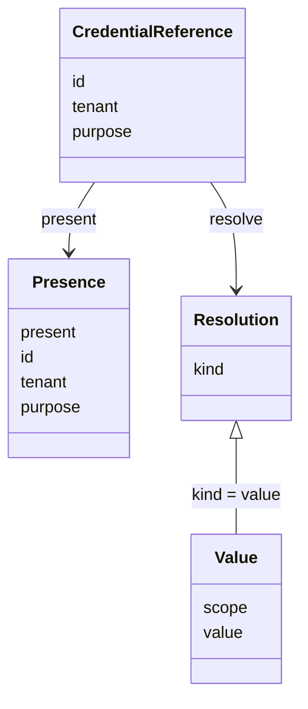
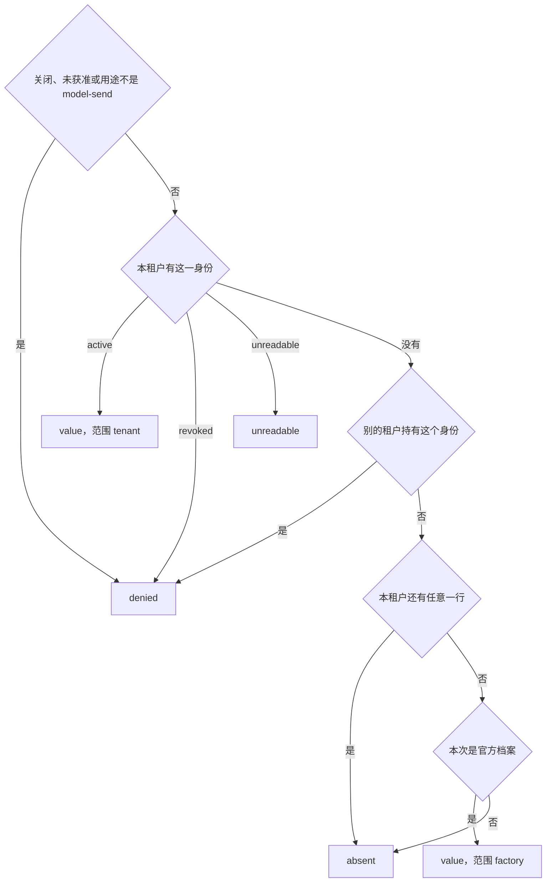

# 模型凭据的抽象与建模

凭据引用与解析规则已由 D-04 接受，并写入 [SPEC](../SPEC.md)。本页拥有引用、存在性和解析的模型。它不改 SPEC 已接受的调用、重试和结果保管承诺。包内模块关系见 [architecture](architecture.md)。Cordis 装配见 [cordis](cordis.md)。发送顺序见 [key-flow](key-flow.md#凭据解析)。

档案的身份、同名求值和模态仍由 [profile-and-modality](profile-and-modality.md) 拥有。原结果、ACK 和费用仍由 [consumption-and-cost](consumption-and-cost.md) 拥有。本页不复制那两份行为正文。

调用记录只保存引用。引用含凭据身份、租户和用途。本交付的用途取值是 `model-send`。更宽的用途词表不在本卡。查询可以带一个别的用途字符串，`present` 和 `resolve` 都是 `denied`。能写入保管库的引用仍然只有 `model-send`。同一凭据身份可以分属不同租户。已撤销或暂时读不出的行仍然存在，`present` 为 true。`resolve` 才分别返回 `denied` 或 `unreadable`。

租户标识使用 `packages/common/legal-identity` 的 `TenantId`。凭据身份是本成员自己的标识，不是 `TenantId`，也不是登录出示物。持有引用不构成读取授权。

`Presence` 没有秘密。`Resolution` 的种类如下。只有 `value` 携带秘密，并且只交给这一次发送。

| 种类 | 含义 | 发送端 |
| --- | --- | --- |
| `value` | 当前资格允许 | 发出，并记下所用的值 |
| `absent` | 没有这份凭据 | 不发送 |
| `unreadable` | 引用在，值暂时读不出 | 不发送 |
| `denied` | 跨租户、用途不符、无资格、已撤销或保管已关闭 | 不发送 |
| `unavailable` | 保管或存储暂时不能判断 | 不发送。不得报成 `absent` |

没有租户绑定、且本次档案是官方档案时，解析可以使用部署默认凭据，范围记为 `factory`。租户绑定仍在但值不可读时，结果是 `unreadable`，不使用部署默认凭据，也不使用其他租户的值。

`resolve` 按下面的顺序取舍。前面的结果一旦成立，后面的不再看。

未获准的官方发送停在第一步，拿不到工厂秘密。本租户没有这一行、但还有任意其他行时，缺的那个身份是 `absent`。其他行包括另一个身份，也包括已经撤销的行。别的租户持有同一身份时是 `denied`，即使本租户一行都没有，也不用工厂秘密。

`present` 不接收发送资格。用途不符或保管已关闭时，它返回 `denied`，不是 `present: false`。同一身份只在别的租户手里，或者本租户没有这一行时，它返回 `known` 且 `present` 为 false。`resolve` 对前一种才是 `denied`。`unavailable` 只在整份保管打不开、任一行读失败或同一持有者出现多行冲突时出现。凭据身份不能是空串，也不能含空格。

本地保管库每次 `present` 和 `resolve` 都从磁盘刷新状态，因此保留的句柄和 Cordis 服务都能观察到其他进程或句柄造成的轮换、撤销或文件损坏。如果文件在打开后被损坏，后续解析返回 `unavailable`，而不是继续返回旧值。

`put` 把该持有者写成 `active`，可以盖过已撤销或读不出的行。`rotate` 只换秘密，不改生命状态。已撤销的行轮换后仍是 `denied`。`markUnreadable` 只把 `active` 改成 `unreadable`。

发送端收到的记录只有发没发。不是 `value` 时，记录是 `{ sent: false }`，不再带那五种种类。发出时记录带上这次的秘密值。调用记录不带。诊断留在本地保管上，字段是 `stage`、`outcome`、`tenantMatch`。`tenantMatch` 表示同一身份且同一租户的行存在。诊断不含秘密。Cordis 服务不转发这份诊断。

四个模块各只有一个变化原因。

| 模块 | 只因什么而变 | 公开给调用执行的事实 |
| --- | --- | --- |
| 引用 | 身份、租户、用途这三项的形状 | 不可变引用 |
| 存在性 | 怎样回答引用是否存在 | `present` 的结果 |
| 解析 | 获准发送时怎样按当前资格取舍 | 五种结果之一 |
| 本地保管库 | 秘密和绑定怎样持久保存、重开和关闭 | 无。它实现前两项，不对外暴露行格式 |

调用执行把引用写进调用记录。它调用 `resolve`，不打开保管库，不保存返回的秘密。替换本地保管库时，调用记录和五种结果保持不变。
