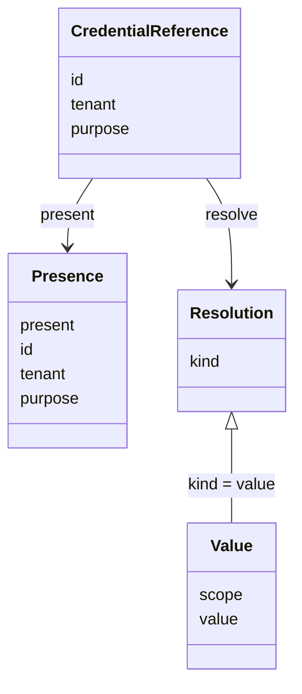

# 模型凭据的抽象与建模

状态是待审。本页拥有引用、存在性和解析的模型。它不改 [SPEC](../SPEC.md) 已接受的调用、重试和结果保管承诺。包内模块关系见 [architecture](architecture.md)。Cordis 装配见 [cordis](cordis.md)。发送顺序见 [key-flow](key-flow.md#凭据解析)。

档案的身份、同名求值和模态仍由 [profile-and-modality](profile-and-modality.md) 拥有。原结果、ACK 和费用仍由 [consumption-and-cost](consumption-and-cost.md) 拥有。本页不复制那两份行为正文。

调用记录只保存引用。引用含凭据身份、租户和用途。本交付的用途取值是 `model-send`。更宽的用途词表不在本卡。查询可以带一个别的用途字符串，解析结果是 `denied`。能写入保管库的引用仍然只有 `model-send`。

租户标识使用 `packages/common/legal-identity` 的 `TenantId`。凭据身份是本成员自己的标识，不是 `TenantId`，也不是登录出示物。持有引用不构成读取授权。

`Presence` 没有秘密。`Resolution` 的种类如下。只有 `value` 携带秘密，并且只交给这一次发送。

| 种类 | 含义 | 发送端 |
| --- | --- | --- |
| `value` | 当前资格允许 | 发出，并记下所用的值 |
| `absent` | 没有这份凭据 | 不发送 |
| `unreadable` | 引用在，值暂时读不出 | 不发送 |
| `denied` | 跨租户、用途不符、无资格、已撤销或保管已关闭 | 不发送 |
| `unavailable` | 保管或存储暂时不能判断 | 不发送。不得报成 `absent` |

没有租户绑定、且本次档案是官方档案时，解析可以使用部署默认凭据，范围记为 `factory`。租户绑定仍在但值不可读时，结果是 `unreadable`，不使用部署默认凭据，也不使用其他租户的值。

四个模块各只有一个变化原因。

| 模块 | 只因什么而变 | 公开给调用执行的事实 |
| --- | --- | --- |
| 引用 | 身份、租户、用途这三项的形状 | 不可变引用 |
| 存在性 | 怎样回答引用是否存在 | `present` 的结果 |
| 解析 | 获准发送时怎样按当前资格取舍 | 五种结果之一 |
| 本地保管库 | 秘密和绑定怎样持久保存、重开和关闭 | 无。它实现前两项，不对外暴露行格式 |

调用执行把引用写进调用记录。它调用 `resolve`，不打开保管库，不保存返回的秘密。替换本地保管库时，调用记录和五种结果保持不变。
