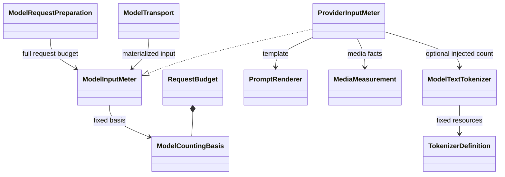
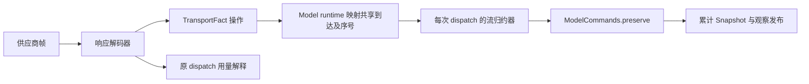

# Model 实现对象模型

公开对象与操作端口由[领域契约](../../model-contract/docs/object-model.md)拥有。本页保留实现内部角色、构造配置和资源组合；名称不自动成为公共类型或新的包。具体工厂见[公开入口](public-api.md)。

## 计量与供应商内部对象

| 对象或逻辑角色 | 单一责任 | 构造依赖与状态 |
| --- | --- | --- |
| ModelTextTokenizer | 按固定编码规则计数文本与显式控制 token | 不可变 TokenizerDefinition 与已初始化资源；无网络、档案或账目依赖 |
| ModelInputMeter | 解释完整请求表示，生成分维度计量和适用依据 | 固定 ModelCountingBasis；具体实现按需注入 tokenizer、模板和媒体算法 |
| ModelCountingBasis | 标识计量的供应商、物理模型、算法及格式适用范围 | 不可变值；预算和物化回执保存，不携带运行句柄 |
| 请求编码器 | 将固定请求转换为供应商表示，并提供与实际 payload 对应的计量事实 | 固定协议、模板、参数/schema 映射；媒体读取仍归发送阶段 |
| 响应解码器 | 把供应商帧解释为 TransportFact，区分内容、终止与用量尾帧 | 固定供应商协议；不持有 Session 或重试策略 |
| 流归约器 | 对每次 dispatch 校验块顺序、累计值、封口和首内容 | 当前块表与归约状态；不拥有网络或耐久存储 |
| 用量解释器 | 确定原 dispatch 的用量来源、统计口径和未知项 | 固定供应商映射；校准资格与入账资格分别核验 |
| 适配资源拥有者 | 初始化并固定采用，停止新取得，排空使用者后释放 | 具体提供者内部的资源引用及关闭状态 |

只有 ModelTextTokenizer 与 ModelInputMeter 是这里新增或细化的提供者接缝。其余名称表示内部责任，不要求各建公开接口、class 或 Cordis Service。请求编码器可以由函数组成；归约器需要每次 dispatch 的独立状态。

具体 meter 依赖 count 能力，不依赖分词库类型。其 implementation 随厂商家族适配包维护，count 的引擎实现由 tiktoken 或 Hugging Face adapter 提供；词表、特殊 token 配置及模板仍归家族。包组织和资源归属见[组架构](../../docs/architecture.md#tokenizer-的资源与计量分工)。普通调用者不需要词元数组和 encode/decode。字符倍率估算器不能伪装成精确 tokenizer；不使用本地分词的计量器明确声明 not-used 方法。供应商模板或媒体贡献不准确时，文本分词准确也不能把完整计量升级为 exact。

TransportFact 表达块操作，VisibleBlock 表达归约后的当前状态。两者不能共用一个增量含义不明的 output 值。归约器不把未完成工具参数变成 ToolCallPart，不承担消息采用、费用查询或业务取消。完整流协议见 [SPEC](../../model-contract/SPEC.md#供应商解释与流状态归约)。

可选校准留在具体计量提供者内。它可以使用有合法来源的历史观测，但不能读取 Session 私有历史、保存原响应控制权或要求所有调用者维护增量计量状态。

## 参数、配置、依赖与资源

| 类别 | 内容 | 提供时点和约束 |
| --- | --- | --- |
| 操作参数 | 当前 principal、tenant、call、operation、consumer、expected revision | 每次操作显式传入并核验，不能从 Context 隐式补租户 |
| 固定业务值 | 档案采用、供应商次序、消息、ToolDeclaration、参数、限额、来源 | 准备并受理时固定，不能存运行函数或凭据秘密 |
| 装配配置 | 批量保存、观察缓冲、页大小、读闲置、退避及清理间隔 | ModelConfiguration 构造时校验；已开始读保留原期限 |
| 权威依赖 | ModelCommands、档案条件写与当前读取、身份/设置、凭据与内容访问 | 提供者构造注入；支持当前核验及未知状态，不接受 allowed 常量冒充 |
| 算法依赖 | ModelInputMeter、ModelConverter、ModelRetryPolicy、ModelToolPayloadAdapter | 固定 adoption；meter 另固定完整 basis，可按需注入 ModelTextTokenizer；本地转换器没有 Model 调用能力 |
| 执行依赖 | ModelSendBoundary、ModelTransport、ModelInstanceHost、ModelClock | 托管执行工厂显式注入，独立执行只要求其实际路径的依赖 |
| 临时资源 | 转换目录 acquire 结果、ModelMediaLease、PreparedTransport、MaterializedTransport、观察订阅 | 当前操作拥有，完成/失败/取消均释放，不能序列化进恢复数据 |

档案内参数是模型业务设置。ModelConfiguration 是实现运行机制的装配设置。二者由不同拥有者修改，不能把 temperature 作为 runtime 缓冲配置，也不能把 clock 或凭据解析函数放入请求。

ModelProfiles 的提供者注入档案权威读取与身份/设置适配器。维护提供者另取条件写和操作核实能力。ModelRequestPreparation 注入固定算法目录、档案采用解析和凭据绑定引用读取。它不持有原始秘密。ModelMessageConversion 注入系统转换目录和来源核验。具体 converter 注入其本地读取/识别依赖。内部排序、数值比较和 JSON 值树编码不各自成为公开端口。

这些读取和条件写属于实际提供者内部接缝，数据库语句形状由提供者设计拥有。不能据此虚构已有存储实现。提供者必须满足 [提交和顺序协议](../../model-contract/SPEC.md#档案与请求准备协议)，否则不能宣称兑现公开能力。

## 构造、绑定与实例寿命

ModelRuntimeProvider 组合普通 runtime 与受信 driver。构造阶段只建立对象关系；宿主绑定成功后才允许对外受理。ModelDriverHost 维护 binding、按调用键的队列及活跃协程；这些均可重建，不承担调用持久权威。ModelHostAuthority 从原受理与当前宿主资格取得 drive 输入。

| 对象 | 参数、依赖与状态 | 替换条件 |
| --- | --- | --- |
| Profiles | 每次Access/required/selected；注入ModelProfileSource；不缓存永久许可 | 来源换代后新查询读取新快照，在途结果保持其依据 |
| Preparation | 每次固定profile/assembled；注入ModelPreparationResources | 每次取得固定规则/meter，不能用新采用解释旧预算 |
| Conversion | 每次原块/来源/signal；注入Catalog与ContentAuthority | 每次取得原converter租约，退休后停止新取得 |
| RuntimeProvider | 每次调用/控制/消费参数；注入Commands、send、retry、instances、clock及配置 | quiesce、驱动交还、binding关闭后替换；事实继续保留 |
| CallDriver | 每次受信drive输入；共享Commands与阶段端口；私有本次恢复状态 | claim核代次，不凭对象存在取得执行权 |
| ModelDriverHost | 构造配置和HostAuthority；私有队列、binding及活体贡献 | 原driver结束或旧进程已排除后才能绑定后继并恢复 |

ModelProfileMaintenance 由实际档案权威提供者实现，包含条件写及未知核实。普通查询没有维护接口。抽象类只用于框架服务身份；厂商编码器、计量器和本地调度器通过组合实现窄端口，不继承一个包含所有能力的模型基类。
