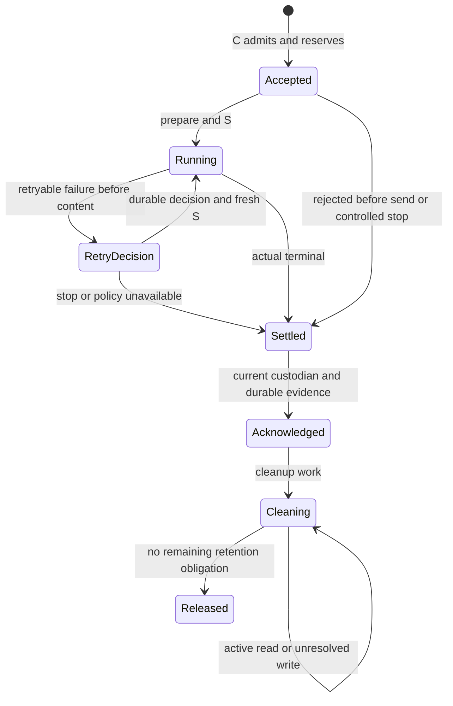

# Model 主干运行契约候选

本页是 [#342](https://github.com/nemori-ai/omne-harness-lite/issues/342) 的接口设计候选，尚未技术接受，也尚无生产实现。已采用行为仍由 [SPEC](../SPEC.md) 及其专题拥有。本页把这些行为落实到操作、参数和提供者责任；共同对象关系见[运行对象模型](../../../../docs/architecture/runtime/runtime-contract-model.md)。代码块是候选声明，不能据此从当前包导入新 API。

## 能力边界

独立执行函数只执行一次真实供应商请求。调用者提供已经准备好的请求与传输能力，承担访问前提及结果。托管调用增加原身份、受理与容量、政策重试、当前资格、耐久输出、控制、ACK 和清理。两层复用请求与传输表示，但不把托管保证赠予独立函数。

Model 不执行工具建议，不决定 Session/Run 终态，不重新运行扩展。活体目录只返回绑定特定实例的观察句柄。原事实、控制与结果领取通过独立操作访问，因此目录失效不解除原责任。普通调用者不能发布实例或传入供应商重试序号。

## 根入口的值与请求

下列代码块按顺序组成同一候选声明。`Identity` 防止误混身份，不提供授权。边界解析器必须验证格式、所属租户和已有关系。各身份采用带领域前缀的非空字符串，序列与修订采用十进制非负整数字符串，不能用浮点序号排序。

`Adoption` 指向可恢复的精确采用。`digest` 为所指规范化内容的 SHA-256 十六进制值；只有名称或当前版本指针不满足它。`ConsumerRef` 是消费者拥有者登记的稳定引用，不是执行许可。Session 适配器负责把它解析到原 Session、存在时的 Run/attempt、用途和消费位置，并在 Model 的原关联记录中保存这些事实。独立适配器只登记自己的工作与位置。Model 不导入 Session 实现，也不由通用字符串猜业务关联。

```ts
import type { Outcome } from '@omne-harness/kernel-basis'
import type { TenantId } from '@omne-harness/legal-identity'
import type { ContentBlock } from '@omne-harness/content-block'
import type { Message } from '@omne-harness/message'
import type { JsonValue } from '@omne-harness/json-text'
import type { CallAccount } from '@omne-harness/call-account'

declare const identity: unique symbol
export type Identity<K extends string> = string & { readonly [identity]: K }
export type ModelCallId = Identity<'ModelCallId'>
export type DispatchId = Identity<'ModelDispatchId'>
export type ModelInstanceId = Identity<'ModelInstanceId'>
export type ModelOperationId = Identity<'ModelOperationId'>
export type ResultVersion = Identity<'ModelResultVersion'>
export type OutputCursor = Identity<'ModelOutputCursor'>
export type ReadId = Identity<'ModelReadId'>
export type Revision = Identity<'ModelRevision'>
export type Adoption = Readonly<{
  owner: string; name: string; revision: string; digest: string
}>
export type ConsumerRef = Readonly<{
  owner: string; work: string; position: string; purpose: string
}>
export type ActorRef = Readonly<{ owner: string; subject: string; revision: string }>
export type Access<P> = Readonly<{ principal: P; tenant: TenantId }>
export type CallAccess<P> = Access<P> & Readonly<{ call: ModelCallId }>
export type Mutation<P> = CallAccess<P> & Readonly<{ operation: ModelOperationId }>
export type Parameter =
  | Readonly<{ kind: 'temperature'; value: number }>
  | Readonly<{ kind: 'top-p'; value: number }>
  | Readonly<{ kind: 'max-output-tokens'; value: string }>
  | Readonly<{ kind: 'stop'; value: readonly string[] }>
  | Readonly<{ kind: 'extension'; definition: Adoption; value: JsonValue }>
export type ToolDeclaration = Readonly<{
  name: string; description: string; argumentsSchema: JsonValue; adoption: Adoption
}>
export type Supplier = Readonly<{
  adoption: Adoption; recipient: string; model: string
  credential: Readonly<{ kind: 'tenant'; id: string }> | Readonly<{ kind: 'factory' }>
}>
export type FixedModelRequest = Readonly<{
  profile: Adoption
  suppliers: readonly [Supplier, ...Supplier[]]
  fallback: boolean
  parameters: readonly Parameter[]
  system: readonly ContentBlock[]
  messages: readonly Message[]
  tools: readonly ToolDeclaration[]
  toolChoice: 'none' | 'auto' | 'required' | Readonly<{ name: string }>
  representation: Adoption
  meter: Adoption
  measuredInput: string
  inputLimit: string
  outputLimit: string
  source: Adoption
}>
export type ResultCapacity = Readonly<{
  bytes: string; blocks: string; attachmentBytes: string
}>
export type Admit<P> = Mutation<P> & Readonly<{
  request: FixedModelRequest; consumer: ConsumerRef; capacity: ResultCapacity
}>
```

`P` 是装配选定的身份拥有者输入。它可能表示人或受限系统主体。泛型不证明可信；注入的资格适配器必须验证其来源、身份与当前访问。`P` 不作为请求快照写入普通日志。网络入口必须通过身份拥有者解析，不能接受反序列化后自称可信的对象。

请求值逐字段冻结并深复制。重复判断使用原值的规范化表示，不比较 JS 对象地址。供应商次序、凭据引用、限额、参数、转换采用、源修订和消费关系均参与冲突判定。秘密值不在请求中。凭据字符串由 #279 的边界验证并转换为 `CredentialId`，不得把任意字符串强制断言为已验证引用。

本候选为常用参数给出小而明确的词表。`temperature` 为有限数且在 [0,2]，`top-p` 在 (0,1]。token 限额为正十进制整数。`stop` 是非空且不重复的非空字符串序列。每个 kind 至多一次；extension 依完整 adoption 去重。扩展参数须有可读取的含义、值 Schema、适用范围和当前 adapter 映射，不接受没有定义的任意供应商键。

温度控制采用供应商声明映射的采样温度，top-p 控制累计概率截断，max-output-tokens 限制总生成 token，stop 在命中停止序列时终止生成。供应商不能准确表达时，在发出前返回 `unsupported`，列明字段和映射采用。省略参数表示该固定供应商采用的默认值，默认值须被解析并保存在受理采用中，不能在恢复时随供应商新默认改变。`outputLimit` 与 max-output-tokens 冲突则拒绝；没有后者时仍按 outputLimit 限制。不得将静默丢弃参数记为成功采用。

所有数字字符串在解析时检查范围和实际提供者能力。容量三个字段是非负整数，bytes 与 blocks 必须为正。容量上界覆盖可保管的原输入、流中快照、终局及必要附件引用。提供者若无法在该上界内兑现已承诺结果，应在发出前拒绝，不能靠 ACK 前丢弃已交内容来回收容量。输入预算使用固定 meter 与 representation；扩展后的最终 request 必须重新通过相同验证。

`argumentsSchema` 是工具声明采用的 JSON Schema 文档，draft 和词汇由其 adoption 指定。Model 检查当前 adapter 能否准确传送，Tool 负责实际参数准入。`JsonValue` 使用现有 lossless JSON 表示，数字为 lexeme，不是 `Record<string, unknown>`。`Message` 的合法形状不证明其中工具结果已获准外传；当前数据来源、内容读取、实际接收方及用途另核。

## 结果、失败和状态

```ts
export type ModelFailure =
  | Readonly<{ kind: 'denied'; action: string }>
  | Readonly<{ kind: 'invalid'; field: string; reason: string }>
  | Readonly<{ kind: 'unsupported'; field: string; adapter: Adoption }>
  | Readonly<{ kind: 'conflict'; operation: ModelOperationId; revision: Revision }>
  | Readonly<{ kind: 'capacity'; required: ResultCapacity }>
  | Readonly<{ kind: 'unavailable'; dependency: string; diagnostic: string }>
  | Readonly<{ kind: 'commit-unknown'; operation: ModelOperationId }>
  | Readonly<{ kind: 'stale-instance'; instance: ModelInstanceId }>
  | Readonly<{ kind: 'not-settled' }>
  | Readonly<{ kind: 'handoff-invalid'; reason: string }>
export type Reply<T> = Promise<Outcome<T, ModelFailure>>
export type ToolSuggestion = Readonly<{
  kind: 'tool_call'; id: string; name: string; arguments: JsonValue
}>
export type ModelBlock = ContentBlock | ToolSuggestion
export type ModelFault = Readonly<{
  cause: 'profile-withdrawn' | 'excluded' | 'modality' | 'credential'
    | 'input-rejected' | 'upstream-unavailable' | 'stream-lost'
    | 'runtime-lost' | 'persistence' | 'policy-unavailable' | 'unclassified'
  diagnostic: string
  upstreamStatus: string | null
}>
export type Termination =
  | Readonly<{ kind: 'completed'; reason: 'stop' | 'limit' | 'tool-suggestions' }>
  | Readonly<{ kind: 'failed'; fault: ModelFault }>
  | Readonly<{ kind: 'interrupted'; control: ModelOperationId }>
export type Settlement = Readonly<{
  version: ResultVersion; termination: Termination; cursor: OutputCursor; source: DurableEvidence
}>
export type CustodyState =
  | Readonly<{ kind: 'producer' }>
  | Readonly<{
      kind: 'acknowledged'; operation: ModelOperationId; receipt: DurableEvidence
      cleanup: 'pending' | 'running' | 'blocked' | 'released'; diagnostic: string | null
    }>
export type CallState = Readonly<{
  call: ModelCallId; revision: Revision; consumer: ConsumerRef
  control: ControlState; custody: CustodyState
}> & (
  | Readonly<{ phase: 'accepted' }>
  | Readonly<{
      phase: 'running'; dispatch: DispatchId
      firstContent: 'none-proven' | 'observed' | 'uncertain'
    }>
  | Readonly<{ phase: 'retry-decision'; dispatch: DispatchId }>
  | Readonly<{ phase: 'settled'; settlement: Settlement }>
)
export type ControlState =
  | Readonly<{ kind: 'none' }>
  | Readonly<{
      kind: 'requested'; operation: ModelOperationId
      propagation: 'pending' | 'sent' | 'unavailable'
      upstream: 'unknown' | 'stopped' | 'completed'
    }>
export type Lookup =
  | Readonly<{ kind: 'found'; state: CallState }>
  | Readonly<{ kind: 'not-accepted'; operation: ModelOperationId }>
export type Admission = Readonly<{ call: ModelCallId; revision: Revision; recovered: boolean }>
export type DurableEvidence = Readonly<{
  owner: string; record: string; revision: string; digest: string
}>
export type Handoff =
  | Readonly<{ kind: 'processed'; completion: DurableEvidence }>
  | Readonly<{ kind: 'retained'; custody: DurableEvidence }>
export type AckInput<P> = Mutation<P> & Readonly<{
  result: ResultVersion; evidence: Handoff
}>
export type AckReceipt = Readonly<{
  call: ModelCallId; result: ResultVersion; custody: Extract<CustodyState, { kind: 'acknowledged' }>
}>
```

`not-accepted` 只在原受理操作的排队、旧写者和数据库恢复均排除后返回。暂不可读返回 unavailable，受理提交不明返回 commit-unknown，目录没有路由不调用此分支。拒绝不披露别租户资源是否存在。身份冲突返回获准披露的修订，不回显秘密或无权读取的输入。

`recovered` 只说明认回原受理。受理成功表示容量与原工作共同成立；它不表示供应商收到请求。受理事实、发出意图、真实发送及供应商回执各自保留。外部错误、内部保存失败和策略不可用不能相互冒名。`unclassified` 必须附安全诊断定位，不覆盖已有可识别原因。

`DurableEvidence` 是耐久记录定位，摘要只校验内容一致性。确认者不能用摘要自证已处理或已保管。Model 通过该 owner 的受信证据适配器读取并验证原租户、调用、结果版本、consumer 与位置、当前承接责任及真实耐久状态。processed 记录保存该业务要求的结果和完成事实；retained 记录还保存内容或可恢复引用、必要保留期限及待交付责任。后者不能依赖即将获准清理的 Model 唯一副本。

Settlement.source 由 Model 在原结果真实收场及必要保存共同成立时产生，定位该租户、call、结果版本和真实终局。inspect 与每页结果给出同一来源，消费方不自己拼摘要。受信参加者按此证据核验原记录；来源引用本身不授予正文读取，也不解除原结果保管。

## 普通调用面与实例观察

```ts
export type VisibleBlock =
  | Readonly<{ kind: 'sealed'; index: string; block: ModelBlock }>
  | Readonly<{
      kind: 'growing'; index: string; mode: 'append' | 'replace'
      content: 'text' | 'thinking' | 'tool-arguments' | 'voice'; value: string
    }>
export type Snapshot = Readonly<{
  call: ModelCallId; cursor: OutputCursor; blocks: readonly VisibleBlock[]
  state: CallState
}>
export type Observation =
  | Readonly<{ kind: 'snapshot'; value: Snapshot }>
  | Readonly<{ kind: 'changed'; value: Snapshot }>
  | Readonly<{ kind: 'ended'; reason: 'observer-closed' | 'stale-instance' | 'denied' | 'unavailable' }>
export interface ModelHandle<P> {
  readonly instance: ModelInstanceId
  observe(input: Access<P> & Readonly<{ signal: AbortSignal }>): AsyncIterable<Observation>
}
export type LiveRoute<P> =
  | Readonly<{ kind: 'live'; handle: ModelHandle<P> }>
  | Readonly<{ kind: 'no-live-route' }>
export type ResultPage = Readonly<{
  blocks: readonly ModelBlock[]; next: string | null; settlement: Settlement
}>
export type ReadState =
  | Readonly<{ kind: 'reading'; page: ResultPage }>
  | Readonly<{ kind: 'ended'; reason: 'complete' | 'closed' | 'denied' | 'stalled' | 'owner-lost' }>
export type ReadStart =
  | Readonly<{ kind: 'started'; read: ReadId; value: ReadState }>
  | Readonly<{ kind: 'acknowledged'; custody: Extract<CustodyState, { kind: 'acknowledged' }> }>
export type DispatchRecord = Readonly<{
  dispatch: DispatchId; supplier: Supplier; intent: ModelOperationId
  send: 'prepared' | 'started' | 'unknown' | 'not-sent'
  firstContent: 'none-proven' | 'observed' | 'uncertain'; terminal: Termination | null
  account: CallAccount | null
}>
export interface ModelCalls<P> {
  admit(input: Admit<P>): Reply<Admission>
  inspect(input: CallAccess<P> & Readonly<{ admission: ModelOperationId }>): Reply<Lookup>
  dispatches(input: CallAccess<P>): Reply<readonly DispatchRecord[]>
  cancel(input: Mutation<P> & Readonly<{ reason: 'user' | 'run-cancelled' | 'session-archived' }>): Reply<ControlState>
}
export interface ModelConsumption<P> {
  beginRead(input: Mutation<P> & Readonly<{ result: ResultVersion }>): Reply<ReadStart>
  readNext(input: CallAccess<P> & Readonly<{ read: ReadId; after: string }>): Reply<ReadState>
  closeRead(input: CallAccess<P> & Readonly<{ read: ReadId }>): Reply<ReadState>
  acknowledge(input: AckInput<P>): Reply<AckReceipt>
}
export interface ModelDirectory<P> {
  connect(input: CallAccess<P>): Reply<LiveRoute<P>>
}
export interface ModelRuntime<P> {
  readonly calls: ModelCalls<P>
  readonly consumption: ModelConsumption<P>
  readonly instances: ModelDirectory<P>
}
```

`Snapshot` 是到 cursor 为止的完整在途快照。第一项一定是 snapshot 或 ended；后续 changed 给出更新快照，不宣称重放每个上游分片。游标单调，重连通过原 call 取得新快照，不能把旧实例流嫁接到后继。替换模式仅改变该 index，封块后不接受 fill。持久的底层步骤继续采用 stream-arrival 的 open/fill/close/trim/finish 语义，公开快照不另造业务终态。

增长中的工具参数不能变成 `ToolSuggestion`。只有完整封块、JSON 验证通过且实际模型收场允许使用时，消费者才得到可交 Tool 准入的建议。图片/文件只在完整且可恢复时作为 sealed 出现。语音片段的 value 是固定 representation 所声明编码，不能由观察者猜文本。首内容判定在原始已接受内容上完成，不能因快照合并而漏掉曾经实际到达的内容。

所有观察内容先提交对应可恢复表示及首内容标记，再发布 cursor。一次提交可以包含多个片段。提供者应按配置批量保存并背压传输；保存未确认的片段不能先向外展示。未发布的接收缓存不作为已展示内容承诺，但接收之后、持久之前的崩溃仍可能已经越过首内容界，必须按下文的 receive-window 保留 uncertain，不得据此重发。附件及原件使用满足同一耐久与保留承诺的引用。

`beginRead` 是第一份内容读取与登记的同一操作，不是空租约申请。它与 ACK 在同一 call 修订上串行裁定。ACK 先提交则返回 acknowledged；读取先提交则 ACK 后可继续这个 read。每一页重新核验当前读取资格。一次读取只能取得同一版本，按 next 继续；重复 after 返回同一页，不移动到新结果。

读者完成或 closeRead 后释放读取关系。空闲句柄从未取得 read，不阻止清理。已经开始却长期不进展的读取，提供者先按其公布的读取期限明确结束，撤销/关闭实际输出资源，再解除保护；不能直接删正在发送的内容。权限撤销可以结束读取，不以保护半份数据为由继续向无权主体输出。read 状态保留可查询原因，不伪造完整成功。期限属于装配配置，不能在一次在途读取中偷偷缩短。

## 逐操作行为

所有受保护操作先验证 principal 的可信来源与显式 tenant，拒绝跨租户默认访问。读取调用事实、读取内容、控制、ACK 和费用各用自己的资源动作，不能因一次受理成功永久免检。异常只表示程序缺陷；可预期的拒绝、不可用、提交未知和观察结束使用上述结果。

| 操作 | 固定身份与资格 | 成功及重复 | 失败、取消及恢复 |
| --- | --- | --- | --- |
| admit | 原 call、operation、request、consumer、capacity；当前发起资格与消费者关系 | 原调用和容量同提交；同身份同值返回原受理 | 不同固定输入 conflict；未提交拒绝不留发出；未知只查询原 operation。调用方停止等待不撤受理 |
| inspect | call 与原 admission；当前事实读取资格 | found 含最新业务状态、控制及交接；同身份可重查 | 仅有权威未受理证明才给 not-accepted。读失败不推断 runtime 失联 |
| dispatches | call；当前账目及发出事实读取资格 | 按原发出顺序返回脱敏事实，费用保留 revision | 不连带授予请求/回复/秘密读取；晚到费用仍入原 dispatch |
| cancel | 原 operation、call、原因；当前相应控制资格 | 持久意图及传播状态；重复认回。同 call 后续同义意图只关联原控制，不追加发出 | 不等待物理停机才确认意图。传播失败保存待续做。已经真实完成仍保留真实终局 |
| connect | call；当前观察资格 | 取得特定 instance 句柄，或明确 no-live-route | 失去目录依赖为 unavailable，不能变 not-accepted；销毁句柄只关观察 |
| observe | tenant/principal 与句柄原 instance | 首快照与后续 cursor 衔接，观察实际状态 | signal 只关本观察；失权/断开/实例替换结束流，原调用继续承担责任 |
| beginRead | 原 operation、call、result；当前内容资格 | 首页与真实读取登记共同成立；重复认回原 read | 未收场 not-settled；已 ACK 返回 acknowledged，不用旧引用新领全文 |
| readNext/closeRead | call、read 与页位置；当前资格 | 同 after 返回同页；close 幂等并保留结束原因 | 读断开不重做 Model。ACK 不能截断已准入读，实际失权按原规则结束 |
| acknowledge | 原 operation、call、result、耐久证据；当前结果承接资格 | 真实收场、证据及 ACK 同一裁定中成立，清理任务一起保存；重复返回原 ACK 与当前清理 | 提前确认或伪证据拒绝；提交未知认回原 ACK；清理失败不撤确认，不要求消费者重确认 |

清理仅移除本调用无用的输入、输出和引用。真实在途写和未知写先核实；共享内容只解除本调用关系。无必要保留且真实读写完成时，恢复工作者持续推进至 released。保留准确结算必需事实，不以未知费用为由保留全部全文，也不把未知填为零。

## 独立执行与提供者操作

独立函数 `executeModel` 执行一次供应商请求，不重试、不保管、不 ACK。其 signal 请求该次传输停止，返回事实仍须区分请求取消与真实停止。托管模式的观察 signal 不传给它。托管模式只有原调用的有效控制可以请求传输停止。

```ts
export type TransportFact =
  | Readonly<{ kind: 'output'; block: VisibleBlock }>
  | Readonly<{ kind: 'trim'; index: string; removed: string; reason: string }>
  | Readonly<{ kind: 'account'; event: string; value: CallAccount }>
  | Readonly<{ kind: 'ended'; termination: Termination }>
export interface PreparedTransport {
  start(signal: AbortSignal): AsyncIterable<TransportFact>
  close(): Promise<void>
}
export interface ModelTransport {
  prepare(request: FixedModelRequest, supplier: Supplier): Reply<PreparedTransport>
}
export declare function executeModel(
  request: FixedModelRequest,
  transport: ModelTransport,
  signal: AbortSignal,
): AsyncIterable<TransportFact>
export type ExecutionRef = Readonly<{
  tenant: TenantId; call: ModelCallId; instance: ModelInstanceId; generation: string
}>
export type WriteContext = ExecutionRef & Readonly<{
  operation: ModelOperationId; expected: Revision
}>
export type CommitQuery<T> =
  | Readonly<{ kind: 'committed'; value: T }>
  | Readonly<{ kind: 'rolled-back' }>
  | Readonly<{ kind: 'unknown' }>
  | Readonly<{ kind: 'not-committed' }>
export type DispatchPlan = Readonly<{
  dispatch: DispatchId; supplier: Supplier; policyDecision: DurableEvidence | null
}>
export type RetryDecision =
  | Readonly<{ kind: 'stop'; fault: ModelFault }>
  | Readonly<{ kind: 'retry'; supplier: Supplier; notBefore: string; basis: Adoption }>
export type RecoveryRecord = Readonly<{
  state: CallState; request: FixedModelRequest; capacity: ResultCapacity
  initiator: ActorRef; admission: ModelOperationId
  execution: ExecutionRef | null; retry: RetryDecision | null
  unresolved: readonly ModelOperationId[]
  tasks: readonly ('execute' | 'control' | 'handoff' | 'cleanup' | 'account')[]
}>
export type LateDispatchFact =
  | Readonly<{ kind: 'account'; event: string; value: CallAccount }>
  | Readonly<{ kind: 'terminal'; event: string; actual: Termination }>
export interface ModelCommands<P> {
  admit(input: Admit<P>): Reply<Admission>
  recall(input: CallAccess<P> & Readonly<{ admission: ModelOperationId }>): Reply<Lookup>
  scanPending(input: Access<P> & Readonly<{
    after: string | null; limit: number
  }>): Reply<Readonly<{ calls: readonly ModelCallId[]; next: string | null }>>
  loadRecovery(input: CallAccess<P>): Reply<RecoveryRecord>
  claim(input: CallAccess<P> & Readonly<{
    instance: ModelInstanceId; operation: ModelOperationId; continuity: DurableEvidence
  }>): Reply<ExecutionRef>
  prepareDispatch(input: WriteContext & DispatchPlan): Reply<Revision>
  recordSend(input: WriteContext & Readonly<{
    dispatch: DispatchId; state: 'started' | 'unknown' | 'not-sent'
  }>): Reply<Revision>
  openReceiveWindow(input: WriteContext & Readonly<{
    dispatch: DispatchId; window: string
  }>): Reply<Revision>
  preserve(input: WriteContext & Readonly<{
    dispatch: DispatchId; window: string; facts: readonly TransportFact[]
  }>): Reply<Snapshot>
  recordLateFact(input: Access<P> & Readonly<{
    call: ModelCallId; dispatch: DispatchId; operation: ModelOperationId
    source: DurableEvidence; fact: LateDispatchFact
  }>): Reply<Readonly<{ revision: Revision; recovered: boolean }>>
  decideRetry(input: WriteContext & Readonly<{
    dispatch: DispatchId; decision: RetryDecision
  }>): Reply<Revision>
  settle(input: WriteContext & Readonly<{ termination: Termination }>): Reply<Settlement>
  control(input: Mutation<P> & Readonly<{
    reason: 'user' | 'run-cancelled' | 'session-archived'
  }>): Reply<ControlState>
  acquireRead(input: Mutation<P> & Readonly<{ result: ResultVersion }>): Reply<ReadStart>
  nextRead(input: CallAccess<P> & Readonly<{ read: ReadId; after: string }>): Reply<ReadState>
  endRead(input: CallAccess<P> & Readonly<{ read: ReadId }>): Reply<ReadState>
  handoff(input: AckInput<P>): Reply<AckReceipt>
  advanceCleanup(input: ExecutionRef & Readonly<{
    operation: ModelOperationId
  }>): Reply<CustodyState>
  query(input: CallAccess<P> & Readonly<{
    operation: ModelOperationId
  }>): Reply<CommitQuery<Readonly<{ revision: Revision }>>>
  dispatches(input: CallAccess<P>): Reply<readonly DispatchRecord[]>
}
export type SendDemand<P> = CallAccess<P> & Readonly<{
  execution: ExecutionRef; dispatch: DispatchId; request: FixedModelRequest
  supplier: Supplier; consumer: ConsumerRef; initiator: ActorRef
}>
export type SendResult =
  | Readonly<{ kind: 'started'; facts: AsyncIterable<TransportFact> }>
  | Readonly<{ kind: 'not-started'; failure: ModelFailure }>
  | Readonly<{ kind: 'unknown'; dispatch: DispatchId; diagnostic: string }>
export interface ModelSendBoundary<P> {
  send(input: SendDemand<P>, signal: AbortSignal): Promise<SendResult>
}
export interface ModelRetryPolicy {
  decide(input: Readonly<{
    request: FixedModelRequest; dispatches: readonly DispatchRecord[]; failure: ModelFault
  }>): Reply<RetryDecision>
}
export type Publication = Readonly<{
  execution: ExecutionRef; registration: string
}>
export interface ModelInstanceHost<P> {
  schedule(input: Readonly<{ tenant: TenantId; call: ModelCallId }>): Reply<Readonly<{ queued: true }>>
  publish(input: ExecutionRef, handle: ModelHandle<P>): Reply<Publication>
  withdraw(input: Publication): Reply<Readonly<{ removed: boolean }>>
  directory: ModelDirectory<P>
}
export interface ModelClock {
  now(): string
  waitUntil(instant: string, signal: AbortSignal): Promise<'elapsed' | 'cancelled'>
}
export type ModelConfiguration = Readonly<{
  outputBatchBytes: number; outputBatchDelayMs: number
  observerBufferBytes: number; readIdleMs: number; resultPageBytes: number
  retryBackoffMs: number; cleanupRetryMs: number
}>
export type ModelDependencies<P> = Readonly<{
  commands: ModelCommands<P>; send: ModelSendBoundary<P>; retry: ModelRetryPolicy
  instances: ModelInstanceHost<P>; clock: ModelClock
}>
export interface ModelProvider<P> {
  readonly runtime: ModelRuntime<P>
  recover(input: Access<P>): Reply<Readonly<{ scheduled: string }>>
  quiesce(): Reply<Readonly<{ pending: string; running: string }>>
}
export declare function createModelRuntime<P>(
  dependencies: ModelDependencies<P>, configuration: ModelConfiguration,
): ModelProvider<P>
```

`executeModel` 选用 request.suppliers 的首项，仅执行一次。需要另一供应商时调用者必须形成新的明确执行，不能把此函数冒充托管 fallback。`prepare` 可以建立无业务内容及秘密外传的连接；它不发送模型请求。`start` 在调用时启动不可撤回的发送并返回流，不能把发送延迟到第一次迭代。准备资源的调用者在所有成功、拒绝和异常路径调用 close；close 不声称撤回外部效果。

实际传输返回每个 index 的最新表示。增长片段按固定 mode 归并。关闭时产生 sealed；合法终止只出现一次。未终止就耗尽或抛错视为传输失联，由执行函数产出有诊断的 failed，不能报 completed。账目事件按供应商采用、dispatch 与 event 身份去重，同 event 不同值拒绝并记录矛盾。修正账目必须有新 revision 和原事件关系。纯函数本身没有足够身份时，只交事实给调用者，不自建账本。

`ModelCommands` 是深提供者接缝。它隐藏提交参加者、资格核验、流中持久、实际读写与清理步骤，普通消费者不会拿到它。它没有任意 `transaction(callback)`、任意 load/save 或外部传入的 allowed 布尔。`ExecutionRef` 是目标和代次；提供者还必须核验调用通道的受信实例身份，单凭序列化值不能写事实。

`ModelProvider` 由受信宿主使用，其 runtime 才是普通消费面。admit 同提交保存待调度责任，提交后调用 schedule 唤醒本域独立协程；唤醒失败不撤销已成功的受理。recover 使用显式租户及当前合格的恢复主体调用 scanPending，以稳定分页扫描耐久待办，再逐 call 调用 loadRecovery。分页按原身份排序，在同一轮扫描结束后重扫仍有责任的项目；扫描本身不 claim 或清除待办，新受理和并发完成不丢失原任务。limit 是正整数且服从提供者公开上界，越界拒绝。查询失败保留当前游标和原身份，不返回空完成。

RecoveryRecord 包含原请求、容量、原发起主体引用、原受理、策略决定、代次、未知操作及责任种类。ActorRef 是身份拥有者生成的可核验原事实引用，不是可继续使用的秘密或授权 token。恢复者自己的当前身份与原工作/原发起者适用资格分别检查，不从系统身份推导无限权限。保存所需身份事实不保留原 P 中的秘密。ModelSendBoundary 消费这个原引用，不能把恢复者变成新业务发起者。

schedule 按原 call 去重，不能自行取得执行代次。recover 先恢复控制、原操作、消费与清理，再决定 claim 或继续等待。quiesce 停止新协程准入并报告真实未完数量；它不默认取消业务，不等待外部效果可逆，也不把 pending/running 非零报成已完成卸载。进程退出必须把原责任留给恢复者，并兑现旧进程排除条件。

| 提供者操作 | 必须在一次原子裁定中成立的事实 |
| --- | --- |
| admit | 当前身份/发起资格、适用消费者工作守卫、固定输入去重、容量与原调用。认回仍检查当前查询资格 |
| claim | 原调用与后继实例绑定、旧执行者排除证据、当前资格及新代次。首内容与原控制保留 |
| scanPending/loadRecovery | 当前恢复主体及显式租户授权、原耐久任务和固定采用。查无活体不删除任务 |
| prepareDispatch | 当前代次、未取消、未收场、首内容界、合法政策和唯一 dispatch 意图。它不记录供应商已收到 |
| recordSend | 原 dispatch 的传输发起观察或未知；后到的真实结果可以补充 unknown，不能把 started 改 not-sent |
| openReceiveWindow | 有效实例/原 dispatch、唯一窗口、尚未首内容时的 uncertain 标记；提交后才允许该窗口的实际接收 |
| preserve | 有效实例/原 dispatch/窗口、顺序与去重、可恢复内容及附件引用、首内容标记、账目事件和游标，同时关闭窗口。该事务之后才发布快照 |
| recordLateFact | 当前补录资格、原 dispatch 归属、可核验来源、供应商事件去重及修订。它不 claim，也不授予新发出或业务推进 |
| decideRetry | 原失败发出、尚未首内容、原政策资格与唯一决定；重复决定认回，冲突拒绝 |
| settle | 整调用真实收场及结果版本。仍执行或等待策略时不能执行；终局后只补事实和费用 |
| control | 当前控制资格、原意图、禁止新发出的状态、传播续做责任 |
| acquireRead/nextRead/endRead | 当前读取资格、结果/页身份、实际读准入或结束。ACK 后不新建读 |
| handoff | 当前资格和承接关系、实际终局、原版本、两条证据之一、ACK 与清理任务 |
| advanceCleanup | 仅解除本调用无用关系，核实在途/未知写及真实读结束，保存每步进度；不能反转 ACK |
| query | 原操作身份的权威提交结论；not-committed 必须消费 Storage 的完整排除证明 |

写操作保留 Storage 的 committed、rolled_back、unknown、identity_conflict 和 rejected_before_accept 含义。成功映射为 Reply.ok，已知回滚或准入拒绝映射为具体失败，未知映射 commit-unknown；query 用于恢复精确原操作。`query` 的 revision 用来重新查询原业务状态，不能拿任意操作回执冒充 Admission/AckReceipt。相同 operation 不得跨方法复用，参数规范化摘要与操作名一并固定。`expected` 不符而原操作未成立时返回 conflict；不得用当前值覆盖旧写。

## 参数与注入的裁定

| 值或能力 | 分类与取得 | 缺席、换代和释放 |
| --- | --- | --- |
| principal、tenant、call、operation、consumer、request、capacity | 本次操作参数。受理时冻结实际采用 | 资格不合法拒绝；request 缺项拒绝。当前值不覆盖原快照 |
| commands | 必需构造注入。提供者拥有本域存储、当前资格及提交组合 | 不可用时不能认成功；替换先排除旧写者并接续原操作，不靠清空缓存恢复 |
| send | 必需构造注入。内部组合当前授权、#279 凭据、真实传输和发送围栏 | 缺席不发；在途连接的资源与未知归旧传输负责，新边界不得复制旧 dispatch |
| retry | 必需策略实现；原 request 的采用和允许范围约束每次决定 | 不可用则不再试并以 policy-unavailable 收场；替换不能重做已持久的决定 |
| instances | 必需实例宿主。登记能力只供 Model 提供者，目录供消费者 | 宿主退出撤路由；事实/保管不消失。后继先接管原责任再发布新实例 |
| clock | 必需时钟/等待能力；时间值为 UTC instant | 时钟不可用不虚构超时或许可；取消等待不取消原调用 |
| configuration | 构造时校验的纯数据，原实例固定采用 | 数值为有限整数，容量/页/空闲期限须正；延迟/退避可为零。替换只影响新实例，恢复读取已固定的在途期限 |
| signal、PreparedTransport、handle | 临时资源 | 创建者释放，不能序列化；观察 signal 不取消原执行 |

配置不设未经测量的生产默认值。发行装配必须显式提供全部字段并注明来源，策略默认仍严格采用 SPEC 的供应商顺序与次数规则。缺配置是加载失败，不是隐式无界队列。输出队列满时背压，观察者落后时结束该观察并允许快照重连；不能因慢观察者无限保存重复快照。resultPageBytes 限制页内联大小，超大单块通过原已获准的耐久附件引用读取，不任意截掉块内容。

## 资格、共同提交与实际发送

本候选采用资格参加者与 Model 的领域提交，再用共同发送围栏排列实际发送和撤权。它是提供者组合条件，不新建按调用颁发的模型执行许可。资格判断仍由 identity/authorization 和实际消费者工作治理拥有。

受理点 C 是资格、适用 Session 当前工作守卫、Model 原调用及容量的同一次提交。Storage Worker 内只执行已登记参加者的版本化 JSON facts，不接收主线程闭包。资格参加者必须验证事实来源并读取本事务可见的权威资格。主线程之前得到的 allowed 结果不能替代这个检查。不能参加同一事务的远端资格源，需要其拥有者提供等价串行协议后才可采用该组合。

撤权/取消点 R 是相应权威事实提交。发送点 S 是已准备传输在受控入口不可撤回地启动本次业务请求。所有能改变该需求资格的撤权、归档、控制与换代，以及 S，都进入同一个提供者协调的围栏。围栏内重读权威状态，核对实际内容、接收方、用途、当前工作资格和凭据，再同步调用 start。之间不得 await、调用不受信回调或排队等待未来发送。

R 先于 S 则不发；S 先于 R 则是已经启动的在途请求，撤权触发控制而不能声称未发出。准备连接与等待资格在围栏外完成，凭据解析后的具体请求不得转交一个稍后自行发送的无约束队列。操作系统网络缓冲不提供撤回保证；本契约不以供应商收到字节的时刻作为本地线性化点。S 附近崩溃保留发送未知，既不能称未发，也不能凭数据库里没有 started 就重发。

首版可由唯一协调进程持有围栏并拥有全部发送入口。多进程只能通过同一协调入口修改适用资格或发出；进程内 Mutex 不覆盖绕行的另一个进程。所有写者不能遵守时，该装配不符合本候选，不以单机名义豁免。替换协调进程前须由宿主确认旧发送进程终止，或撤销其全部真实发送能力；数据库代次和租约超时只阻止旧写，不能阻止旧进程发送。未来分布式需要独立的发送排除协议，不复用本地锁作证据。

#279 的 `CredentialPort.resolve` 在 S 前最后检查内同步调用。`authorized` 和 `official` 由受信边界构造，普通调用者不能传入。只在没有租户绑定且确为官方档案时使用 factory。已绑定但缺失、不可读、拒绝或不可用不回退 factory。秘密仅在本次发送资源内存在，不能写到 request、dispatch、失败、扩展或遥测。采用精确源与映射须随装配记录；本候选不改变凭据协议。

查询、观察及分页在实际披露前核验当前读取资格。需要先 await 准备数据时，准备完成后再次通过受保护输出入口核验，不能把准备前的授权缓存当作长期许可。ACK 的当前承接守卫与 handoff 提交共同成立，不能先授权再在任意时间执行清理。实现不得在一个数据库内使用相互独立的提交来冒充同提交保证。

## 重试、失联与恢复

原实例在输出前记录 dispatch 意图。真实发送与数据库提交不能成为同一事务，因此 recordSend 未确认时保留原 dispatch 并查询，不另造 dispatch。运行中的供应商流即使观察者全部退出仍由 Model 宿主消费并保存。

首内容前合法失败进入 retry-decision，原消费者仍等待同一个 call。策略决定持久之后才准备下一 dispatch。允许 fallback 时按原供应商顺序各至多一次；不允许时只允许首供应商退避后再试一次。`retryBackoffMs` 是默认退避，策略不能突破次数、接收方和首内容边界。策略自身超时/失去依赖按不可用终止重试，不能让最后一个 Agent 句柄负责触发。

为覆盖首片已接收而未保存的窗口，提供者在任何可能观察内容的接收动作前调用 openReceiveWindow。其提交把尚无首内容的状态从 none-proven 改为 uncertain。传输不得在窗口开始之前后台预读；无法禁用预读时，须在 start 前打开覆盖整个预读期间的窗口。仅打开网络连接但未接收模型内容，不自行算首内容。

preserve 保存该窗口全部已接收事实并关闭窗口。包含任何实际内容时永久改为 observed；确认只有非内容事实时可以回到 none-proven，但前提是接收已暂停且没有未纳入的预读缓冲。发送/接收失败先以终止事实关闭窗口，再进行策略判断。崩溃留下的 open window 不能靠数据库里缺少内容来关闭为 none-proven；无法从可信接收记录恢复其完整事实时，以 uncertain 保持不重发并形成 runtime-lost 收场，明确未能判定首内容是否发生。这个保守结果不把真实内容谎报为未出现，也不禁止能证明首内容前的合法恢复。

可信失联由独立宿主生成 continuity 证据。证据必须说明原实例/发送进程已终止或已失去全部执行能力、旧写已结束、数据库已恢复且原操作查询完成。查询超时、目录为空、心跳迟到、租约到期均不单独足够。claim 在验证证据及当前资格后提交新代次；旧实例不能继续写，也不能靠迟到撤除删除后继路由。

首内容后或首内容无法排除时失联以 runtime-lost 收场，不重新生成同一逻辑回复。仅当接收窗口已被可靠闭合且首内容为 none-proven 时，才可以按原政策恢复新的真实发出，仍保留旧发送未知和可能费用，不宣称只有一次上游请求。若不能排除旧执行者，保持未知及责任，不恢复发送。

迟到供应商账目或实际停止/完成事实通过 recordLateFact 补录。调用者可以是当前合格恢复者或供应商回执适配器，无须持有旧 ExecutionRef。该端口核验 source 指向的可信回执与租户、call、dispatch、供应商绑定；只允许账目修订和实际终结事实。相同事件同值认回，异值拒绝，新账目 revision 记录原事件关系。它不改变逻辑调用终局、结果版本、ACK 或 cleanup，也不接受输出块、新 request、策略或控制。ACK 后继续补原账，不重新申请全文。

业务取消之后而实际收场之前到达的输出，仍由原独立执行者或依法接手的当前实例通过 preserve 保存。它不能因 Agent 已退出而被丢弃。运行时失联且原发送者已排除后，若另有完整内容到达的异步供应商模式，该 adapter 必须在原受理中明确其回执与内容保管协议；本主干的 recordLateFact 不承载这种额外内容协议，也不能将未知支持默认为允许重新输出。实际采用 adapter 未提供所需协议时在发送前拒绝 unsupported，不缩小已受理调用的保管责任。

ACK 后恢复只续做清理、在途/未知写核实和账目，不复活全文读取或原执行。读关系恢复须检查实际输出端是否仍存活；已经失去进程的输出读明确结束，不能让历史读者名单永久阻止清理。资料保留责任尚在时继续报告 blocked 和具体责任，不按期限擅自丢弃。

## 协议状态图与证据边界



控制意图、在途发送、消费确认及费用状态是正交事实，不由这张图压成一个状态。发送未知不新增一条可随意重发的转移。真实 dispatch 的收场与逻辑 call 收场分别记录；业务取消不抹去后来确定的实际完成。

W2 类型消费和序列证据见[消费与反例](runtime-examples.md)。W3/W4 须用 Tool/Session/Agent 的具体消费验证 ConsumerRef、工具声明及共同提交边界。W5 须补 Cordis 实例宿主、调用者 fiber 登记与换代的真实机制证据。当前公开形状、候选协议和类型通过都不证明生产持久性、授权提供者或网络围栏已经实现。
