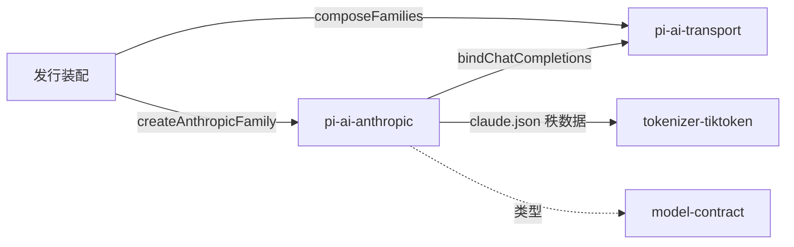

# 使用与定位

本文件说明消费侧怎样使用本包、具名上层消费者、典型调用关系，以及本包在系统与能力组中的位置。它覆盖独立消费与适用的 Harness 接入，引用系统架构与真实消费者，不成为新的架构源。

## 使用方式

装配方读取词表资源、创建家族并交给传输，示例见 [README_ZH.md“使用”](../README_ZH.md#使用)。

- 依赖：本包、pi-ai-transport 与 tokenizer-tiktoken。词表文件随本包发布，装配方不另行下载。
- 配置：tokenizer 资源、解码器限额与估算余量都由装配方给出，本包没有默认值。
- 档案：`officialAnthropicProfiles` 给出纯数据的档案定义。档案的身份、修订与范围归 Model 的档案维护。
- 与 OpenAI 家族组合：装配方用 `composeFamilies([openai, anthropic])` 组合两家。同一段历史在两家之间切换时，另一家的推理状态按回放声明略去并留诊断，切回时带回原家族的状态。两个家族包互不导入。
- 释放：家族与绑定没有需要释放的资源。传输按家族表的规则调用 `release`。

## 消费者与定位

计划中的消费者是发行装配与本包的示例，都还没有消费本包。本包在模型组中的位置见[组架构“成员与新增条件”](../../docs/architecture.md#成员与新增条件)。
