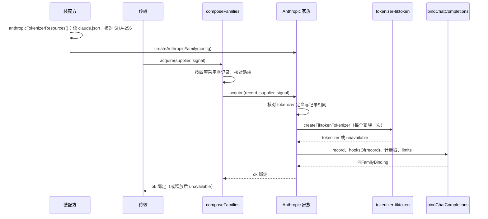
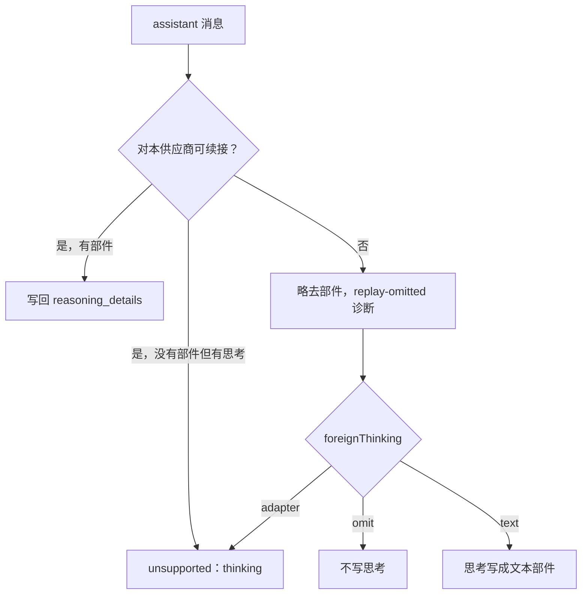

# 关键流程

本文件用可维护的文本图源描述本包的关键业务流程与数据流：参与者、调用时序、数据来源与去向、状态变化、失败分支与生命周期。图旁写前提与边界，不编造流程。

## 流程

**装配与取得绑定**：装配方读取一次词表资源，传输按供应商的精确采用经家族表调用本家族。

**规划、编码与计量**：

1. `rules.plan` 由引擎执行：展开档案的回放声明、按记录的参数表规划、投影、调用 `check`、调用 `represent` 得到表示。
2. 请求组装方在发送前用 `meter.measure` 计量这份表示。
3. `encode` 用同一投影写出请求体，1h 缓存标记在最后一条消息上。回放用请求为该供应商固定的声明与再发略去集合，并返回回放略去的诊断。

**响应**：引擎的解码器逐帧归约。头部（`index`、`format` 等成员）与身份（`id`）都相同的 `reasoning.text` 片段拼成一项。签名可以单独在最后一个片段到达。完整规则见 [pi-ai-transport SPEC 的映射表](../../pi-ai-transport/SPEC.md)。收场时把全部推理项交给 `anthropic-signed-group/1` 的 `seal`，整组可以回放时成为一个推理续接状态部件。收场之后解码器调用 `usage` 规则，给出账目报告与可能的 `usage-inconsistent` 诊断。

**回放**：下一次请求中，可续接的 assistant 消息的部件交给 `replay`，写回 `reasoning_details`。

**外来工具轮次**：按项目约定，记录不关闭推理。最后一个用过工具的 assistant 消息不可续接时，请求仍保持请求的推理强度，请求体写 `reasoning.effort`。encode 只对略去的外来状态给出 `replay-omitted` 诊断。

## 失败与生命周期

- 资源：`claude.json` 的摘要或形状不符时，`anthropicTokenizerResources` 抛出 `TokenizerResourceError`，装配不能继续。
- 取得：tokenizer 定义不符、tokenizer 初始化失败与取消都返回 `unavailable`，不交出绑定。
- 规划与编码：不受支持的参数、工具 schema、回放载荷、`adapter` 规则下的外来思考与没有缓存位置都返回闭合失败，不删值。本家族消息没有签名组的思考没有原生写法，不写出，见 [SPEC“规则”](../SPEC.md#规则)。
- 计量：签名组、缺少图片事实与规则不适用都返回具名失败，不给估算。
- 生命周期：家族与记录是普通值。tokenizer 归家族，随家族被丢弃。绑定的 `release` 不释放任何东西。
