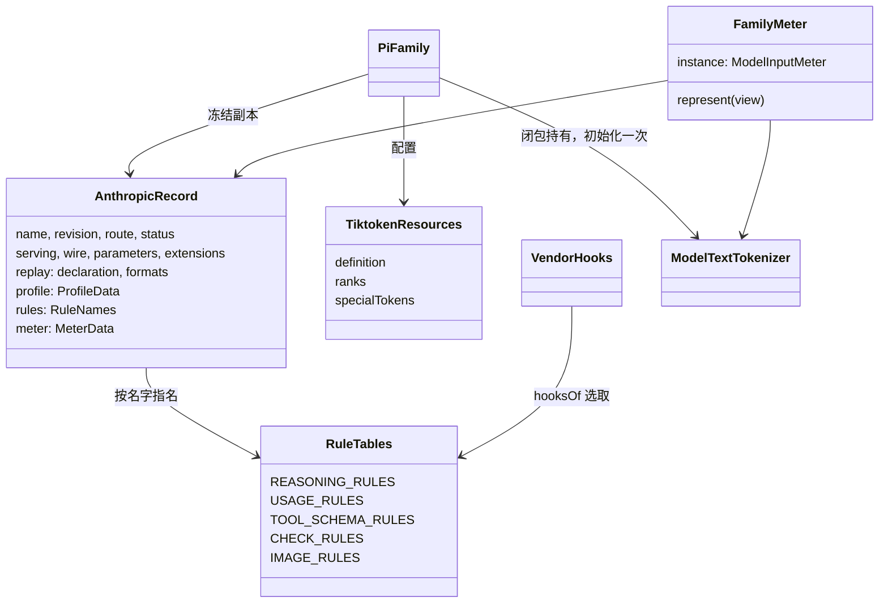

# 对象模型

本文件描述本包内部对象的职责、身份、状态、关联、组合、继承与生命周期，配类图。它不强迫实现改成 class；纯函数或值包写实际模型与不适用项。

## 对象与关系

本包只有一个类：`TokenizerResourceError`，它是 `Error` 的子类，只表示词表文件不符。其他对象都是普通值与闭包：

- 记录的身份是采用 `{owner, name, revision, digest}`。摘要由整条记录算出，不写在记录里。
- 组件采用 `<记录名>#<组件>` 的身份跟随记录。
- 推理编解码器每条记录一个，持有记录的采用，用作 `unsupported` 的 `adapter`。
- 计量器与 hook 是每个绑定新建的冻结值，持有记录与 tokenizer 的引用。

## 生命周期

- 记录：模块常量，不变。家族表保存冻结副本。
- 词表资源：装配方调用 `anthropicTokenizerResources` 时读出，作为家族配置的值，归装配方。
- tokenizer：家族第一次取得时创建，之后复用，没有需要释放的资源。
- 绑定：每次取得新建。`release` 不释放任何东西，重复调用返回同一结果。
