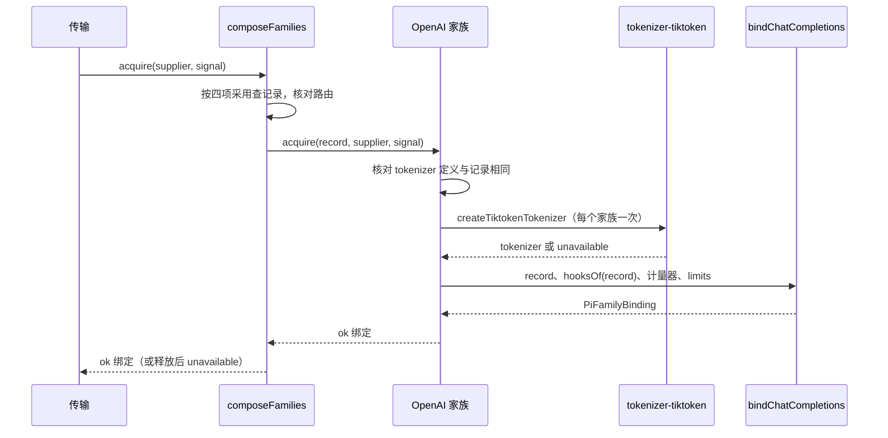

# 关键流程

本文件用可维护的文本图源描述本包的关键业务流程与数据流：参与者、调用时序、数据来源与去向、状态变化、失败分支与生命周期。图旁写前提与边界，不编造流程。

## 流程

**取得绑定**：传输按供应商的精确采用经家族表调用本家族。

**规划、编码与计量**：

1. `rules.plan` 由引擎执行：展开档案的回放声明、按记录的参数表规划、投影、调用 `check`、调用 `represent` 得到表示。
2. 请求组装方在发送前用 `meter.measure` 计量这份表示。
3. `encode` 用同一投影写出请求体，回放用请求为该供应商固定的声明与再发略去集合，并返回回放略去的诊断。

**响应**：引擎的解码器逐帧归约。收场时把全部推理项交给 `openai-encrypted/1` 的 `seal`，每个加密项成为一个推理续接状态部件。收场之后解码器调用 `usage` 规则，给出账目报告与可能的 `usage-inconsistent` 诊断。

**回放**：下一次请求中，可续接的 assistant 消息的部件交给 `replay`，写回 `reasoning_details`。其他家族产出的消息不可续接，部件与思考都不写出，encode 的 `replay-omitted` 诊断指名该消息。

## 失败与生命周期

- 取得：tokenizer 定义不符、tokenizer 初始化失败与取消都返回 `unavailable`，不交出绑定。
- 规划与编码：不受支持的参数、工具 schema 或回放载荷返回闭合失败，不删值。
- 计量：加密推理、缺少图片事实与规则不适用都返回具名失败，不给估算。
- 生命周期：家族与记录是普通值。tokenizer 归家族，随家族被丢弃。绑定的 `release` 不释放任何东西。
