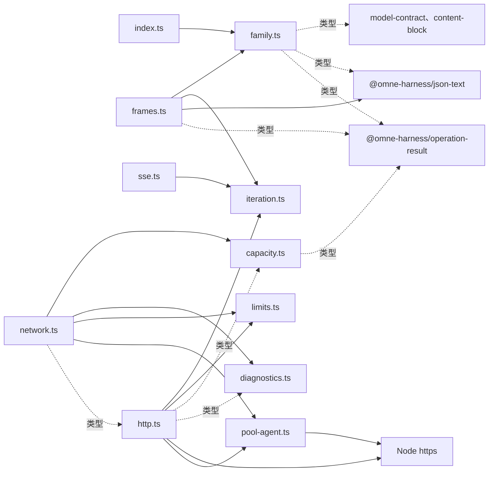
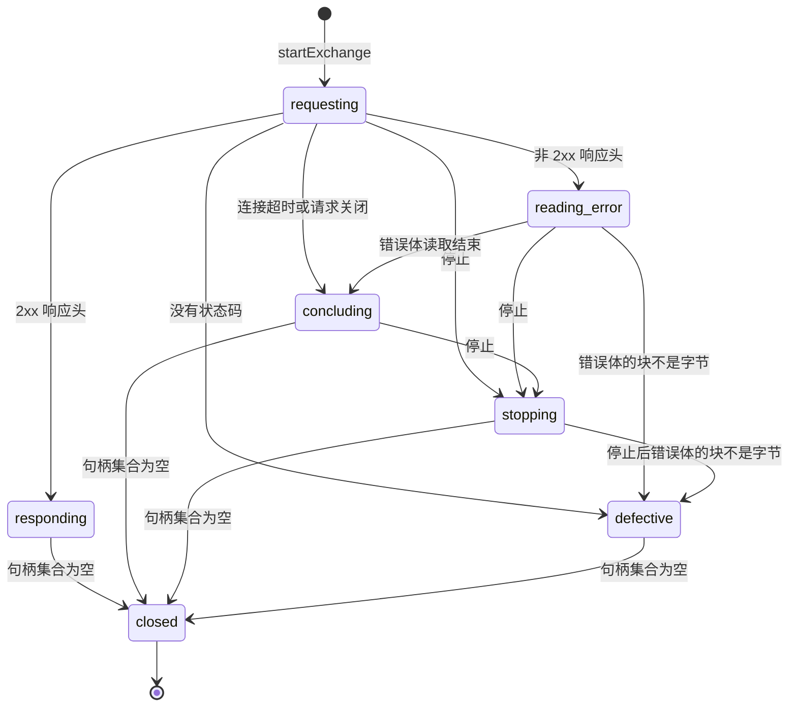

# 内部架构

本文件说明本包怎样兑现 [SPEC.md](../SPEC.md)：包内模块划分、依赖方向、状态与资源归属、关键机制及设计理由。组级边界见[组架构“成员与新增条件”](../../docs/architecture.md#成员与新增条件)与[“包依赖与装配”](../../docs/architecture.md#包依赖与装配)。

## 模块与依赖

| 模块 | 回答的问题与持有的东西 | 依赖 |
| --- | --- | --- |
| [family.ts](../src/family.ts) | 五个已接受的家族贡献接口类型，形状照抄组架构 | model-contract、json-text、content-block、operation-result，只有类型 |
| [index.ts](../src/index.ts) | 根入口，只转出 family.ts 的类型 | family.ts |
| [capacity.ts](../src/capacity.ts) | 谁可以发：FIFO 等待队列、已授予计数、关闭标志、每个预约的状态 | operation-result（类型） |
| [diagnostics.ts](../src/diagnostics.ts) | 观察怎样隔离：失败、在途与丢弃计数 | 无 |
| [iteration.ts](../src/iteration.ts) | 读者提前结束时怎样关闭来源：未启动的生成器不运行 `finally`，由它补上 | 无 |
| [limits.ts](../src/limits.ts) | 哪些数是合法限额：正的安全整数，以及 Node 定时器的最大延迟 | 无 |
| [sse.ts](../src/sse.ts) | 字节怎样成为事件：UTF-8 解码器状态、当前行、当前事件的 data 行与字节计数 | iteration.ts；改编自 pi |
| [frames.ts](../src/frames.ts) | 事件怎样成为协议帧：是否已过 end-marker | family.ts、iteration.ts、json-text、operation-result |
| [http.ts](../src/http.ts) | 怎样发一次并收场：一次交换的相位、未关闭的物理句柄、座位、结果、连接超时与建连取消信号，以及读者看到的错误类型 | Node `https`、`http`、`net`，iteration.ts、limits.ts、pool-agent.ts，capacity.ts 与 diagnostics.ts（类型） |
| [pool-agent.ts](../src/pool-agent.ts) | 连接池怎样建立连接：Node 缺陷的规避、把交换的停止接到正在建立的连接，以及 Node 版本是否支持 `proxyEnv` | Node `https`，Node `stream`（类型） |
| [network.ts](../src/network.ts) | 怎样组合与排空：代理配置的校验、容量、连接池、在途登记、诊断隔离与关闭状态 | capacity.ts、diagnostics.ts、limits.ts、pool-agent.ts，http.ts（类型） |

下图画出表中的全部依赖，虚线是只有类型的依赖：

依赖方向只从组合者指向机制。http.ts 不创建容量、连接池或诊断隔离，它们由 network.ts 注入。http.ts 只从 pool-agent.ts 取得建连取消信号的选项键。http.ts 只看到 `ExchangeResources` 中它需要的部分：连接池、TLS 选项、诊断隔离、在途登记、关闭标志，以及容量的预约归属核对。sse.ts 只接收字节的异步迭代，不接收 Node 的 `IncomingMessage`。iteration.ts 与 limits.ts 是机制共用的小工具，不持有状态。

运行依赖只有 model-contract、operation-result、json-text、content-block 与 Node 内置模块。本包不导入任何家族。家族差异只经已接受的 `PiFamilyBinding` 与 `PiResponseDecoder` 进入，由上层装配提供。[dependencies.spec.ts](../tests/dependencies.spec.ts) 核对 `package.json` 的声明与源码中的值导入和类型导入。

## 关键机制与理由

### 交换的相位

http.ts 用一个相位与一个物理句柄集合管理一次交换。相位决定结果，句柄集合决定交换何时关闭。

| 相位 | 含义 |
| --- | --- |
| `requesting` | 请求已发出，还没有响应 |
| `responding` | 2xx 结果已交付，响应体在读者手中 |
| `reading-error` | 正在收集非 2xx 的错误体 |
| `concluding` | 自然结果已知，停止仍可替换它 |
| `stopping` | 停止已胜出 |
| `defective` | 出现 Node 契约以外的情况 |
| `closed` | 全部资源已释放 |

物理句柄集合有三种成员：

- `request`：发起时加入，请求的 `close` 事件时离开。
- `response`：收到响应时加入，响应的 `close` 事件时离开。
- `error-body`：开始读取错误体时加入，读取结束时离开。

集合为空时，交换进入 `closed`：清除连接超时定时器，移除信号监听器，离开在途登记，经座位归还名额，确定结果，投递 `exchange-stopped`，然后完成 `stopped`。`responding` 的结果已在收到响应头时交付，`closed` 时不再改变。

停止在 `requesting`、`reading-error` 与 `concluding` 时把相位改为 `stopping`，然后销毁响应与请求。在 `responding` 时，停止不改变相位，只销毁连接，读者的迭代因此以 `ResponseBodyStoppedError` 结束。其他相位上的停止不起作用。

交换记住是否发生过本地停止。响应体在到达末尾之前结束时，读者按这个记录得到两种错误之一：有本地停止是 `ResponseBodyStoppedError`，没有本地停止是 `ResponseBodyReadError`，后者带 Node 报告的 `cause`。读者按类型分支，不解释 Node 的错误码。

响应体的读者提前结束迭代时，本包销毁响应。未启动的异步生成器不运行 `finally`，所以 `claim()` 返回的迭代器、`readSseEvents` 与 `readProtocolFrames` 都经 [iteration.ts](../src/iteration.ts) 包装：读者在第一次 `next()` 之前调用 `return()` 或 `throw()` 时，包装先关闭来源。来源关闭失败时，包装仍让生成器完成，之后的 `next()` 返回 done，失败本身传给读者。包装在这种 `return()` 或 `throw()` 开始时同步进入“结束中”状态。关闭期间到达的 `next()`、`return()` 或 `throw()` 等关闭完成后才转给已完成的生成器，与原生生成器的排队一致。所以 `next()` 返回 done，生成器不启动，来源只关闭一次。三层组合提前结束时，关闭逐层到达响应。

### 资源所有权

| 资源 | 拥有者 | 释放路径 |
| --- | --- | --- |
| 预约 | 容量 | 调用 `release()` 或被一次交换消费 |
| 座位 | 消费预约的交换 | 交换进入 `closed` 时归还 |
| 物理请求与响应 | 交换 | 停止、读完、读者提前结束或连接失败，最终都触发 `close` 事件 |
| 2xx 响应体 | 认领它的读者 | 读完，或提前结束迭代（含第一次 `next()` 之前） |
| 在途登记 | 网络资源 | 交换在 `closed` 时自行离开 |
| 连接池 | 网络资源 | `close()` 销毁 |
| 诊断计数 | 诊断隔离 | 只增减计数，不持有观察者的结果 |

每个监听器与定时器都有清理路径：

- 容量在授予或取消时移除信号监听器。
- 交换在 `closed` 时移除信号监听器。
- 交换在请求取得已连接的套接字、收到响应或关闭时清除连接超时定时器。新建的直连在 TLS 握手完成时才算已连接。
- 连接池在把套接字交给请求或收到建连错误时，移除建连取消信号上的监听器。直连时 Node 不调用这个回调，监听器随交换的取消控制器一起被回收。
- 诊断隔离只在 thenable 完成时调整计数，派生的 Promise 不会拒绝。

### 同步发起与发送围栏

model-contract 要求发送点 S 位于同一个同步围栏内，围栏内不得 await 或排队。因此 `startExchange` 是同步函数：校验输入、消费预约、调用 `https.request` 与 `end(body)`，然后返回句柄。容量的等待放在发起之前，由 `reserve` 完成，后续由[阶段二](https://github.com/nemori-ai/omne-harness-lite/issues/446) 2.2 的 materialize 调用。

同时进行的交换数只由容量限制。连接池不设套接字上限：`maxSockets` 是 `Infinity`，也不设 `maxTotalSockets`。连接池只负责 keep-alive 复用与空闲超时。

因此 `maxConnections` 限制同时进行的交换数，不限制物理连接数。下列连接不占名额，连接数可以超过容量：

- 空闲连接。连接池在连接空闲 `idleConnectionTimeoutMs` 后关闭它，这个值是连接池的 `timeout` 选项。
- 交换已停止、但直连仍在握手的连接。交换在连接池交出套接字之前停止时（例如在发起的同一 tick 内），Node 已经为请求新建了套接字。Node 在 `onSocketNT` 中发现请求已销毁，对套接字发出 `free`。连接池于是把这个套接字收为空闲套接字，即使 TLS 握手尚未完成。本包的连接超时已随交换结束而清除，所以这个连接按 `idleConnectionTimeoutMs` 结束，不按 `connectTimeoutMs` 结束。这一行为按 Node 26.12.0 的 `lib/_http_client.js` 核对。
- 正在关闭、尚未移出连接池的套接字。下一段说明，套接字到它自己的 `close` 事件才移出计数。在这之前，等待者可能已经新建连接，物理连接数短暂超过容量。

本包不用 `maxSockets` 对齐容量，原因是 Node 与本包的计数时刻不同。本包在请求与响应的 `close` 事件时归还名额，等待者在下一个 microtask 发起。Node 的连接池对不保留的套接字在请求的 `close` 同一个 tick 销毁它，但只在该套接字自己的 `close` 事件到达时才把它移出 `agent.sockets` 的计数，这是事件循环的下一轮。不保留的情况有：服务端声明 `Keep-Alive: timeout=1`，低于 Node 的复用余量；套接字已不可写。于是在 `maxSockets` 等于容量时，前一个交换 `stopped` 之后立即发起的请求会看到计数仍然占满，进入 `agent.requests`，尽管它持有名额。总上限 `maxTotalSockets` 还会把其他接收方的空闲连接计入总量，同样让持有名额的请求排队。这一顺序按 Node 26.12.0 的 `lib/_http_client.js` 与 `lib/_http_agent.js` 核对：`responseKeepAlive` 在 nextTick 里先投递请求的 `close`，再投递套接字的 `free`；`free` 的处理里不保留的套接字被 `destroy()`；`removeSocket` 只在套接字 `close` 时调用。

发起后，本包仍同步核对请求没有进入连接池的等待队列（Node 公开的 `agent.requests`）。网络资源创建的连接池不让请求排队。排队只在配置被绕过等缺陷下出现，例如有人改小了 `agent.maxSockets`。进入等待队列违反“返回前已发出”，本包按缺陷处理：销毁请求、把它移出 `agent.requests`（队列空时删除该键）、归还名额、抛出 `ExchangeQueuedError`，不把它当成已发起的交换。移出队列是必要的：`req.destroy()` 不把请求移出 `agent.requests`，而连接池在任何套接字关闭时（`removeSocket`）都会为队列中的请求新建连接，`agent.destroy()` 之后也是如此。本包只读写 `requests` 这一已文档化属性。名额在请求与响应物理关闭之后才归还。

### 经代理建立连接

配置了代理时，network.ts 把 `proxy` 映射为 Node 连接池的 `proxyEnv`，CONNECT 隧道由 Node 实现。本包不自写隧道。network.ts 在构造时校验配置，并检查 Node 版本：24.5.0 之前的 24.x 没有 `proxyEnv`，会静默忽略它而直连，绕过调用方要求的代理。network.ts 交给 Node 的是 `URL` 规范化后的 `href`，不是原文。Node 读取原文时只按小写的 `http://` 或 `https://` 前缀判断，并对回车与换行抛出含完整 URL 的错误。`URL` 却接受这些写法。用原文会让校验通过的配置静默直连，或泄露代理凭据。

经代理时，Node 的连接池在两点上与本包的契约不一致。连接池因此是 pool-agent.ts 中 `https.Agent` 的子类 `PoolAgent`，只覆盖已文档化的 `createConnection(options, callback)`。两点都只发生在 Node 以回调交出套接字的建连路径上。直连时 Node 同步返回套接字，并在同一调用中把它交给请求，不调用回调，所以覆盖不改变直连的行为。网络资源总是使用 `PoolAgent`，不按是否配置代理分支。

| 问题 | Node 的行为 | `PoolAgent` 的处理 | 删除条件 |
| --- | --- | --- | --- |
| 拒绝后重置使进程崩溃 | 代理以 200 以外的状态回复 CONNECT 时，Node 移除代理套接字上的错误监听器，把错误与该套接字一起交给回调，但不销毁套接字。连接池的回调丢弃套接字。代理随后重置连接时，套接字发出没有监听器的 `error`，进程以未处理的 `ECONNRESET` 崩溃 | 回调收到错误与套接字时，先给套接字加一个空的 `error` 监听器并销毁它，再调用原回调 | 引擎下限到达自行销毁该套接字的 Node 版本时删除 |
| 停止等不到建立中的连接 | 建立期间套接字在连接池，不在请求上。`req.destroy()` 只标记请求，请求的 `close` 要等 Node 交出套接字或错误。CONNECT 阶段要等 Node 的隧道超时（取 `idleConnectionTimeoutMs`）。隧道返回 200 之后，Node 清除这个超时，所以经隧道停滞的 TLS 握手没有上限。`agent.destroy()` 不处理建立中的套接字 | http.ts 为每个交换建一个取消控制器，把它的信号放在请求选项中以包内私有的 symbol（`CONNECTION_CANCEL`）为键。销毁请求时（停止、连接超时或网络资源关闭）同时取消它。`createConnection` 从选项读到信号。信号在 Node 交出套接字之前取消时，`PoolAgent` 以错误销毁它返回的套接字，Node 随即把错误交给请求 | Node 的 `req.destroy()` 自己结束建立中的代理连接时删除 |

第二点依赖一个没有写进 Node 文档的行为：Node 把请求选项传到 `createConnection`。`ClientRequest` 把选项交给 `addRequest`，`addRequest` 与 `createSocket` 各自复制自有键，symbol 键也被复制。这一路径按 Node 26.12.0 的 `lib/_http_client.js`、`lib/_http_agent.js` 与 `lib/https.js` 核对。[proxy.spec.ts](../tests/proxy.spec.ts) 中的下列用例锁住这一依赖：

- 代理不回复时按连接超时结束；
- 隧道内 TLS 不完成时按连接超时结束；
- CONNECT 期间 `stop()` 及时结束；
- 隧道内 TLS 期间网络资源 `close()` 及时结束。

Node 不再把信号传到 `createConnection` 时，这些用例以“未在时限内完成”失败。第一点由同一文件中“代理拒绝后重置”的用例锁住：去掉规避时，测试运行报告未处理的 `ECONNRESET`。

`PoolAgent` 只判断套接字是否在已文档化的 `sockets` 与 `freeSockets` 中，不读取 Node 的内部符号。连接池已经计入的套接字由请求自己的关闭路径处理，取消信号对它不起作用。

连接超时从交换发起时开始计时，原因是经代理时 Node 在隧道与 TLS 都完成之后才把套接字交给请求。如果仍从套接字交给请求时开始计时，连接超时就不覆盖代理阶段。对直连与复用的连接，起点只提前到发起的同一 tick。

### 不迁移旧的脱敏策略

封存件用旧的凭据政策包对头部和错误体脱敏。本包不迁移这套策略。原样的响应头与错误体只在包内交给家族解释，对外失败只由家族形成的安全诊断表达，诊断事件只含种类与级别。这样秘密只存在于本次发送资源内，不需要第二套脱敏规则（依据 [#461 的决定评论](https://github.com/nemori-ai/omne-harness-lite/issues/461#issuecomment-6311010561)）。

### 与封存件的差异

- 取消的报告方式：封存件把“在 Node 连接池队列中被取消”报为本地失败。本包把发出之后的取消统一报为 `stopped`，并以 `responded` 区分是否已有响应。发起前已取消的信号得到拒绝原因 `cancelled`，不发出请求。
- 连接池上限：封存件把 `maxSockets` 与 `maxTotalSockets` 都设为连接数。本包不设套接字上限，并发只由容量限制，原因见上文“同步发起与发送围栏”。
- 发起：封存件在 send 内等待容量。本包把等待移到 `reserve`，发起本身同步。
- 地址：封存件固定 OpenRouter 路径。本包只接收调用方给出的完整 https 地址。
- 诊断上限：封存件复用连接数作为诊断在途上限。本包的 `maxPending` 独立配置。
- 读者看到的错误：封存件把 Node 的流错误原样交给读者。本包把本地停止与对方中断分为 `ResponseBodyStoppedError` 与 `ResponseBodyReadError` 两种类型。

### 从 pi 改编的 SSE 分帧

[sse.ts](../src/sse.ts) 改编自 pi 1.0.0 的 `parseSSE`，保留逐字符的分帧算法与来源头。来源、哈希与改编内容登记在 [provenance.json](../provenance.json)，说明见 [UPSTREAM.md](../UPSTREAM.md)，原许可证在 [LICENSE.pi](../LICENSE.pi)。其他源文件是本项目自写的，不带来源头。

相对封存的 fork，sse.ts 改了两处：

- 只有 UTF-8 解码器的 `TypeError` 映射为非法 UTF-8，其他错误原样传出。
- 没有冒号的 `data` 行按 WHATWG 规则取空值。

JSON 读取与 end-marker 移到本项目自写的 [frames.ts](../src/frames.ts)，由 `@omne-harness/json-text` 无损解析。

## 未实现的优化方向：按优先级与等待方式分配连接席位

**状态：未实现，未采用为契约。** 本节记录一个已提出的产品要求和建议的实现方向，供后续实施时使用。产品要求的来源是 [#461 的决定评论](https://github.com/nemori-ai/omne-harness-lite/issues/461#issuecomment-6311010561)。当前行为以 [SPEC.md](../SPEC.md#连接容量) 为准：连接席位按先来先得授予，等待在授予、取消或容量关闭时结束，调用方可以用带时限的取消信号限定等待时间。

### 要解决的问题

发起模型请求的调用方主要是 agent。agent 有两类：在前台与人交互的 agent，以及在后台工作的 subagent。它们共用同一个传输实例的连接席位（同时占用连接的请求数上限，由 `maxConnections` 配置，即 SPEC 中容量的名额）。席位用满时，后台请求可能占住席位，前台请求排队，首字延迟（TTFT）变差。

产品要求：

1. 请求到达时可以带自己的优先级。
2. 请求到达时可以声明没有席位时立即失败，还是等待一段时间。
3. 通过配置，同时保证前台交互请求的高优先级与 TTFT，以及后台 subagent 请求的低优先级与稳定性。

### 建议的机制（席位分配，归本包容量模块）

- **优先级。** 用小的封闭集合，至少区分“交互”与“后台”，不用任意数字。席位空出时先授予高优先级的等待者；同一优先级内先来先得。
- **预留席位。** 为高优先级预留一部分席位：低优先级最多占用 `maxConnections` 减去预留数。预留数由配置给出。这是保证前台 TTFT 的主要手段。
- **防止低优先级饿死。** 二选一或并用，由配置给出：低优先级保底席位数；等待超过阈值后提升其授予顺序。
- **请求声明等待方式。** 三种：没有空席位立即失败；最多等待一段时间，超时失败；等待到取消。每个优先级有配置的默认等待方式，请求可以覆盖。失败结果区分“没有席位立即失败”“等待超时”“被取消”。
- **不抢占。** 优先级只决定空出席位的授予顺序。已经发出的请求不被中断让位：发出的请求不能撤回，中断还会产生费用。
- **配置与观测。** 所有数值（预留数、保底数、提升阈值、各优先级默认等待时限）来自配置，不在代码里写永久默认值。记录每次等待的时长与结束原因，用于调参。

### 尚需决定的承载方式（跨成员）

优先级与等待方式要从 agent 传到本包。当前 Model 契约没有承载它们的字段：传输的 `prepare` 只接收固定请求与供应商，`materialize` 只接收取消信号。两种承载方式：

| 方式 | 做法 | 影响 |
| --- | --- | --- |
| 装配映射 | 不改契约。装配配置按固定请求中的消费者引用或发起者身份，映射到优先级与等待方式 | 改动只在装配与本包；请求本身不声明，同一调用方不能逐次改变 |
| 请求声明 | Model 契约增加调度意图（优先级与等待方式），调用方随请求声明，经 Model 运行时传到传输 | 要走契约变更，同步 `model-contract`、`model` 运行时与 Agent 等消费者 |

建议先用装配映射落地，再按需要经契约变更引入请求声明；本包的席位机制两种方式都适用，只是取值来源不同。

### 实施时的责任与入口

- 席位分配机制：本包（容量模块与网络资源配置）。
- `materialize` 等待策略的取舍（立即失败、限时、等待到取消）：传输三段语义的拥有者（阶段二 2.2 的实现及其后续）。
- 请求声明方式：Model 契约拥有者，按契约变更协议另立任务，并同步 Agent 线。
- 产品取值（预留比例、默认等待时限）：产品负责人。

## 验证与维护

保证与测试的对应见 [SPEC“组合与验证”](../SPEC.md#组合与验证)，测试的分层与替身见 [tests/README.md](../tests/README.md)。

- 改变家族贡献接口：先改[组架构](../../docs/architecture.md#pi-家族贡献的取得协议)的已接受代码块，再同步 family.ts、[public-entry.spec-d.ts](../tests/public-entry.spec-d.ts) 与[公开接口](public-api.md)。
- 改变交换相位、拒绝原因或结果：同步 SPEC、[关键流程](flows.md)、http.ts 的测试，以及 2.2 的调用代码。
- 改变 sse.ts：同步 provenance.json 的改编说明与 UPSTREAM.md。
- 增加运行依赖：先核对组架构的依赖方向，再更新 dependencies.spec.ts 的允许集合。
- 2.2 实现 `ModelTransport` 之后，套件的 transport 组成为更高的测试接缝，本包的网络接缝用例可以随之收敛。
