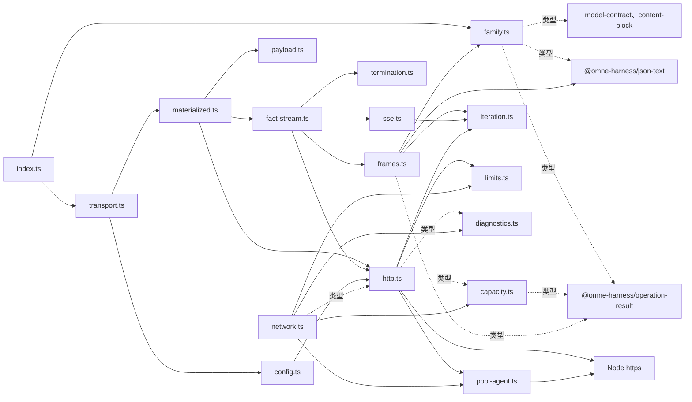
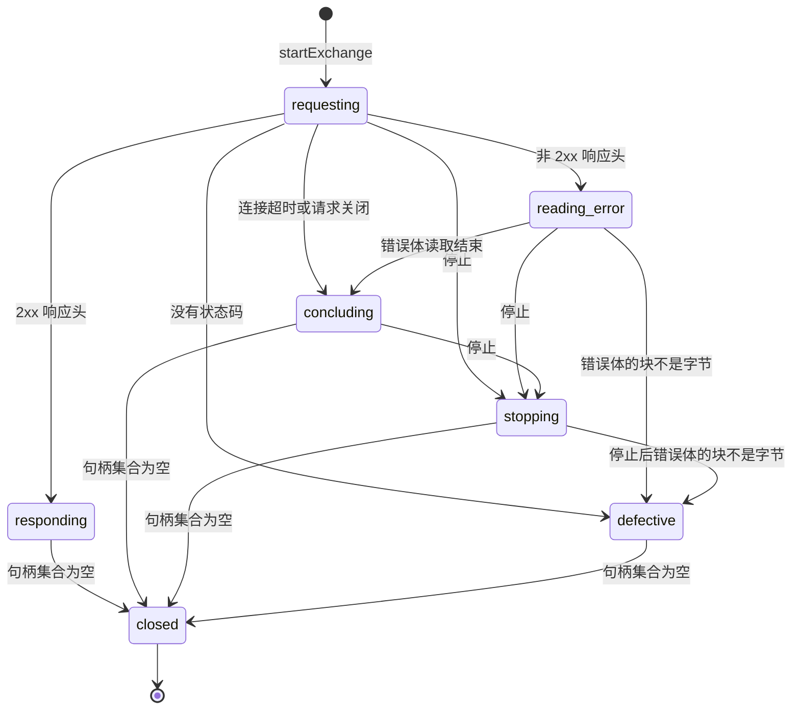

# 内部架构

本文件说明本包怎样兑现 [SPEC.md](../SPEC.md)：包内模块划分、依赖方向、状态与资源归属、关键机制及设计理由。组级边界见[组架构“成员与新增条件”](../../docs/architecture.md#成员与新增条件)与[“包依赖与装配”](../../docs/architecture.md#包依赖与装配)。

## 模块与依赖

| 模块 | 回答的问题与持有的东西 | 依赖 |
| --- | --- | --- |
| [family.ts](../src/family.ts) | 五个已接受的家族贡献接口类型，形状照抄组架构 | model-contract、json-text、content-block、operation-result，只有类型 |
| [index.ts](../src/index.ts) | 根入口，转出 family.ts 的类型、family-table.ts 的家族表、config.ts 的配置类型、transport.ts 的工厂、network.ts 的工厂与配置类型，以及 diagnostics.ts 的观察者类型 | family.ts、family-table.ts、config.ts、transport.ts、network.ts、diagnostics.ts |
| [family-table.ts](../src/family-table.ts) | 精确采用怎样解析到家族与记录：每个家族的记录冻结副本与采用，组合后的采用表，取得时的失败映射 | canonical-json.ts，family.ts、model-contract 与 operation-result（类型） |
| [canonical-json.ts](../src/canonical-json.ts) | 纯数据的规范 JSON 与它的 SHA-256 | Node `crypto` |
| [chat-completions/index.ts](../src/chat-completions/index.ts) | 子入口，转出 `bindChatCompletions` 与 vocabulary.ts 的类型 | bind.ts、vocabulary.ts |
| [chat-completions/bind.ts](../src/chat-completions/bind.ts) | 一条记录怎样成为完整绑定：绑定时的记录检查、请求上下文、只包一层的释放 | family-table.ts、request.ts、projection.ts、parameters.ts、gateway.ts、decoder.ts |
| [chat-completions/request.ts](../src/chat-completions/request.ts) | plan 与 encode 的步骤：回放声明的展开、请求体、表示与编码诊断 | projection.ts、parameters.ts、gateway.ts、json.ts、payload.ts，model-contract 的 `judgeReplayDeclaration`；改编自 pi |
| [chat-completions/projection.ts](../src/chat-completions/projection.ts) | 请求怎样投影为网关消息：角色、内容、工具调用与结果、回放、缓存位置、工具 | json.ts、json-text、model-contract 的 `projectReplay`、Node `crypto`；改编自 pi |
| [chat-completions/parameters.ts](../src/chat-completions/parameters.ts) | 参数怎样按记录表规划与写出 | gateway.ts |
| [chat-completions/gateway.ts](../src/chat-completions/gateway.ts) | 网关字段的闭合词表：写出与扩展值的读取 | json.ts |
| [chat-completions/json.ts](../src/chat-completions/json.ts) | 排序键的 json-text 值树构造 | json-text（类型） |
| [chat-completions/vocabulary.ts](../src/chat-completions/vocabulary.ts) | 记录词表、四个 hook 与计量接缝的类型 | family-table.ts、model-contract、json-text、content-block、operation-result（类型） |
| [chat-completions/decoder.ts](../src/chat-completions/decoder.ts) | 响应流怎样成为事实：阶段联合（`streaming`、`finished`、`ended`）与每帧一个纯归约步，开着的块、工具调用、推理缓存、服务方与尾帧计数都在阶段值里 | chunk.ts、details.ts、termination.ts、content-block 的 `judgeBlockIdentity`、json-text，family.ts（类型）；改编自 pi |
| [chat-completions/chunk.ts](../src/chat-completions/chunk.ts) | 一个数据帧是不是网关 chunk：边界上读成具名的 chunk，或给出形状失败 | json-text（类型）；改编自 pi |
| [chat-completions/details.ts](../src/chat-completions/details.ts) | 推理片段怎样拼接成项，以及一个片段的可见文本 | json-text（类型） |
| [testing/index.ts](../src/testing/index.ts) | 子入口 `./testing`，转出夹具检查与采用指纹 | fixtures.ts、adoptions.ts |
| [testing/fixtures.ts](../src/testing/fixtures.ts) | 一个家族的夹具是否与引擎一致：按记录读三个文件、编码比较、经 `decodeBody` 回放比较、多余目录 | family-table.ts、fact-stream.ts、termination.ts、chat-completions/json.ts、model-contract 的 `judgeFixedModelRequest`、json-text、Node `fs/promises`、`path`、`util` |
| [testing/adoptions.ts](../src/testing/adoptions.ts) | 采用指纹文件是否与记录一致，以及只追加的生成 | family-table.ts、Node `fs/promises` |
| [config.ts](../src/config.ts) | 三段传输的配置是否合规：路由解析为 `URL`、限额校验 | http.ts、limits.ts，json-text、family.ts 与 network.ts（类型） |
| [transport.ts](../src/transport.ts) | 外层与每个 prepared 的生命周期：路由查找、请求中的供应商与它的回放声明、家族绑定、在途 acquire 的中止、关闭的顺序 | config.ts、materialized.ts，model-contract 与 operation-result（类型） |
| [materialized.ts](../src/materialized.ts) | 一次发送：名额、编码后的字节、回执、start 的同步发起与关闭 | payload.ts、fact-stream.ts、http.ts，capacity.ts 与 termination.ts（类型） |
| [fact-stream.ts](../src/fact-stream.ts) | 响应怎样成为事实：SSE、协议帧、家族解码器，保留解码器的 `ended` 直到最后。2xx 响应体的解码是单独的 `decodeBody`，测试入口用它回放夹具 | sse.ts、frames.ts、http.ts、iteration.ts、termination.ts |
| [termination.ts](../src/termination.ts) | 一次发送怎样结束：发送结束到流终止的纯函数 | model-contract（类型），frames.ts 与 sse.ts（类型） |
| [payload.ts](../src/payload.ts) | 固定的 payload：内容引用扫描、JSON 序列化、SHA-256 | json-text、Node `crypto` |
| [capacity.ts](../src/capacity.ts) | 谁可以发：FIFO 等待队列、已授予计数、关闭标志、每个预约的状态 | operation-result（类型） |
| [diagnostics.ts](../src/diagnostics.ts) | 观察怎样隔离：失败、在途与丢弃计数 | 无 |
| [iteration.ts](../src/iteration.ts) | 读者提前结束时怎样关闭来源：未启动的生成器不运行 `finally`，由它补上 | 无 |
| [limits.ts](../src/limits.ts) | 哪些数是合法限额：正的安全整数，以及 Node 定时器的最大延迟 | 无 |
| [sse.ts](../src/sse.ts) | 字节怎样成为事件：UTF-8 解码器状态、当前行、当前事件的 data 行与字节计数 | iteration.ts；改编自 pi |
| [frames.ts](../src/frames.ts) | 事件怎样成为协议帧：是否已过 end-marker | family.ts、iteration.ts、json-text、operation-result |
| [http.ts](../src/http.ts) | 怎样发一次并收场：一次交换的相位、未关闭的物理句柄、座位、结果、连接超时与建连取消信号，以及读者看到的错误类型 | Node `https`、`http`、`net`，iteration.ts、limits.ts、pool-agent.ts，capacity.ts 与 diagnostics.ts（类型） |
| [pool-agent.ts](../src/pool-agent.ts) | 连接池怎样建立连接：Node 缺陷的规避、把交换的停止接到正在建立的连接，以及 Node 版本是否支持 `proxyEnv` | Node `https`，Node `stream`（类型） |
| [network.ts](../src/network.ts) | 怎样组合与排空：代理配置的校验、容量、连接池、在途登记、诊断隔离与关闭状态 | capacity.ts、diagnostics.ts、limits.ts、pool-agent.ts，http.ts（类型） |

下图画出表中的全部依赖，虚线是只有类型的依赖：

依赖方向只从组合者指向机制。三段传输是最上层的组合者，它不创建网络资源、家族绑定或凭据，它们由构造参数注入。http.ts 不创建容量、连接池或诊断隔离，它们由 network.ts 注入。http.ts 只从 pool-agent.ts 取得建连取消信号的选项键。http.ts 只看到 `ExchangeResources` 中它需要的部分：连接池、TLS 选项、诊断隔离、在途登记、关闭标志，以及容量的预约归属核对。根入口的 `NetworkResources` 是不透明句柄，只有 `close()`。network.ts 用模块级 `WeakMap` 从句柄找到包内资源，`createPiTransport` 经它取回资源。所以包外代码不能取得连接池、在途登记或容量，也不能用结构相同的对象冒充网络资源。sse.ts 只接收字节的异步迭代，不接收 Node 的 `IncomingMessage`。iteration.ts 与 limits.ts 是机制共用的小工具，不持有状态。

运行依赖只有 model-contract、operation-result、json-text、content-block 与 Node 内置模块。本包不导入任何家族。网关引擎需要的消息与用量项类型经 model-contract 的类型取得，不另依赖 message 或 call-account。家族差异只经已接受的 `PiFamilyBinding` 与 `PiResponseDecoder` 进入，由上层装配提供。[dependencies.spec.ts](../tests/dependencies.spec.ts) 核对 `package.json` 的声明与源码中的值导入和类型导入。

## 关键机制与理由

### 交换的相位

http.ts 用一个相位与一个物理句柄集合管理一次交换。相位决定结果，句柄集合决定交换何时关闭。

| 相位 | 含义 |
| --- | --- |
| `requesting` | 请求已发出，还没有响应 |
| `responding` | 2xx 结果已交付，响应体在读者手中 |
| `reading-error` | 正在收集非 2xx 的错误体 |
| `concluding` | 自然结果已知，停止仍可替换它 |
| `stopping` | 停止已胜出 |
| `defective` | 出现 Node 契约以外的情况 |
| `closed` | 全部资源已释放 |

物理句柄集合有三种成员：

- `request`：发起时加入，请求的 `close` 事件时离开。
- `response`：收到响应时加入，响应的 `close` 事件时离开。
- `error-body`：开始读取错误体时加入，读取结束时离开。

集合为空时，交换进入 `closed`：清除连接超时定时器，移除信号监听器，离开在途登记，经座位归还名额，确定结果，投递 `exchange-stopped`，然后完成 `stopped`。`responding` 的结果已在收到响应头时交付，`closed` 时不再改变。

停止在 `requesting`、`reading-error` 与 `concluding` 时把相位改为 `stopping`，然后销毁响应与请求。在 `responding` 时，停止不改变相位，只销毁连接，读者的迭代因此以 `ResponseBodyStoppedError` 结束。其他相位上的停止不起作用。

交换记住是否发生过本地停止。响应体在到达末尾之前结束时，读者按这个记录得到两种错误之一：有本地停止是 `ResponseBodyStoppedError`，没有本地停止是 `ResponseBodyReadError`，后者带 Node 报告的 `cause`。读者按类型分支，不解释 Node 的错误码。

响应体的读者提前结束迭代时，本包销毁响应。未启动的异步生成器不运行 `finally`，所以 `claim()` 返回的迭代器、`readSseEvents` 与 `readProtocolFrames` 都经 [iteration.ts](../src/iteration.ts) 包装：读者在第一次 `next()` 之前调用 `return()` 或 `throw()` 时，包装先关闭来源。来源关闭失败时，包装仍让生成器完成，之后的 `next()` 返回 done，失败本身传给读者。包装在这种 `return()` 或 `throw()` 开始时同步进入“结束中”状态。关闭期间到达的 `next()`、`return()` 或 `throw()` 等关闭完成后才转给已完成的生成器，与原生生成器的排队一致。所以 `next()` 返回 done，生成器不启动，来源只关闭一次。三层组合提前结束时，关闭逐层到达响应。

### 资源所有权

| 资源 | 拥有者 | 释放路径 |
| --- | --- | --- |
| 预约 | 容量 | 调用 `release()` 或被一次交换消费 |
| 座位 | 消费预约的交换 | 交换进入 `closed` 时归还 |
| 物理请求与响应 | 交换 | 停止、读完、读者提前结束或连接失败，最终都触发 `close` 事件 |
| 2xx 响应体 | 认领它的读者 | 读完，或提前结束迭代（含第一次 `next()` 之前） |
| 在途登记 | 网络资源 | 交换在 `closed` 时自行离开 |
| 连接池 | 网络资源 | `close()` 销毁 |
| 诊断计数 | 诊断隔离 | 只增减计数，不持有观察者的结果 |

每个监听器与定时器都有清理路径：

- 容量在授予或取消时移除信号监听器。
- 交换在 `closed` 时移除信号监听器。
- 交换在请求取得已连接的套接字、收到响应或关闭时清除连接超时定时器。新建的直连在 TLS 握手完成时才算已连接。
- 连接池在把套接字交给请求或收到建连错误时，移除建连取消信号上的监听器。直连时 Node 不调用这个回调，监听器随交换的取消控制器一起被回收。
- 诊断隔离只在 thenable 完成时调整计数，派生的 Promise 不会拒绝。

### 同步发起与发送围栏

model-contract 要求发送点 S 位于同一个同步围栏内，围栏内不得 await 或排队。因此 `startExchange` 是同步函数：校验输入、消费预约、调用 `https.request` 与 `end(body)`，然后返回句柄。容量的等待放在发起之前，由 materialize 调用 `reserve` 完成。

同时进行的交换数只由容量限制。连接池不设套接字上限：`maxSockets` 是 `Infinity`，也不设 `maxTotalSockets`。连接池只负责 keep-alive 复用与空闲超时。

因此 `maxConnections` 限制同时进行的交换数，不限制物理连接数。下列连接不占名额，连接数可以超过容量：

- 空闲连接。连接池在连接空闲 `idleConnectionTimeoutMs` 后关闭它，这个值是连接池的 `timeout` 选项。
- 交换已停止、但直连仍在握手的连接。交换在连接池交出套接字之前停止时（例如在发起的同一 tick 内），Node 已经为请求新建了套接字。Node 在 `onSocketNT` 中发现请求已销毁，对套接字发出 `free`。连接池于是把这个套接字收为空闲套接字，即使 TLS 握手尚未完成。本包的连接超时已随交换结束而清除，所以这个连接按 `idleConnectionTimeoutMs` 结束，不按 `connectTimeoutMs` 结束。这一行为按 Node 26.12.0 的 `lib/_http_client.js` 核对。
- 正在关闭、尚未移出连接池的套接字。下一段说明，套接字到它自己的 `close` 事件才移出计数。在这之前，等待者可能已经新建连接，物理连接数短暂超过容量。

本包不用 `maxSockets` 对齐容量，原因是 Node 与本包的计数时刻不同。本包在请求与响应的 `close` 事件时归还名额，等待者在下一个 microtask 发起。Node 的连接池对不保留的套接字在请求的 `close` 同一个 tick 销毁它，但只在该套接字自己的 `close` 事件到达时才把它移出 `agent.sockets` 的计数，这是事件循环的下一轮。不保留的情况有：服务端声明 `Keep-Alive: timeout=1`，低于 Node 的复用余量；套接字已不可写。于是在 `maxSockets` 等于容量时，前一个交换 `stopped` 之后立即发起的请求会看到计数仍然占满，进入连接池的等待队列，尽管它持有名额。总上限 `maxTotalSockets` 还会把其他接收方的空闲连接计入总量，同样让持有名额的请求排队。这一顺序按 Node 26.12.0 的 `lib/_http_client.js` 与 `lib/_http_agent.js` 核对：`responseKeepAlive` 在 nextTick 里先投递请求的 `close`，再投递套接字的 `free`；`free` 的处理里不保留的套接字被 `destroy()`；`removeSocket` 只在套接字 `close` 时调用。

连接池没有套接字上限，所以持有名额的请求不会在连接池中排队，`startExchange` 返回时请求已经发出。本包不读取也不修改连接池的等待队列。快层用例核对网络资源创建的连接池 `maxSockets` 与 `maxTotalSockets` 都是 `Infinity`。名额在请求与响应物理关闭之后才归还。

### 经代理建立连接

配置了代理时，network.ts 把 `proxy` 映射为 Node 连接池的 `proxyEnv`，CONNECT 隧道由 Node 实现。本包不自写隧道。network.ts 在构造时校验配置，并检查 Node 版本：24.5.0 之前的 24.x 没有 `proxyEnv`，会静默忽略它而直连，绕过调用方要求的代理。network.ts 交给 Node 的是 `URL` 规范化后的 `href`，不是原文。Node 读取原文时只按小写的 `http://` 或 `https://` 前缀判断，并对回车与换行抛出含完整 URL 的错误。`URL` 却接受这些写法。用原文会让校验通过的配置静默直连，或泄露代理凭据。

经代理时，Node 的连接池在两点上与本包的契约不一致。连接池因此是 pool-agent.ts 中 `https.Agent` 的子类 `PoolAgent`，只覆盖已文档化的 `createConnection(options, callback)`。两点都只发生在 Node 以回调交出套接字的建连路径上。直连时 Node 同步返回套接字，并在同一调用中把它交给请求，不调用回调，所以覆盖不改变直连的行为。网络资源总是使用 `PoolAgent`，不按是否配置代理分支。

| 问题 | Node 的行为 | `PoolAgent` 的处理 | 删除条件 |
| --- | --- | --- | --- |
| 拒绝后重置使进程崩溃 | 代理以 200 以外的状态回复 CONNECT 时，Node 移除代理套接字上的错误监听器，把错误与该套接字一起交给回调，但不销毁套接字。连接池的回调丢弃套接字。代理随后重置连接时，套接字发出没有监听器的 `error`，进程以未处理的 `ECONNRESET` 崩溃 | 回调收到错误与套接字时，先给套接字加一个空的 `error` 监听器并销毁它，再调用原回调 | 引擎下限到达自行销毁该套接字的 Node 版本时删除 |
| 停止等不到建立中的连接 | 建立期间套接字在连接池，不在请求上。`req.destroy()` 只标记请求，请求的 `close` 要等 Node 交出套接字或错误。CONNECT 阶段要等 Node 的隧道超时（取 `idleConnectionTimeoutMs`）。隧道返回 200 之后，Node 清除这个超时，所以经隧道停滞的 TLS 握手没有上限。`agent.destroy()` 不处理建立中的套接字 | http.ts 为每个交换建一个取消控制器，把它的信号放在请求选项中以包内私有的 symbol（`CONNECTION_CANCEL`）为键。销毁请求时（停止、连接超时或网络资源关闭）同时取消它。`createConnection` 从选项读到信号。信号在 Node 交出套接字之前取消时，`PoolAgent` 以错误销毁它返回的套接字，Node 随即把错误交给请求 | Node 的 `req.destroy()` 自己结束建立中的代理连接时删除 |

第二点依赖一个没有写进 Node 文档的行为：Node 把请求选项传到 `createConnection`。`ClientRequest` 把选项交给 `addRequest`，`addRequest` 与 `createSocket` 各自复制自有键，symbol 键也被复制。这一路径按 Node 26.12.0 的 `lib/_http_client.js`、`lib/_http_agent.js` 与 `lib/https.js` 核对。[proxy.spec.ts](../tests/proxy.spec.ts) 中的下列用例锁住这一依赖：

- 代理不回复时按连接超时结束；
- 隧道内 TLS 不完成时按连接超时结束；
- CONNECT 期间 `stop()` 及时结束；
- 隧道内 TLS 期间网络资源 `close()` 及时结束。

Node 不再把信号传到 `createConnection` 时，这些用例以“未在时限内完成”失败。第一点由同一文件中“代理拒绝后重置”的用例锁住：去掉规避时，测试运行报告未处理的 `ECONNRESET`。

`PoolAgent` 只判断套接字是否在已文档化的 `sockets` 与 `freeSockets` 中，不读取 Node 的内部符号。连接池已经计入的套接字由请求自己的关闭路径处理，取消信号对它不起作用。

连接超时从交换发起时开始计时，原因是经代理时 Node 在隧道与 TLS 都完成之后才把套接字交给请求。如果仍从套接字交给请求时开始计时，连接超时就不覆盖代理阶段。对直连与复用的连接，起点只提前到发起的同一 tick。

### 不迁移旧的脱敏策略

封存件用旧的凭据政策包对头部和错误体脱敏。本包不迁移这套策略。原样的响应头与错误体只在包内交给家族解释，对外失败只由家族形成的安全诊断表达，诊断事件只含种类与级别。这样秘密只存在于本次发送资源内，不需要第二套脱敏规则（依据 [#461 的决定评论](https://github.com/nemori-ai/omne-harness-lite/issues/461#issuecomment-6311010561)）。

### 与封存件的差异

- 取消的报告方式：封存件把“在 Node 连接池队列中被取消”报为本地失败。本包把发出之后的取消统一报为 `stopped`，并以 `responded` 区分是否已有响应。发起前已取消的信号得到拒绝原因 `cancelled`，不发出请求。
- 连接池上限：封存件把 `maxSockets` 与 `maxTotalSockets` 都设为连接数。本包不设套接字上限，并发只由容量限制，原因见上文“同步发起与发送围栏”。
- 发起：封存件在 send 内等待容量。本包把等待移到 `reserve`，发起本身同步。
- 地址：封存件固定 OpenRouter 路径。本包只接收调用方给出的完整 https 地址。
- 诊断上限：封存件复用连接数作为诊断在途上限。本包的 `maxPending` 独立配置。
- 读者看到的错误：封存件把 Node 的流错误原样交给读者。本包把本地停止与对方中断分为 `ResponseBodyStoppedError` 与 `ResponseBodyReadError` 两种类型。
- 非 2xx 的报告：封存件把所有非 2xx 归为一类。三段传输按状态码区分 `credential`、`upstream-unavailable`、`input-rejected` 与 `upstream-protocol`，见 SPEC“事实流”。
- 凭据：封存件经旧的凭据通道取得凭据。三段传输只在 start 的同步调用中读取注入的凭据槽。

### 从 pi 改编的 SSE 分帧

[sse.ts](../src/sse.ts) 改编自 pi 1.0.0 的 `parseSSE`，保留逐字符的分帧算法与来源头。来源、哈希与改编内容登记在 [provenance.json](../provenance.json)，说明见 [UPSTREAM.md](../UPSTREAM.md)，原许可证在 [LICENSE.pi](../LICENSE.pi)。其他源文件是本项目自写的，不带来源头。

相对封存的 fork，sse.ts 改了两处：

- 只有 UTF-8 解码器的 `TypeError` 映射为非法 UTF-8，其他错误原样传出。
- 没有冒号的 `data` 行按 WHATWG 规则取空值。

JSON 读取与 end-marker 移到本项目自写的 [frames.ts](../src/frames.ts)，由 `@omne-harness/json-text` 无损解析。

### 家族表：精确采用到记录

家族表回答“档案里的采用值由哪个家族包的哪条记录兑现”。采用由记录算出：摘要是整条记录规范 JSON 的 SHA-256，所以记录中的线数据与规则名都在摘要内。记录是唯一的清单，档案、采用与夹具都从它派生。

- `PiFamily` 是只有 `defineFamily` 能产生的类实例。类的私有字段使类型名义化，包外不能读取记录，也不能用结构相同的对象冒充。`composeFamilies` 经类的静态方法取回记录，其他值抛出 `RangeError`。
- `defineFamily` 保存记录的冻结副本，并把副本交给家族的 `acquire`。调用方之后改动自己的对象，不改变已算出的采用，也不改变家族收到的记录。
- 查表的键是采用的四项。键中含 owner，所以两个 owner 不可能声明同一采用。组合时仍核对重复采用，同一家族出现两次也由此发现。
- 取得时，家族表在调用家族前后各核对一次取消。家族返回绑定时信号已中止，家族表释放绑定再返回 `cancelled`。所以取消的取得不会留下未释放的绑定。

### 网关引擎：一份协议实现

所有请求都经 OpenRouter chat completions，所以协议实现只有一份，放在子入口 `./chat-completions`。家族包只给记录数据与四个 hook：`reasoning`（封存与回放推理状态）、`usage`（用量算术）、`toolSchema`（schema 子集）与 `check`（跨字段校验）。分界规则是：差异只是在网关已定义的几种写法里选一种时，它是记录数据；需要家族自己的算术、分组或格式时，它是 hook。

- 唯一入口 `bindChatCompletions` 在绑定时核对记录：采用与供应商一致、默认值在记录自己的范围内、每个网关字段只有一个写入方。这些是家族包的缺陷，所以抛出 `RangeError`，不在请求时变成失败。
- plan 与 encode 调用同一个 `project` 与同一个请求体写法。plan 写出请求体只为得到 `requestBytes` 与计量视图，所以计量看到的就是 encode 发出的形状。
- 回放声明来自请求，不来自记录。plan 用档案的声明投影，encode 用请求为本供应商固定的声明与这次发出的再发略去集合投影。受理固定了声明，所以恢复与再发按同一声明编码；记录的官方声明只供官方档案。
- 引擎不关闭推理，这是项目约定（见[模型组架构](../../docs/architecture.md#厂商适配的内聚范围)）。所以引擎没有前缀降级：最后一条用过工具的 assistant 消息不可续接时，plan 不改参数采用，encode 不写 `reasoning.enabled`。网关词表没有关闭推理的字段与值。
- encode 的诊断（回放略去）随返回值交给传输。传输在请求发出之后、响应的事实之前把它们作为 `diagnostic` 事实给出；请求没有发出时不给出，因为诊断描述的是发出的请求。
- 请求体用 json-text 值树构造，每个对象的键在构造时排序。hook 返回的值在进入请求体前排序。工具调用的参数是值树的 JSON 文本，保持原键序。
- 引擎源码不出现厂商名，一项测试扫描 `src/chat-completions/`。引擎来源头因此不写上游文件名，文件名登记在 provenance.json。
- 解码器的状态是一个阶段值。归约步从阶段与 chunk 得到新阶段与事实，不改动旧阶段，所以每条规则只看它需要的字段，失败时直接返回 fault。解码器对象只持有当前阶段。`ended` 阶段拒绝之后的帧，与组架构“已 ended 的 decoder 拒绝后续内容”一致。
- 解码器从 `end()` 给出唯一的终止。结束标记本身不给事实，所以响应体结束与结束标记走同一条路径：`finished` 阶段给出终止，`streaming` 阶段以 `stream-lost` 失败。唯一 `ended` 的守护仍在 fact-stream.ts，解码器不另建检查。
- 缓冲限额来自绑定输入 `limits`，不在记录里：限额约束内存，不是线协议的差异，不应进入采用摘要。
- 推理续接状态部件由家族的 `reasoning.seal` 在 finish 时一次给出，引擎只负责序号、可见性、配对与长度上限。部件长度上限照抄 message 成员的 `REASONING_STATE_PAYLOAD_MAX_LENGTH`，因为本包不依赖 message。
- 解码器在 `finished` 阶段的 `end()` 给出账目报告：usage 在阶段中保留到结束，因为尾帧可能带来最后一份 usage。报告不含调用身份，保存方补上。归约步失败时 `accept` 只返回 fault，没有带事实的失败形状，所以失败的流没有账目。
- 网关的 `cost` 以额度计。call-account 的 `USD` 最多两位小数，网关的费用常有更多位，所以单位写成 `openrouter-credit`，原样保留词法。

投影、请求参数、chunk 循环与停止映射改编自 pi 1.0.0 的 chat completions 模块，只取纯计算。HTTP、SDK、重试、环境凭据与按 URL 猜兼容性都不取。改编内容见 [UPSTREAM.md](../UPSTREAM.md)。

### 三段传输的相位与所有权

三段传输的每个对象用一个显式的相位字段表示生命周期，不用多个布尔值：

| 对象 | 相位 | 持有的资源 |
| --- | --- | --- |
| 外层 | `open` → `closing` | 在途 acquire 的中止信号、仍打开的 prepared 集合 |
| prepared | `open` → `materializing` → `materialized` → `closing` → `closed` | 家族绑定；`materializing` 时持有正在进行的 materialize，`materialized` 时持有它交出的 materialized |
| materialized | `held` → `started` → `closed` | `held` 持有名额与编码后的字节；`started` 持有交换（没有发送时为空） |

资源的创建者与释放者：

- 家族绑定：prepare 经 `acquire` 取得，prepared 的 close 释放。外层 close 开始之后到达的绑定，prepare 立即释放。
- 名额：materialize 预约。start 把它交给交换，交换在物理关闭之后经座位归还。start 不发送时，materialized 立即归还。未 start 时由 materialized 的 close 归还。materialize 中途失败时，materialize 归还。
- 交换：start 创建。事实流在物理停止之后才给出 `ended`。materialized 的 close、读者提前结束与取消信号都停止它。
- 中止信号：外层持有一个，中止在途的 acquire。每个 prepared 持有一个，与调用方的信号经 `AbortSignal.any` 合并后交给 `reserve`，所以 prepared 关闭时等待中的 materialize 结束。
- 网络资源：装配拥有。传输只使用它，不关闭它。多个传输可以共享同一容量。

materialize 只有一个 await：预约名额。预约之后的扫描、编码、序列化与摘要都是同步的。所以 prepared 的 close 只需要等待这一次 materialize 结束，再关闭它交出的 materialized。

prepared 的 close 在 `materializing` 相位开始时，materialize 得到的 materialized 归 close 所有。materialize 恢复时看到相位已不是 `materializing`，就返回 `prepared-closed`，不把 materialized 交给调用方。所以调用方拿到的 materialized 都在 close 开始之前交出。

关闭之后的 start 不发送，流只给出 `interrupted`。materialized 的 close、prepared 的 close 与外层 close 都经 materialized 的 `closed` 相位到达 start，结果与网络资源关闭之后的 start 相同。Model 的发送方把没有 `ended` 的空流记为传输丢失，所以只有同一 materialized 在 start 之后、关闭之前的再次 start 返回空流：那是用法错误，第一次 start 已给出唯一的 `ended`。关闭之后的 start，含 start、关闭、再 start 的顺序，都给出 `interrupted`。

### start 的同步围栏

start 是同步函数。凭据槽在 start 的同步调用中读取一次：Model 的发送资源只在同步调用 start 期间把秘密放进私有槽，返回前清空。秘密只写入交给 `startExchange` 的请求头对象，不保存在传输的任何字段中。

没有凭据时，start 不发送，返回一个以 `credential` 失败结束的流，不抛出。Model 的发送方把 start 抛出记为发送不确定，而这时没有请求发出。返回失败的流让这种情况与其他失败走同一路径。

`startExchange` 的拒绝原因中，`invalid-header` 只能来自凭据，因为其他请求头是固定值。路由、限额、请求体与预约都在之前核对过，它们的拒绝是本包的缺陷，start 抛出。

### 事实流与唯一的终止

fact-stream.ts 把 http.ts 的结果、sse.ts 与 frames.ts 的失败、家族解码器的输出归约为 termination.ts 的 `SendEnd`，再由纯函数 `terminationOf` 映射为终止。映射与读取分开，所以映射表可以逐行做快层测试。

家族解码器可能先给出 `ended`，再给出用量等尾部事实（组架构“finish 后的 usage 尾帧”）。事实流保留解码器的 `ended`，在协议结束、解码器 `end()` 成功之后才给出，所以它总是最后一个事实。协议在响应体结束之前失败时，终止取那次失败，不取已保留的 `ended`。

路由的 `endMarker` 不是 `null` 时，end-marker 帧就是协议的结束。供应商可能在 end-marker 之后不结束响应，所以事实流不等待响应体结束。读到 end-marker 帧时，事实流只看 Node 是否已收到完整响应体（`IncomingMessage.complete`）：已收到时，连接回到连接池；其他情况下，事实流停止交换。只看这一项就足够，因为 `Readable.read()` 一次交出全部已缓冲的响应体，完整响应体在 end-marker 帧读出时已被读完。

读入 end-marker 所在的响应字节之后，协议结束优先于取消与关闭。取消与关闭只停止交换，已读入的字节仍按顺序解码，所以读入的字节含 end-marker 时，终止取解码器的 `ended`，不取 `interrupted`。`endMarker` 为 `null` 时，响应体结束才是协议的结束。

事实流在给出 `ended` 之前等待交换物理停止。响应体读到末尾时，交换自行关闭，连接可以回到连接池复用。只有响应体没有读完时，事实流才调用 `stop()`。

### 路由的 end-marker 与 JSON 限额

协议帧需要 end-marker 文本与 JSON 限额。已接受的家族接口不提供它们。组架构写明构造配置固定路由协议与限额，所以路由配置给出 `endMarker`，限额配置给出 `json`。

## 未实现的优化方向：按优先级与等待方式分配连接席位

**状态：未实现，未采用为契约。** 本节记录一个已提出的产品要求和建议的实现方向，供后续实施时使用。产品要求的来源是 [#461 的决定评论](https://github.com/nemori-ai/omne-harness-lite/issues/461#issuecomment-6311010561)。当前行为以 [SPEC.md](../SPEC.md#连接容量) 为准：连接席位按先来先得授予，等待在授予、取消或容量关闭时结束，调用方可以用带时限的取消信号限定等待时间。

### 要解决的问题

发起模型请求的调用方主要是 agent。agent 有两类：在前台与人交互的 agent，以及在后台工作的 subagent。它们共用同一个传输实例的连接席位（同时占用连接的请求数上限，由 `maxConnections` 配置，即 SPEC 中容量的名额）。席位用满时，后台请求可能占住席位，前台请求排队，首字延迟（TTFT）变差。

产品要求：

1. 请求到达时可以带自己的优先级。
2. 请求到达时可以声明没有席位时立即失败，还是等待一段时间。
3. 通过配置，同时保证前台交互请求的高优先级与 TTFT，以及后台 subagent 请求的低优先级与稳定性。

### 建议的机制（席位分配，归本包容量模块）

- **优先级。** 用小的封闭集合，至少区分“交互”与“后台”，不用任意数字。席位空出时先授予高优先级的等待者；同一优先级内先来先得。
- **预留席位。** 为高优先级预留一部分席位：低优先级最多占用 `maxConnections` 减去预留数。预留数由配置给出。这是保证前台 TTFT 的主要手段。
- **防止低优先级饿死。** 二选一或并用，由配置给出：低优先级保底席位数；等待超过阈值后提升其授予顺序。
- **请求声明等待方式。** 三种：没有空席位立即失败；最多等待一段时间，超时失败；等待到取消。每个优先级有配置的默认等待方式，请求可以覆盖。失败结果区分“没有席位立即失败”“等待超时”“被取消”。
- **不抢占。** 优先级只决定空出席位的授予顺序。已经发出的请求不被中断让位：发出的请求不能撤回，中断还会产生费用。
- **配置与观测。** 所有数值（预留数、保底数、提升阈值、各优先级默认等待时限）来自配置，不在代码里写永久默认值。记录每次等待的时长与结束原因，用于调参。

### 尚需决定的承载方式（跨成员）

优先级与等待方式要从 agent 传到本包。当前 Model 契约没有承载它们的字段：传输的 `prepare` 只接收固定请求与供应商，`materialize` 只接收取消信号。两种承载方式：

| 方式 | 做法 | 影响 |
| --- | --- | --- |
| 装配映射 | 不改契约。装配配置按固定请求中的消费者引用或发起者身份，映射到优先级与等待方式 | 改动只在装配与本包；请求本身不声明，同一调用方不能逐次改变 |
| 请求声明 | Model 契约增加调度意图（优先级与等待方式），调用方随请求声明，经 Model 运行时传到传输 | 要走契约变更，同步 `model-contract`、`model` 运行时与 Agent 等消费者 |

建议先用装配映射落地，再按需要经契约变更引入请求声明；本包的席位机制两种方式都适用，只是取值来源不同。

### 实施时的责任与入口

- 席位分配机制：本包（容量模块与网络资源配置）。
- `materialize` 等待策略的取舍（立即失败、限时、等待到取消）：传输三段语义的拥有者（本包的 materialized.ts）。
- 请求声明方式：Model 契约拥有者，按契约变更协议另立任务，并同步 Agent 线。
- 产品取值（预留比例、默认等待时限）：产品负责人。

## 验证与维护

保证与测试的对应见 [SPEC“组合与验证”](../SPEC.md#组合与验证)，测试的分层与替身见 [tests/README.md](../tests/README.md)。

- 改变家族贡献接口：先改[组架构](../../docs/architecture.md#pi-家族贡献的取得协议)的已接受代码块，再同步 family.ts、[public-entry.spec-d.ts](../tests/public-entry.spec-d.ts) 与[公开接口](public-api.md)。
- 改变交换相位、拒绝原因或结果：同步 SPEC、[关键流程](flows.md)、http.ts 的测试，以及 materialized.ts 与 fact-stream.ts 中的调用代码。
- 改变失败映射：同步 termination.ts、SPEC“事实流”的表与 termination.spec.ts。
- 改变 sse.ts，或 chat-completions/ 下的 projection.ts、request.ts、chunk.ts、decoder.ts：同步 provenance.json 的改编说明与 UPSTREAM.md。
- 改变解码器的映射：同步 SPEC“网关引擎：流解释”、tests/chat-completions-decode.spec.ts，以及各家族包的 facts.json 夹具。
- 增加网关字段或引擎的变化点：改 vocabulary.ts 与 gateway.ts，并同步 SPEC“网关引擎：请求”。新的变化点是 `wire` 的必填字段，不是引擎里的厂商分支。
- 增加运行依赖：先核对组架构的依赖方向，再更新 dependencies.spec.ts 的允许集合。
- 套件的 transport 组（[conformance.spec.ts](../tests/conformance.spec.ts)）是比本包网络接缝用例更高的测试接缝。本包的网络接缝用例可以随之收敛。
