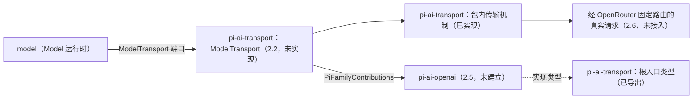

# 使用与定位

本文件说明消费侧怎样使用本包，以及本包在 Model 能力组中的位置。

## 使用方式

### 独立消费：只取类型

根入口只导出类型。家族作者用它们实现贡献，不取得任何运行时值：

```ts
import type {
  PiFamilyBinding,
  PiFamilyContributions,
  PiProtocolFrame,
  PiResponseDecoder,
} from '@omne-harness/pi-ai-transport'

declare const contributions: PiFamilyContributions
const acquired = await contributions.acquire(supplier, signal)
if ('ok' in acquired) {
  const binding: PiFamilyBinding = acquired.ok
  const decoder: PiResponseDecoder = binding.createDecoder()
  const frame: PiProtocolFrame = { kind: 'end-marker' }
  decoder.accept(frame)
  await binding.release()
}
```

依赖 `@omne-harness/pi-ai-transport` 会安装 model-contract、operation-result、json-text 与 content-block，不安装 Cordis、`@omne-harness/model` 或任何家族。这些类型的行为条款归[组架构“pi 家族贡献的取得协议”](../../docs/architecture.md#pi-家族贡献的取得协议)。

### 包内消费：传输机制

传输机制不经入口导出，只能由同包代码使用。下例说明 2.2 的 `ModelTransport` 预计怎样组合它们。例中的数值是示意的初值，本包不设默认值：

```ts
import { createNetworkResources } from './network.ts'
import { startExchange } from './http.ts'
import { readSseEvents } from './sse.ts'
import { readProtocolFrames } from './frames.ts'

const network = createNetworkResources({ maxConnections: 4, idleConnectionTimeoutMs: 30_000 })

// materialize：预约名额。undefined 表示已取消或资源已关闭。
const reservation = await network.capacity.reserve(signal)
if (reservation === undefined) return unavailable()

// start：同步发起。返回时请求已交给 Node。
const start = startExchange(
  network,
  { url, headers, body, reservation, connectTimeoutMs: 10_000, maxErrorBodyBytes: 65_536 },
  signal,
)
if (start.kind === 'refused') return refusedBeforeSend(start.reason)

const result = await start.exchange.result
if (result.kind === 'ok') {
  const bytes = result.body.claim()
  if (bytes !== undefined) {
    const events = readSseEvents(bytes, 1_048_576)
    for await (const frame of readProtocolFrames(events, { endMarker: '[DONE]', json: limits })) {
      // 把 frame 交给家族 decoder。
    }
  }
}
await start.exchange.stopped // 名额已归还。
await network.close()
```

初始化与释放责任：

- 网络资源的创建者负责调用 `close()`。
- 预约的持有者负责归还预约，或把它交给一次交换。
- 认领 2xx 响应体的读者负责读完它，或停止交换。
- 调用方在发起时把凭据放进请求头。本包不解析、保存或记录凭据。

## 消费者与定位



具名消费者：

- 同包 2.2 的 `ModelTransport` 实现：组合包内机制，兑现 `prepare → materialize → start`。尚未实现。
- 2.3：请求规划与帧到 `TransportFact` 的映射，消费协议帧。尚未实现。
- 2.5 的 OpenAI 家族 `pi-ai-openai`：实现根入口导出的家族贡献类型。真实请求经 OpenRouter 固定路由发出，本包不直连 OpenAI，也不内置任何接收方地址。尚未建立。

当前没有应用或其他包在源码中消费本包。组内位置见[组架构“成员与新增条件”](../../docs/architecture.md#成员与新增条件)：pi-ai-transport 集中维护 pi fork 与公共 HTTP/SSE、取消和连接资源，家族不复制这些机制，本包也不导入家族。
