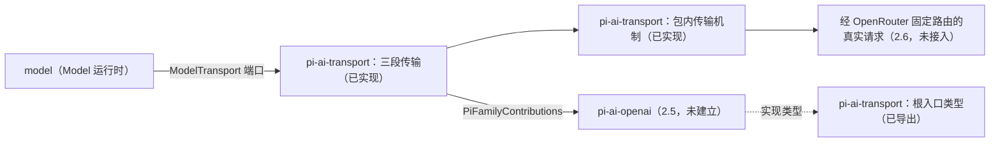

# 使用与定位

本文件说明消费侧怎样使用本包，以及本包在 Model 能力组中的位置。

## 使用方式

### 独立消费：只取类型

家族作者只从根入口取得类型，用它们实现贡献，不取得任何运行时值：

```ts
import type {
  PiFamilyBinding,
  PiFamilyContributions,
  PiProtocolFrame,
  PiResponseDecoder,
} from '@omne-harness/pi-ai-transport'

declare const contributions: PiFamilyContributions
const acquired = await contributions.acquire(supplier, signal)
if ('ok' in acquired) {
  const binding: PiFamilyBinding = acquired.ok
  const decoder: PiResponseDecoder = binding.createDecoder()
  const frame: PiProtocolFrame = { kind: 'end-marker' }
  decoder.accept(frame)
  await binding.release()
}
```

依赖 `@omne-harness/pi-ai-transport` 会安装 model-contract、operation-result、json-text 与 content-block，不安装 Cordis、`@omne-harness/model` 或任何家族。这些类型的行为条款归[组架构“pi 家族贡献的取得协议”](../../docs/architecture.md#pi-家族贡献的取得协议)。

### 装配：三段传输

装配用 `createNetworkResources` 创建网络资源，再用 `createPiTransport` 构造传输，把 `transport` 交给 Model 的发送资源。装配拥有网络资源，可以把它交给多个传输。例中的数值是示意的初值，本包不设默认值。`families` 是家族贡献，`slot` 是 Model 发送资源在 start 期间填写的私有槽：

```ts
import { createNetworkResources, createPiTransport } from '@omne-harness/pi-ai-transport'

const network = createNetworkResources({ maxConnections: 4, idleConnectionTimeoutMs: 30_000 })
const { transport, close } = createPiTransport({
  network,
  families,
  routes: {
    openrouter: { url: 'https://openrouter.ai/api/v1/chat/completions', endMarker: '[DONE]' },
  },
  credential: { read: () => slot.value },
  limits: {
    connectTimeoutMs: 10_000,
    maxErrorBodyBytes: 65_536,
    maxEventBytes: 1_048_576,
    json: {
      maxBytes: 1_048_576,
      maxDepth: 64,
      maxItems: 100_000,
      maxMembers: 1_000,
      maxStringLength: 1_048_576,
      maxNumberLength: 64,
    },
  },
})

// 关闭：先关闭所有传输，再关闭网络资源。
await close()
await network.close()
```

### 包内消费：传输机制

网络资源以外的传输机制不经入口导出，只能由同包代码使用。下例说明三段传输怎样组合它们，完整实现在 [materialized.ts](../src/materialized.ts) 与 [fact-stream.ts](../src/fact-stream.ts)。例中的数值是示意的初值，本包不设默认值：

```ts
import { openNetwork } from './network.ts'
import { startExchange } from './http.ts'
import { readSseEvents } from './sse.ts'
import { readProtocolFrames } from './frames.ts'

// 包内工厂返回包内资源。根入口的 createNetworkResources 只返回它的句柄 network.handle。
const network = openNetwork({ maxConnections: 4, idleConnectionTimeoutMs: 30_000 })

// materialize：预约名额。undefined 表示已取消或资源已关闭。
const reservation = await network.capacity.reserve(signal)
if (reservation === undefined) return unavailable()

// start：同步发起。返回时请求已交给 Node。
const start = startExchange(
  network,
  { url, headers, body, reservation, connectTimeoutMs: 10_000, maxErrorBodyBytes: 65_536 },
  signal,
)
if (start.kind === 'refused') return refusedBeforeSend(start.reason)

const result = await start.exchange.result
if (result.kind === 'ok') {
  const bytes = result.body.claim()
  if (bytes !== undefined) {
    const events = readSseEvents(bytes, 1_048_576)
    for await (const frame of readProtocolFrames(events, { endMarker: '[DONE]', json: limits })) {
      // 把 frame 交给家族 decoder。
    }
  }
}
await start.exchange.stopped // 名额已归还。
await network.close()
```

需要经 HTTPS 代理发出请求时，装配在边界把环境映射为 `proxy`，再交给 `createNetworkResources`。本包自己不读取环境变量。例中 `env` 是装配持有的环境对象：

```ts
const proxyUrl = env.HTTPS_PROXY
const bypass = (env.NO_PROXY ?? '')
  .split(',')
  .map(entry => entry.trim())
  .filter(entry => entry !== '')
const network = createNetworkResources({
  maxConnections: 4,
  idleConnectionTimeoutMs: 30_000,
  ...(proxyUrl === undefined || proxyUrl === '' ? {} : { proxy: { url: proxyUrl, bypass } }),
})
```

代理的行为、失败映射与 Node 版本要求见 [SPEC“代理”](../SPEC.md#代理)。

初始化与释放责任见 [SPEC“调用方责任”](../SPEC.md#调用方责任)。

## 消费者与定位



具名消费者：

- 同包的三段传输：组合包内机制，兑现 `prepare → materialize → start`。已实现，只经测试家族验证。
- 2.3：请求规划与流事件映射。尚未实现。
- 2.5 的 OpenAI 家族 `pi-ai-openai`：实现根入口导出的家族贡献类型。真实请求经 OpenRouter 固定路由发出，本包不直连 OpenAI，也不内置任何接收方地址。尚未建立。

当前没有应用或其他包在源码中消费本包。Model 的发送资源经 `ModelTransport` 端口使用本传输，由 2.6 接入。组内位置见[组架构“成员与新增条件”](../../docs/architecture.md#成员与新增条件)：pi-ai-transport 集中维护 pi fork 与公共 HTTP/SSE、取消和连接资源，家族不复制这些机制，本包也不导入家族。
