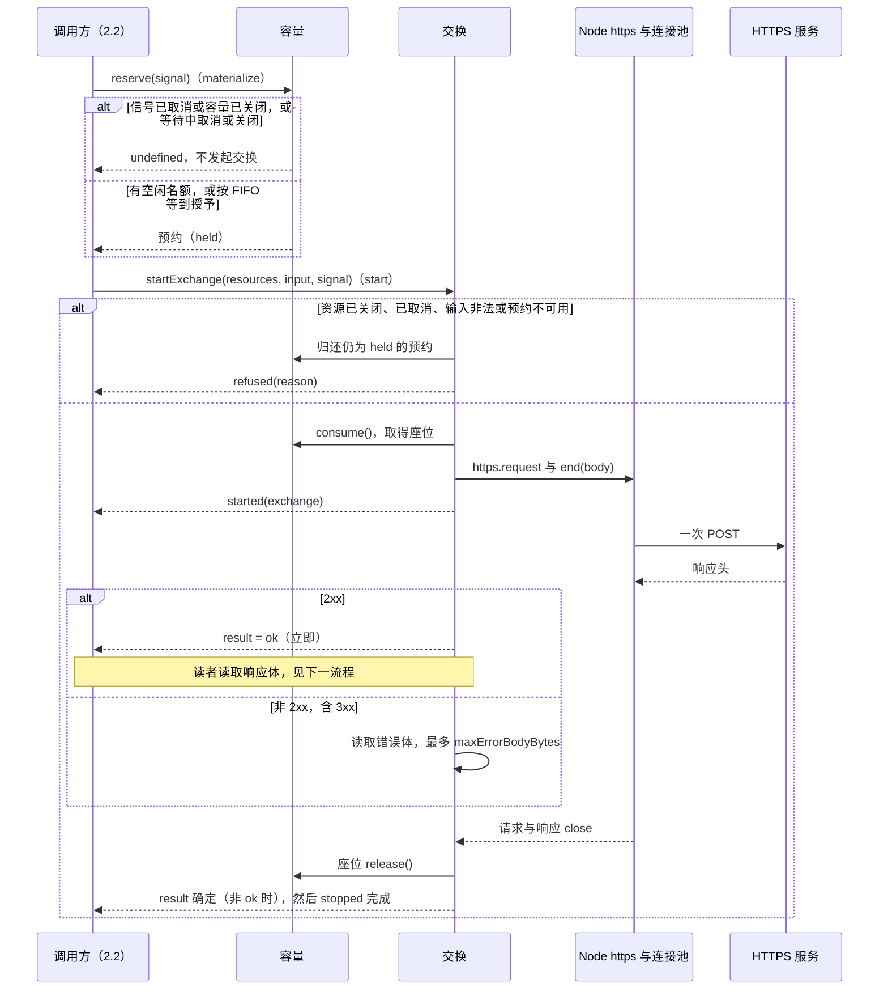
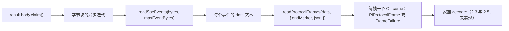
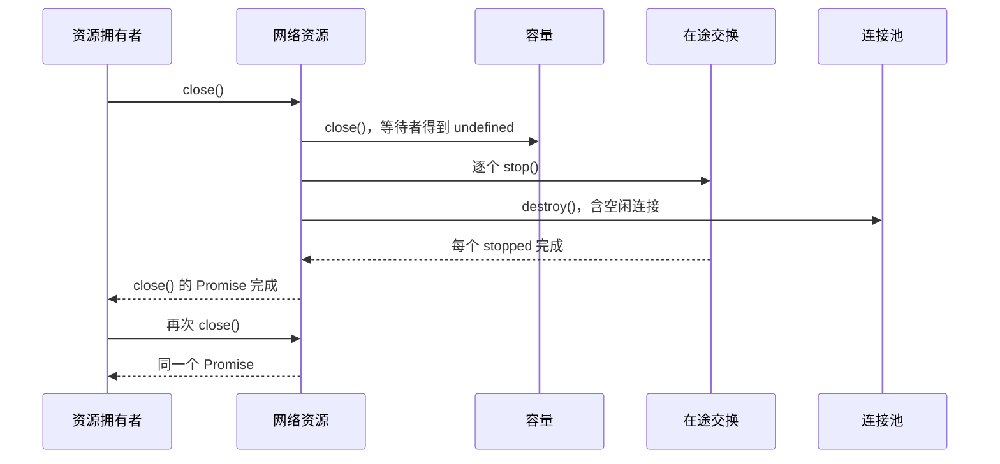

# 关键流程

本文件描述本包的三条流程：一次交换、2xx 响应体的读取，以及网络资源的关闭。前提：调用方是同包的代码，首个调用方是[阶段二](https://github.com/nemori-ai/omne-harness-lite/issues/446) 2.2 的 `ModelTransport`。它在 materialize 时预约名额，在 start 时发起交换。本包还没有 `ModelTransport`，图中的 materialize 与 start 只标出调用位置。行为条款以 [SPEC.md](../SPEC.md) 为准。

## 流程

### 一次交换

数据的来源与去向：

- 请求地址、请求头（含凭据）与已序列化的请求体来自调用方。本包只加 `content-length`，然后把它们交给 Node。
- 状态码、响应头与错误体进入交换结果，只在包内交给家族解释。
- 诊断事件只带种类与级别，经诊断隔离交给调用方的观察者。

状态变化：预约从 `held` 变为 `consumed`，交换关闭时座位归还名额，预约变为 `released`。交换的相位见[内部架构](architecture.md#交换的相位)。

### 读取 2xx 响应体

- 响应体只能认领一次。读者读到末尾时响应关闭，交换随之归还名额。
- 读者提前结束任何一层的迭代时，关闭逐层到达上游，响应被销毁，交换随之关闭。读者在第一次 `next()` 之前结束时也是如此。
- 响应体在到达末尾之前结束时，读者得到 `ResponseBodyStoppedError`（本地停止在先）或 `ResponseBodyReadError`（对方关闭或重置连接）。
- SSE 层失败时抛出 `SseProtocolError`。帧层失败时产出一个失败值。两种失败都会结束对上游的迭代，上游迭代的结束销毁响应，交换随之关闭。
- 事件结束只结束帧序列。是否为合法终局由家族 decoder 判断。

### 关闭网络资源

第一次调用 `close()` 之后，`startExchange` 以 `resources-closed` 拒绝，`reserve` 以 `undefined` 结束。

## 失败与生命周期

- 发起前已取消：`startExchange` 返回 `refused('cancelled')`，不建立连接，归还预约。
- 请求进入连接池的等待队列：缺陷，只在配置被绕过时出现。`startExchange` 销毁请求、把它移出队列、归还名额并抛出 `ExchangeQueuedError`，没有交换句柄，之后也不为它建立连接。
- 收到响应之前取消或调用 `stop()`：本包销毁请求。物理关闭之后，结果是 `stopped`，`responded` 为 `false`，然后名额归还。
- 读取错误体时取消：结果是 `stopped`，`responded` 为 `true`。错误体被丢弃。
- 2xx 响应体读取中取消、调用 `stop()` 或关闭网络资源：结果仍是 `ok`，读者的迭代以 `ResponseBodyStoppedError` 结束，响应关闭之后名额归还。
- 2xx 响应体读取中连接被对方关闭或重置：结果仍是 `ok`，读者的迭代以 `ResponseBodyReadError` 结束，响应关闭之后名额归还。
- 错误体超过上限：本包关闭连接，结果是 `http-error`，错误体为 `too-large`，投递 `error-body-too-large` 诊断。
- 错误体读取中连接中断：结果是 `http-error`，错误体为 `read-failed`。
- 新建连接在 `connectTimeoutMs` 内没有完成 TLS 握手：本包销毁请求，结果是 `connect-failed`，`timeout` 为 `true`。
- 连接被拒绝或在响应之前关闭：结果是 `connect-failed`，`timeout` 为 `false`。
- 响应没有状态码或错误体的块不是字节：本包销毁连接，物理关闭之后 `result` 拒绝。
- 调用方认领了 2xx 响应体却不读完、也不停止：响应、连接与名额一直被占用。本包不回收它们。
- 所有路径上，名额都在请求与响应物理关闭、错误体读取结束之后才归还，然后 `stopped` 完成。
