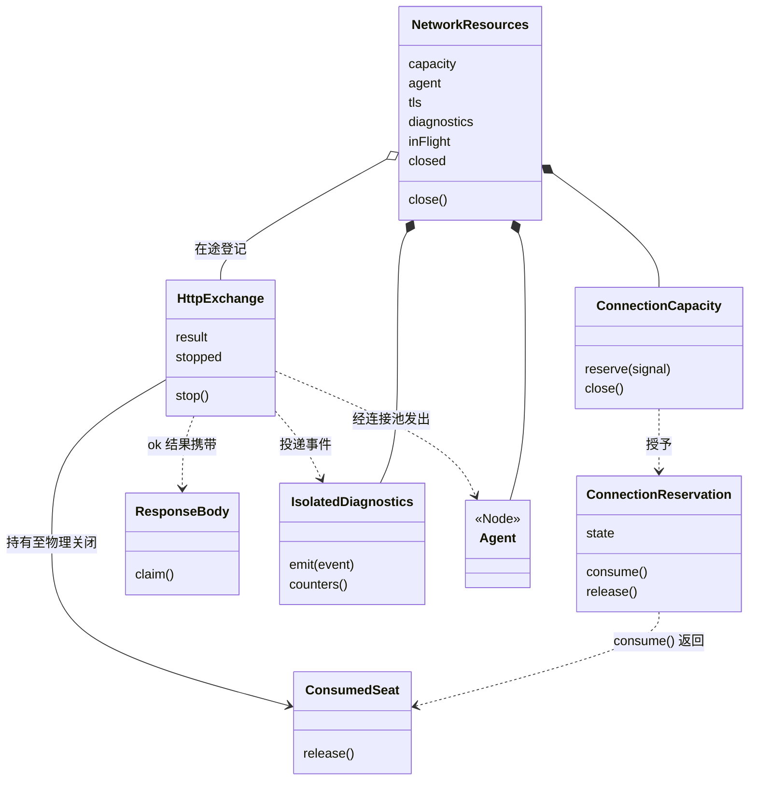
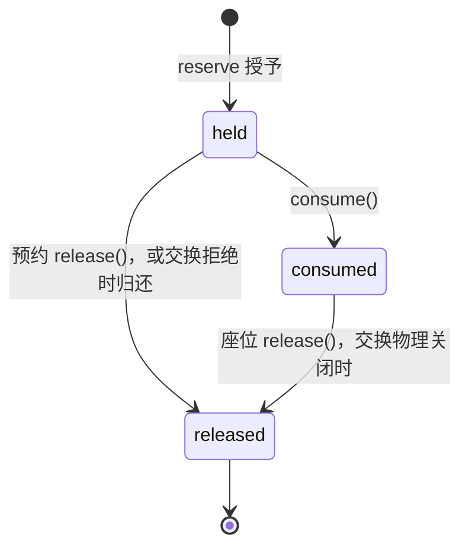

# 对象模型

本包的对象都是工厂函数返回的闭包对象。三段传输的外层、prepared 与 materialized 的相位与资源见[内部架构“三段传输的相位与所有权”](architecture.md#三段传输的相位与所有权)。class 只用于错误：`SseProtocolError`、`ResponseBodyStoppedError` 与 `ResponseBodyReadError` 继承 `Error`，http.ts 另有一个不出模块的内部错误类。SSE 分帧与协议帧是异步生成器，不持有跨调用的身份。对象的行为条款以 [SPEC.md](../SPEC.md) 为准。

## 对象与关系

| 对象 | 职责 | 身份与状态 |
| --- | --- | --- |
| 网络资源 | 组合容量、连接池、在途登记与诊断隔离，负责关闭排空 | 由创建者持有。状态是“未关闭”或“关闭中或已关闭”，关闭的 Promise 被记住 |
| 容量 | 按 FIFO 授予预约，限制同时持有的名额，核对预约的归属 | 持有等待队列、已授予计数、关闭标志与已授予预约的归属标记 |
| 预约 | 代表一个已授予的名额 | `held`、`consumed` 或 `released` |
| 座位 | 消费之后归还名额的唯一途径 | 只在预约为 `consumed` 时起作用 |
| 交换 | 一次 POST 的发起、结果与物理关闭 | 相位与未关闭的物理句柄集合，见[内部架构](architecture.md#交换的相位) |
| 响应体 | 把 2xx 响应体交给唯一的读者 | 未认领或已认领 |
| 诊断隔离 | 把事件的冻结副本交给观察者，隔离观察者的故障 | `failed`、`pending` 与 `dropped` 三个计数 |
| 连接池 | Node 的 `https.Agent`，keepAlive，不设套接字上限，只负责复用与空闲超时 | 由网络资源创建并销毁 |

## 生命周期

三段传输的对象：

- 外层：`createPiTransport` 创建，外层 `close()` 结束。它关闭仍打开的 prepared，不关闭网络资源。
- prepared：一次成功的 prepare 创建，持有一个家族绑定，`close()` 释放绑定。
- materialized：一次成功的 materialize 创建，持有一个名额，start 把名额交给交换，`close()` 在未 start 时归还名额，在已 start 时停止交换。

- 网络资源：调用方用 `createNetworkResources` 创建，用 `close()` 结束。`close()` 结束容量、在途交换与连接池。连接池是 `PoolAgent`。配置了代理时，它经代理建立连接，并在交换停止时结束为该交换建立中的连接。
- 容量：随网络资源创建，随网络资源关闭。关闭之后不再授予预约，已授予的预约仍可消费和归还。
- 预约：容量授予时创建。持有者负责归还它，或把它交给一次交换。预约不过期。
- 座位：`consume()` 时创建，归消费它的交换所有。交换物理关闭时归还名额。
- 交换：`startExchange` 返回 `started` 时创建，并加入在途登记。物理关闭时离开在途登记，`stopped` 完成。交换句柄在此之后可以保留，`stop()` 不再起作用。
- 响应体：随 `ok` 结果创建。认领之后由读者负责读完或停止交换。
- 诊断隔离：随网络资源创建，没有自己的关闭操作。没有配置观察者时，网络资源使用一个不投递、计数为零的替代对象。
