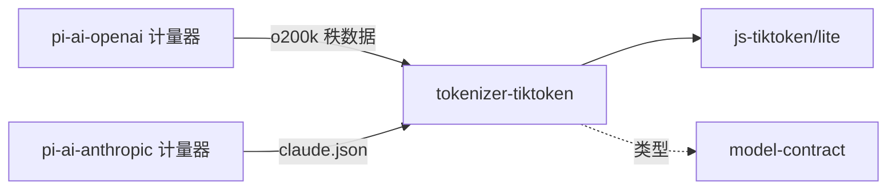

# 使用与定位

本文件说明消费侧怎样使用本包、具名上层消费者、典型调用关系，以及本包在系统与能力组中的位置。它覆盖独立消费与适用的 Harness 接入，引用系统架构与真实消费者，不成为新的架构源。

## 使用方式

家族成员在发布计量能力之前初始化 tokenizer，示例见 [README_ZH.md“使用”](../README_ZH.md#使用)。

- 依赖：本包、model-contract（类型）与 js-tiktoken。家族成员自己提供词表。OpenAI 家族从 `js-tiktoken/ranks/o200k_base` 取得秩数据，并把下划线命名的字段改为 `TiktokenRanks` 的字段名。
- 采用值：`implementation.revision` 写实际安装的 js-tiktoken 版本。`vocabulary.digest` 与 `configuration.digest` 按 [SPEC“规范 JSON”](../SPEC.md#规范-json) 算出，并作为数据写进家族的记录。
- 初始化与释放：初始化失败时，家族的计量能力报告 `unavailable`，不得换用其他编码。tokenizer 没有需要释放的资源，家族可以在多次计量之间共享它。

## 消费者与定位

`pi-ai-openai` 与 `pi-ai-anthropic` 的计量器消费本包。组架构中 Moonshot 家族也是候选消费者。请求组装方经 Model 的计量能力间接使用 tokenizer，不直接依赖本包。本包在模型组中的位置见[组架构“成员与新增条件”](../../docs/architecture.md#成员与新增条件)。
