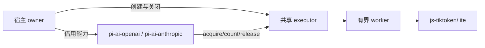

# 使用与定位

## 使用方式

宿主创建一份 executor，并把借用能力注入家族。家族给出固定词表与采用定义，从同一 executor acquire 私有租约。每次 count 都须 await，结束后须 await release。宿主最终 await close。

- 资源采用规则与示例见 [README_ZH](../README_ZH.md#使用) 和 [SPEC 初始化](../SPEC.md#初始化)。
- limits 全部由宿主明确给出。超载返回 unavailable，不启动无界任务，也不回到同步计数。
- 不同租约不共享缓存。单次合法计量范围内可复用同一租约的精确片段；该范围和 lineage 由上层拥有者判定。
- 根入口可独立消费。Cordis 借用能力从 [独立入口](cordis.md) 取得，关闭责任仍归宿主 owner。

## 消费者与定位

Model 负责计量前提、lineage 与完整预算的使用。家族负责模板和规范化。本包只对给定编码序列计数；不取得档案或凭据，不判断发送权限。应用装配与两个家族的真实组合验证归各自成员，本包单测不替代该验证。
