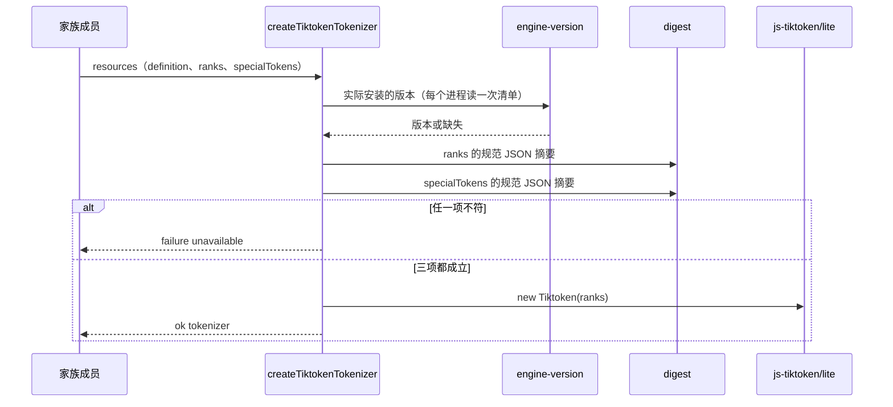

# 关键流程

本文件用可维护的文本图源描述本包的关键业务流程与数据流：参与者、调用时序、数据来源与去向、状态变化、失败分支与生命周期。图旁写前提与边界，不编造流程。

## 流程

**初始化**：家族成员调用 `createTiktokenTokenizer`。

**计数**：计量器调用 `count(segments)`。

1. 依次读段。`text` 段先检查是否良构的 Unicode，再接到当前文本之后。
2. `special-token` 段查固定表。查不到时立即返回 `unsupported-token`。查到时，先编码当前文本，再加 1，并清空当前文本。
3. 读完后编码剩下的文本，返回总数的十进制串。

计数不改变任何状态，不读文件，不访问网络。

## 失败与生命周期

- 初始化：三项核对任一不符，或找不到 js-tiktoken 的清单，返回 `unavailable`。没有规范 JSON 形式的 id 也返回 `unavailable`。其他错误原样抛出。
- 计数：未知的特殊 token 返回 `unsupported-token`；非良构的 Unicode 返回 `invalid`。第一个失败结束计数。
- 生命周期：tokenizer 没有需要释放的资源，没有取消或恢复的流程。调用方丢弃它即可。
