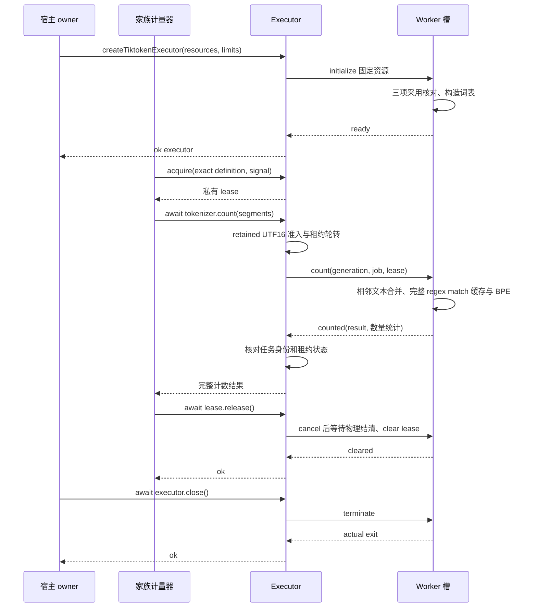

# 关键流程

本文件描述 [SPEC](../SPEC.md) 的计数、释放和关闭时序。

## 流程

计数按段序处理。普通文本先验证 Unicode，连接相邻文本后按原 regex 扫描。显式特殊 token 查固定表，文本字样不激活特殊 token。缓存只复用完整 match 的 countPiece，失败立即结束当前计数。

## 失败与生命周期

准入、过载、取消、截止和线程失败返回 `unavailable`。排队取消直接移除保留输入。在途取消先结束调用者等待，物理槽继续占用。原子检查不能结清时，25ms 后请求终止，仍等实际退出。

线程失败不重试失败 count。替换只能发生在 exit 后，并消耗该槽的一分钟替换额度。槽不可恢复时，等待任务全部失败。release 和 close 都幂等，成功表示各自负责的物理清理已经确认。
