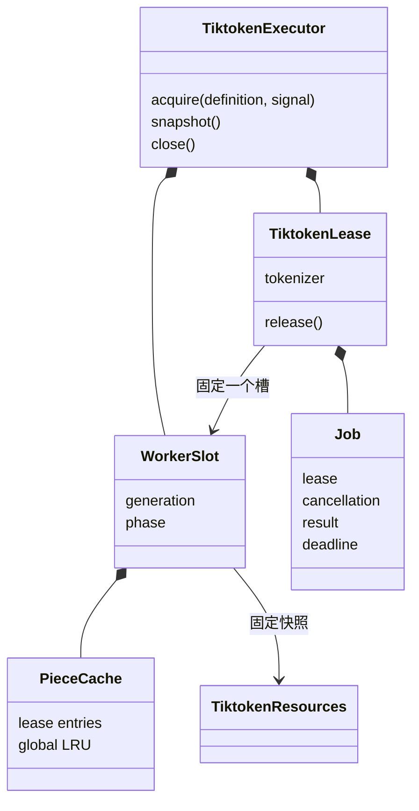

# 对象模型

## 对象与关系

公开 definition 表示采用身份，内部租约编号只隔离任务和缓存，不表示业务 principal。任务编号、槽代际和租约编号一起核验异步回复。worker 不持有 Session、Agent、tenant 或 lineage。

## 生命周期

executor 从 open 变为 closing，实际线程全部退出后变为 closed。租约从 active 变为 releasing，物理结清且缓存删除后变为 released。

槽的状态是 starting、idle、counting、clearing、stopping 或 dead。stopping 保留之前的物理工作，因此停止请求不会提前减少 runningJobs。每次替换增加代际，并初始化新的词表和空缓存。

调用结果可以早于物理结清。release Promise 与 close Promise 各自只创建一次，重复调用取得同一个结果。资源和 limits 在创建调用时复制；调用方后续修改不能改变实例身份和限额。
