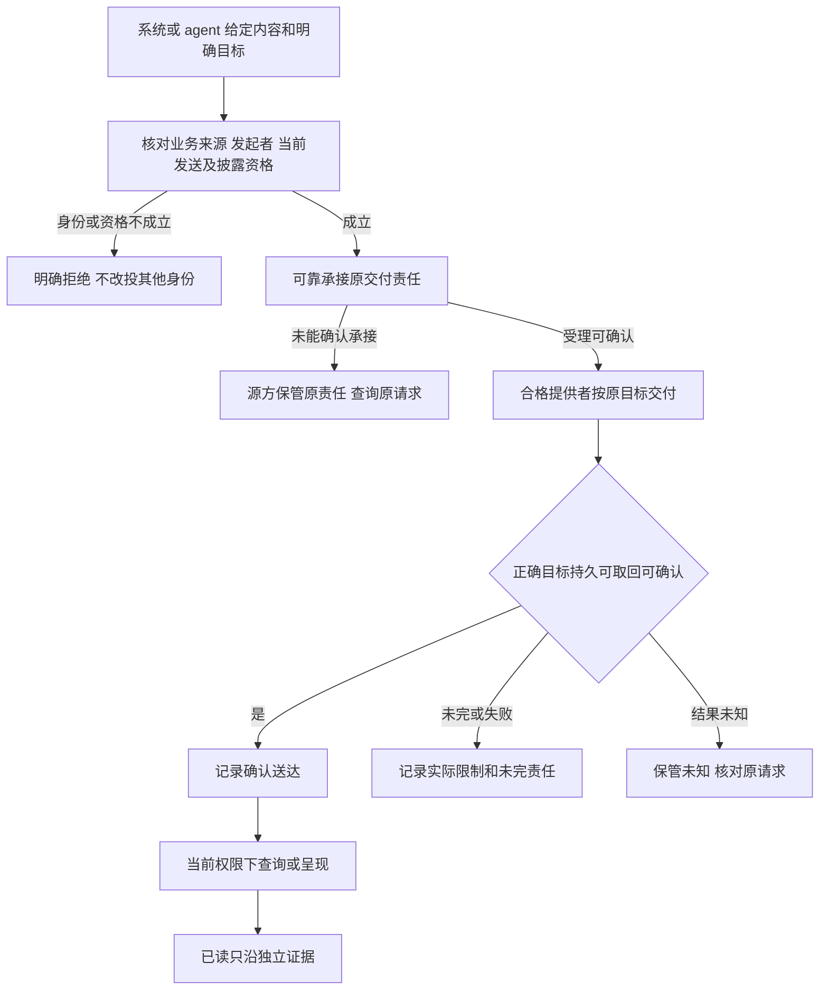
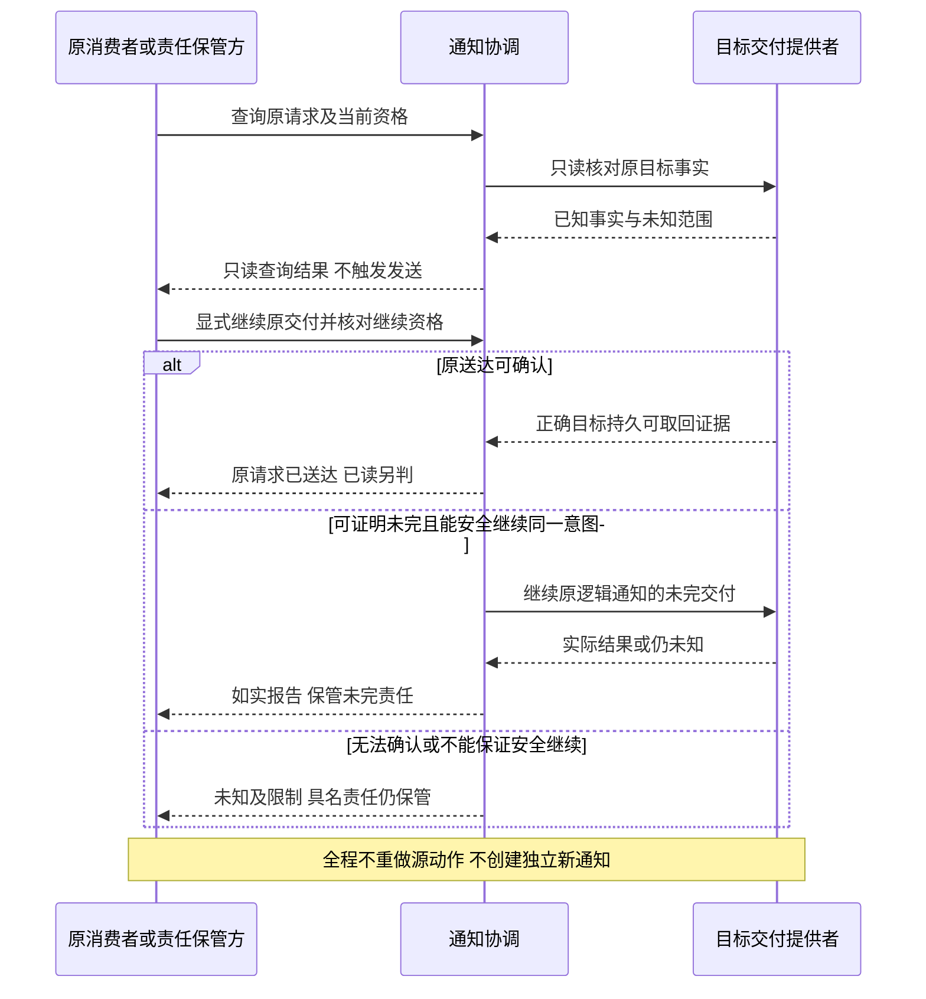

# 通知协作设计候选

本页保存尚待技术采用的设计，不表示实现、产品接受或阶段承诺。完整必要行为见[notification/notification SPEC](../SPEC.md)，产品范围见[产品正文](../../../../.meta_harness/design/product/notifications/design.md)。

## F-NO01 独立发送与可靠承接

覆盖 J-NO01、J-NO03–J-NO05，保护 INV-NO01–INV-NO06、INV-NO09–INV-NO11、INV-NO17。

J-NO04 仅在形成独立合法提示请求时进入本发送链；HITL 入口显式呈现待办也能兑现让人知道的责任。给定内容不要求来源 Schedule/Job 或新 agent 会话。受理可确认时原内容/目标/关联/责任须可恢复；对目标的授权在实际披露边界仍有效。源已提交而承接失败，只恢复反应，不回滚或重做源动作。目标提交与回执丢失走未知分支，不改投或盲目重发。

## F-NO02 当前权限下查询与取回

覆盖 J-NO01、J-NO02、J-NO04、J-NO06，保护 INV-NO02–INV-NO04、INV-NO06、INV-NO07、INV-NO16。

消费者显式选择租户并提供原查询定位，按当前查询及字段披露资格读取通知权威事实或具名读面。返回原内容/来源/目标、实际受理和尝试、可确认送达及未确认部分；读面滞后说明新鲜度。资格不足明确拒绝或合法裁剪，不泄露其他租户私有存在性。查询只读，断开只中止呈现；恢复重新查询，不新发通知。离线目标的持久通知可在重新进入后取回，已读仍需独立证据。

## F-NO04 未知核对与安全恢复

覆盖 J-NO04–J-NO06、J-NO08，保护 INV-NO05、INV-NO07、INV-NO08、INV-NO13–INV-NO18。

只读查询先返回事实；后面的恢复分支只由原责任保管方明确发起继续交付并经过准入，查询本身不能进入发送分支。这里表达逻辑分责，不选择恢复 API。超时、无回执、找不到读面记录或重试耗尽不自动证明从未发生。已有目标提交时恢复原状态，不重发；不能安全辨认时停止盲目副作用而保管责任。新业务发送意图须另行表达，不充当技术恢复。

## F-NO06 配置换代、停止与交接

覆盖 J-NO08，保护 INV-NO05、INV-NO08、INV-NO13–INV-NO18。

装配确认支持范围和合法配置，沿明确生效点接入。必要依赖缺席停止相应准入；可选依赖缺席返回真实限制。旧方停止准入后保管在途及未知，可靠移交原身份和未完责任，再释放自身登记/监听/资源。新方先核对原请求再安全接续，旧引用失效及晚到结果均有处置拥有者。没有承接方时不能把未完责任当完成或删除历史；源业务无需因此重跑。技术参数改变不重写原内容、目标或源事件声明。
