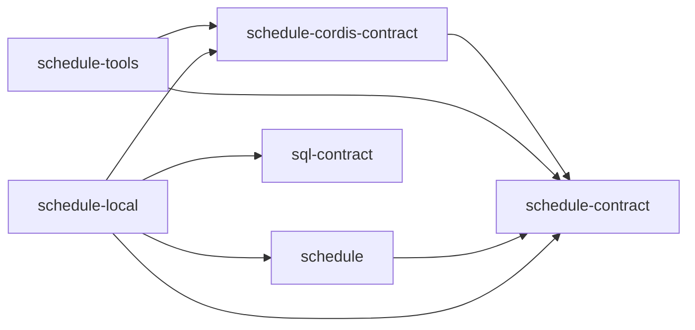
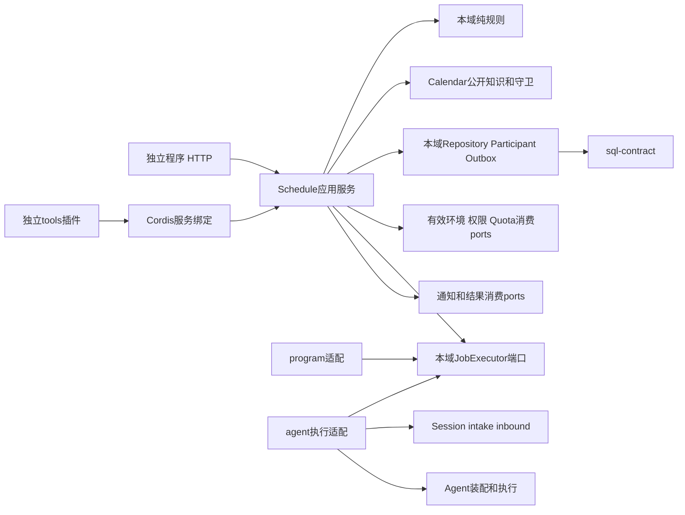

# 日程与 Job 能力组工程关系

本组包含 schedule-contract、schedule-cordis-contract、schedule、schedule-local、schedule-tools 五个成员，均为初始化草稿。完整目标设计已确认，运行实现和验收未完成。本组根不是统一服务或统一SPEC，不因图中角色创建新包。

## 安装边界

`schedule-contract` 拥有可替换服务协议与公共值。`schedule` 拥有无 Cordis 的领域算法和应用服务工厂。`schedule-cordis-contract` 唯一拥有绑定定义。`schedule-local` 承接本机存储、恢复和适配装配，`schedule-tools` 只消费契约与服务定义。

箭头表示允许的安装依赖，不表示当前已经实现运行调用。tools 不依赖 core 或 local，绑定定义不依赖实现。公共消费不能要求同机、同进程或共享数据库；未来远程客户端可实现同一服务定义，本次不建立远程提供者包。

持久化参加者是 local 内部适配协议，不是服务间 wire 协议。跨域资格和发布版本的强保证仍须由对应拥有者协议兑现；当前快照不能代替动作发生时所需的有效性证明。具体限制见[部署边界](../../../docs/package-organization.md#日历与日程的安装和部署边界)。

## 成员分解与依赖

成员拥有纯日期组合、Schedule作者生命周期与管理、Preparation/Receipt、Job接受/控制与整体结果。公开形状见[API设计](../schedule/docs/public-api-design.md)，必要行为见[SPEC](../schedule/SPEC.md)。Repository/participant、Clock与外部ports通过工厂传入；根接口不导入Cordis、HTTP、工具、Session或Agent。

箭头为公开契约消费方向或适配实现方向，不是消息顺序。JobExecutor由本域定义，program/agent适配实现；只有外部agent适配认识Session/Agent。program独立运行不需这两个领域。new/existing是冻结Work的两个agent目标分支，不是两套调度器。已有会话不自动成为self-wake，后者属于Session自身的耐久工作接续。

## 协作与验证责任

本域协调同提交的来源、次数、Job、receipt与交接责任。Calendar提供不可变知识与publication guard，环境/权限/Quota拥有者提供自己的当前守卫；不能跨私有表建立第二真相。JobExecutor提供真实承接/原执行/停止证据，通知提供真实intent接受/取消与耐久可取回，结果与归档各保留独立operation。

真实sql-contract/sqlite-provider已有实现，[实际限制与差额](../schedule/docs/internals.md#实际存储能力与未闭合保证)说明哪些强保证尚不能直接取得。两方位于同一进程或Context不自动形成事务。源17组154AC与N01–N27归[SPEC完整映射](../schedule/SPEC.md#来源与目标验收映射)，P0–P7都属于完整交付门槛；图与字段检查不能代替真实provider、故障、并发和tools装配。

## 本组工程分解与公开依赖

纯函数→纯应用服务→持久与执行消费ports→Cordis装配→独立tools分别承担不同职责，不把规则散在入口。纯规则在 schedule，存储和外部执行适配在 schedule-local，工具在 schedule-tools，不增加第二套状态或后台 runner。服务key、inject和动作映射唯一在[API设计](../schedule/docs/public-api-design.md#cordis-采用约束)。

## 机制与流程导航

- [必要身份与分别成立的状态](../schedule/docs/internals.md#必要身份与分别成立的状态)。
- [完整定义与日期组合](../schedule/docs/internals.md#完整定义保存与日期组合)。
- [最终接受与耐久](../schedule/docs/internals.md#最终校验受理与耐久责任)。
- [补跑、重叠和控制](../schedule/docs/internals.md#补跑重叠及控制顺序)。
- [执行与原工作](../schedule/docs/internals.md#执行成果及原工作接续)。
- [通知与整体结算](../schedule/docs/internals.md#通知交接与整份结算)。
- [提供者与生命周期](../schedule/docs/internals.md#提供者生命周期及验证)。
- [F-SJ01–F-SJ04 保存、接受、补跑与重叠](../schedule/docs/key-flows.md)。
- [F-SJ05 三路执行](../schedule/docs/key-flows.md#f-sj05-执行意图到原执行结算)。
- [F-SJ06–F-SJ08 通知、取消和换代](../schedule/docs/key-flows.md#f-sj06-实际事件通知承接与整份工作)。
- [F-SJ09 作者生命周期](../schedule/docs/key-flows.md#f-sj09-草稿转正与原子替换)。

## 维护

变更同步纯定义/行为、端口、持久映射、流程和所有真实消费者。公开源码实现后移除设计类型的重复定义，保留必要语义。强撤权、跨进程排除、外部Session/通知/归档接缝按其拥有者闭合；不能退回双API候选或假成功。Q-SJ02–Q-SJ06继续定位实现与证据义务。
