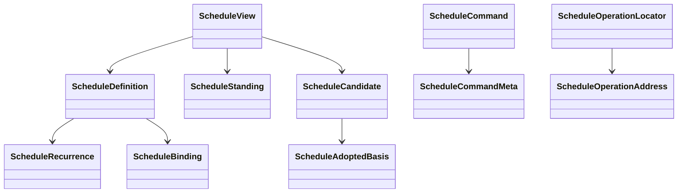

# 公共值关系

ScheduleDefinition描述安排意图，ScheduleView投影已保存安排及当前控制/资格。ScheduleCandidate是日期计算结果，携带全部来源和实际采用依据。候选不是已接受的Job。

这些对象是可序列化值，没有运行时生命周期。ScheduleId、操作地址、原来源及实际依据分别表达身份，不能相互替代。字段唯一源见[公开索引](public-api.md)。
