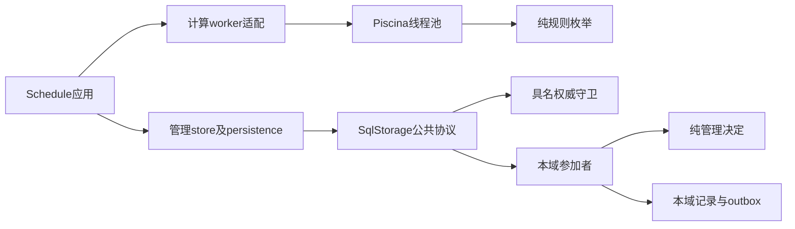
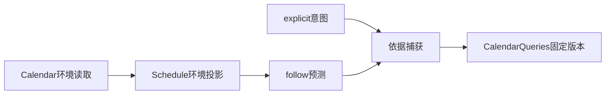
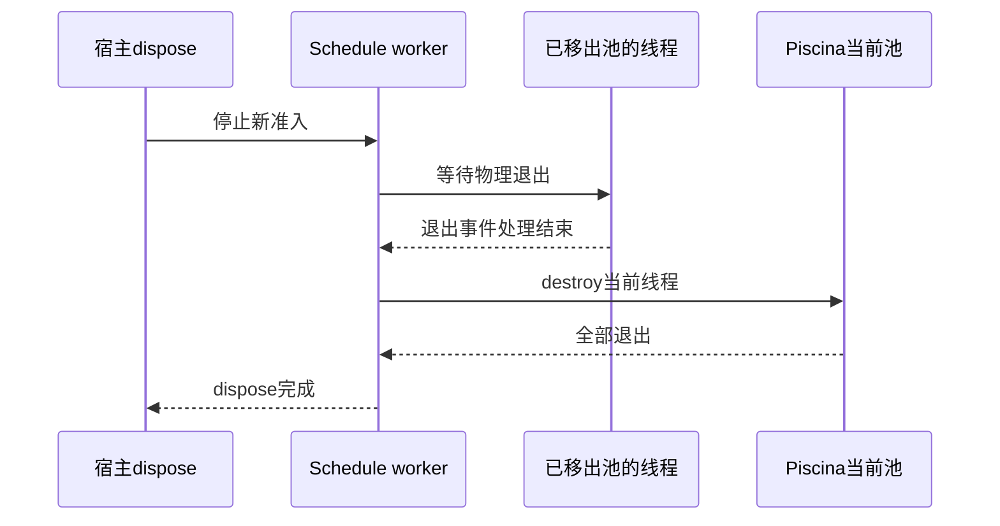

# 成员架构

本成员以本地机制兑现schedule核心端口。计算worker拥有线程生命周期；storage模块拥有管理持久化材料及SQL协议适配。application组合两者及管理、预测、查询；它拥有worker，借用storage。

成员关系归[组架构](../../docs/architecture.md)。公共服务协议与提供者构造依赖分开。本机句柄、工厂回调和SQL参加者不进入线上请求与回执。

计算使用固定编译entry，取消终止任务，dispose等待真实退出。存储参与者在事务内重新决定，不复制状态机。schema集中校验守卫及持久结果；records保存变更，read和pagination处理一次快照中的可见集合。

scope由构造固定，业务owner及读取权限仍逐边界绑定。外部守卫的具体权威实现归各拥有者。当前测试夹具只证明本地消费协议，未形成生产跨域组合。Cordis绑定显式注入storage与Calendar，并按[生命周期](cordis.md)排空。后台扫描仍待后续实现。

`calendar-environment` 消费 Calendar 的公开环境端口，使 follow 使用同一 Settings 投影。它只映射观察值与失败，不负责设置写入、主体发行、日历授权或命令依据预留。其输出不能替代 `basisGuardRef` 的提交协议。

计算worker关闭先拒绝新调用并结算当前等待者，然后等待已被取消、移出Piscina池但尚未物理退出的线程。排空这批退出事件后才销毁池内线程。Piscina 5.3.2 在 destroy 完成后会解除其内部 destroying 标记；若把旧线程等待与 destroy 并行，旧线程迟到退出可能补建新线程。现有实现以先后顺序消除这个窗口，不修改库的私有状态。

