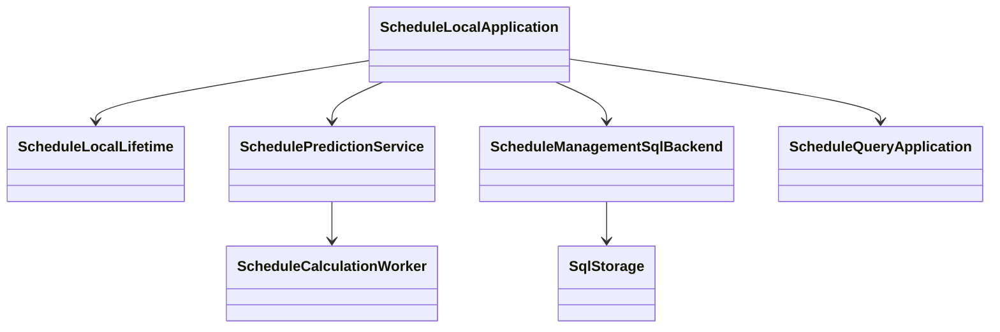

# 本地对象与资源

ScheduleLocalApplication组合已存在的领域应用。ScheduleLocalLifetime记录本实例已接纳的调用，关闭准入后等待它们结束。它不保存业务事实，也不代替SQL回执。

worker归本实例，dispose等待实际线程退出。SqlStorage归宿主，Scope在后端构造时固定。管理表、修订、原操作和outbox是耐久事实，不随应用或Cordis fiber销毁。
