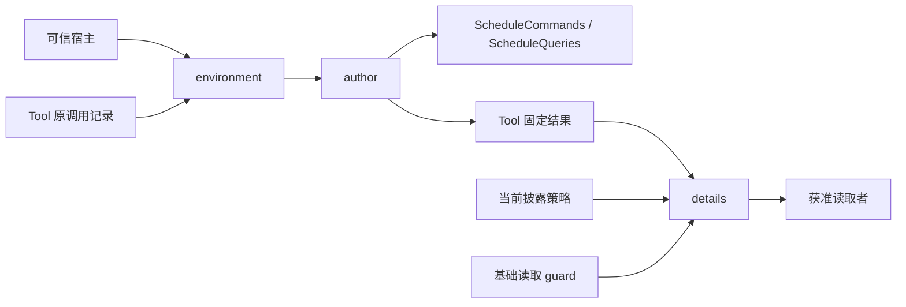

# 工具适配架构

本包独立于 Schedule 核心和 -local 后端。author 消费业务服务，environment 恢复原 Tool 调用，details 守住固定结果披露。protocol 组合公开 schema 和采用身份。detail-metadata 校验 Tool 页元信息，不重定义业务模型。

写操作由业务服务承担幂等和恢复。工具只固定原意图并返回 locator，不再建第二份业务日志。详情从已产生的精确结果读取，不再执行命令或用最新结果替代原结果。资源和贡献生命周期归宿主与 Cordis 贡献协议。
