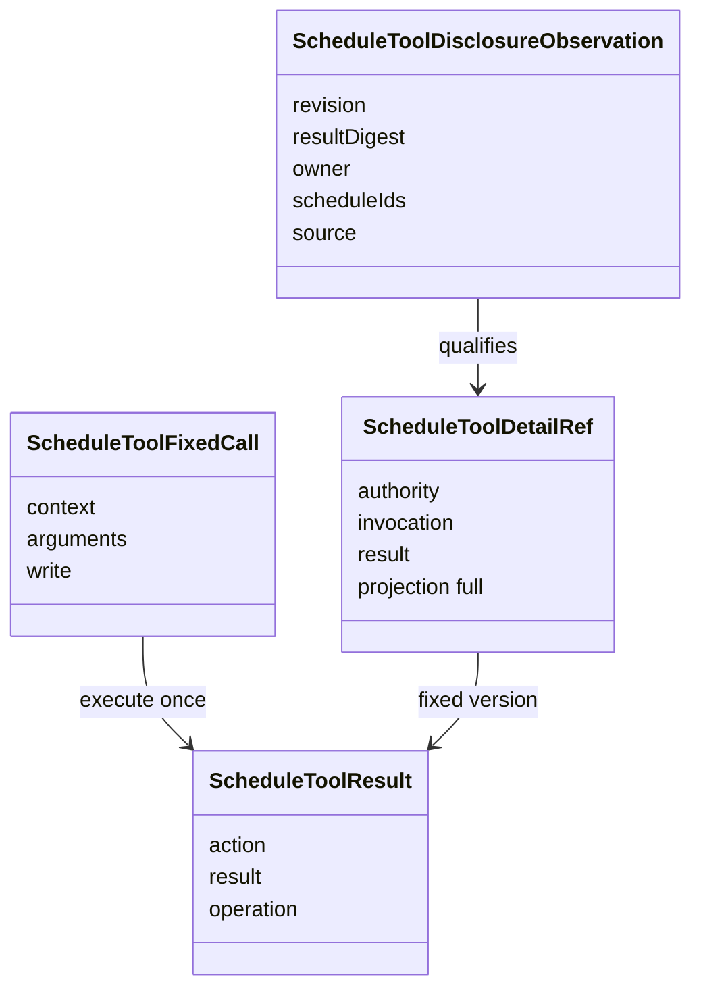

# 工具适配对象

ScheduleToolFixedCall 表示已经从原耐久调用恢复并校验的上下文、参数和可选写意图。ScheduleToolResult 区分业务结果与适配失败。两者不能用一次 Tool 调用完成来推断业务执行完成。

ScheduleToolDetailRef 定位精确 invocation/result/full。DisclosureObservation 把当前资格与结果摘要、owner 和相关安排 ID 绑定。续页还绑定同一观察与页元信息，读取前后不一致即拒绝。

